# Cataclysm 3D

A real-time, first-person 3D take on Cataclysm, running in the browser. The live branch
(`bn`) plays **[Cataclysm: Bright Nights](https://github.com/cataclysmbnteam/Cataclysm-BN)**
content and rules with a modern mouse-first interface (drag-and-drop inventory, quick-loot,
context menus, a clean HUD) aimed at players who bounce off the classic tiles/curses UI. The
world is built from the **UltiCa pixel-art tileset** and real 3D geometry in the style of
*Project Shadowglass*. The original DDA-based version is tagged `v1-dda` on `master`.

**Current state, backlog and how to work on it: [`docs/STATUS.md`](docs/STATUS.md).**

## Running

```sh
nix-shell               # node 22, chromium, ffmpeg, imagemagick (see shell.nix)
npm install             # first time only
npm run dev             # → http://localhost:5173
```

Production build: `npm run build` (output in `dist/`, static files, serve with anything).

Useful URL parameters: `seed=<n>` (world seed), `skipmenu=1` (straight into the game),
`gen=test` (small test scene), `debug=1` (render stats; F6 cycles colour grading),
`px=<n>` (internal render height), `radius=<chunks>`, `debug=atlas` (sprite atlas viewer).

## Gallery

All captured in the production build at 1920×1080 on a GPU (`docs/screenshots/`).

| | |
|---|---|
| 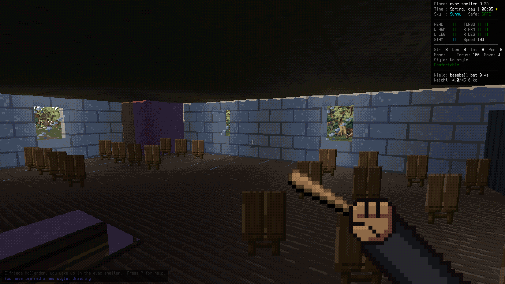 | 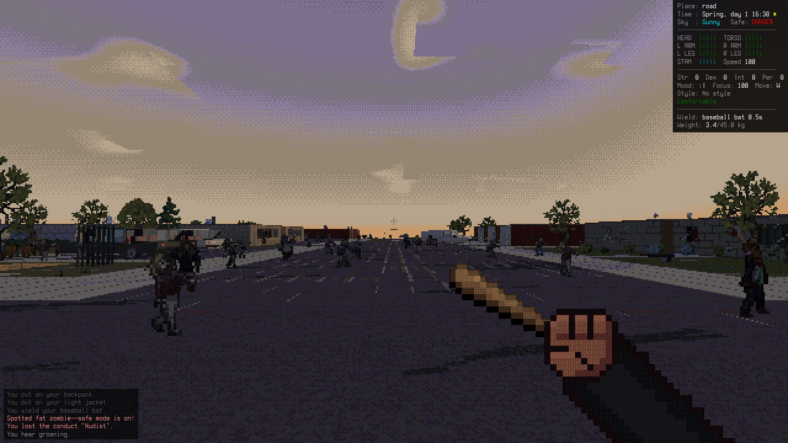 |
| Waking up in the evacuation shelter | A town street at golden hour, the dead already walking |
| 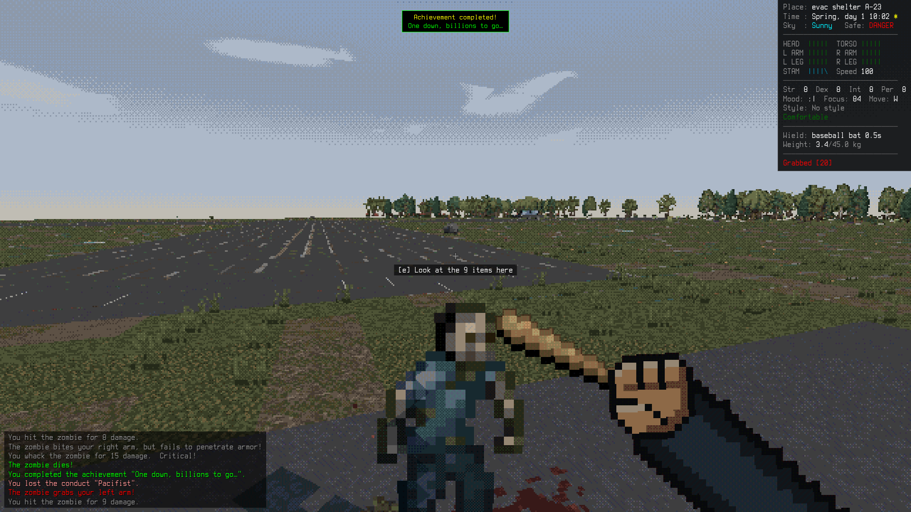 | 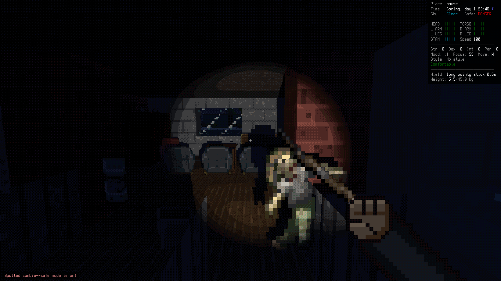 |
| Melee: CDDA to-hit, criticals and blood on the pavement | Night inside a house, by flashlight |
| 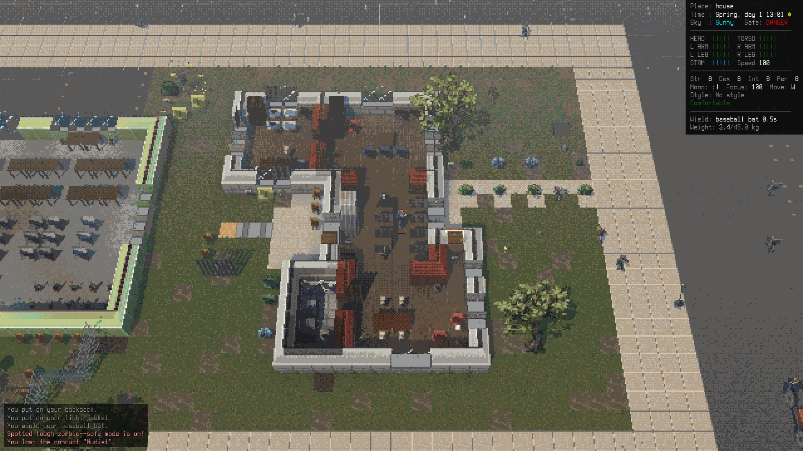 | 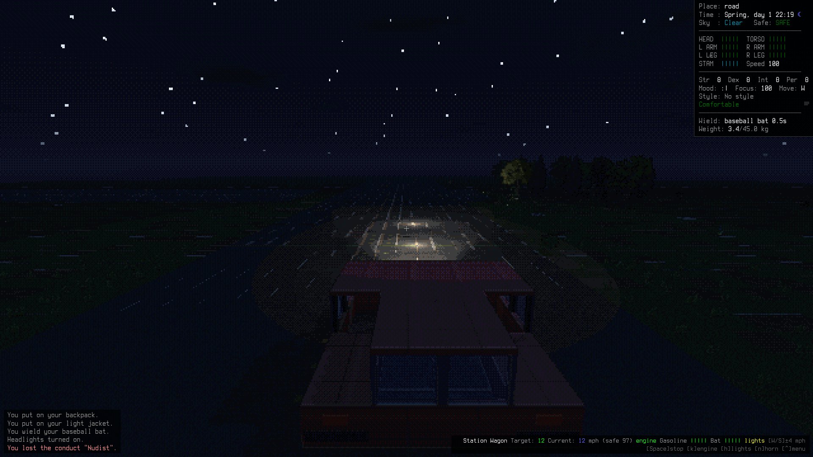 |
| The top-down camera (`v`, mouse wheel zooms) cuts roofs away | Driving at night with headlights and cruise control |
| 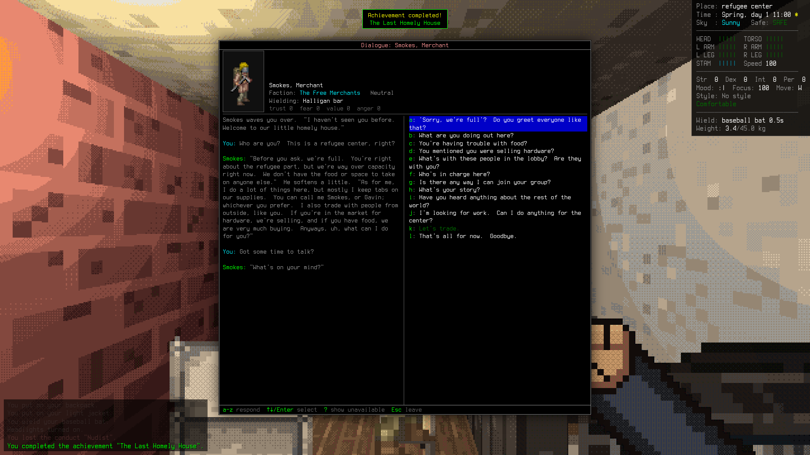 | 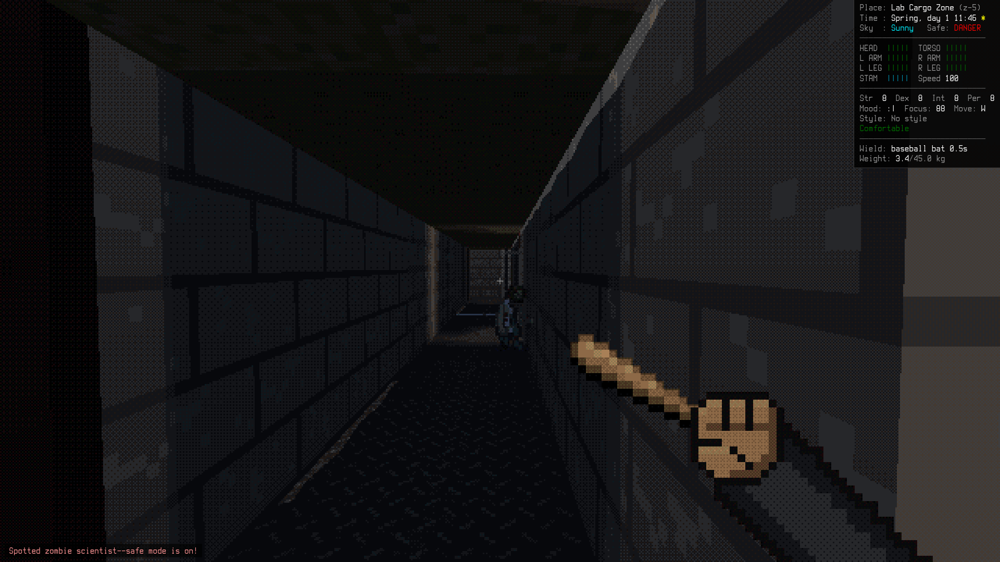 |
| CDDA dialogue at the refugee center | A zombie scientist in an underground lab |
| 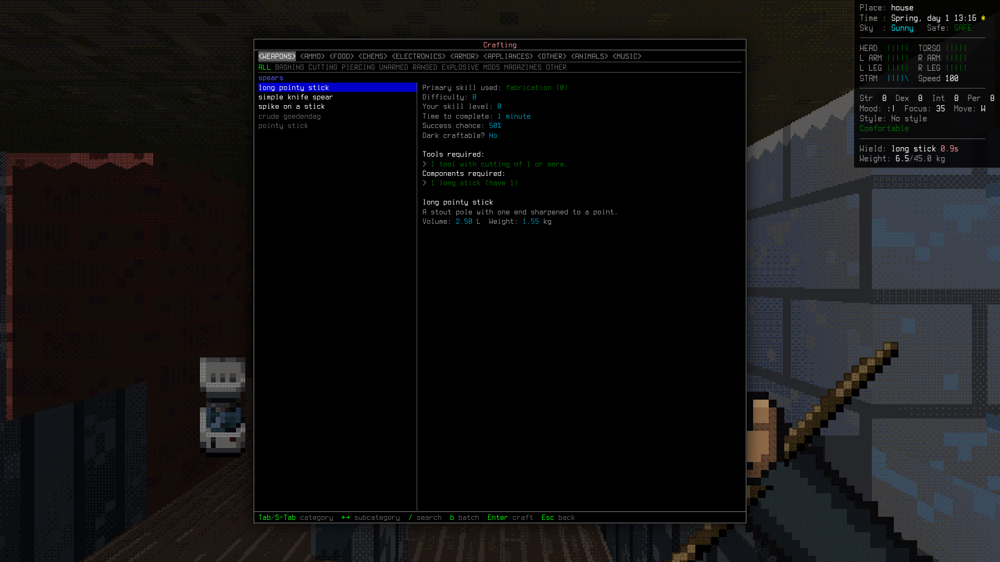 | 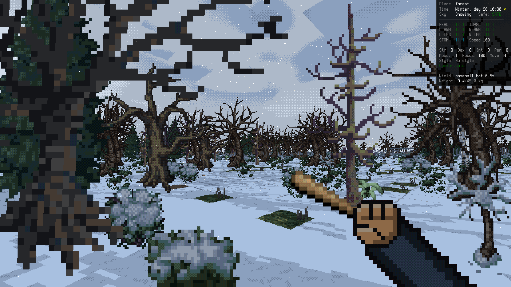 |
| Crafting with CDDA recipes, tools and nearby components | Seasons: a snowy winter forest |
| 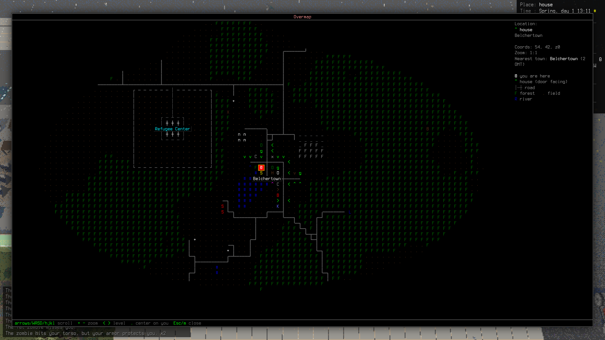 | 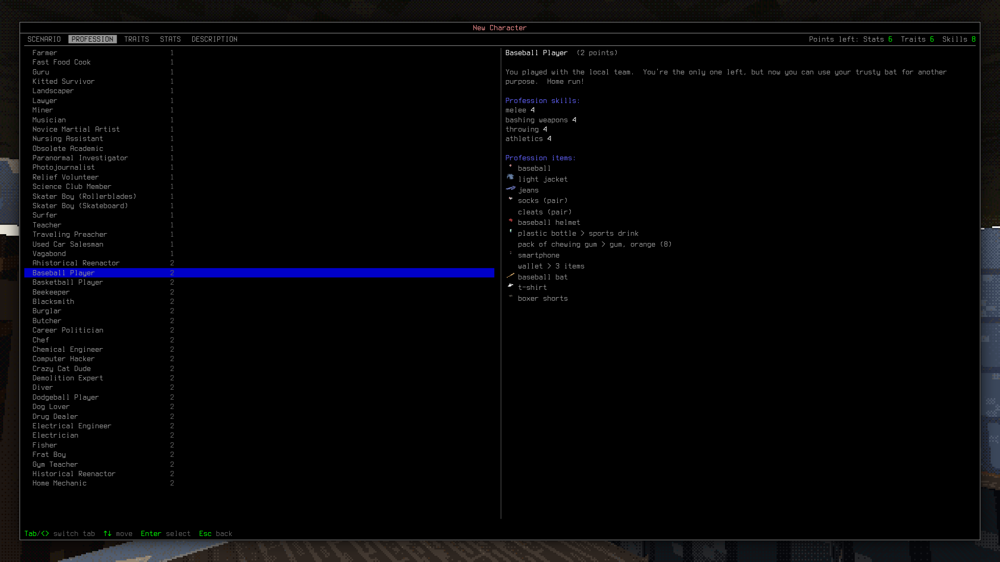 |
| The overmap, with the refugee center marked | Character creation: scenarios, professions, traits |

## Controls

WASD move (Shift run, `c` crouch, Space side-step), mouse look, LMB attack/fire,
RMB guard / aim / draw a bow, `e` interact (get in and drive a car, open doors),
`o` world action menu, `Tab`/`i` inventory, quick-loot at the crosshair (wheel, `e` take,
`r` take all), `1`–`0` hotbar, `` ` `` tactical pause, `&` craft, `*` construct,
`@` character, `m` map, `J` journal, `F` flashlight, `F5` save, `F11` fullscreen,
`?` help, Esc pause menu, `v` camera (first person / shoulder / top-down). Space (or the key
that opened it) closes any menu and keeps the mouse in the game.
Everything is rebindable in Options → Key bindings; the full list is in `docs/STATUS.md`.

## What's in it

- **World**: overmap with towns grown on CDDA's street algorithm, roads, forests, rivers,
  lakes and wilderness specials. Every building comes from CDDA's JSON mapgen, including
  palettes, nested chunks, rotations, roofs and basements. The world also has the evac
  shelter start, the refugee center, underground labs (to z-7) and microlabs.
- **Survival**: CDDA body-part HP, pain, stamina, hunger/thirst/kcal, sleep, body
  temperature with clothing, wind and wetness, effects (bleeding, infection, …), morale,
  skills, weather, seasons with real Boston sunrise and sunset, and food that spoils.
- **Items**: pockets and containers, liquids, guns with magazines, gunmods and fire modes,
  armor with coverage, encumbrance and layering, and item info in CDDA's format.
- **Monsters**: CDDA stats and special attacks (grab, bite, shriek, acid, leap, boomer,
  necromancer…). They hear noise and hordes converge on gunfire. They see by light level,
  bash doors, evolve over days, and turrets shoot.
- **Combat**: CDDA to-hit and damage, weapon techniques (sweeps, knockback, stuns), blocking
  and dodging, martial arts styles with buffs, weapon durability, aim levels, burst fire,
  pellets and explosive ammo. Monsters can be butchered and dissected.
- **Crafting**: CDDA recipes, tools, qualities and components (nearby items and fires
  count), construction, disassembly, reading and learning from books, and lighting fires.
- **Nature**: foraging, harvesting and woodcutting, farming with growth that continues
  while you're away, fishing, swimming and water.
- **NPCs**: survivors and bandits, the Free Merchants at the refugee center, CDDA dialogue
  (trials, conditions, effects), trading, missions and followers.
- **Vehicles**: cars from mapgen with CDDA parts, fuel and batteries. You can hotwire them,
  drive them in real time with cruise control, crash them, run over zombies, use
  headlights, and hear engine audio.
- **Body mods**: mutagen, mutations and thresholds (vitamin-based), CBM installation
  (Autodoc or self-install), and bionic power.
- **Meta**: title screen, character creation (scenarios, professions, traits, stats),
  save/load (IndexedDB, autosave, permadeath), the memorial, and CDDA's 231 achievements.
- **Audio**: 3D positional sound effects, ambience and music from the CDDA soundpacks.

## Development

The code was written by a team of AI agents working in parallel; `ARCHITECTURE.md` is the
map: conventions, subsystem APIs and extension points. Handy commands:

```sh
npm run typecheck && npm test        # strict TS + ~500 vitest tests
npm run data:all                     # re-extract public/data from ~/code/Cataclysm-DDA
npm run atlas                        # recompile the UltiCa sprite atlas
npm run audio                        # rebuild the soundpack subset
npm run shot -- --help               # headless screenshots / scripted checks
npx tsx tools/drive.ts --help        # persistent headless session (--gpu, --dist = production build, --headful = real input)
npx tsx tools/realinput.ts           # real keyboard/mouse UX regression (Xvfb + xdotool)
```

## Credits and licences

- **Cataclysm: Dark Days Ahead** data and text: © the CDDA contributors, licensed
  CC-BY-SA 3.0. This project is a derivative work under the same licence.
- **UltiCa tileset** (I-am-Erk/CDDA-Tilesets): CC-BY-SA 3.0.
- **Sound effects**: CDDA "CC-Sounds" soundpack. Per-file authors and licences are in
  `public/audio/CREDITS.md`.
- **Music**: CO.AG tracks from the CDDA music packs. They are used with the composer's
  informal permission to redistribute with credit, as recorded in that repository. Drop them
  with `npm run audio -- --music-tracks 0` if that's not enough for your use.
- **Fonts**: Terminus (SIL OFL, `public/fonts/LICENSE-OFL-Terminus-Font.txt`) and GNU
  Unifont, both as shipped with CDDA.
- The visual style is inspired by Starhelm Studios' *Project Shadowglass*. No assets or code
  from that game are used.
