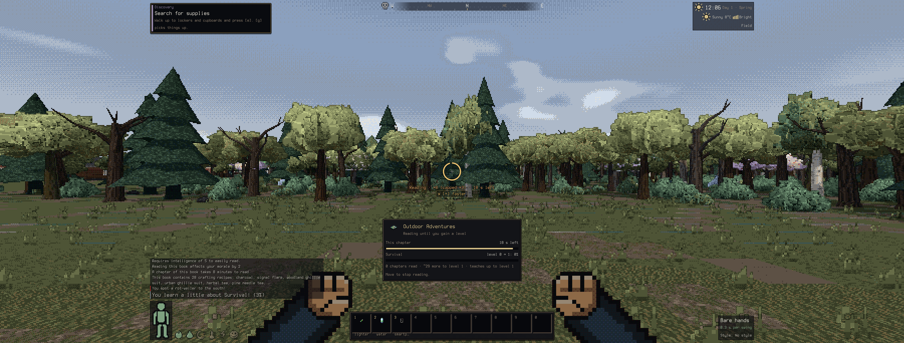

# Balance, difficulty presets and real-time pacing

DESIGN_V2 decision 3 asks for three things. **Accessible** is the default and should be gentle
early, forgiving on needs and clear. **Classic** uses Bright Nights' numbers, adapted only where
real time breaks them. **Custom** lets you set every rule. A tactical pause is always there.
This document records the numbers, why they were chosen, and how they were measured.

Code: `src/game/difficulty.ts` holds the knobs, presets, validation and `applyDifficultySettings`.
`src/game/balance.ts` holds the live multipliers that low-level code reads. `src/difficulty.ts`
does the wiring: new-game hook, save section, and the Options > Difficulty screen.
The pause lives in `src/game/pause.ts` and `src/pause.ts`. The measurements come from
`tools/balance_sim.ts`.

## The presets

| Group | Rule | Accessible | Classic |
|---|---|---|---|
| Monsters & world | Zombies in buildings | 45% | 75% |
| Monsters & world | City hordes | 10% | 20% |
| Monsters & world | Safe radius | 32 m | 10 m |
| Monsters & world | Safe radius: corpses too | yes | no |
| Monsters & world | Monster speed | 90% | 100% |
| Monsters & world | Monster toughness | 70% | 100% |
| Monsters & world | Item spawn rate | 100% | 100% |
| Combat | Combat timing | forgiving | tight |
| Combat | Damage you take | 70% | 100% |
| Combat | Bleeding | 50% | 100% |
| Combat | Crash damage | 50% | 100% |
| Survival | Hunger rate | 75% | 100% |
| Survival | Thirst rate | 75% | 100% |
| Survival | Tiredness rate | 100% | 100% |
| Survival | Healing rate | 200% | 100% |
| Survival | Cold | 70% | 100% |
| Time | Day length | 60 min | 60 min |
| Time | Pause in menus | yes | no |
| Death | Permadeath | no | yes |

(`tsx tools/balance_sim.ts --presets` prints this table from the code.) "Zombie density" (BN
SPAWN_DENSITY, 0.5×/1×/2×) stays a separate world option on top of these. The Custom editor
also offers values between and beyond the two presets.

Every knob is in the Options > Difficulty… screen. There, Accessible and Classic show their values.
Change any value and the world becomes Custom. In the new-game panel, **Custom → Edit rules**
edits the rules a new Custom game starts with. They are remembered in localStorage and start
out as Accessible's.

**When changes apply.** Needs, healing, bleeding, cold, monster speed, combat timing, day length,
pausing and permadeath change at once. Spawn rules (building zombies, city hordes, safe radius,
toughness, items) work like BN world options. They apply to map areas generated from then on,
and monsters that already exist keep their hit points.

**Persistence.** The full settings live in the save section `difficulty` (order 18) for each
world. Progression's section records which preset the run was started with. On load, the
`difficulty` section wins, because it also holds changes made mid-run. A damaged section falls
back to its named preset with a load warning. Saves from before presets existed keep the
player's last-picked preset.

**API for other systems.** `settingsFor(preset)`, `applyDifficultySettings(game, preset, s)`,
`difficultyState(game)`, `permadeath(game)`, `DIFFICULTY_PRESETS`, `KNOBS` (the UI table).
Progression calls `applyDifficulty(game, d)` in `src/progression/difficulty.ts`. That runs
`difficultyHooks`, and `src/difficulty.ts` registers the hook. Debug helpers: `cdda.difficulty()`,
`cdda.setDifficulty('classic', {thirst: 0.5})`, `cdda.openDifficulty()`.

### What "Classic" keeps and adapts

| Knob | Classic | Why |
|---|---|---|
| Hunger, thirst, tiredness, healing, bleeding, cold | BN (100 %) | BN rates are per game second. They run on the game clock, so real time doesn't change them. |
| Zombies in buildings | 75 % | Was already `SPAWN_REALTIME`. In real time you can't stop to think between blows. |
| City hordes | 20 % of BN's 80 per city size | Was already `CITY_HORDE_REALTIME`. |
| Combat timing | "tight" (FEEL classic) | BN's swing rate, with short tells. See docs/COMBAT_FEEL.md. |
| Pause in menus | no (only the Esc menu and the pause key) | BN menus take no time, but real time can't be stopped per keypress. A player who wants BN tension keeps time running. |
| Permadeath | yes | BN. |

## Tactical pause

- **Key:** `` ` `` (Backquote) or **Pause/Break**. The key is `tactical_pause` in Options > Key
  bindings. Space is the side-step and `P` is the message log. `` ` `` sits under Esc on US and
  UK layouts. On layouts where it is a dead key, Pause/Break or a rebind works.
- It works anywhere: in gameplay, in legacy menus and in ui2 windows. Inside menus it goes
  through `input.onPriorityPress`, and it is ignored while the key-binding screen waits for a key.
- **While paused** the simulation is frozen: no ticks, no clock. Mouse-look still turns the view
  (`Game.frame` applies look before the pause check), and every window can be opened.
  A big **PAUSED** banner shows the resume key.
- **State machine** (`TacticalPause`): the manual toggle plus named holds. The holds are
  `'menus'`, set while a ui2 inventory-type window is open and the preset pauses in menus.
  Closing the inventory never cancels a pause you asked for. Un-pausing inside an Accessible
  inventory takes effect when the window closes. Death clears it. A menu's own hold shows only
  a small "PAUSED" tag, because the window already says time is stopped.
- **Accessible:** every menu pauses. That covers legacy windows through `game.pauseInMenus` and
  ui2 inventory windows through `settings.pauseInInventory`.
- **Classic:** time runs in the inventory, crafting and other menus. The **Esc menu** pauses in
  both presets, and so do Options and Help opened from it.

Checked with OS-level input (xdotool): `tsx tools/realinput.ts --only pause` runs 8 checks that
cover everything below. The first manual pass with `tools/drive.ts --headful` found:
- `` ` `` froze the clock (29270 s → 29270 s over 2 s) while mouse motion turned the view
  (yaw 0.36 → 0.84).
- `` ` `` pressed inside the legacy inventory toggled the pause.
- Tab (ui2 inventory) added the `menus` hold. `` ` `` then Tab left the manual pause on.
- In Classic, the inventory let time run (+53 game-s in 2 s). The Esc menu froze it, and
  closing it resumed time.

## Real-time pacing

`CLOCK_SCALE` is 24: one game day takes one real hour of play. Sleeping warps at 2 real s per
game hour, so a night's sleep takes about 16 s. Crafting, reading and waiting warp to finish in
2–8 real s. Needs follow the game clock. So the question "does the player starve during a
1-hour session?" is the same as asking what happens in one BN day.

Needs for a survivor who never eats or drinks, sleeping 23:00–07:00, from 08:00 on day 1
(`--scenario needs`). Times are game time, with real minutes of play in brackets (sleep counted
at its warped speed):

| milestone | Classic | Accessible | Classic with day length 90 min |
|---|---|---|---|
| Hungry | day 1 19:06 (28 real min) | day 1 22:42 (37 real min) | day 1 19:06 (42 real min) |
| Very hungry | day 2 07:06 (38 real min) | day 2 14:42 (57 real min) | day 2 07:06 (57 real min) |
| Thirsty | day 1 18:06 (25 real min) | day 1 20:06 (30 real min) | day 1 18:06 (38 real min) |
| Very thirsty | day 2 04:06 (38 real min) | day 2 08:48 (42 real min) | day 2 04:06 (56 real min) |
| Dehydrated | day 3 00:06 (78 real min) | day 3 11:30 (89 real min) | day 3 00:06 (117 real min) |
| Parched | day 3 10:06 (86 real min) | day 4 01:18 (118 real min) | day 3 10:06 (128 real min) |
| Tired | day 2 22:54 (78 real min) | day 2 22:54 (78 real min) | day 2 22:54 (116 real min) |
| Dead tired | not in 3 days | not in 3 days | not in 3 days |

"Tired" appears only on day 2 because this scripted sleeper goes to bed at 23:00, before the
16 hours awake that make you Tired.

Reading the table:
- **Within the first half hour something changes.** You get Thirsty at about 25 min (Classic) or
  30 min (Accessible) and Hungry soon after. Dusk falls at 18:00, 25 real min in (spring). None
  of this is dangerous. It is a nudge to go and find water and food.
- **Nobody starves in a session.** Starvation is 7 game days away, 7+ real hours. Without any
  water, Dehydrated (−25 speed) comes after about 78 real min in Classic and about 89 in
  Accessible. Parched (−50 speed) comes after about 86 and 118 real min. Death from thirst is
  more than 4 game days away. One drink resets it.
- **Night.** Spring daylight runs roughly 06:00–18:00, so night is 12 game hours or 30 real min
  if you stay up. A survivor awake from 08:00 gets Tired at 16 hours awake, around midnight
  (40 real min). Going to bed then skips the rest of the dark in about 15 s. This is why
  Accessible keeps **tiredness at 100 %**. A slower rate would push bedtime past 02:00 and leave
  a newcomer 20 extra minutes in the dark with nothing prompting them to sleep.
- **Day length stays at 60 min in both presets.** A longer day, for example 1.5 = 90 min
  (column 3), stretches everything above in real time, including daylight. It is there for
  players who want more time per day (Custom). Monster stuns and other effects converted from
  turns keep their real-time length, because `clockScale()` is used everywhere real time is
  turned into game time.

### Fast-forward (`+`)

User: *"I'd kind of want to be able to accelerate reading a bit more, maybe add a button to make
time pass faster (if possible on the machine while reading?)"*

During any timed action whose clock is warped (reading, crafting, construction, butchering,
waiting, sleeping) **`+`** (also `=`, rebindable as `fast_forward`) steps the speed
**×1 → ×2 → ×4 → ×8 → ×16 → ×1** on top of the action's own warp. A chapter that takes ~4.5 real s
takes ~0.6 s at ×8; a night's sleep (~16 s) takes 1 s at ×16. The line under the crosshair ring
says it: `Reading · ×8 · 18 min left (~2 s)`, `» [+] faster` (clickable when the cursor is
free), and `×8 (capped ×5)` when the machine can't keep up. The Rest window has a **Fast** pick
(`+` there too) so a wait or a night starts fast.

**How it stays safe and exact** (`src/game/timewarp.ts`): fast-forward runs *more* 1/30 s ticks
per real second (`Game.simSpeed`), never longer ticks, so every per-tick check — the activity's
interrupts ("You see a zombie!", noises, the cold), monster AI, fields and fire, needs, the
spawner — runs exactly as at ×1. `tests/timewarp.test.ts` plays read / craft / wait / sleep with
a zombie walking in mid-way at ×1 and ×8 and requires identical results (same tick, game second,
fraction, messages, HP, zombie position, skill exercise). It drops back to **×1** at once (the
rest of that frame runs at ×1 too) when:
- the action is interrupted or cancelled for any reason (a hostile in view, a noise, moving…);
- you are hurt — and, as BN's `Character::on_hurt`, being hurt now also **stops** the action
  ("You were attacked by the zombie!") and **wakes** a sleeper (before, a zombie got six blows in
  on a sleeping survivor);
- hunger or thirst gets a step worse (Hungry, Very Thirsty…: it doesn't stop the action, BN only
  stops at the dangerous ones, but at ×8 the change would fly past unread);
- you wake up.
The speed also resets when the action ends; "read until …" chapters keep it.

**"If possible on the machine"**: a governor measures what a tick and a drawn frame cost and caps
the speed so our loop stays under **25 ms** a frame (the simulation always gets at least 6 ms, so
a machine whose drawing alone is over budget still fast-forwards a little). The cap falls after 3
frames in a row over budget and rises one step per 0.5 s of room. Options:
- **Fast-forward key**: *Press to step ×1-×16* (default) / *Hold for top speed* (`?ffkey=hold`).
- **Fast-forward drawing**: *Lighter* (default: the 3D view redraws at most 30 times a second
  while fast-forwarding, shadows and all, leaving the frame to the simulation) / *Full*
  (`?ffdraw=full`).

Measured (`tools/realinput.ts --gpu --size 3440x1304 --only ffmeasure`, reading a manual in a
field at ×16 asked; machine shared with other agents, load ~6, browser frame interval 80+ ms in
Xvfb whatever we did):

| browser | drawing | tick ms | draw ms | cap / effective | game s per real s |
|---|---|---|---|---|---|
| Chromium | Lighter | 0.23 | 29 (streaming after the teleport) | ×9 | 1389 |
| Chromium | Full | 0.19 | 7 | ×16 | 3034 |
| Firefox | Lighter | 0.77 | 21 | ×3 | 267 |
| Firefox | Full | 0.37 | 10 | ×9 | 871 |

A tick costs well under a millisecond while you sit still, so on a 60 Hz machine the cap is
×16 unless the drawing itself is slow. Known gap: the shadowcast light map is refreshed per drawn
frame, so with Lighter drawing at ×16 vision lags the sun by up to ~1 game minute.

Reading: the reading card shows **"~N more to level L"** (BN's experience formula at your current
focus; an estimate, each chapter's experience is a roll), and the book's actions offer
**Read (until you level up)** (BN), **Read until done (to level N)** (ours: the same as choosing
"until you level up" again after each level) and **Read one chapter** (BN).

## Accessible tuning: measurements

`tools/balance_sim.ts` builds the real world headlessly, as main.ts does minus the renderer: the
evac shelter start, the spawner, monster AI, weather, needs, and real-time ticks at 30 Hz. The
game is driven through the same inputs a player has: held WASD with a yaw, Shift, LMB swings,
doors, and sleep. Every run is deterministic per seed.

- `day1`: a scripted **reasonable newcomer**. It heads for the nearest houses, the ones the map
  screen shows, and loots them: food, clothes, and the first weapon better than its fists. It
  fights a lone zombie. It runs from two or more, or from anything once it is hurt below 60 %,
  keeping a path around walls. It fights back when cornered or when the chaser is faster than
  a run. It goes home to sleep at 21:00, or when hurt. It never guards, parries or side-steps.
  The run lasts until 08:00 on day 2.
- `duel`: the same melee against 1 or 2 zombies on open ground, per weapon.
- `needs`: the timelines above. `cold`: the first night in the shelter.

The tables below were measured on 2026-09-29, before the inventory rewrite was merged. That
rewrite changed encumbrance values: the Evacuee now walks at 2.9 tiles/s instead of 2.8. Re-run
the sim after changes like that.

`tsx tools/balance_sim.ts --preset accessible --seeds 20 --out runs.jsonl` writes JSON-lines
records. `--from runs.jsonl` prints the tables again without simulating. `--trace` prints the
bot's state and the game log every second.

#### Day 1 with the scripted newcomer (20 seeds each, 08:00 day 1 → 08:00 day 2)

| configuration | died on day 1 | first sighting (median) | first contact ≤3 m (median, p25–p75) | never met one | hostiles ≤40 m of the start at spawn (median, max) | most within 6 m at once (median / max) | kills (median) | HP lost (median) |
|---|---|---|---|---|---|---|---|---|
| **Before**: the numbers v2 shipped with (Classic spawns and needs, forgiving feel)* (`--preset classic --set feel=accessible`) | 12 (60 %): torso ×9, infection ×2, head ×1 | 1.3 min | 2.2 min (2.0–3.5) | 3 | 0, 4 | 2 / 9 | 1 | 211 |
| **Classic** | 12 (60 %): torso ×11, infection ×1 | 1.3 min | 2.3 min (1.8–3.5) | 3 | 0, 4 | 2 / 11 | 0.5 | 202 |
| **Accessible** | 3 (15 %): torso ×2, infection ×1 | 1.8 min | 2.6 min (2.0–3.9) | 4 | 0, 0 | 3 / 8 | 2.5 | 73 |

\* Run with the current bot and the walking-speed fix. The first bot version (it ran in place against walls and flipped between fleeing and looting)
combined with the old walking speed gave Classic 17/20 deaths (85 %) and a first Accessible draft
10–12/20. Those runs led to fixes 1 and 2 below and to a better bot. They measured the bot as much
as the game, so the table uses the current bot throughout.

What the numbers say:
- **Contact.** The first zombie comes within 3 m after a median of 2.6 min of real time on
  Accessible (half of the seeds between 2.0 and 3.9 min). That is inside the 2–4 min target.
  Classic's safe radius lets something be near the door on some seeds (the coyote pack: 7 s).
  On 4 of 20 seeds the shelter is in open fields with no houses in reach, and the bot meets
  nothing all day.
- **Crowding.** On Accessible there are no hostiles within 40 m of the shelter when the world
  spawns. The bot usually faces at most 3 at once, and those are the ones it ran from. The
  maximum is 8, when it dragged a street horde around.
- **Deaths.** The Accessible deaths are the bot's worst habits: it pulls a horde into a chase
  until stamina runs out, and it never treats a bite, so one bite became a fatal infection on
  day 2. A human on Accessible also has the parry window, the side-step bonus, doors, and
  tactical pause to think. Pushing further (damage taken 50 %, building zombies 35 %, hordes
  5 %) didn't change the bot's death rate (4/20). The remaining deaths are about behaviour,
  not numbers, so Accessible stops where it is and stays closer to BN.
- **Classic** stays tense. More than half the naive runs die on day 1, as a Bright Nights
  veteran would expect from an Evacuee who fights everything with bare hands.

#### Melee on open ground (`--scenario duel`, 10 seeds per row)

The survivor walks in and swings whenever the weapon is ready. It never guards, parries or
side-steps. Zombies are `mon_zombie` (BN: 80 HP, melee skill 4, 3d3, grab + bite):

| weapon | zombies | Classic: won / died | Classic: fight s, HP lost | Accessible: won / died | Accessible: fight s, HP lost |
|---|---|---|---|---|---|
| fists | 1 | 10 / 0 | 14 s, 48 | 10 / 0 | 11 s, 14 |
| fists | 2 | 9 / 1 | 24 s, 115 | 10 / 0 | 17 s, 49 |
| chef knife | 1 | 10 / 0 | 6 s, 19 | 10 / 0 | 5 s, 6 |
| chef knife | 2 | 10 / 0 | 11 s, 55 | 10 / 0 | 8 s, 15 |
| pipe | 2 | 10 / 0 | 15 s, 74 | 10 / 0 | 10 s, 23 |
| crowbar | 2 | 10 / 0 | 16 s, 75 | 10 / 0 | 10 s, 19 |
| baseball bat | 2 | 10 / 0 | 10 s, 34 | 10 / 0 | 7 s, 12 |

In both presets a single zombie on open ground is never a threat. Two are dangerous bare-handed
in Classic. What kills on day 1 is being caught by more than that, cornered, or chased until
out of stamina.

#### The first fight (`npm run sim -- --scenario first`, 30 seeds per row)

QA_V2 timed a newcomer's first fight (long pointy stick against one zombie, Accessible) at
~20 s with four grabs. The `first` scenario plays it the way a newcomer does: it walks in and
swings when the weapon is ready after a ~0.35 s beat. When grabbed, it mashes the interact key
about 5 times a second and doesn't swing meanwhile.

| preset | fight s (median / p90) | grabs (median / max) | time grabbed (median s) | hits | misses | HP lost |
|---|---|---|---|---|---|---|
| Accessible, before | 7.0 / 10.5 | 1 / 3 | 0.2 | 4 | 2 | 5 |
| Accessible, now | 6.2 / 9.0 | 1 / 1 | 0.1 | 4 | 2 | 4 |
| Classic, before | 11.0 / 15.1 | 3 / 5 | 1.8 | 6 | 3 | 23.5 |
| Classic, now | 9.8 / 14.9 | 2 / 5 | 1.0 | 6 | 3 | 26 |

Three changes produced these numbers:
- **Grab, bite and scratch cooldowns run on the melee clock** (both presets). BN counts them
  in turns. They were converted at the movement rate (3 turns/s) while the swings they
  alternate with run at `MELEE_SCALE` (2 turns/s). As a result a zombie grabbed ~1.5× as often
  per swing as in BN. Classic is now closer to BN's own ratio.
- **Accessible spaces grabs out further** (`FEEL.grabCooldownMul` 1.6, Classic 1).
- **Accessible: a staggering blow makes the grabber let go** (`FEEL.staggerBreaksGrab`). That
  is 20 % of its HP or a crit. The banner says "mash [e] to break free (or hit it hard)".

A human fight runs longer than the bot's: aiming, stepping in and out, guarding. The real-input
check (`tools/realinput.ts --only firstfight`) plays the fight with xdotool and requires it
to end within 14 s of first contact, with at most 2 grabs.

#### Aim models (wave 3)

Free aim ("Steady hands", the default, docs/COMBAT_FEEL.md "Aim models") replaces BN's to-hit
dice for the survivor. `--aim sway|timing|dice` runs any scenario under a model; `--scenario
range` is the ranged table (in COMBAT_FEEL.md). Melee on open ground, 10 seeds, Accessible
(fight s / HP lost), dice → free aim:

| weapon | 1 zombie | 2 zombies |
|---|---|---|
| fists | 10 s, 10.5 → 9 s, 10 | 19 s, 26.5 → 16 s, 29 |
| chef knife | 4 s, 3 → 4 s, 1 | 8 s, 11.5 → 7 s, 9 |
| pipe | 5 s, 5.5 → 4 s, 3 | 10 s, 16.5 → 8 s, 10 |
| crowbar | 5 s, 5 → 4 s, 0 | 10 s, 15 → 7 s, 8 |
| bat | 3 s, 3 → 3 s, 0 | 7 s, 8 → 7 s, 5 |

First fight (long stick, 30 seeds): Accessible 6.4 → 5.2 s (misses 2 → 0, glancing blows
instead); Classic 9.8 → 7.8 s. Free aim makes first fights a little shorter; no death-rate change
in the duels. Classic keeps a larger sway (`aimSwayScale` 2.0, Accessible 1.6) and a lower
skill-0 damage (×0.65, Accessible ×0.75) so its ranged kill times stay close to BN's dice.

Ranged, one zombie walking in from 20 m (`--scenario range`, 20 seeds, a player who fires 0.18 s
after seeing the crosshair on it), time to kill in s, skill 0 → skill 5:

| weapon | Accessible dice | Accessible free aim | Classic dice | Classic free aim |
|---|---|---|---|---|
| pistol | 7.4 → 5.2 | 6.1 → 4.8 | 7.3 → 5.5 | 8.2 → 5.4 |
| rifle | 4.5 → 2.6 | 3.0 → 1.5 | 5.4 → 3.0 | 5.3 → 1.6 |
| shotgun | 8.7 → 3.4 | 5.3 → 2.4 | 9.1 → 6.0 | 9.6 → 3.4 |
| longbow | 8.4 → 5.2 | 9.3 → 4.5 | 9.0 → 7.5 | 9.2 → 5.3 |

Free aim makes skill matter more steeply than dice (skill 5 halves the kill time) while skill 0
stays about as slow as BN's dice: the weave costs aiming time, and a slower player misses (at a
0.3 s reaction, skill-0 rifle hits 67 %, shotgun 80 %, longbow 52 %). Full table with hit rates
and aiming time in docs/COMBAT_FEEL.md. Noise is unchanged; rounds per kill drop (fewer misses).

#### First night in the shelter

The survivor wears the starting kit, stays inside the shelter and sleeps on the floor at 22:00.
The scenario would take a blanket from the shelter if one lay within 10 tiles, but none of the
10 seeds had one (`--scenario cold`, monsters removed):

| preset | runs | coldest air °C (median) | lowest body °C (median / min) | worst feeling (count) | cold wake-ups (median) | died |
|---|---|---|---|---|---|---|
| Classic | 10 | −4.3 | 32.1 / 30.6 | Chilly 9, Very cold! 1 | 7 | 1 |
| Accessible | 10 | −4.3 | 33.6 / 32.6 | Chilly 8, Comfortable 2 | 0 | 0 |

The Classic death (seed 7, −10.6 °C) is BN's `cold` effect. At "Very cold" it does 1 HP every
~200 turns to the cold part, and here that part was the head. Spending 5 hours asleep with a
very cold head killed the survivor. Veterans find a blanket or build a fire, and the game's
survival hints say so ("It's cold. Find warmer clothes, or build a fire."). Accessible's 70 %
cold keeps the body above 32.5 °C on the same nights, with no shivering wake-ups.

### Findings that changed code (not only numbers)

1. **A dressed survivor walked no faster than a zombie.** `PlayerAvatar.moveSpeed` multiplied
   move cost by (leg + leg + feet/2 encumbrance)%. For jeans and sneakers that is +36 %, which
   gives 2.2 tiles/s. A speed-70 zombie makes 2.1 tiles/s. BN's `run_cost` adds
   (feet × 2.5 + legs × 1.5) / 10 moves instead, which is +7 and gives 2.8 tiles/s. The code
   now does what BN does. Before the fix the bot got caught by plain zombies it was running
   from. ARCHITECTURE's "you out-walk a speed-70 zombie" is true again. Running (5.6 tiles/s)
   also outruns runners and dogs, for as long as stamina lasts.
2. **Mutant animal packs near the shelter.** Seed 1 has a pack of four grinning coyotes 12–40 m
   from the shelter. They move at speed 155 with 2d8+8 bites and can't be outrun. They killed
   the Evacuee in about 25 s on both presets. Animal groups ignore the zombie spawn scales (BN
   `SPAWN_ANIMAL_DENSITY`). The safe radius does keep them away, so Accessible's is 32 m.
   Classic keeps 10 m.
3. **One-on-one is fine; groups are not.** In the duels a bare-handed Evacuee beats one zombie in
   every run, in both presets. Two zombies bare-handed kill 3 in 10 in Classic. Day-1 deaths come
   from 2–10 zombies at once, mostly a street horde, or a dog you can't outrun. Accessible
   therefore works on *how many* you meet (building spawns, horde scale, safe radius) and on
   *how long* each fight lasts (toughness 70 %). It doesn't make zombies hit softer, which BN has
   no option for.

### Why each Accessible number

| Rule | Accessible | Reason |
|---|---|---|
| Zombies in buildings | 45 % | Houses near the shelter hold one or two zombies instead of three or four, so a newcomer can meet them one at a time. |
| City hordes | 10 % | Street hordes were the top killer of the bot (2–10 zombies at once, noise pulls more in). Half of Classic's. |
| Safe radius | 32 m, corpses too | Clears the shelter's surroundings. It covers the mutant coyote pack on seed 1 and dormant zombies near the door. The first contact is still at the first houses, 2–4 min out. |
| Monster speed | 90 % | A plain zombie then walks 1.9 tiles/s against the survivor's 2.8, so a newcomer who backs off gets away. Runners and dogs still need a sprint. |
| Monster toughness | 70 % | 56 HP zombies: a fight with a found weapon takes 3–5 s instead of 5–8 s, so less time spent trading blows. |
| Damage you take | 70 % | The largest single lever on day-1 deaths in the sim. Keeps BN's hit *rates* (you still get grabbed and bitten) but gives more room to learn to back off. |
| Combat timing | forgiving | Longer telegraphs, wider parry, dodge bonus (docs/COMBAT_FEEL.md). The bot doesn't use them; a human does. |
| Bleeding | 50 % | Bleeding with no bandage is a slow death newcomers don't see coming. |
| Crash damage | 50 % | Driving into things while learning the controls shouldn't kill. |
| Hunger, thirst | 75 % | First Thirsty at 30 real min instead of 25, Dehydrated at 89 instead of 78. The first session can go to finding water, not racing it. |
| Tiredness | 100 % | Bedtime lands around midnight (40 real min), which skips most of the first night. See pacing. |
| Healing | 200 % | One night's sleep brings a scratched-up survivor back to fighting shape (the bot rests when under 60 %). |
| Cold | 70 % | Sleeping on the shelter floor in the starting clothes at −4…−10 °C: 0 cold wake-ups instead of 7–11 (table above). |
| Day length | 60 min | Same as Classic. Needs are already eased, and a longer day means a longer dark night too. |
| Pause in menus | yes | Inventory, crafting and every window stop time. |
| Permadeath | off | Death keeps the last save (autosave every 6 game hours plus manual saves). The memorial and unlocks still count the death. |

