# Characters: 3D pixel-textured creatures (wave 3)

Monsters, NPCs and their corpses used to be camera-facing billboards of their UltiCa sprite.
Next to 3D geometry that read as cardboard cut-outs turning to follow you. They are now
**low-poly procedural bodies** in the Project Shadowglass manner: boxes with nearest-filtered
pixel-art textures at the project's **32 texels per metre**, **stepped animation** (10 poses
per second), turning to face where they walk or what they fight. The sprite is the
inspiration and the paint source; the model is the thing you walk around.

The billboards are still there as a variant.

| Switch | |
|---|---|
| `?chars=model` / `?chars=billboard` | URL, wins for the session |
| Options → **Creatures** | `3D models` / `sprites`, persisted (`localStorage cdda3d.chars`) |
| `cdda.chars('billboard')` | debug console; switches live, rebuilding every creature and body |
| `cdda.chars({ fps: 12 })` | pose rate (0 = every frame, smooth) |
| `cdda.chars({ far: [16, 45], emph: 0.35 })` | hostile readability ramp (m) and strength |
| `cdda.chars({ paint: 'sprite' })` / `?charpaint=sprite` | people painted by projecting the sprite (round 1) instead of the styled skins |
| `?viewmodel=model` / `?viewmodel=sprite`, Options → **First-person hands**, `cdda.chars({ viewmodel: 'sprite' })` | 3D first-person arms/items (default) or the classic 2D viewmodel sprites |
| `?zstyle=shamble` / `caricature` / `boxy`, Options → **Zombie bodies**, `cdda.chars({ zstyle })` | zombie bodies: hunched, reaching, a silhouette per family (default) / the same pushed further / the round-6 upright box bodies (persisted, `localStorage cdda3d.visual.zstyle`) |
| `cdda.chars()` | current settings + live/body/skin/page counts |

## How it works (src/render/chars/)

| File | What |
|---|---|
| `archetype.ts` | Body plan from BN data: `bodytype` first (human, quadruped, dog, pig, bear, horse, gator, insect, spider, crab, bird, "flying insect", blob, snake, fish, frog, migo, angel), then species/flags/symbol for the ~120 without one (robots, plants, fungi, nether). Size from BN `volume` (ml), clamped. Zombie builds (fat, brute, hulk, child, skeleton…) from the id. Pure. |
| `rig.ts` | Rigid-part skeletons + poses per archetype: **humanoid** (hips, torso, head, two-segment arms and legs, feet; optional wings), **quadruped**/**critter** (body, head, 4 legs, tail, ears; common quadruped family anatomy, below), **insect** (thorax, abdomen, head, 6 or 8 two-segment legs, antennae or fangs), **flyer** (body, head, wings, tail/abdomen), **blob** (mass + lumps, squash & stretch), **serpent** (7-segment chain), **plant** (base, stalk, bulb, leaves), **machine** (tracked body + turret head, or a turret), **lump** (fallback). Each pose function covers idle, walk/run, wind-up (melee/heavy/leap), strike follow-through, flinch, downed and dead. Pure. |
| `paint.ts` | Skins. Each box gets a Minecraft-style net; the part's rect of the sprite (opaque box, v down) is projected onto its front (people: drawn facing us) or right side (animals: drawn in profile, head to the right); other faces reuse the crop mirrored / its edge columns / hair rows for the back of heads. Sprite outlines are removed first (they would stripe every box edge), texels take the most common sprite colour in their footprint snapped to the sprite's own 16-colour ramp (a pixel-art downsample, not a blur), and every face gets a 1-texel darker rim. Pure (RGBA arrays), unit-tested. |
| `charLayer.ts` | Rendering: one `InstancedMesh` of a unit cube per skin page (1024², shelf-packed), one instance per body part. Per-instance face rects (the vertex shader picks the net rect from the face id), flash colour, sky visibility and the creature root (light-map sample, distance). Banded Lambert + light map + MRT normals like everything else, so outlines, flashlight, lamps and shadow maps just work. Two layers: live creatures (rewritten every frame) and bodies (rewritten only when one is added, removed or still falling). |
| `creature.ts` | Animation driver: stepped pose clock, gait from actual speed, facing that turns toward movement or the target it fights (9 rad/s), downed topple, and `FallingBody` (death: stagger along the killing blow, topple — backwards for people, onto a side for animals, onto the back for bugs — bounce, lie). |
| `index.ts` | Mode switch, shared layers per renderer, sprite pixel reading (atlas page or outfit composite canvas). |
| `playerModel.ts` | The survivor's own body in the third-person/top-down cameras, painted from the player's outfit composite (repainted when clothes change); hides the renderer's billboard via `renderer.playerBodyOverride`. At the wheel (chase / top-down cameras) it hands the body to `VehicleRenderer`, which seats it on the saddle / seat (`src/render/vehicleRider.ts`, docs/VEHICLES.md "Your body in the seat"). |
| `shapes.ts` | Unit shapes the parts are drawn with: box, octagonal prism, bevelled box, ball (rhombicuboctahedron). Every triangle belongs to one of the cube's six faces and takes its uv by projection onto it, so any part can change shape without repainting. |
| `zombieFamily.ts` | The zombie family table (BN data → family, build, features, gear). Pure. |
| `zombie.ts` | Zombie bodies on the 16 person parts plus silhouette pieces and animated features; poses blended in world terms. Pure. |
| `zombieSkin.ts` | Zombie skins: the styled person painter pushed toward the sprites, plus rags, gear, sacs, bone, plants, smoke, arcs, flesh, tendrils. Pure. |
| `ridePose.ts` | Seated / riding pose: `PoseIn.ride` gives hand and ankle targets in model space and the humanoid solves each limb by two-bone IK (splay, swing, elbow / knee bend), torso lean, head kept level. Pure, unit-tested against the built matrices. |

`monsterView.ts` and `npcView.ts` keep all the combat-feel logic (telegraph warm/hot flashes,
rear-back, lunge, knock-back kicks, hit-stop, flinch shiver, downed, death sequence and the
body-landing callback) and feed it to either a billboard or a model. NPCs are painted from
their CDDA outfit composite (body + worn overlays + wielded item), so a survivor in a red
jacket is a 3D person in a red jacket; the skin is repainted when the outfit changes.

### Combat readability

- Wind-up: arms swing up over the head and the torso rears back (heavy: further, hands behind
  the head); a leap crouches with bent knees. The warm flash at the start and the hot flash just
  before the blow lands are unchanged. Animals crouch head-low or rear up; bugs rear their
  front legs; blobs stretch tall.
- Strike: arms slam forward, torso pitches in, the body lunges (same kick as before).
- Hits: red flash, knock-back and a head/torso flinch pose; hit-stop freezes the pose.
- Facing: a hostile winding up or within 2.5 m turns to face you; otherwise it faces where it
  walks. You can see which way a zombie is going, and that it has turned toward you.

### Distance readability

- **Far LOD thickening**: from 22 m to 55 m (`FAR_LOD` in `creature.ts`) limbs get up to 45%
  thicker (the core up to 18%), so a zombie stays a few pixels wide at 50 m instead of a
  1-pixel stick figure.
- **Hostile emphasis**: hostile creatures get a small self-lit share of their albedo ramping in
  from 16 m to 45 m (`cdda.chars({ far, emph })`), so they never sink into shade or dusk at
  range. Neutral animals and friendly NPCs don't.
- Box face rims and the post pass's crease outlines keep shapes separate from the ground.

### Picking and effects

Crosshair targeting, look cards and melee reach use the logical creature cylinder in
`game/raycast.ts` (`CREATURE_HEIGHT`), not render meshes, so they are unchanged. Blood sprays
and stuck arrows ask `MonsterView.bodyOf(m)` for the model's own height and half-width (the
billboard path still uses the sprite's art span). The point-blank sprite hacks (`nearClamp`,
`meleeAimLift`) only apply to billboards: a 3D zombie's head is at eye height anyway.

## Round 2: art pass

- **Styled person skins** (`styled.ts`, default for every humanoid): the sprite is read for a
  semantic palette — hair, skin, shirt/jacket (+ undershirt), upper/lower sleeve (bare arm vs
  cloth), pants, shoes, how bloody — and each region is painted deliberately: flat colour,
  a top-lit highlight row and 3 stepped shade bands, darker vertical edges, collar/neckline,
  placket or open jacket, belt + buckle, cuffs, hems, side seams, shoe soles and laces.
  Faces are hand-authored 8×8 pixel templates tinted by the skin (people: brows, eyes with
  whites, nose, lips; zombies: sunken sockets with yellow eyes, open mouth with teeth, jaw).
  The back of the head is hair. Blood is placed splatter decals (chest, hands, legs, a drip
  from a zombie's mouth); zombies get a torn shirt hem. A red shirt is not mistaken for gore.
  Animals keep the sprite projection (it reads well on fur) with the palette-snapped
  downsample.
- **Shapes**: every box can taper along its length (a per-instance attribute; the shadow
  pass uses the same taper). People got shoulders wider than the waist, a neck, fists,
  wrists/ankles narrower than elbows/knees, feet that narrow to the toe and a jaw narrower
  than the crown. Zombies get per-individual quirks from their seed: hunch, head tilt, a
  sideways lean, sometimes one arm hanging and dragging, a limp.
- **Animals**: deep chest / narrow loins, a tapered muzzle with a dark nose, tapering tail and
  legs. **Plants** (triffids, fungaloids) are a root-tendrilled, two-part bending stalk with a
  bulb head that opens in four petals around a dark maw, a whip and drooping leaves (petals
  flare and the whip coils during a wind-up). **Turrets** are a tripod + post with a slewing
  head, twin barrels and a red sensor eye; **robots** a sloped hull on tracks with a sensor
  dome, red visor and antenna.
- **Corpses** fall flat on their back or front (never sideways), arms flung out, feet pointed
  along the legs; nothing sticks up.
- **Weapons**: NPCs use the detailed `buildHeld` item meshes already used in first person,
  with the actual item variant and sprite palette: rifle receivers/stocks/magazines, pistol
  slides, knife blades, axe heads, and shaped melee handles. Guns remain held at the ready
  with the off hand supporting; melee weapons hang from the fist. The third-person survivor
  holds the same meshes. Held descendants all disappear when
  crawling or riding; changing items rebuilds even when two items share an overlay or have
  no overlay. NPC reload currently has no separate animation phase in simulation.
  [Inspected six-item lineup](screenshots/gaps/npc-held-lineup-final.png).

  Validation: cold atlas-backed boot supplied real palettes for M4A1, AK-47, Glock 19, combat
  knife, fire axe and bat. `main.ts` awaits `renderer.ready` before installing NPC rendering;
  the procedural fallback is also synchronous. Normal inventory hands-to-ground moves and
  regaining each item, followed by ordinary outfit checks, gave weapon-part counts
  14/14/10/5/6/9 → 0 → their original counts, without forced refresh. Rig regressions cover
  descendant attachment and crawling/riding stow; identity regression covers missing overlays.
- **Far figures**: monsters outside monai's 60-tile reality bubble aren't simulated, but
  dormant ones within the draw distance (≤130 m) are now drawn where they stand, idling, with
  the far-LOD thickening and hostile emphasis — a horde down a long road is visible
  (`after_horde_road`: 66–110 m).

## Round 3: the first-person view in 3D

`src/render/chars/fpView.ts` + `held.ts`. The flat pixel viewmodel was the most-seen 2D element
left; the hands and what they hold are now 3D in the same kit, drawn as the overlay scene
(after the world, same outline/dither/grade pass).

- **Not a second animation system.** `render/viewmodel.ts` still runs every pose — phased
  swings (anticipation/strike/follow-through/recovery), hit-stop, guard, block, thrust,
  recoil, reload dip / crossbow crank, ADS, bow/slingshot draw & loose, sling whirl, jolts,
  walk bob, look sway and the free-aim offset (`aimPx`). It now also publishes what it
  computed (`Viewmodel.state`, additive) and hides its sprites when `hide2d` is set; fpView
  maps those screen-space poses into a small perspective scene (grip point → a point in front
  of the eye, 2D rotation → roll/chop, `dy` → forward reach). Upcoming changes to the 2D
  animation (the combat agent's aim work) flow into the 3D view for free.
- **Arms**: forearm + upper arm + fist (knuckle ridge, folded thumb), painted by the styled
  person painter from the survivor's own outfit composite at 80 texels/m — sleeves and skin
  follow what you wear. Lit by the renderer's light-map sample at the player (`vm.tint`) with
  a fixed 3-band key light; muzzle flashes are unlit.
- **Held items** (`heldClass`: guns by BN skill, the rest by id/name keywords): pistol,
  rifle, SMG, shotgun (pump + wooden stock), launcher, crossbow (prod + string), knife,
  machete, sword, axe, hammer, bat (tapered barrel, taped grip), pipe/crowbar, spear (held
  low, two hands), flashlight (lens, head), and a generic object sized by volume in its sprite
  colours. Guns have sights and a muzzle point for the flash; two-handed items put the off
  hand on the support point. Down the sights the gun comes onto the eye axis following the
  free-aim offset.
- **Bow / slingshot**: riser and two limbs that bend with the draw, string halves that follow
  the nock, an arrow with head and fletching that appears when nocked; the right fist pinches
  the nock.
- Also this round: far figures **dither-fade** over the last 12 m before the draw distance
  instead of popping; zombies **shamble** — a per-individual lurch and sway onto the good leg.

## Round 4: first-person art pass

- **Fists** are modelled, rooted at a narrower wrist: domed back of the hand, a palm, four
  fingers in two curled segments (a knuckle row on top, separation shading between them, the
  little finger shorter) and a thumb wrapping across the front. Holding something, the hand
  rolls so the grip runs *through* the curled fingers (`heldRig`: hand = hold · Rz 90°).
- **Sleeves** are painted for 30 cm: readable cloth (dark UltiCa cloth lifted to a legible
  level keeping its hue — the default flannel reads red, not a black slab), a woven grid,
  drifting fold creases, an underside seam, a darker cuff and bare skin at the wrist.
- **Lighting**: the first-person layer has its own camera-relative key (upper left) and a cool
  fill (lower right), both stepped, scaled by the light-map sample at the player so night
  still darkens the hands.
- **Items** are painted at 256 texels/m with surface detail (`Detail` in rig.ts, painted in
  paint.ts): wood grain, slide serrations, knurled grips, grip tape, a receiver ejection port
  and rail, handguard vents, blade bevels with a bright edge, metal highlights. Round things
  (bat, barrels, shafts, flashlight, knob) are 8-sided (a box plus a twin turned 45°). The
  rifle has a front sight block and post and a rear aperture; the stock is hidden in first
  person (under the arm at the hip, at the shoulder down the sights).
- **Pistol at the hip** is held higher, nearer and turned in so the gun itself reads (the
  playtest saw only a fist); one-handed at the hip.
- **Bows and slingshots stay 2D** while drawn: in side-by-side shots `bowArt`'s hand-drawn
  bend and string read better than the 3D bow. `cdda.chars({ fpBow: true })` shows the 3D bow.
- **Honest verdict** (see `uw_before_fp_*` / `uw_after_fp_*` at 3440×1304): held weapons are
  clearly better in 3D (the sprite pistol is a fist with a stub, the sprite rifle a curved
  blob); bare fists are a draw — the sprite fists are cleaner icons, the 3D ones add sleeves and
  depth. Default stays **model**; the Options switch is there to compare.
- **Zombie heads** are now ~1/7.5 of body height (0.23 × 0.20 m, was 0.25 × 0.24 × 0.25): the
  combat hit zones read the model boxes (aimPick.ts), so the headshot zone shrank with them.

## Round 5: the last camera-facing billboards

Audit of what still turned to face you in the default `full` look (code search for
`sprites.add` / chunk `sprites.push`), and what happened to each:

| Thing | Was | Now |
|---|---|---|
| Fire (`fd_fire` fields) | billboard | 3 crossed world-fixed cards (`render/cards.ts`), in the chunk geometry |
| Far furniture billboards (flowers, shrubs, props with no model/voxel) | billboard | 2 crossed world-fixed cards |
| Mannequins, statues | voxel lump / billboard | a posed humanoid rig baked into the chunk (`chars/figures.ts`): plastic dummy, stone statue with a raised arm |
| Loose loot beyond the top voxel/model item of a pile | small billboards | the item sprite lying flat on the floor / furniture top |
| Arrows, bolts, sling stones (flying, stuck in ground/walls/monsters) | rows of pixel-dot billboards | tiny meshes: head, 8-sided shaft, crossed fletching (`chars/fxMeshes.ts`); the flight trail stays dots |
| Monster projectiles (acid, bile) | glyph billboard | a coloured glob mesh with a tail |
| Bullet impact sparks (player tracers, NPC shots) | `*` glyph billboard | a small spark mesh |
| Smoke / gas clouds | dithered billboard | **kept**: translucent round puffs don't read as turning cards, and the world material has no transparency |
| Blood/dust/spark particles, bullet-hole dots | 1–3 px billboards | **kept**: point particles |
| Loot "?" pile markers | DOM overlay | **kept**: UI, drawn in the HUD layer with UI styling |
| Trees (far impostors) | billboard | skipped: the readability agent owns trees |
| Player body / creatures in `?chars=billboard` | billboard | only in that variant |

`?props=billboard` restores the old billboards for fire, props, loot and projectiles.

**Weapon variants** (`heldVariant`, from BN `weapon_category` then id/looks_like): revolver
(cylinder, round barrel, wooden grip, hammer) / M1911 (steel slide, wooden checkered grip,
hammer) / polymer autos; pump vs double- and single-barrel break-action shotguns; AR (carry
rail, straight mag) vs AK (wooden furniture, banana mag) vs bolt/lever hunting rifles (full
wooden stock, bolt handle, scope) vs lever actions (`leverGun`: tube magazine under the barrel,
forend with cap, barrel band, lever loop hanging under the wrist, exposed hammer, loading gate;
Marlin 1894C / 39A / 1895 SBL (stainless + grey laminate), Henry and Colt ring lever (brass
receiver), Browning BLR (box magazine, no tube), Winchester 1887 (shotgun bore); the lever swings
through the recoil in first person); crowbar (claw, chisel) vs pipe; kitchen knife (riveted
handle, wide thin blade) vs combat knife; sledgehammer vs hammer; hatchet vs red fire axe vs
axe.

## Round 6: fire, body plans, NPC variety

- **Fire** (`chars/fireView.ts`): each `fd_fire` field is three crossed world-fixed cards
  playing UltiCa's own flame animation (`fd_fire_int1..3`, 4–8 frames at 8/60 s ≈ 7.5 fps,
  stepped), sized by intensity, desynchronised per tile, with rising, drifting, cooling ember
  meshes. The light map's fire source already flickers; the cards are unlit. The chunk
  mesher's static fire cards are skipped while it runs (`cardSettings.fireLive`).
- **Body plans** (`BodyShape.variant`): ants (pinched waist, round gaster, big head,
  mandibles, elbowed antennae), roaches/beetles (wing cases, shield), spiders (unchanged
  8-leg plan); wasps and bees (striped abdomen tapering to a sting, second wing pair, dangling
  legs), mosquitoes (long legs, proboscis, thin abdomen), flies (red compound eyes, stubby),
  dragonflies (long abdomen, four long wings), birds (beak, fanned tail, feet, eyes), bats
  (tall ears, wide membrane wings with finger struts). Zombie features: boomer/gasbag
  (distended belly, jowls), hulk (hump, log forearms, huge fists), skeleton (pared limbs,
  bone ribs), acid (glowing pustules), shocker (blue spines), scorched (crusted flakes). New
  part names follow the hit-zone prefixes (`head*`, `wing*`, `leg*`) so aimPick zones stay right.
- **NPC variety** (`npcLook` in npcView.ts, stable per uid; neighbouring uids differ): six
  builds (height/girth), seven skin tones, eight hair colours, hair styles (short, long,
  ponytail, bald; women and men draw from different lists), or the worn headgear instead (cap,
  hat, helmet from worn item ids). Palette overrides go through `PaintOpts.person`.

## Round 7: zombie readability

The user's verdict on round 6: zombies were too boxy and the special zombies too similar —
upright mannequins with their arms out, told apart mostly by colour
([old horde](screenshots/wave3/characters/after_zombies2.jpg)). The UltiCa sprites
([common](screenshots/zombies/common.png), [specials](screenshots/zombies/special.png)) say
something else: zombies are hunched with the head thrust forward and the arms reaching out at
chest height; they are torn and lopsided; their skin is a rotten grey-green; and every special
has its own outline. This round is also groundwork for a telegraphed lunge-grab.

**Sprite / before / after** (`tools/zombie-compare.py`; rows are the same scene, same light):

| | |
|---|---|
| common town zombies | 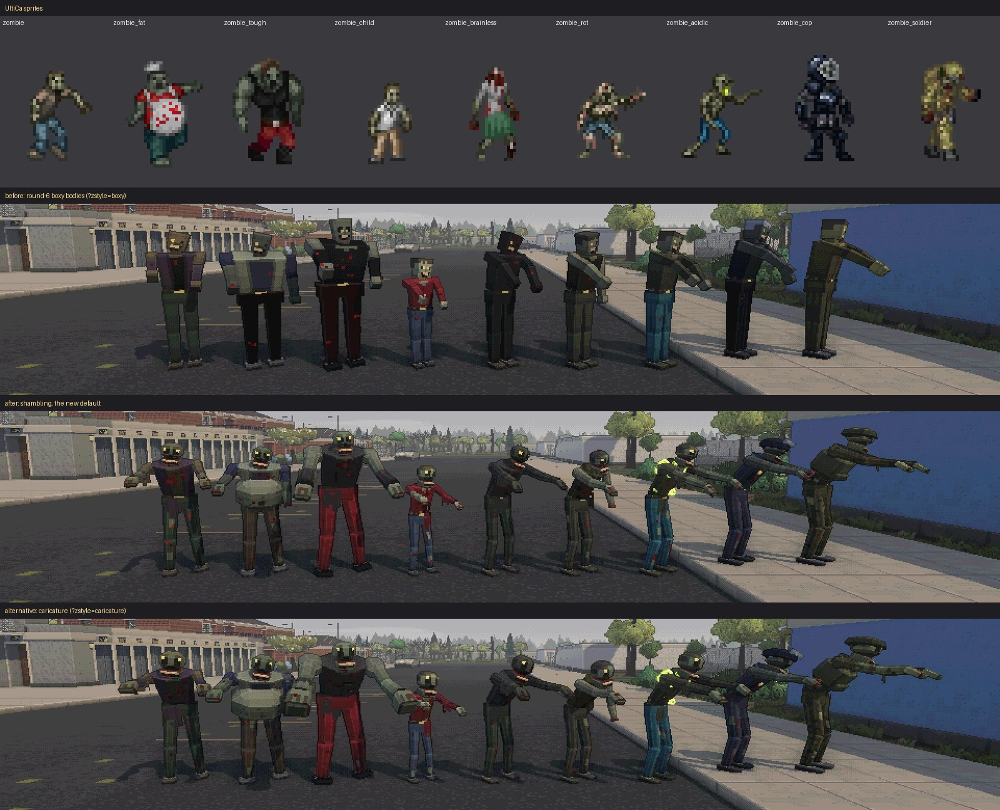 |
| specials | 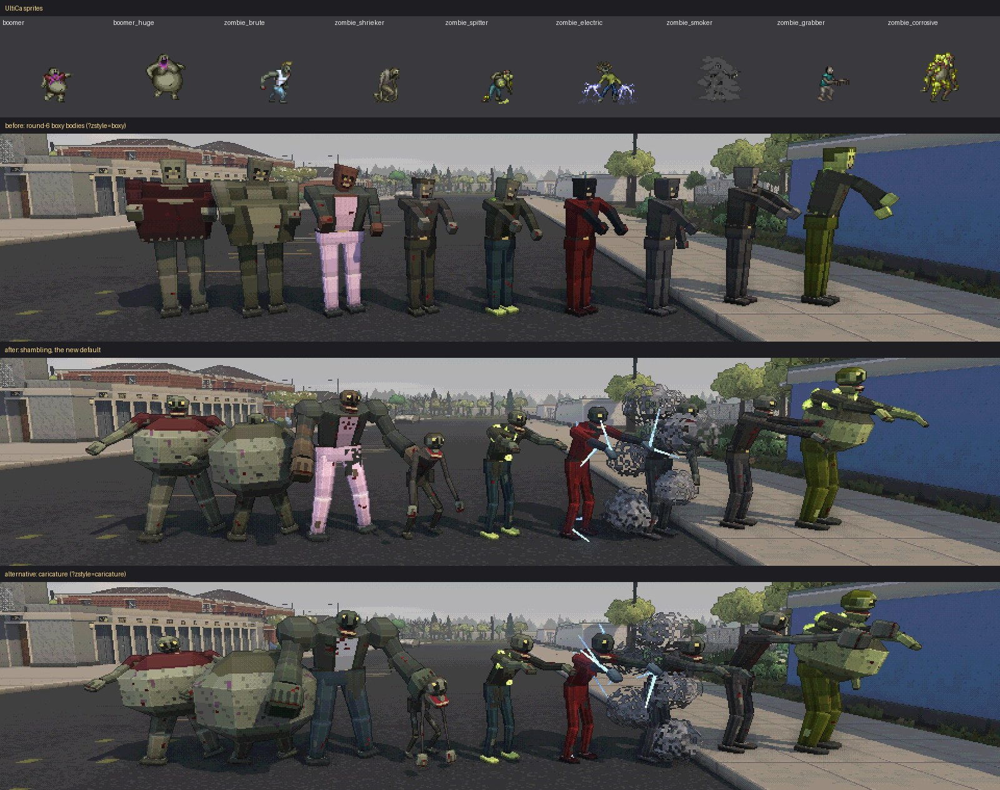 |
| more specials (necro master, skeleton brute, screecher, gasbag, brute shocker, survivor, bio-op, predator, hulk) | 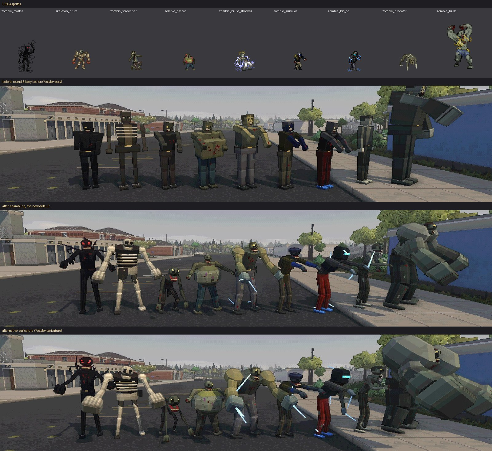 |
| uniforms, skeleton, thorny, necromancer | 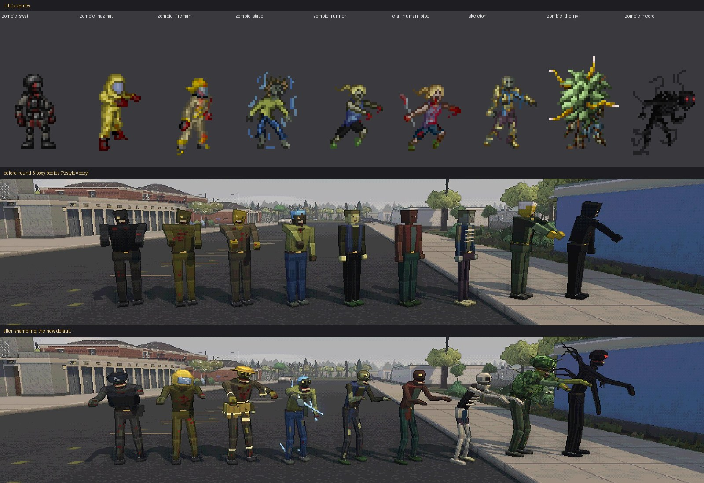 |
| the same families at 25-30 m (crop, 2× nearest) | 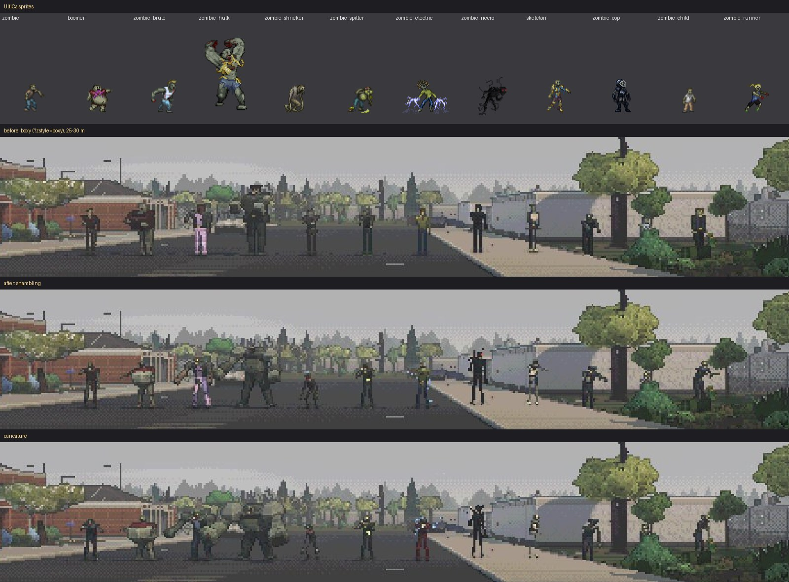 |

Wind-ups: rear-back (front, 3/4), overhead hammer (brute, broadside), crouch before a leap
(broadside, front), lunge-grab: [after](screenshots/zombies/after_zombie_lineup_windup.jpg) vs
[before](screenshots/zombies/before_zombie_lineup_windup.jpg),
[caricature](screenshots/zombies/caricature_zombie_lineup_windup.jpg). Also: individuals of one
type up close ([after](screenshots/zombies/after_zombie_lineup_close.jpg) /
[before](screenshots/zombies/before_zombie_lineup_close.jpg)), a hostile group shambling in
([after](screenshots/zombies/after_zombie_lineup_walk.jpg) /
[before](screenshots/zombies/before_zombie_lineup_walk.jpg)), crawlers
([after](screenshots/zombies/after_zombie_lineup_crawl.jpg)) and bodies
([after](screenshots/zombies/after_zombie_lineup_dead.jpg) /
[before](screenshots/zombies/before_zombie_lineup_dead.jpg)).

### Shapes (shapes.ts, charLayer.ts)

Still instanced, still pixel-textured: a part now names a unit shape — `oct` (octagonal prism:
limbs, neck, torso, hips), `bevel` (chamfered box: jaw, hands, feet, gear), `ball`
(rhombicuboctahedron: skull, belly, hump, deltoids, sacs, helmets) or `box`. The six-face nets
are unchanged: each facet is textured by projection onto the box face it leans toward, so
chamfers sample that face's edge strip and catch the banded light as facets. One InstancedMesh
per (skin page, shape), so a street of zombies is a handful of draws. Skin alpha became a
channel: 0 cuts a texel out (torn rag edges, dithered smoke), 1..254 glows (acid sacs, red eyes,
arcs, the miner's lamp), 255 is plain. Aim picking skips cosmetic parts named `fx…` (smoke,
arcs, tendrils, drool), so shots pass through smoke and a flickering arc never makes a body
unpickable.

### Families (zombieFamily.ts)

One table, first match wins, read from BN data first (special attacks, flags, species, volume,
`emit_fields`) and the id second — so unlisted variants and mod monsters land somewhere
sensible (anything with `ACID_BLOOD` grows sacs, anything `ELECTRIC` crackles, anything with
`SMASH` is built like a brute, anything over 500 L is a hulk). A look is a family label, a
**build** (proportions + resting posture), stacking **features**, **gear** (by id: BN has no
field for uniforms), a degree (zombie_tough is half a brute; a huge boomer is all belly),
`bone` (species SKELETON: a skeleton brute is a brute made of bone) and `undead`.

| Family | Read from | Build / signature |
|---|---|---|
| thorny | species PLANT | walker under a leafy plant mass with yellow-tipped thorns |
| necro | RESURRECT / COMMAND_BUFF | tall, thin, jet black; red glowing eye pips; five writhing tendrils from the back |
| hulk | volume ≥ 500 L | towering hunch, hump, logs for forearms, fists the size of a torso, small sunk head |
| boomer | BOOMER / BOOMER_GLOW / SUICIDE | a ball of pale stretched belly with the shirt riding up, short legs, arms out; boomer_huge almost all ball |
| acid | ACID_BLOOD or ACID / ACID_BARF | glowing yellow-green sacs on shoulders, back, neck, arm; glowing drool; corrosive bigger and covered |
| electric | ELECTRIC or SHOCKSTORM | blue arcs jumping off hands, shoulders, head and shins every pose step; blue-cast hands; brute build with SMASH |
| smoker | emit_fields smoke | wrapped in dithered grey puffs turning round the body |
| shrieker | SHRIEK* on a stumbling adult | gaunt, crouched low on bent knees, long neck, head up, maw hanging wide open |
| fat | id | belly and bulk, arms spread |
| brute | SMASH | wide deltoids and hump, heavy arms hanging low, big fists, swinging arms when walking |
| grabber | GRAB_DRAG / RANGED_PULL / STRETCH_* | long straight reaching arms, big hands |
| child | volume ≤ 32 L | small, big head |
| runner | no STUMBLES + leap, runner/hunter/predator ids | lean, pitched forward, elbows bent, arms pumping when running |
| scorched | id | burnt crust flakes, charred skin and clothes |
| skeleton | species SKELETON | thin bone limbs, skull with dark sockets, rib bars, rags of trousers |
| feral | living HUMAN with a feral id | runner build, living skin |
| walker | everything else | hunched, head forward, arms reaching at chest height |

Gear: cop (riot helmet, raised visor, badge), swat (helmet, dark visor, vest), soldier (helmet,
vest, pouches, camo blotches), hazmat (big rounded hood with a window), fireman (helmet with a
long brim, coat skirt, reflective bands), bio-op (helmet, glowing cyan visor, plate), survivor
(helmet, backpack), armored (plates, pauldrons), miner (hard hat, glowing lamp), beekeeper (wide
brim and veil), scientist (lab-coat tails), medic (surgical mask).

### Bodies and poses (zombie.ts)

The 16 person parts in their usual order (hit zones, crawl poses, sprite rects and aimPick
work unchanged) plus a hanging **jaw**, **deltoids**, a **hump**, a **belly**, **rags** and the
family pieces. Three torn individuals per type, picked by the creature's appearance seed (the
same for its corpse): rags front + a sleeve, a forearm torn off at the elbow (a bloody stump) +
back rags, or rags both sides and the other sleeve; each also a little taller or shorter. On
top, per-individual quirks from the seed: one arm hanging dead in about a third, a head tilt, a
lean, a dragged leg.

Poses are blended between named states in world terms (how far the torso leans, where an arm
points from straight down) and only then turned into part rotations, so a hunched torso doesn't
drag the arms or the head with it. Standing height and floor contact come from forward
kinematics of the idle pose (`poseBounds`), not a constant.

- **Idle / walk**: hunched, head thrust forward, arms reaching at chest height with limp
  wrists, knees bent; a lurching shamble that drags one leg and sways onto the good one. Brutes
  and runners swing their arms instead; running pitches the body into the stride.
- **Wind-up (melee)**: the torso arches back, both arms are thrown up and back over the head,
  the maw opens. **Heavy** (and every brute/hulk blow): a double-fisted overhead hammer, rocked
  back further.
- **Leap (crouch before a lunge)**: coiled low, chest over the knees, arms swept back, eyes up,
  weight back — a completely different shape from the rear-back, readable from the front and the
  side. The strike after a leap is a **lunge-grab**: body flung forward, both arms straight out
  and open, a leg trailing. This is the pose the coming telegraphed lunge-grab can use (it is
  already wired to the existing `leap` telegraph kind and plays on the `resolved`/`whiff` event).
- Flinch, downed and dead as before (corpses lie flat with the jaw slack; arcs stop).

### Skins (zombieSkin.ts)

The styled person painter, then: skin pulled toward one rotten grey-green; dark UltiCa cloth
lifted to a readable level keeping its hue; a 6-row cranium face (every row is one texel, so
the eye row is never skipped) with a brow ridge, sunken sockets, a dull yellow glint (red and
glowing on a necromancer), nostrils and upper teeth; the jaw's lower teeth, dark mouth and a
blood drip; holes torn through the shirt showing skin, a ragged hem, torn-off sleeves, rips in
the trousers, dark nails and blood on the fingers. Bone, black, charred and plant skins for the
families. 32 texels/m as before.

### Variants

`shamble` (default) follows the sprites. `caricature` pushes every family further (geometry
deviations ×1.7, bigger heads and hands, deeper hunch, more belly and hump): a second direction
to compare, not a fix. `boxy` is the round-6 body, untouched. All three are in Options →
**Zombie bodies**, the gallery's Characters switches (scenes *Zombie lineup: specials / common
/ at 25 m / wind-ups*), `?zstyle=` and `cdda.chars({ zstyle })`; switching rebuilds every
creature and body. NPCs, the survivor's body, animals and robots are unchanged.

### Tooling

`tools/char-shots.ts --views zombie_lineup_a|b|c|d|far|windup|close|walk|crawl|dead`: the
lineups stand on the nearest open strip of pavement (`terAt`/`furnAt`), looking away from the
sun, with the clock paused so nobody turns; `windup` freezes telegraphs and a lunge-grab.
`tools/zombie-compare.py` builds the sprite/before/after sheets above.

    ~/claude-stuff/bin/heavy --kind gpu --vram 2 --mem 2.5 -- nix-shell --run 'npx tsx tools/char-shots.ts --gpu --full --out docs/screenshots/zombies --prefix after --views zombie_lineup_c'
    ... --prefix before --params zstyle=boxy        ... --prefix caricature --params zstyle=caricature

## Performance

`tools/char-shots.ts --gpu --bench --views bench` (60 hostile zombies and dogs 8–45 m down
the street, `full` look, RTX 5080, 1920×1080, `cdda.benchView(6)`). Round 1 (machine quiet):

| | frame p50 | p95 | p99 | work p50 | draw calls | triangles |
|---|---|---|---|---|---|---|
| billboards (`?chars=billboard`) | 7.7 ms | 14.6 | 23.9 | 11.0 | 405 | 437.7 k |
| 3D models | 7.4 ms | 14.6 | 23.6 | 10.7 | 405 | 446.4 k |

Round 2 (after merging `bn`'s atmosphere; the machine was shared with other GPU jobs, so
compare within the run): billboards p50 13.8 ms / p99 34.6, work 19.6 ms; models p50 13.8 ms /
p99 39.6, work 18.5 ms — the same. Humanoids are now 16 parts (18 with wings, +1 weapon).

Round 6 (fires, body plans, NPC variety, props as cards; same bench scene): 3D models + cards
p50 5.3 ms / p99 8.3 ms, work p50 7.8 ms; `?chars=billboard&props=billboard` p50 5.6 ms /
p99 49.9 ms (spikes from other GPU jobs during that run) — no cost from the round.

Round 7 (zombie bodies; same bench scene, three interleaved runs each, RTX 5080, machine
shared with other sessions):

| | frame p50 | p95 | p99 | work p50 | draw calls | triangles |
|---|---|---|---|---|---|---|
| `zstyle=boxy` (round 6 bodies) | 7.2–7.6 ms | 11.6–12.0 | 17.3–17.8 | 10.9–12.0 | 344–384 | 1.40 M |
| `shamble` (default) | 7.4–7.5 ms | 11.4–12.1 | 16.0–19.7 | 11.5–11.9 | 349–350 | 1.46 M |
| `caricature` | 7.2–7.5 ms | 11.0–12.6 | 16.0–16.9 | 11.1–12.1 | 353–354 | 1.46 M |

Within run-to-run noise. A walker is ~22 parts (was 16), a necromancer ~45; the octagonal and
bevelled shapes take the 60 creatures from ~10 k to ~70 k triangles (+4% of the frame). A
first version cost ~0.5 ms of CPU work: the per-part Map lookups added to the instance flush
for the per-shape batches; plain arrays keyed by page × shape brought it back.

No measurable cost: ~800 part instances are one or two instanced draws (plus shadow), 12
triangles each. Matrices are rebuilt at the simulation rate (30 Hz) only for creatures that
moved; bodies are static once they land. Skins: a zombie is ~4 k texels; one 1024² page holds
~150–250 species/outfits; more pages are added as needed (a warning past 6 = 24 MB).

## Screenshots

`docs/screenshots/wave3/characters/` (JPEG q85, half size; `--full` for full size) — `before_*` are the billboards, `after_*`
the models: zombie horde near / mid / far / down a long road (66–110 m) and at dusk, a dog,
NPCs (with weapons), corpses, a melee wind-up, critters, plus `after_zoo` (one of each body
plan), `after_night` (flashlight) and `after_third` (the survivor's own body), and the
first-person set `after_fp_*` (fists, punch, pistol firing, rifle hip/ADS/reload, shotgun,
bat idle/swing/guard, knife, axe, spear, katana, flashlight, bow at draw) with
`before_fp_*` for the sprite viewmodel, and `uw_before_fp_*` / `uw_after_fp_*` pairs at the
user's 3440×1304. `tools/char-shots.ts --views fp_...` regenerates them.
Regenerate with

    ~/claude-stuff/bin/heavy --kind gpu --mem 2 -- nix-shell --run 'npx tsx tools/char-shots.ts --gpu --prefix after'
    ~/claude-stuff/bin/heavy --kind gpu --mem 2 -- nix-shell --run 'npx tsx tools/char-shots.ts --gpu --prefix before --params chars=billboard'

## Dropped weapons on the ground

The held meshes (`held.ts`) also lie on the floor. Before, ground items in the modelled looks
were one of 16 generic shapes (`furniture/items.ts`): every gun was the same plank with a stock
block, so a dropped Marlin 1894C read as "a brown stick"; in the billboard looks an item with no
UltiCa sprite (the Marlin, ~17 % of guns, ~39 % of melee weapons) was its map glyph.

- `src/render/furniture/groundHeld.ts`: `groundHeldClass(def)` (heldClass/heldVariant on the
  ItemDef, gated to weapons/tools/scrap categories with a keyword blacklist, since heldClass's
  keywords also catch soap "bars", battery cells and tobacco pipes; bows/slings stay generic) and
  `buildGroundHeld` (the part list evaluated like charLayer, rolled a quarter turn about its
  length: guns on a side, blades and tools on their flat; lowest point on the surface, centred;
  small things up to 1.6x toward 0.34 m, long ones down to 1.3 m). Faces are painted by the
  furniture painter at 32 texels/m (wood grain, rubber, steel, chrome), so they sit next to
  sprite items and furniture in the same pixel style.
- Baked into the chunk geometry by `ModelFactory.item` (cached per id and side up; piles lift
  each held mesh 4.5 cm per slot so crossing rifles lie on each other). No extra draw calls: a
  50-gun room is ~3000 quads, ~0.8 ms to bake, 0.7 ms per new model the first time.
- Full/Voxel: every weapon with a held class. Crisp/Terrain (billboards): only items the tileset
  never drew (`MeshExtras.heldItems`), the rest keep their sprite. Classic is unchanged.
- Switch: Options > World > **Dropped weapons** (Modelled / Simple shapes), `?grounditems=held|shape`,
  `cdda.setGroundItemStyle()`, gallery switch + "Dropped weapons" scene (`loot_weapons`).
- Coverage: `npx tsx tools/ground-item-coverage.ts` (catalog and a world sample around the start).
  Catalog: guns 93 % / melee 67 % / tools 9 % get a held mesh (before: 0 %, all generic shapes);
  glyph-only in the billboard looks: guns 17 % -> 1 %, melee 39 % -> 18 %, tools 40 % -> 37 %.
  heldClass gained jian/estoc/nodachi/khopesh/dao/fencing blades (sword), switchblade/kirpan/
  katar (knife), staffs/tonfa/shillelagh/pool cue (bat), ji/war scythe/lajatang (spear).

| | v2 (simple shapes) | now |
| --- | --- | --- |
| Marlin 1894C | 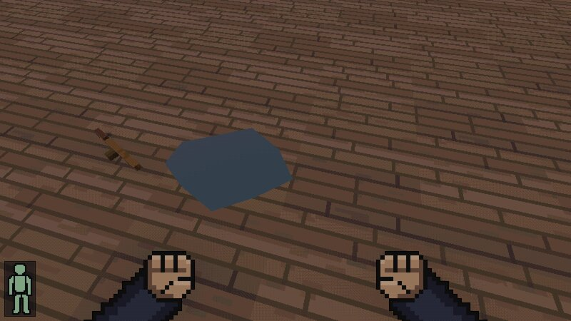 | 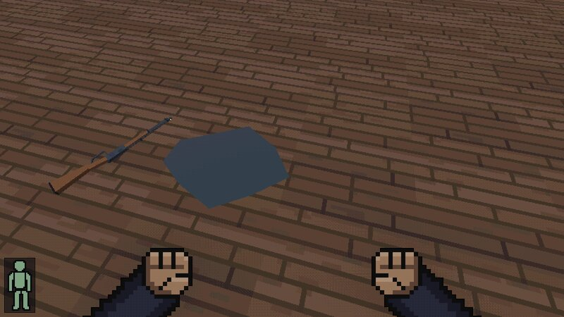 |
| guns and melee, close | 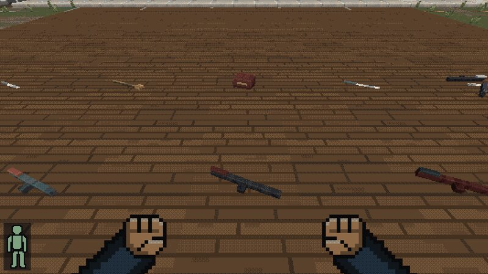 | 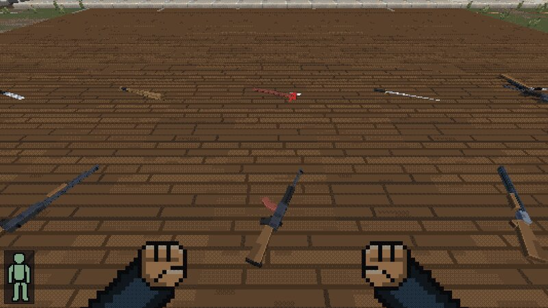 |
| top-down | 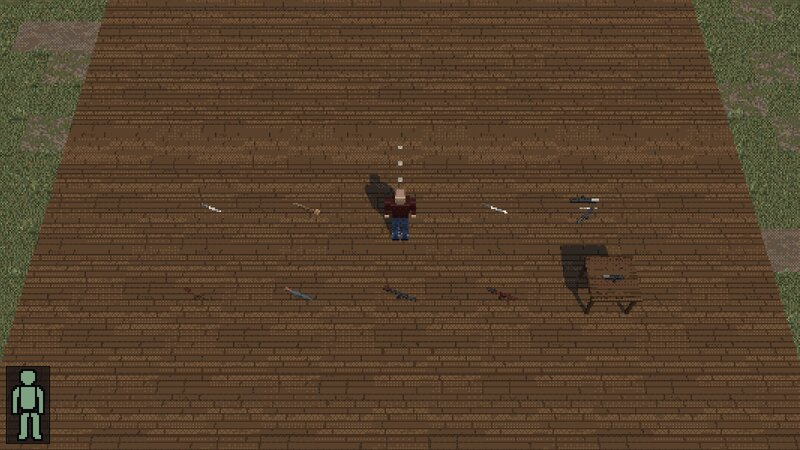 | 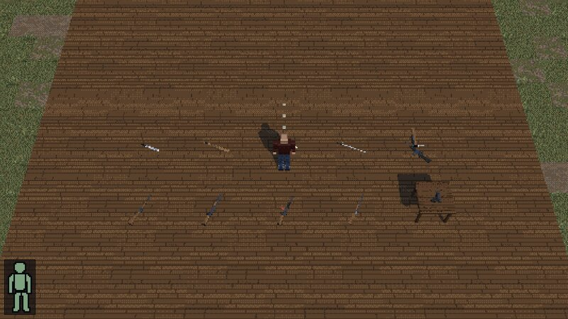 |
| Crisp look (artless Marlin, far right) | 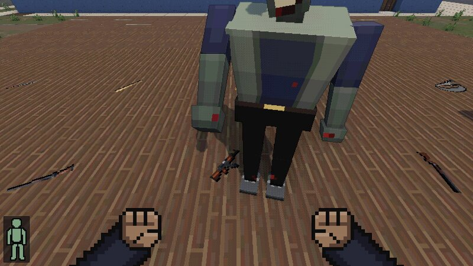 | 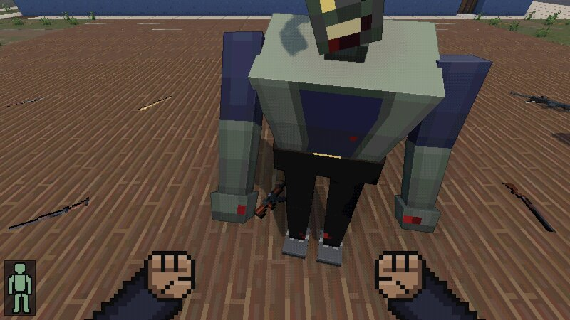 |

A pile dropped with real keys (q, Enter): 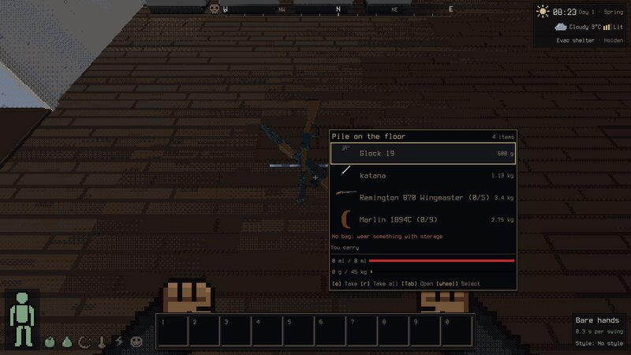

### Icons for weapons without tileset art

The same meshes draw the inventory, pile-list, hotbar and every other ui2 icon (`iconEl`) of an
item UltiCa never drew, which used to be its glyph (the Marlin 1894C was a brown "("). 145 BN
items qualify: the ones that pass `groundHeldClass` and have no sprite of their own or through
looks_like (tileset art, including a looks_like sprite, always wins).

- `src/render/heldIcon.ts` `heldIconPixels(held)`: a small software rasterizer, no WebGL. The
  part boxes (`heldPartBoxes`, shared with `buildGroundHeld`) are projected orthographically at
  4x4 supersampling with a depth buffer, flat-shaded from the upper left in a few steps, and
  downsampled to 32x32: a pixel needs 3 of its 16 samples covered (so 2 cm barrels survive),
  takes its most common colour (a flat palette, no blended edges), and gets a dark outline like
  UltiCa's sprites. Guns are side-on with the muzzle right (rifles about 24 px, pistols at least
  10); melee weapons and tools lie on the diagonal, grip bottom-left. Colours come from the
  same sprite palette as in the hands.
- `src/render/heldIconInstall.ts` plugs it into `ui2/icons.ts` (`setModelIconSource`, tried after
  the atlas and looks_like, before the glyph) once the renderer's sprite source is up; ui2 caches
  the data URL per item id.
- Cost (headful Chromium, GPU): ~0.8 ms per icon to draw (all 145: 112 ms), plus ~1.6 ms PNG
  encoding in ui2's existing `toDataURL`; the first icon of a session takes ~30-40 ms (canvas and
  JIT warm-up). Cached icons cost a Map lookup.
- Switch: Options > Interface > **Icons without art** (Modelled / Glyph), `?itemicons=model|glyph`,
  `cdda.setItemIcons()`, `cdda.itemIconStats()`, `cdda.heldIcon(id)` (a fresh data URL). No
  gallery switch: the gallery captures the 3D canvas without the HUD.
- Tests: `tests/render/heldIcon.test.ts`.

| glyph (before) | modelled |
| --- | --- |
| 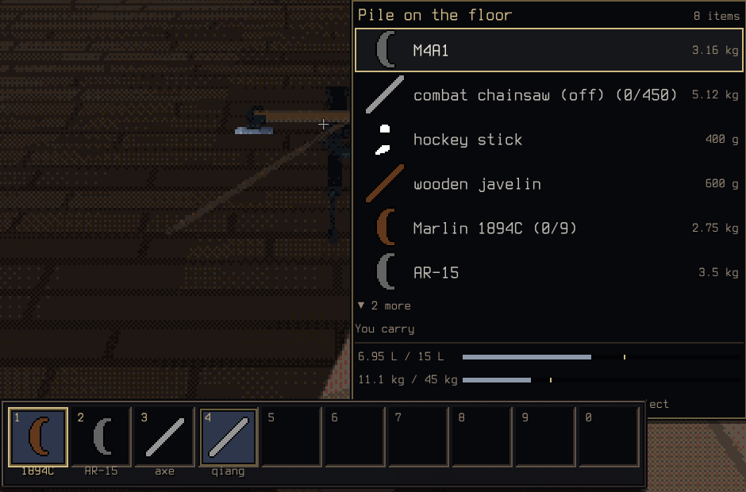 | 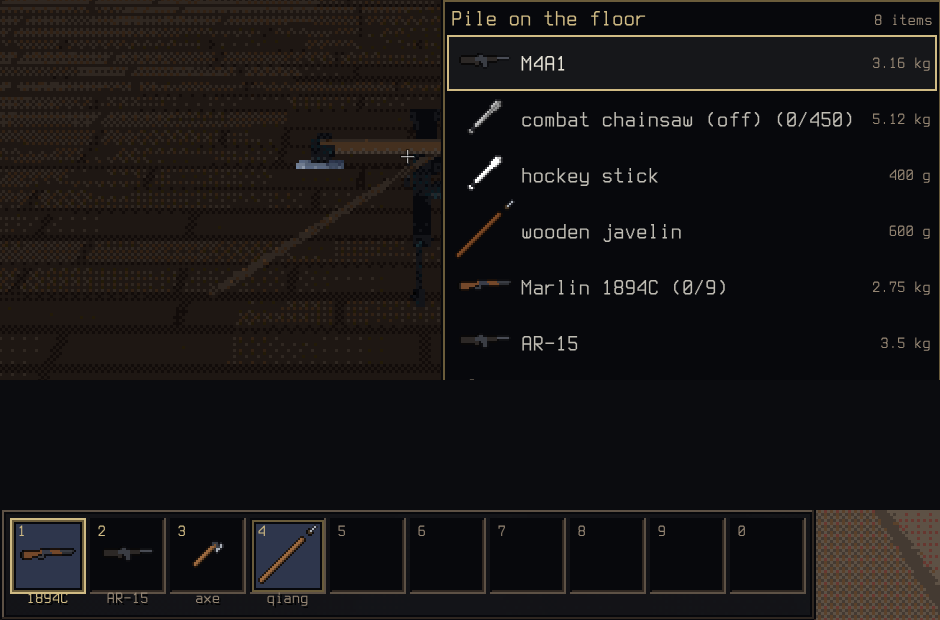 |

## Known gaps

- Zombie bodies (round 7): zombie *animals* (zombie dogs, zombears) still use the plain animal
  plans with zombie colours; the zombie dog has no hunch, torn flesh or exposed ribs yet. Smoke
  around smokers is model puffs, not BN's emitted smoke fields (our game doesn't emit them).
  Gear is chosen by id (BN has no uniform field), so a modded uniformed zombie gets none.
  Feral humans now use the runner build but still don't show the weapon they wield. The cop
  and soldier sprite colours come through the sprite palette, so a cop is only as blue as its
  sprite reads.

- Common quadruped families now differ in anatomy, but cattle, many unusual creatures,
  and unique species art still reuse broader plans. Insects retain their shared segmented
  skeleton with variants; robots remain a generic tracked machine.
- NPC held meshes and the third-person survivor (`playerModel.ts`) use detailed
  classes/variants. With the default sprite hands, an item the tileset never drew (e.g. the
  Marlin 1894C, otherwise held as its map glyph) switches first person to the 3D hands while
  wielded (`FpView.artless`). NPC simulation has no separate reload-animation phase. Bespoke
  geometry for every item remains outside the current class/variant system. Dropped weapons use
  the same meshes on the ground (above); bows, grenades and most tools (pans, brushes, scissors,
  screwdrivers) remain generic, and so do their inventory icons when the tileset has no art
  (weapons get a held-mesh icon, above).
- First-person 3D eat/drink/direct-use gestures now show successful actions; food and liquid
  use a generic palette-colored portion, rather than bespoke food or container geometry.
  Deferred tool uses (an axe/shovel/rod activity, lighting a fire, self-installing a CBM) now
  gesture too, but only from each action's own completion signal, never on open or cancel;
  resuming an in-progress craft is excluded (see "Deferred tool-use gestures" below). The
  sprite view retains its poses.
- At 90–110 m a zombie is a few pixels tall; far figures are idle (dormant monsters only
  drift), and they appear/disappear at the draw distance.
- Hordes of hundreds: transforms and dynamic attributes still upload for every live part
  each animated frame. Texture/taper attributes now upload on layout changes (see PERF);
  crowd simulation and sparse transform uploads remain open.

## Successful item gestures

`Inventory.onItemPresentation` reports the actual consumed portion or a snapshot of the
used item's identity before transformation, only after success. The 3D first-person view
raises food, tips the drink portion, or turns the used item for 1.2 real seconds, then
restores the currently wielded item. Menus/pause retain a pending gesture; loading clears
it, and sprite mode clears pending 3D gestures. No materials, charges, wield state, action
duration, or simulation activity are changed by the renderer. Food names bypass weapon
keywords (a chocolate bar is not a pipe).

Native OS picker input selected chocolate, water, and a charged flashlight in the normal
world. Midpoint screenshots were scheduled by successful-action facts, after the normal
consume activity completed; timing was not slowed or overridden. The knife remained
wielded throughout and returned after each gesture. Inspected captures:
[eat](screenshots/gaps/fp-eat.png), [drink](screenshots/gaps/fp-drink.png),
[use](screenshots/gaps/fp-use.png), [restored knife](screenshots/gaps/fp-restored.png).

Regression checks cover rejected consumption/no power, pre-transform item identity,
menu-only successful results staying silent, pause/expiry/replacement/load cleanup, and
food-name classification. Deferred handlers returning action choices are deliberately
excluded; this does not claim their eventual selected action has a rendering hook.

## Deferred tool-use gestures

The gap above is closed for every deferred tool use that actually completes while applying
an item: `use()` itself only knows "accepted" from a handler's `ActionResult.deferred` flag
(true means "say nothing yet"), and the handler fires `Inventory.presentDeferredUse` itself
from the action's own completion signal — an activity's `onComplete` (never its start, and
never `onCancel`) — not from a guess at open time:

- **Axe/shovel/fishing-rod tool-quality uses** (`src/nature.ts` `toolActions`/
  `withDeferredGesture`): chop tree/logs, cut planks, clear rubble, till, dig a pit, cast a
  line. `withDeferredGesture` wraps the one `game.activities.start()` call the chosen action
  makes (even across clearing an occupied rubble tile's own confirm dialog) so only *that*
  activity's completion fires the gesture with the real tool.
- **Lighting a fire** (`src/game/fire.ts` `useFirestarter`): the gesture fires from `light()`,
  the activity's `onComplete`, with a snapshot of the lighter/matches taken before the wait
  (its ammo is spent there too, after the snapshot).
- **Self-installing a CBM** (`src/mutbio.ts` + `src/ui/mutbio_ui.ts` `beginInstall`): a new
  `InstallFlowOpts.onInstalled` hook fires after the uninterruptible install activity
  completes (with or without complications — BN always installs), not after any of the
  confirm dialogs the flow asks first. The Autodoc flow (`src/screens/bodymods.ts`) doesn't
  pass it: there's no held item to show for an operation performed on a couch.

Excluded, deliberately:

- **Resuming an in-progress craft** (the `CRAFT` use_action, `src/ui/crafting_install.ts`):
  the held item is an abstract WIP placeholder that turns into an unrelated finished item on
  completion, so there's nothing sensible to show. `deferred` is still set on its result so
  `use()` no longer fires its own premature gesture the moment the craft is merely resumed —
  that bug is fixed even though no completion gesture replaces it.
- **Reading a martial arts manual** (`MA_MANUAL`) and the **heal/transform/UPS-toggle**
  use_actions are synchronous (they finish inside the `A`pply call itself), so they already
  got use()'s own immediate gesture correctly and needed no change.

Real-input evidence (`tools/realinput.ts --only toolgesture --params "look=classic&viewmodel=model"`,
`tools/realinput_toolgesture.ts`): a wielded high-quality lens, `u` → the picker → lighting a
patch of underbrush (an activity; of the firestarter tools the lens's slow case runs longest,
but `src/game/activity.ts`'s warp still caps any activity at ~8 real s, so this one only gets
~3.5 — see the scenario's own comments for why the cancel step has no slack to spare under
load). `?viewmodel=model` forces the 3D hands on (the default is the flat sprite viewmodel,
which never animates — see above). Inspected captures: [opening the
picker](screenshots/gaps/toolgesture-apply-picker.png) (no gesture yet), [cancelled by
walking away](screenshots/gaps/toolgesture-cancelled-no-gesture.png) ("You stop lighting the
fire," never animated, nothing lit), [the gesture right as the fire
catches](screenshots/gaps/toolgesture-gesture-on-completion.png),
[restored](screenshots/gaps/toolgesture-restored.png) to the normal held tool past the 1.2 s
window. `src/monsters.ts` exposes the installed `FpView` on `window.cdda.fpView` read-only,
purely so this (and future) real-input evidence can check the pending gesture without ever
driving the action itself through a debug call.

The scenario uses a lens rather than an axe because it's the simpler demonstration (one
use_action, no submenu, keeps the cancel/completion timing the focus) — not because the axe
path didn't work. It didn't, until now: writing this evidence found a pre-existing,
unrelated ui2 bug — `src/ui2/bn/install.ts`'s `reg('apply', …)` recomputed `model.actions()`
a second time and filtered its own `use` entry out of it by reference equality against the
*first* call's objects, so the "Use" submenu for any multi-use_action tool (axe, shovel,
fishing rod) always built empty and nothing was ever chosen (no error, no message — the
picker just closed). Fixed by factoring the decision into a standalone
`applyPickerChoice(model, view, loc)` that reuses the one `model.actions()` computation
instead of recomputing and comparing against it; the other `model.actions()` call sites in
`src/ui2/` (`lists.ts`, `containers.ts`, the loot screens) each call it once and don't have
this pattern. Unit regression: `tests/nature.test.ts` ("the \`u\` apply picker's Use
submenu…") calls `applyPickerChoice` directly for a wielded axe, asserts the submenu lists
Chop tree/Chop logs/Lumber, and that choosing Chop tree starts and (after
`onComplete`) completes the real activity, firing the deferred gesture.

Real-input evidence for the fix (`--only toolgestureaxe`): `u` → the picker → a wielded wood
axe → its "Use" submenu (previously always empty) → Chop tree → the chop starts, runs with
no gesture, finishes, and gestures. Inspected captures:
[the picker](screenshots/gaps/toolgestureaxe-apply-picker.png),
[the Use submenu, now populated with Chop tree/Chop logs/Lumber](screenshots/gaps/toolgestureaxe-use-submenu.png),
[chopping, no gesture](screenshots/gaps/toolgestureaxe-chopping-no-gesture.png),
["You finish chopping down a tree," gesturing](screenshots/gaps/toolgestureaxe-gesture-on-completion.png),
[restored](screenshots/gaps/toolgestureaxe-restored.png).

Unit coverage for success/cancel/ordering: `tests/nature.test.ts` ("a tool-quality use" and
"the \`u\` apply picker's Use submenu…"), `tests/crafting.test.ts` ("fire"),
`tests/mutbio.test.ts` ("bionics in a game"), and `tests/inventory.test.ts` ("deferred tool
presentation") for `use()`'s own `deferred` check.

Both real-input scenarios were flaky under heavier machine load (merge-integration review),
all in `tools/realinput_toolgesture.ts` — never in the game code they exercise. Each failure
was a scenario check racing a short real-time window rather than waiting on the actual state
transition: "walking away cancels it" checked `!activityName()` exactly once right after the
key hold, before slow frame delivery had given `ActivityManager`'s own per-tick movement-cancel
check (and `ItemGesture`'s per-frame elapsed-time tick) a chance to run; the "restored" checks
did the same after one fixed sleep. Fixed by polling the real condition instead of a single
check or a bare sleep (`waitUntil`/`waitNoGesture`), and — since "the activity is no longer
running" is ambiguous between "cancelled" and "it simply finished in the meantime" — by
reading BN's own outcome message ("You stop lighting the fire." vs. "You successfully light a
fire.") to tell which actually happened, rather than inferring it from timing. The lens
replaced flint and steel for extra cancel-timing margin (every firestarter tool's slow case
falls well short of the ~8 real s `defaultWarp` caps activities at, so none of them gives much
room; the lens's is the longest available). A combined `--only toolgestureaxe,toolgesture` run
is green 3 consecutive times under `heavy` as part of this fix's own verification.

## Common quadruped family anatomy

The existing BN volume and proportion rules still set body size. Quadruped bodytype and
identity now select a canine baseline or equine, cervid, bear, pig, reptile, or feline
variant. Horses add a raised neck, mane, hanging tail and hooves; deer and moose add a
neck, pointed ears, short tail and split hooves. Bears add round ears, short tails,
shoulder bulk and paws. Pigs add a broad nose pad, curled tail and split hooves. Gators
add a flattened long muzzle, widening legs, back plates and a tapered extended tail.
Cats use a short muzzle, thin long tail and paws. These additions inherit the existing
parent animation, skin palette and saved appearance seed. Generic cervid identity
does not imply sex-specific antlers. Creature hitboxes and balance are unchanged.

Inspected paired captures use actual BN monsters spawned in the paused seeded gallery,
broadside at five metres, through the normal monster view. The focused gallery is at
noon, on cleared grass, with model characters and styled sprite-derived palettes:
[horse/deer](screenshots/gaps/species-hooved.png),
[bear/pig](screenshots/gaps/species-bear-pig.png), and
[gator/cougar](screenshots/gaps/species-gator-cat.png).
The 29 character tests include BN family selection, parent order, named anatomy,
standing floor/height bounds, finite walking/attack/death transforms, and finite
toppled corpse bounds. The shared side-fall contact estimate is retained; these tests
do not claim every limb rests precisely on the floor. This is family-level geometry,
not a complete bespoke species-art pass.
