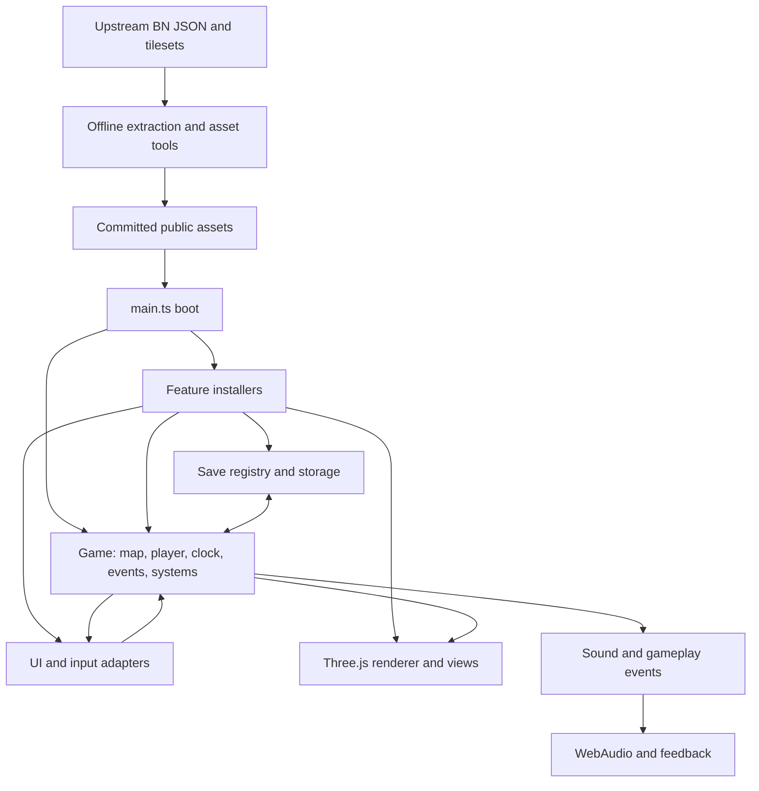
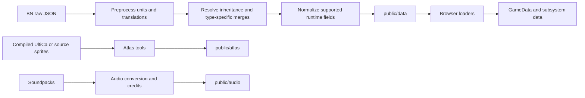

# Working with Cataclysm3D

A contributor's explainer of the architecture, execution model, strengths, pitfalls, and improvement opportunities.

**Inspection baseline:** 2026-10-04, branch `bn`, commit `03c547c`, plus the existing uncommitted gameplay and window-modernization changes in the working tree. This guide describes the inspected source. Historical documentation and proposed designs are identified as such. It is an engineering guide, not a claim that every upstream Cataclysm feature is supported.

The workspace changed concurrently during this inspection: recharge support, gap-work documents, and edits to tests appeared before finalization. Validation below is a point-in-time result, not certification of every later edit. [RECHARGING.md](RECHARGING.md) documents the new vehicle-cargo charging implementation; [GAP_IMPLEMENTATION_WORK.md](GAP_IMPLEMENTATION_WORK.md) tracks ongoing work that may supersede limitations listed here. Neither the existence of that work ledger nor an assigned task establishes that a gap is completed.

## Contents

1. [What this project is](#1-what-this-project-is)
2. [Get running and establish a baseline](#2-get-running-and-establish-a-baseline)
3. [The architectural map](#3-the-architectural-map)
4. [Boot and feature installation](#4-boot-and-feature-installation)
5. [Time, coordinates, and units](#5-time-coordinates-and-units)
6. [Content extraction and asset production](#6-content-extraction-and-asset-production)
7. [World generation, streaming, and persistence](#7-world-generation-streaming-and-persistence)
8. [Simulation systems](#8-simulation-systems)
9. [Items and inventory: the central invariant](#9-items-and-inventory-the-central-invariant)
10. [Rendering and lighting](#10-rendering-and-lighting)
11. [UI, input, and pause ownership](#11-ui-input-and-pause-ownership)
12. [Audio, achievements, and progression](#12-audio-achievements-and-progression)
13. [Trace real workflows through the code](#13-trace-real-workflows-through-the-code)
14. [Testing and debugging effectively](#14-testing-and-debugging-effectively)
15. [What is particularly well designed](#15-what-is-particularly-well-designed)
16. [Known pitfalls and limitations](#16-known-pitfalls-and-limitations)
17. [Prioritized improvements](#17-prioritized-improvements)
18. [Recipes for making changes](#18-recipes-for-making-changes)
19. [Reading path and glossary](#19-reading-path-and-glossary)

## 1. What this project is

Cataclysm3D is a browser game that reinterprets Cataclysm survival gameplay as a real-time 3D experience. Its current `bn` branch uses **Cataclysm: Bright Nights** content and many BN mechanics. The repository still uses `cdda` in identifiers, filenames, debug APIs, and tool arguments because BN and Dark Days Ahead share ancestry. An identifier saying CDDA does not establish that its behavior follows modern DDA.

The application is TypeScript, Three.js, DOM/CSS, and WebAudio. Vite serves and builds it; Vitest tests it. There is no application server required for ordinary play, no C++ game engine embedded in the browser, and no ECS framework. Upstream JSON is processed offline into committed browser assets. Cataclysm C++ and, for some mapgen, Lua are references for the TypeScript implementations.

The source is best understood as an **adaptation with explicit layers**:

- Content retains upstream IDs, definitions, names, item groups, recipes, mapgen, dialogue, and statistics.
- Simulation implements a substantial subset of upstream rules.
- Real-time adaptation adds different timing, telegraphs, free aiming, interruption, difficulty, and pausing.
- Presentation builds pixel-textured 3D geometry and mouse-oriented interfaces around that simulation.

This distinction matters when fixing a bug. A difference from BN can be a deliberate product choice, a conversion error, or an unsupported feature. Determine which before replacing it with upstream behavior. [DESIGN_V2.md](DESIGN_V2.md), [ADAPTATION.md](ADAPTATION.md), [COMBAT_FEEL.md](COMBAT_FEEL.md), and [BALANCE.md](BALANCE.md) explain the product choices.

## 2. Get running and establish a baseline

The repository's documented environment is:

```sh
nix-shell
npm install
npm run dev
```

`shell.nix` supplies Node 22, Chromium, Python, ImageMagick, FFmpeg, Xvfb, xdotool, and keyboard-layout tools. It sets `CHROME_PATH` and prevents Puppeteer from downloading its own browser. Vite normally starts on port 5173, but `strictPort: false` permits another port when that port is occupied: read its actual startup output.

The machine-specific convention in [../ARCHITECTURE.md](../ARCHITECTURE.md) routes memory-heavy jobs through `~/claude-stuff/bin/heavy`:

```sh
nix-shell --run '~/claude-stuff/bin/heavy --mem 1.5 --name build -- npm run build'
```

That wrapper is not part of the repository. On a different machine, install the needed tools and run the underlying command using local resource management. The shell imports `<nixpkgs>` rather than a pinned flake, so its exact package versions depend on the host's Nix setup. `package-lock.json` controls npm dependency resolution; consult it rather than assuming the version ranges in `package.json` are exact versions.

The essential commands are:

| Command | Purpose |
| --- | --- |
| `npm run typecheck` | Strict TypeScript checking of `src`, `tools`, and `tests` |
| `npm test` | Node-environment Vitest suite |
| `npm run build` | Typecheck, then Vite production build into `dist/` |
| `npm run data:all` | Regenerate extracted content in dependency order |
| `npm run atlas` | Build the tile atlas |
| `npm run audio` | Build the soundpack subset |
| `npm run shot -- --help` | Screenshot and page-evaluation harness |
| `npx tsx tools/drive.ts --help` | Persistent browser-session tooling |
| `npm run sim` | Headless balance simulation with the CSS import shim |
| `npm run perf` | Gameplay performance benchmark followed by sky-leak checks |
| `npm run perf:report` | Analyze performance reports |

Serve `dist/` over HTTP for production checks. The output contains fetched assets; opening the entry HTML directly as a `file:` URL is not equivalent to serving the game. Vite uses `base: './'`; static assets should resolve from any hosting subpath.

Useful initial URLs:

```text
/?seed=1&skipmenu=1
/?seed=1&gen=test&skipmenu=1
/?debug=atlas
/?debug=ui2
/?gallery
```

Use the test generator to isolate mechanics and the world generator to exercise actual content. A fixed seed gives a stable world-generation starting point, not a guarantee of identical complete gameplay across different frame timings, settings, or content revisions.

### Verified checkout health

The inspection ran the actual working tree through Nix:

- `npm run typecheck`: passed.
- `npm run build`: passed, with the warnings recorded in the validation record below.
- `npm test`: **1555 passed, 19 skipped, 2 failed**, across 117 test files (115 passed, 2 failed).
- The failures are `tests/crafting.test.ts`, “leaves recovered components and contents on the source tile” (expected two `stick` items, received one), and `tests/grab.test.ts`, “rides along last…” (the action list includes `deconstruct_furniture` where the expectation only lists `pickup` and `grab`).

These are observations, not root-cause diagnoses. Both intersect areas with existing local edits; no pristine-commit comparison was run. Do not quote historical green test counts in README or STATUS as the health of this checkout. The build outcome is recorded at the end of this guide.

## 3. The architectural map

The central object is [`Game`](../src/game/game.ts). It owns the map, player, clock, typed event bus, activity manager, key bindings, and an ordered array of simulation systems. Feature installers construct subsystems and connect them through hooks, events, providers, save registration, key handlers, and render callbacks.



This is a diagram of responsibilities rather than an enforced dependency DAG. There are exceptions: `Game` imports UI key routing; `world/levels.ts` imports render terrain classification; simulation lighting can read a renderer-provided light map; some installers live under `ui/` while owning substantial simulation wiring.

| Location | Responsibility and entry points |
| --- | --- |
| `src/main.ts` | Composition root, asynchronous startup, animation loop |
| `src/core/` | Input, RNG, clock conversions, event bus, asset bases, unload support |
| `src/data/` | Normalized content types, loading, item-group expansion, warnings |
| `src/world/` | Chunk storage, registries, coordinates, generation, overmap, level policy, prefetch |
| `src/game/` | Character/item models and mechanics, AI, combat, activities, vehicles, interactions |
| Top-level feature files in `src/` | Installers such as `monsters.ts`, `npcs.ts`, `nature.ts`, `feel.ts`, `stairs.ts` |
| `src/render/` | Camera, meshes, rigs, textures, lights, shadows, postprocessing, visual effects |
| `src/ui/` | Framework, key routing, HUD, boot menus, legacy/adapted menus and feature adapters |
| `src/ui2/` | Modern UI primitives, input hosting, inventory, looting, drag/drop, hotbar |
| `src/screens/` | Modern dialogue, trade, vehicle, mission, and body-mod screens; pure screen logic |
| `src/save/` | Section registry, versioned format, storage, tracking, serialization, eviction |
| `src/progression/` | Browser profile, unlocks, discovery, start cards, journal, memorial integration |
| `src/loadgate/` | Missing-surroundings state machine and UI/pause integration |
| `src/perf/`, `src/perfDebug.ts` | Frame instrumentation, telemetry, overlay and analysis |
| `tools/` | Offline pipelines, browser automation, debugging, balance and performance experiments |
| `tests/` | Fixtures, real-data checks, invariants, subsystem and renderer logic tests |
| `public/` | Runtime assets copied into the production build |
| `vendor/` | Locally available source assets; git-ignored, not a portable dependency bundle |
| `docs/` | Design decisions, implementation notes, playtests, screenshots, performance evidence |

Avoid recursive searches through `.claude/worktrees`, `node_modules`, or `dist` unless that is intentional. They contain duplicate or generated material. Start with `rg --files src tests tools docs` and scoped symbol searches.

## 4. Boot and feature installation

Read [`main.ts`](../src/main.ts) before changing composition. Its ordering encodes real dependencies.

1. Debug-only atlas and UI showcases short-circuit normal boot. Gallery mode follows a special path that avoids normal save/session behavior.
2. A pending load is examined **before** choosing the seed and generator. Saved player coordinates are used before surrounding chunks are built.
3. Core content and worldgen content load concurrently; input and the DOM framework initialize; `Game` is constructed.
4. Chunk tracking installs before generation so it can capture untouched baselines.
5. The world or test generator attaches; a fresh world locates the evacuation shelter. A load starts at the saved position.
6. `Renderer` constructs and waits for its preferred atlas source. Debug APIs and visual-style adapters install.
7. Audio, crafting, interactions, nature, lighting, monsters, stairs, difficulty, vehicles, grab, NPCs, mutations/bionics, and labs install.
8. Save hooks install before the UI that exposes them. Eviction installs; the UI loads and registers actions.
9. Combat depth, combat feel, and aiming install after earlier handlers because they wrap or replace those handlers. Achievements precede progression. Tactical pause, load gate, and modern replacement screens follow.
10. Prefetch and performance telemetry attach. Pending save application completes before normal frames begin on a loaded world.
11. Boot menus finish, pointer policy begins, the load gate arms, held spawns release, and save/achievement/progression sessions begin.

The animation callback caps incoming wall-clock delta at 0.1 seconds, calls `game.frame(dt)`, observes prefetch movement, renders, and records timing.

**Installation is part of behavior.** Moving a call can change which key handler wins, whether a wrapper sees the right implementation, whether spawns use the selected density, or whether a feature is included in the first save. A passing isolated unit test will not necessarily catch that.

Preferred extension pattern:

- Keep formulas and state transitions in `game/` or a pure logic module.
- Add one installer that wires dependencies and exposes automation helpers.
- Add a `GameSystem` only for work that needs simulation ticks.
- Use renderer callbacks for visual synchronization, providers for contributed UI actions, and saveables for persistent state.
- Add a small composition-root call at the correct dependency point.

The typed event bus emits synchronously. Subscribers run during the emitter's call, so events are not a queued command stream or a transaction boundary. A handler can observe intermediate state if emitted too early, and an exception can propagate to the emitter. Publish events after the fact they represent has been applied.

## 5. Time, coordinates, and units

Many regressions come from crossing these boundaries incorrectly.

### Coordinates

[`world/coords.ts`](../src/world/coords.ts) establishes:

| Concept | Convention |
| --- | --- |
| Simulation axes | `x` east, `y` south, `z` integer floor level |
| Tile | One meter; tile `(x,y)` occupies `[x,x+1) × [y,y+1)` |
| Creature positions | Fractional tile coordinates |
| Chunk / OMT | 24 × 24 tiles at one z-level |
| Level height | 2.6 meters |
| Supported levels | -7 through +5 |
| Three.js axes | `(world x, level × 2.6 + lift, world y)` |

Three.js vertical `y` is not simulation north/south `y`. Raycast heights use meters, whereas many gameplay functions take z-levels. Stair walkers also have a continuous lift above the level; rendering adds that lift.

Use `chunkOf`, `localOf`, and `chunkKey`. Negative coordinates require floor division and positive modulo: JavaScript `%` alone gives the wrong local coordinate west or north of zero. Range checks often use Chebyshev distance (`squareDist`), while physical circles, movement, and some reach tests use Euclidean distance. Preserve the intended metric.

### Four timing concepts

[`core/time.ts`](../src/core/time.ts) and [`game/game.ts`](../src/game/game.ts) separate:

| Concept | Meaning |
| --- | --- |
| Fixed simulation step | `TICK = 1/30` seconds; systems receive fixed `realDt` |
| Action scale | `ACTION_SCALE = 3`; 100 BN moves is normally 1/3 simulated real second |
| Melee scale | `MELEE_SCALE = 2`; melee is deliberately slower than movement |
| Calendar scale | `CLOCK_SCALE = 24`, multiplied by configurable day-length rate and activity warp |

`Game.tick` advances the calendar, moves the player, updates the character with `gameDt`, then updates registered systems in array order with both deltas. `Game.frame` applies mouse-look before its pause checks and consumes fixed ticks from an accumulator. The accumulator caps debt, favoring responsiveness over catching up indefinitely after a long stall.

`clock.warp` increases calendar advancement per tick during long work. `simSpeed` runs more **same-sized ticks** per wall-clock second during fast-forward. They have different effects: multiplying a calendar delta does not make every real-time AI timer advance faster. Fast-forward's repeated ticks allow per-tick interruption and hazard checks to keep running.

Use `clockScale()` where configurable day length matters; do not blindly use the constant `CLOCK_SCALE`. Monster action cooldowns are typically real seconds, character effects use game seconds, and conversion helpers bridge them. An incorrect bridge can make a brief stun last a visibly different duration when the day-length setting changes.

Terrain `move_cost` is expressed in units of **50 moves**. Flat ground's value of 2 means 100 moves. `Game.updatePlayerMovement` performs that multiplication before calculating speed. Do not treat the field as seconds or feed 2 directly into a moves-based calculation.

### Normalized physical quantities

The common runtime bases are milliliters, grams, game seconds, cents, and degrees Celsius. Some fields have their own units: BN wheel sizes are centimeters; flashlight `power_draw` is milliwatts. Read [`tools/extract/prepare.ts`](../tools/extract/prepare.ts), [`tools/extract/units.ts`](../tools/extract/units.ts), the normalized type, and the relevant BN reader before adding a formula.

## 6. Content extraction and asset production

The browser loads normalized artifacts rather than resolving upstream inheritance on startup.



[`tools/extract/cdda.ts`](../tools/extract/cdda.ts) loads raw core JSON in deterministic file order, records source provenance, and implements inheritance. Its default checkout is `~/code/Cataclysm-BN`, overridden by `CDDA_DIR` or tool arguments. Core loading excludes mods. BN item types share an ID namespace across types; modern DDA's consolidated `ITEM` format is deliberately not treated as an interchangeable input.

`prepareObject` runs quantity and translation conversion before inheritance arithmetic. A parent's `"250 g"` and a child's relative `"-25 g"` must both become numbers before addition. Bare integers are not always base units: legacy volume integers multiply by 250 ml; recipe integers are moves; book reading times can be minutes. The preprocessing also protects IDs and prose that resemble quantities.

Inheritance rules vary by type and upstream loader. Item groups with repeated IDs can append; vehicle parts have append behavior; dialogue responses merge. Generic deep-merge logic would produce believable but wrong output. The extraction inheritance and units tests are essential when touching this pipeline.

[`tools/extract/all.ts`](../tools/extract/all.ts) runs **core → NPCs → mapgen → vehicles → UI → achievements**. Mapgen reads extracted item migrations and NPC-referenced update-mapgen IDs, so order is meaningful. It supports `--dry-run`, `--only`, and `--cdda`; selecting a later stage assumes its earlier inputs are already suitable.

[`data/load.ts`](../src/data/load.ts) fetches terrain, furniture, items, item groups, monsters, monster groups, recipes, and misc concurrently, failing on missing HTTP resources. Worldgen, NPCs, vehicles, UI, achievements, and progression have additional loaders. Not every file in `public/data` is extractor-owned: the progression unlock catalogue is a separate input, so identify a file's owner before regenerating it.

The loader mostly casts parsed JSON to TypeScript types; it does not fully validate the data at runtime. Typechecking therefore cannot prove that fetched content matches the schema.

The atlas tool defaults to BN's compiled UltiCa tileset. Source-form input and optional fill assets are alternate paths. Audio extraction handles conversion and attribution separately from data extraction. Generated data and atlas assets are committed so normal development can work without the upstream checkout or ignored vendor directory.

When content seems wrong, trace **raw definition → preprocessing/inheritance → generated JSON → runtime consumer → UI/render**. A renderer cannot repair an omitted gameplay flag, and a runtime formula cannot repair a factor-of-250 normalization mistake.

All asset fetches should use [`core/assets.ts`](../src/core/assets.ts). Hard-coded `/data`, `/atlas`, or `/audio` paths break deployment beneath a subpath.

## 7. World generation, streaming, and persistence

### Map storage and generation

[`GameMap`](../src/world/map.ts) lazily creates chunks. Terrain and furniture are `Uint16Array`s of registry indices; sparse maps hold items, fields, traps, signs, graffiti, computers, and radiation. Chunks also carry placement requests for monsters, vehicles, and NPCs, plus zones, generation provenance, a version, and an empty hint.

Registry indices are compact process-local references, not durable IDs. The generated JSON and save palettes use string IDs.

**A map read can allocate a world.** `terAt`, `furnAt`, `itemsAt`, and many derived queries call `chunk()`, which generates missing content. This is convenient for interaction near the player but dangerous for AI scans, sound queries, analytics, or debugging over a large area.

[`game/los.ts`](../src/game/los.ts) provides a `Grid` that checks `hasChunk` and treats unknown areas as blocked/opaque instead of generating them. It caches lookups and resets per tick. Use this behavior for bounded AI/perception work; do not replace it with normal map getters merely because their names look equivalent.

[`WorldGenerator`](../src/world/worldgen.ts) asks the overmap what belongs at `(cx,cy,z)`, interprets JSON mapgen into temporary `MapBuffer`s, resolves regional terrain, and commits content. Builtin ports handle selected BN C++/Lua-generated terrain. [`world/mapgen/jsonmapgen.ts`](../src/world/mapgen/jsonmapgen.ts) handles structural keys, palettes, pieces, nested content, placement, rotation, and other supported constructs. Unsupported constructs are counted by `GenStats` and warned about.

Buildings can write content into other z-levels. Pending overlays wait until the destination chunk exists; existing destinations can receive overlays immediately. Upper-level generation requests the lower level first because roofs and overlays depend on it. A chunk is therefore not wholly independent of its vertical neighbors.

Mapgen emits spawn descriptions. The map's `itemFactory`, installed by `Game`, turns item spawns into real `Item` instances. Creature and vehicle installers consume placement queues after generation. Do not instantiate a parallel creature population inside the JSON interpreter.

### Generated, simulated, and drawn are separate states

A generated map chunk may have no completed render mesh yet. A monster may exist but be dormant. A distant column may be represented by skyline geometry rather than full local terrain.

[`VisibleLevels`](../src/world/levels.ts) supplies shared per-column level policy to the chunk renderer, prefetcher, telemetry, and views. On the surface it includes building extent and roof levels rather than only a fixed z-window. Underground it uses a local window. `roofAbove` searches for overhead content beyond the immediately adjacent floor.

[`ChunkPrefetcher`](../src/world/prefetch.ts) generates ahead during idle time, predicts motion, and uses the shared level policy. It improves scheduling but is **not a worker**. One chunk's mapgen is still synchronous and can overrun the idle deadline. Missing chunks are generated on demand if prefetch has not reached them.

[`ChunkManager`](../src/render/chunkManager.ts) schedules time-sliced mesh jobs. [`surroundings.ts`](../src/render/surroundings.ts) and the load gate prevent creatures/effects from appearing in apparently empty space before the surrounding walls and floors have been drawn. The gate can hold simulation while rendering continues to make progress. Its timeout/suppression behavior avoids a permanently stuck loading screen; consequently it is not a guarantee that streaming can never fall behind.

### Saves are section-based

[`save/registry.ts`](../src/save/registry.ts) holds per-Game saveables. Each section has `save`, `load`, optional `missing`, and a load order. Core ordering starts with map 0, clock/world 5, player 10, monsters 20; body mods, martial arts, NPCs, vehicles, and other features fit around those dependencies.

`load` must **replace** prior state, not merge into it. `missing` resets new sections when reading older saves. A section referencing inventory items must restore after the inventory, and references should resolve against restored instances rather than objects retained from before the load.

[`save/format.ts`](../src/save/format.ts) validates the outer format, checks supported versions and world seed, serializes sections, and applies them sequentially. The current top-level save version is 1; some subsystems have their own schema/version fields. Unknown sections and recoverable unknown IDs warn; a failed section can leave the game half-loaded. Recover by restarting/loading afresh, not by assuming rollback occurred.

Chunks use ID palettes and run-length encoding, with repeated-item runs reducing size. Compression is available through platform compression streams. IndexedDB stores primary saves; localStorage provides an emergency unload fallback and some browser-wide preferences/profile state. Save operations are serialized by `SaveManager` to prevent overlapping writes from interleaving.

### Dirty tracking and eviction

[`ChunkTracker`](../src/save/tracking.ts) snapshots version and content fingerprint before spawn consumers modify the chunk. A changed version, changed fingerprint, bash damage, or restored status makes a chunk dirty. Saves store dirty chunks plus the seed and generated-key history; untouched chunks regenerate.

Clean distant chunks are evicted **by whole column** in [`save/eviction.ts`](../src/save/eviction.ts). Evicting one roof level while retaining its generating lower level could lose an overlay. Eviction also marks generated history so regeneration does not duplicate NPCs, monsters, or vehicles.

The actualizer applies off-screen crop growth, harvest regrowth, and food rot from timestamps when areas become relevant again. Rebaselining is allowed only for changes that regeneration deterministically re-derives. Rebaselining player edits would erase persistence; failing to rebaseline harmless derived rot would retain every visited chunk indefinitely.

This architecture bounds untouched terrain, but **modified and restored chunks are retained**. Saving does not turn all modified chunks into evictable clean chunks. Long, heavily edited worlds still need a strategy for paging authoritative chunks to storage.

## 8. Simulation systems

### Character and survival

[`Character`](../src/game/character.ts) owns stats, skills, body-part HP, stamina, pain, needs, effects, traits, morale/focus, temperature, and inventory. `PlayerAvatar` adds player position and view state. NPCs also extend `Character`, reusing those mechanics.

Character behavior is BN-oriented: calorie storage, instantaneous thirst effects, flat stamina assumptions, mutation values and enchantment providers differ from some DDA models. Read [BN_DATA_MODEL.md](BN_DATA_MODEL.md) before treating an old DDA fixture as the specification.

Effects, body parts, healing, morale, weather, sun position, temperature, and reading/practice each have focused modules. Installers connect their updates and feedback. Prefer reusing those calculations rather than putting a second approximation in a HUD or item action.

### Monsters and AI

[`monster.ts`](../src/game/monster.ts) defines instance state; [`monai.ts`](../src/game/monai.ts) owns the monster system, spatial queries, active/dormant behavior, targeting, damage, death, corpses, and update budgeting. [`spawner.ts`](../src/game/spawner.ts) consumes mapgen requests and handles city population. [`standing.ts`](../src/game/standing.ts) checks where body types can stand.

The active reality bubble is roughly 60 tiles and nearby levels; distant monsters are not fully simulated. Dormant monsters can drift toward noise. [`monstash.ts`](../src/game/monstash.ts) serializes eligible far monsters by column and removes them from live collections. Do not retain a distant monster object as a forever-valid reference.

[`pathfind.ts`](../src/game/pathfind.ts) provides budgeted A* with doors/bashing costs, partial paths, and bounded reusable scratch arrays. Retained scratch storage reduces allocation; nested or exceptional searches use private storage. Result paths are independently owned. Reuse preserves search ordering and Float32 cost behavior, which matter for deterministic results.

Special attacks and deaths are separate modules, using supported BN actors and hard-coded behaviors. Noise is a simulation input: call `emitSound`, which applies player hearing and interruption behavior, rather than emitting a raw sound event solely for audio.

### Combat and real-time adaptation

[`combat.ts`](../src/game/combat.ts) contains reusable combat math; [`playercombat.ts`](../src/game/playercombat.ts) applies attacks to the world. Techniques, martial arts, gunmods, monster guns, projectiles, and explosions add depth.

[`feel.ts`](../src/feel.ts), [`game/combatfeel.ts`](../src/game/combatfeel.ts), [`aim.ts`](../src/aim.ts), and [`game/aimmodel.ts`](../src/game/aimmodel.ts) adapt that behavior to visible swings, windups, guard/parry, side-step, sway, recoil, model hit zones, and optional timing or classic-dice aiming. The default free-aim mode makes the crosshair matter; a classic-dice option retains a different rules path. Test the mode you are changing and any alternate modes sharing its code.

Do not collapse hit feedback and damage into one operation. A whiff, dodge, armor block, hit, critical hit, and kill have different event semantics. The typed `playerAttack` and `playerHurt` events allow views, HUD, sound, stats, and achievements to react without owning damage rules.

### Activities and crafting

[`ActivityManager`](../src/game/activity.ts) runs long actions with duration, progress, completion/cancellation, warp, interruption, and activity metadata. It tracks movement keys already held at start so approaching an object does not immediately cancel work. New danger checks can refuse/interrupt activities; newly arising personal distractions interrupt while already-present ones can be ignored for that activity.

In the inspected working tree, successful activity start also invokes UI start hooks that close menus/windows and release their pause. Without this transition, work can start logically while a still-open inventory prevents ticks from advancing it.

Crafting functions accept a narrower `CraftHost` rather than requiring a renderer or DOM. `CraftingInventory` gathers player items and nearby resources/pseudo-tools. Requirements handle alternatives, charges, tool qualities, and consumption.

An unfinished craft is a real `craft` item containing reserved components and recipe/progress variables. Construction similarly leaves an unfinished item at its site. That makes partial progress durable without serializing callback closures. Continuing, abandoning, or completing the work must use the existing lifecycle rather than spawning the result directly.

Activities themselves are cleared during load and clock warp resets. Durable work survives through its item/site state; a new activity can resume it. Cancellation is therefore not synonymous with refunding every material.

### Vehicles, stairs, NPCs, and body mods

Vehicles retain BN parts, condition, fuel, cargo, and controls. `VehicleSystem` supplies movement/opacity overlays and creature hooks; the renderer supplies vehicle views and cockpit feedback. [`game/chassis/`](../src/game/chassis/index.ts) is the current authority for template selection, socket mapping, shared layout, body collision outline, seats, and hit-to-mount mapping. A saved template remains authoritative; old grids migrate on load, and unusual shapes use frame fallbacks.

Vehicle-cargo recharging was added concurrently in `game/recharging.ts`, integrated with vehicle updates and both modern and fallback controls. Its documented contract uses game-time energy transfer, charger/cargo co-location, and fractional credits persisted on target items. It does not implement the entire power-network roadmap. Consult [RECHARGING.md](RECHARGING.md) for its separate validation record; this guide did not independently run that feature's browser checks.

**Chassis mapping is implemented; the entire vehicle-building roadmap is not.** [design/VEHICLES_V3.md](design/VEHICLES_V3.md) explicitly separates phase 1 templates/migration from later adoption, stripping, queued installation, facility access, crews, and towing. Do not mistake design prose for callable APIs.

Stair links connect floors with walking paths and continuous lift; player, monster, NPC, rendering, and save adapters use those links. Some offset and compact layouts retain classic transitions. Level-based melee remains limited on flights; see [STAIRS.md](STAIRS.md).

NPC state includes character stats, attitude/opinion, stock, dialogue variables, and missions. `Dialogue` evaluates supported dynamic lines, conditions, trials, math, and effects. `TradeSession` calculates trade state; inventory transfers still use the item move layer. Missions can apply live `update_mapgen`, which preserves existing map state unless the update changes it and sends new requests through chunk-update hooks.

Mutation/bionic state attaches to characters through body-mod helpers and contributes via providers for enchantments, armor, encumbrance, qualities, consumption, light, and vision. The UI and renderer consume those results; they should not become the source of mutation rules.

## 9. Items and inventory: the central invariant

**Each existing item has one location. All gameplay location changes go through [`moves.ts`](../src/game/moves.ts).** This is the repository's most valuable correctness boundary.

An item definition in `GameData.items` is shared content. An `Item` is a mutable instance: charges, damage, rot, variables, container contents, magazine slot, and gunmods. Separate identical objects may appear as one UI stack; a charges-based stack is a different representation. Do not use the visible row count as a quantity census.

BN carrying uses a flat carried inventory and worn storage capacity. Containers support their BN one-load rules; they are not a general modern-DDA pocket simulation. Older prose describing “pockets” can obscure this distinction.

`Loc` covers hands, worn gear, carried inventory, contents, detachable magazine, gunmods, ground, vehicle cargo, and NPC stock. `L.*` constructs those locations. The API checks stale sources, destination rules, cycles, liquid containment, capacity, splitting/merging, and costs.

```ts
import { L, moveItem } from './moves';

// `item` already exists on this tile. Preserve its identity and source.
const result = moveItem(
  item,
  L.ground(game.map, x, y, z),
  L.inv(game.player),
  { actor: game.player },
);
if (!result.ok) game.message(result.msg);
```

This is a mechanics example, not a complete input action: its caller still needs to handle move cost, player feedback, and any activity/UI transition appropriate to the action. Existing inventory adapters show how those are applied.

Use `spawnItem`/`spawnOnGround` for creation and `consumeItem` for explicit consumption. Moving an existing object by spawning it again can duplicate ownership. Passing `null` as an inventory action source means a **new item**, not “find wherever this item is.”

`transaction` records undo operations for synchronous multi-step changes and rolls them back on `false`, `{ok:false}`, or exceptions. It is not an asynchronous transaction: do not `await` inside it or let its callback return a Promise. The module-level undo stack ends when the callback returns, not when a Promise later resolves.

After a move, use `MoveResult.item` if you need the destination instance. A partial transfer can split an object; merging can choose a different destination object. A cached UI reference may become stale between display and click, and the source check is intentionally allowed to fail.

[`inventory_view.ts`](../src/game/inventory_view.ts) supplies UI-free views, location keys, verdicts, and contributed item actions. Modern inventory and drag/drop adapters build on these rules. Do not duplicate capacity checks in the UI: display the same verdict the mutation path will use, then recheck when committing.

Tests enforce the boundary in two ways: `moves_lint.test.ts` scans source for prohibited raw edits, and `conservation.test.ts` performs seeded random operations, transactions, stale moves, consumption, and save/load while checking counts and aliasing. The source scan is intentionally a guardrail with explicit exceptions, not a complete semantic proof.

## 10. Rendering and lighting

[`Renderer`](../src/render/renderer.ts) owns the Three.js scene, camera rig, chunk manager, sprite/model layers, lights, tile light map, sky/weather, ground/flora/decor, first-person view, and post pipeline. Views read simulation state and synchronize their visual representations through `beforeRender` hooks.

The current presentation is substantially more 3D than the old “billboards everywhere” architecture description suggests. Characters use procedural rigs/archetypes, furniture uses modeled families, vehicles use shared body layouts, trees have multiple geometry levels, and surfaces are painted procedurally. UltiCa remains a source of textures, palettes, silhouettes, and fallback art. Some effects/items and alternate looks still use cards or sprites.

### Pixel pipeline

[`post.ts`](../src/render/post.ts) renders the scene to a low-resolution multiple-render-target buffer with color, normals/flags, and depth. Postprocessing applies outlines, haze, color conversion, dithering, grading, and configured effects at that resolution, then presents with integer nearest-neighbor scaling. CSS/DOM UI is a separate overlay.

Internal scene height (`px`/render resolution) and display pixel ratio are separate settings. A small scene buffer does not eliminate the cost of a high-DPI canvas blit. Actual internal dimensions may shift to permit integer scaling; changing display ratio is not guaranteed to preserve identical pixels in every viewport.

Materials require the normal-output MRT patch. [`materials.ts`](../src/render/materials.ts) also integrates banded lighting, atlas wrapping, roof/wall cutting, light-map sampling, and shared uniforms. Static materials are patched when installed; other materials can be patched dynamically. A new custom material must correctly write the auxiliary target or postprocessing may produce undefined outlines.

Shader customization depends on Three.js internals and shader chunks. A dependency bump deserves build and visual checks of world materials, characters, sky, weather, shadows, and postprocessing; passing TypeScript alone cannot establish shader correctness.

### Chunk meshing and GPU lifecycle

Chunk geometry merges surfaces and uses model extras. Jobs yield by row/tree so construction can span frames. Their signatures depend on their own and neighboring versions because walls, slab edges, joins, and roofs cross boundaries. Old meshes remain until replacements complete. Nearest/needed holes take priority over cosmetic LOD refinements.

Static local transforms are frozen after assembly to reduce matrix recomputation, while world updates still support parent changes. If you add a supposedly static object and later animate its transform, revisit that ownership rather than silently writing to a frozen transform.

Sprite and character instancing upload changed spans or active prefixes rather than blindly uploading full capacity. Pending writes must survive skipped rendering and buffer growth. Geometry, materials, and textures have owners; dispose replaced resources without disposing shared factory assets still used elsewhere.

### Lighting bridges simulation and presentation

The visual light manager handles sun/moon, shadow maps, flashes, and flashlight presentation. A shadowcast tile light map handles natural/artificial illumination through floors, walls, openings, and sources. Gameplay `vision.lightAt` consults `game.lightProvider` for an exact renderer result where available and estimates elsewhere. Crafting and reading are wired to the same light query in `main.ts`.

That bridge avoids obviously conflicting “the room looks lit but reading is impossible” models, while keeping Three.js out of the core vision module. It also means a headless test without the provider exercises a fallback path and that exact coverage is limited. Test seams, other floors, lighting changes, and fallback behavior when changing perception.

Use the shared level and roof policy. A roof three levels above an open interior still blocks sky; changing only a `z+1` test can bring back sun/rain leaks. Do not cull all off-camera geometry without considering shadow cameras: unseen geometry can cast visible shadows.

## 11. UI, input, and pause ownership

There are several presentation generations:

- `ui/framework.ts`: shared windows, menus, prompts, confirmations, markup/colors, keyboard capture. Its shell is being modernized in the current local edits.
- `ui2/`: panels, tooltips, toasts, item cells, drag/drop, context menus, surfaces, hotbar, and mouse-oriented inventory/loot.
- `ui/screen2.ts` and `screens/`: higher-level screens on ui2, including character/map/options and NPC/vehicle/body-mod panels.

Legacy-looking file names do not prove legacy behavior. `screens/install.ts` replaces screen seams and key handlers after the underlying features exist. Inventory's BN implementation is under `ui2/bn/`; other inventory/mock modules also exist. Follow the install path to identify the active implementation.

Pure screen logic under `screens/logic/`, `ui2/logic/`, and modules such as `hud_logic.ts` makes data transformation testable without a DOM. Gameplay rules still belong in mechanics; screen models adapt them for display.

### Input rules

Physical movement uses `KeyboardEvent.code`, while actions use normalized `key` routing and rebindable action IDs. Register actions through `game.keys.register`; add defaults to `DEFAULT_BINDINGS`. Display `game.keys.label(id)`, `keyFor(id)`, or `<keybind:id>` in messages rather than hard-coding the current key.

Menu/input capture is a stack. A window that receives input needs to release that ownership on every close path. ui2 has its own surface/key stack with overlay handling so a focused list does not eat a context menu's keys. Crosshair interaction, quick loot, and world context can wrap the same keys; inspect wrapper ordering before adding another handler.

Pointer lock is browser behavior, not merely a boolean in the game. Outside fullscreen, Escape can release lock without delivering a keydown to the page. [`pointer.ts`](../src/ui/pointer.ts) interprets unexpected lock loss as closing a top window or opening the pause menu, distinguishes expected releases and focus loss, and pauses gameplay without capture until resume.

The advertised close action is Space/opening key, with Escape still supported. Puppeteer synthetic input can bypass browser behavior; it does not replace OS-level input tests.

### Pause ownership

`Game.frame` considers explicit pause, lock pause, tactical pause, and captured menus. [`TacticalPause`](../src/game/pause.ts) combines the manual toggle and named automatic holds. Closing inventory must not undo a manual pause, and opening/closing a loading gate must not clear someone else's hold.

ui2 surfaces ask for conditional or `always` pausing. Options/help/pause menus stop time regardless of inventory preference. Work-start hooks now close pausing surfaces so activity time can advance. New screens should use the framework/surface lifecycle and the tactical-pause controller rather than set `game.tacticalPause = false` on close.

Several UI registries, hook lists, settings, and shared shader uniforms are module-level. The application assumes one main game per page even though some registries are per-Game. Tests creating multiple games must restore global providers/hooks/settings; adding another registration without cleanup can contaminate later tests.

## 12. Audio, achievements, and progression

Audio maps gameplay sound facts and explicit SFX helpers to soundset variants, decodes buffers, updates a spatial listener, handles ambience, and generates selected fallback sounds. Browser audio must unlock through a user gesture. The audio loader catches failure separately; sound loading is not the same startup barrier as required game data.

Keep audible presentation and gameplay hearing distinct. Monster attraction depends on `emitSound` and hearing rules; playing a WebAudio effect alone does not notify AI. Conversely, a sound event can intentionally suppress a second audio playback when a direct SFX call already played it. See `sfxId` semantics in `core/events.ts` and the audio event mapper.

[`AchievementTracker`](../src/game/achievements.ts) implements event transformations/statistics and achievement/conduct evaluation. Repeated identical payloads aggregate, statistics cache by event version, and requirements re-evaluate when relevant events arrive. Unsupported event-dependent achievements remain explicitly untracked. The mere presence of a definition is not evidence that it can unlock.

The installer bridges game events, wrapped actions, and polling into achievement events. Run achievement state is saved; browser-wide completed achievements contribute to unlocks. Progression adds profile counters/sets, discovery nudges, start cards, journal, and unlock feedback. Browser-wide profile state and a character save are different persistence scopes: importing a character does not automatically imply importing every preference or lifetime unlock.

## 13. Trace real workflows through the code

### Picking up an item

1. Input reaches quick-loot, inventory, or a world action through registered handlers.
2. The UI identifies an `Item` and its source `Loc`; view/verdict helpers describe allowed actions.
3. The inventory adapter invokes mechanics and `moveItem` with the source and destination.
4. The move layer validates current ownership and capacity, detaches/splits, attaches/merges, and returns the outcome/cost/destination item.
5. The action adapter handles time and feedback. Ground mutation updates chunk version; inventory/loot views refresh from state.
6. Save tracking observes the changed ground/inventory state. No separate UI-owned inventory must be saved.

**Debugging question:** is this a wrong view, a stale source, a rule refusal, or a failed ownership change? Those are different failures.

### Starting a craft

1. The craft screen computes recipe availability against `CraftingInventory` and requirements.
2. `startCraft` checks rules/light/resources and creates a real unfinished craft holding components through the move layer.
3. `continueCraft` creates an activity, updates progress/skill/failure state, and handles danger/cancellation.
4. Activity start hooks release menus and pause ownership; the clock advances on subsequent ticks.
5. Completion consumes/settles unfinished state and creates outputs; hooks feed UI, statistics, and other observers.
6. Saving preserves the unfinished item. Loading clears the callback activity; continuing reconstructs work from durable state.

**Debugging question:** did work fail to start, start behind a pause, cancel immediately from input, or lose durable progress?

### Smashing a door

1. A key action or empty melee swing calls the world bash path.
2. `bash.ts` applies strength/damage accumulation and terrain/furniture transformation.
3. `emitSound` informs hearing and audio; mutation versions/events notify observers.
4. Physics/AI read current terrain; chunk and neighbor signatures request mesh rebuilds.
5. Persistence captures both transformed terrain and any partial bash damage.

**Debugging question:** does collision disagree with the map, or is the visual mesh still waiting for a rebuild?

### Loading a character

1. The chosen save becomes a pending load; a page restart can select its seed/generator.
2. Startup positions the player before rendering/prefetch near the old default shelter.
3. Registered sections restore in dependency order; generated history prevents repeat spawns and repeat overlays.
4. `gameLoaded` invalidates chunk meshes and refreshes observers.
5. Rendering builds surroundings while the gate can hold simulation; normal play resumes once its rules permit it.

**Debugging question:** is the problem the stored snapshot, load order, regenerated content, duplicate placement, or incomplete drawing?

### Changing vehicle appearance

1. Parts/template feed `chassisOf` and cached `layoutOf`.
2. Gameplay collision and seat/hit positions consume the shared layout.
3. Vehicle renderer builds the corresponding body/skin/cockpit.
4. Door/damage/version or width-epoch changes invalidate cached layout/views.

**Debugging question:** did only the render dimensions change, leaving collision, seats, or hit mapping behind?

## 14. Testing and debugging effectively

### Use the right verification layer

| Change | Useful verification |
| --- | --- |
| Formula, normalization, inheritance | Focused Vitest test plus real extracted examples |
| Item transfer or crafting consumption | Ownership/conservation tests, rollback/stale-action tests |
| Worldgen | Fixed-seed mapgen/worldgen tests, generation stats, real locations and vertical overlays |
| Save schema | Round-trip, missing-section reset, old fixture/migration, unknown-ID behavior |
| UI data transformation | Pure logic tests |
| Menus, input, pointer lock, fullscreen | Real keyboard/mouse playtest in Chromium and Firefox |
| Geometry, material, lighting, camera | Inspect screenshots and live movement, multiple levels and views |
| Performance | Representative routes, warmup, comparable settings, no capture during timings |

Vitest runs in Node, not a full browser. Tests under `tests/render` validate useful geometry/scheduling/light logic but are not a GPU rendering certification. Real-data tests prevent tidy fixtures from hiding normalization or content mismatches. Skipped BN-transition tests are unfinished coverage, not passing requirements.

For a focused check:

```sh
nix-shell --run 'npm test -- tests/conservation.test.ts tests/moves_lint.test.ts'
```

For heavier local runs, apply the repository's resource wrapper. Run the whole suite and typecheck before treating an integration change as ready.

### Automation APIs

[`debug.ts`](../src/debug.ts) installs `window.cdda`; installers add helpers. It exposes the game/renderer, state, controlled stepping, teleport, item/monster/NPC setup, and feature-specific inspection. `api.ready` signals installed APIs/startup progress, but the world may still be streaming. Wait for drawn surroundings when making screenshot or visibility assertions.

Use helpers for setup and observation. For a UX claim, perform the actual input action: a direct call to `continueCraft` proves mechanics, not that the craft button closes the window and starts time.

`tools/shot.ts` starts its own Vite server and headless Chromium, waits for ready, supports eval/print/reload/capture, and reports page errors. It uses SwiftShader; complex default looks can be extremely slow. A software rendering bottleneck does not establish real-GPU performance.

`tools/drive.ts` provides persistent sessions, GPU/production/headful variants, scripting, and real input. The headful path uses Xvfb/xdotool. `tools/realinput*.ts` exercise browser/user flows. The human workflow documented in STATUS uses Firefox at an ultrawide viewport; check both browsers and widths when UI or input is involved.

The Vite live bridge (`tools/live.ts`, `tools/dev/liveBridge.ts`, `src/dev/bridge.ts`) reports a visible tab's state and accepts eval/canvas screenshot requests. It is dev-only and carries powerful code execution; keep it local. A canvas-only screenshot omits the DOM HUD, so inspect reported UI state or use full-page screenshots for UI claims. Multiple visible tabs can make bridge targeting ambiguous; use one relevant game tab.

### Performance evidence

Start with the F3 overlay, frame telemetry, chunk queue/runway/holes, and saved route reports. Separate simulation, map generation, meshing, draw submission, GPU/presentation, and allocation.

[PERF_EXPERIMENTS.md](PERF_EXPERIMENTS.md) and [PERF_SIMULATION.md](PERF_SIMULATION.md) record actual measurements and their limits: A* scratch reuse improves a kernel modestly; static material/transform work reduces CPU cost; smaller upload payloads do not by themselves establish higher FPS; one RTX development box does not establish broad desktop support. Node worker round trips and a cube WebGPU experiment are not browser-game performance results.

Hold seed, content, look, draw radius, viewport, DPR, browser/backend, route, warmup, and instrumentation constant. Screenshots and CPU/heap profilers can perturb timing. Preserve committed performance budgets rather than rewriting them to make a regression pass.

## 15. What is particularly well designed

### Ownership is explicit where duplication is most dangerous

The location model, transactional transfers, shared verdicts, source guards, and conservation fuzzing make inventory behavior coherent across loot, trade, crafting, cargo, reload, and containers. This is stronger than individual “pickup works” examples because it checks system-wide conservation and aliasing after long operation sequences. Keep new features inside this boundary.

### Durable state is separated from transient execution

Unfinished work is an item, saves are subsystem sections, map layers use durable string palettes, and activities reconstruct execution from stored state. This avoids trying to serialize live closures, renderer objects, or a giant object graph.

### World-derived visibility fixes a whole class of errors

Shared column extents and roof queries coordinate renderer, prefetch, creatures, weather/light, and telemetry. A local roof fix in one renderer would leave other systems inconsistent; the shared policy removes that duplication. The load gate also acknowledges that present simulation state and visible geometry have different readiness.

### Expensive work is budgeted with user-visible priorities

AI caps search expansions; meshing yields; streaming prioritizes holes over refinements; prefetch predicts movement; dormant/stashed entities avoid full simulation everywhere. These are practical mechanisms for a browser main thread. The performance tools measure failures such as missing roads and queue age, not only average FPS.

### Pure logic and thin presentation adapters recur across the code

Combat math, requirements, inventory views, screen logic, gate decisions, input policy, achievements, and storage interfaces can run without the full browser. That makes subtle cases reproducible while installers keep feature integration explicit.

### Adaptation choices remain inspectable

Classic and modern aim/presentation options, debug scenes, style gallery comparisons, screenshots, and written playtest findings make tradeoffs reviewable. Unsupported dialogue/mapgen and achievement behavior warns or marks itself untracked instead of universally pretending to work.

## 16. Known pitfalls and limitations

The first table covers source-verified hazards. The later list summarizes subsystem-documented limitations that should be rechecked when doing related work.

| Pitfall | Consequence | Working rule |
| --- | --- | --- |
| Installer order and method/key wrapping | A new handler can replace or bypass an earlier feature | Trace registration/wrappers from `main.ts`; test integrated input |
| Map getters generate chunks | A broad “read-only” scan can hitch or grow the world | Use non-generating grid/known-chunk queries where appropriate |
| Mutating item arrays directly | Duplication, lost charges, stale references, failed rollback | Use the move/consume/spawn API |
| Confusing UI rows, charges, and instances | Wrong consumption/refund/quantity assertions | Check actual item semantics and census |
| Confusing real time, game time, moves, warp, speed | Effects, needs, work, combat accelerate incorrectly | Use existing conversion helpers and both system deltas |
| Direct chunk writes without version updates | Meshes/caches can remain stale even if a save fingerprint catches the edit | Use mutators; explicitly maintain versions/events for low-level changes |
| Incomplete dirty fingerprints | Silent metadata edits can evade dirty detection | Maintain tracking when adding persistent chunk fields |
| Saving a new feature nowhere | It works until reload, or leaks state across loads | Register a section and implement replacement/reset behavior |
| Changing generated content without provenance | Old untouched areas regenerate differently from modified saved areas | Plan content/generator compatibility explicitly |
| Headless-only interaction QA | Pointer-lock/focus/fullscreen issues remain invisible | Verify OS-level input |
| Module-global hooks/settings | Repeated install or multi-game tests can leak behavior | Track registration lifetimes and restore test globals |
| Type assertions over JSON and extension seams | Typecheck passes despite malformed runtime data | Validate boundaries and exercise real data |
| Packed numeric coordinate keys | Large coordinates can alias caches beyond their implicit ranges | Define supported bounds or adopt collision-safe keys |

**Specific tracking gap:** `chunkFingerprint` currently hashes terrain/furniture, items, fields, traps, signs, graffiti, and radiation. `encodeChunk` also persists computers, zones, placement data, and provenance. A modification to a computer/zone that neither bumps version nor changes another hashed field can evade dirtiness. This is a concrete coverage mismatch, not evidence that every current computer interaction loses data.

**Specific coordinate risk:** `ChunkManager` packs coordinates using 4096-wide arithmetic; `VisibleLevels` uses 65536-wide column packing. Those keys assume bounded coordinates although `GameMap` is described as unbounded. `Grid` also packs coordinates but verifies cached non-null chunk coordinates. Treat extreme-coordinate correctness as an audit target; no long-distance collision reproduction was performed here.

**Regeneration compatibility:** the save envelope stores seed/generator kind, not an upstream content revision or generator hash. Dirty chunks survive as snapshots, while clean areas come from the current generator/assets. A new extractor output or changed random draw order can produce a mixed-version world when an older save loads.

**Boundary leakage:** `world/levels.ts` depends on `render/tileKinds.ts`, `Game` owns UI key routing, and crafting's optional light seam is discovered through casts rather than a declared `CraftHost` capability. These are manageable dependencies today, but they complicate a renderer-free simulation or multiple independent games.

Source-verified support gaps include unsupported dialogue conditions resolving false, unsupported effects becoming no-ops with warnings, unsupported mission goals never completing, selected builtin/mapgen fallbacks, approximate ammo explosions, and achievement events that are untracked. Counted warnings show observed usage, not all possible unsupported upstream content.

Documented limitations worth knowing:

- Vehicle collision follows a simplified body outline; full vehicle-to-vehicle dynamics, coupling, NPC crews/passengers, and the later building roadmap remain incomplete. AI passability is coarser than sub-tile player collision. Frame fallbacks cover unusual vehicle types.
- Stair fighting still uses discrete levels in some attack paths; monsters do not autonomously plan arbitrary multi-floor routes. Offset stairs and some shapes use classic transitions.
- Character art is archetype-based, with simplified weapons/poses and limited distant animation. The active character prefix is uploaded each frame, so very large crowds still warrant profiling.
- Hearing uses the port's tile-volume model even where BN bash sound fields have changed toward dB semantics.
- Full off-screen survival simulation is intentionally absent; timestamp-based actualization and dormant/stashed behavior are approximations of what happened away from the player.
- The repository has asset attribution, but STATUS notes no explicit license for the project's own code. Clarify licensing before treating redistribution terms as settled; do not infer the answer from the content license alone.

Historical notes can contradict current source. Examples: the README extraction example names the DDA checkout despite BN being the default; README's approximate test count is outdated; STATUS's old backlog repeats issues its own wave-3 summary says were fixed; ARCHITECTURE includes historical DDA labs/render prose. Use source and tests to establish current behavior, then consult dated docs for intent.

## 17. Prioritized improvements

These are recommendations derived from inspection, not a claim that each is a measured bottleneck.

| Priority | Improvement | Why it matters | Completion evidence |
| --- | --- | --- | --- |
| 1 | Resolve the two current test failures against intended new behavior | Restore a trustworthy working-tree baseline | Correct quantity/action behavior and the full suite green; avoid merely loosening expectations |
| 1 | Align chunk mutation, serialization, and dirty tracking | Prevent persistent metadata from falling through tracking gaps | Mutation APIs plus tests for computer/zone edits across save/load and eviction |
| 1 | Record content/generator provenance and define compatibility policy | Seed alone cannot preserve regenerated areas across upgrades | Manifest in generated assets/saves; explicit migration or mismatch handling |
| 2 | Replace incidental handler wrapping with explicit ordered hooks/action middleware | Reduce installation-order surprises in reload/interact/combat/UI | Named stages/priorities, preserved behavior, integrated tests for wrapper chains |
| 2 | Introduce a feature registration/disposal context | Avoid global provider leaks and stale callbacks on reinstall | Handles unregister systems/events/keys/saveables/render hooks; repeated-install tests |
| 2 | Validate external JSON/save section boundaries | TS casts cannot protect runtime content | Targeted schema validation with file/ID diagnostics; malformed-input tests |
| 2 | Clean up documentation ownership and active entry points | Contributors currently encounter stale counts and parallel implementations | One dated source-of-truth index; implemented/planned/historical labels |
| 2 | Make coordinate bounds explicit or keys collision-safe | Reconcile packed caches with an unbounded map | Negative/extreme-coordinate tests and an agreed supported-world policy |
| 3 | Page dirty authoritative chunks into persistent storage | Current eviction only bounds clean terrain | Long-world memory plateau, unchanged edits and spawn history after revisits |
| 3 | Tighten dependency boundaries and light interfaces | Improve headless testing and future worker options | Shared world classification outside render; declared light capability; comparable headless behavior |
| 3 | Expand real-input integration coverage and automated execution | Pure tests cannot verify browser capture flows | Repeatable Chromium/Firefox scenarios for nested menus, activities, load, and quit |
| 3 | Make setup reproducible on a clean machine | Nix channel, ignored vendor inputs, and private wrapper limit portability | Pinned environment/provenance, documented asset regeneration prerequisites |
| 3 | Audit startup loading and ineffective code splitting | The build reports dynamic imports defeated by static imports; the main JS chunk is about 1.76 MB before gzip | Loading measurements, deliberate import boundaries, unchanged feature boot order |
| 4 | Profile representative browser workloads before larger performance rewrites | Workers/WASM/WebGPU require new boundaries and shader work | Multiple hardware classes, route-level CPU/GPU/GC evidence, visual parity |

The safest performance work targets measured hot paths while preserving ownership and ordering. Occupancy/cost caching, atlas-page batching, texture arrays, and worker A* are plausible investigations; their invalidation, overlay, shadow, and stale-result costs must be measured. Sending the mutable `Game` to a worker is not a practical serialization boundary. A worker prototype needs packed/versioned world data and revalidated results.

A renderer backend migration is particularly broad: this project relies on custom GLSL and `onBeforeCompile` patches throughout. The existing backend experiment is evidence for experimentation, not justification for a mechanical WebGPU replacement.

## 18. Recipes for making changes

### Add an interaction or timed world action

1. Find the current path in `game/interact.ts`, the relevant installer, and world context providers.
2. Put eligibility, mutation, and result logic in a mechanics module. Reuse qualities, reach, light, and item-transfer rules.
3. Contribute an interaction/examine provider and modern context action rather than replacing the whole menu.
4. Use `activities.start` for long work, with progress/cancellation and durable state where needed. Let successful start release pausing surfaces.
5. Maintain chunk versions/events and saveable state; emit gameplay sound through `emitSound`.
6. Add an automation setup/inspection helper. Test pure mechanics, then perform the actual menu/key action with real input.

### Add a persistent subsystem

```ts
registerSaveable(game, 'my_feature', {
  order: 50,
  save: () => state.toJSON(),
  load: (json, ctx) => state.replaceFromJSON(json, ctx),
  missing: () => state.reset(),
});
```

Choose the order from its references, not convenience. Ensure replacement clears caches/collections and resolves new objects. Test loading twice, loading an old save without the section, and malformed or unknown content. Keep cosmetic state derived unless persisting it serves a gameplay purpose.

### Change an upstream rule

1. Identify the BN C++ reader/formula and any deliberate adaptation layer.
2. Check the generated field, its units, inherited values, flags, and runtime type.
3. Add a focused regression with an actual extracted example when useful.
4. Change the mechanic and all meaningful consumers; avoid hiding a data bug with a UI fix.
5. Check alternate aim/difficulty modes if shared code is involved; update BN/adaptation notes.

### Add or change a visual model

1. Find its factory/catalog/archetype and near/far variants.
2. Keep gameplay shape authority in shared layout where appropriate, especially vehicles and stairs.
3. Use the existing texture/material contract, MRT patch, light-map sampling, level policy, and resource ownership.
4. Include changes in version/cache keys; respect time-sliced construction and static-transform assumptions.
5. Capture nearby/distant, day/night, first/third/top, interior/exterior, and alternate-look views as relevant. Inspect the images and move through the scene.

### Work safely in this checkout

Check `git status` and preserve unrelated edits. This baseline already contains local activity, crafting/construction/disassembly, interaction, UI framework/theme, test, and design-document changes. A guide or a focused feature change should not absorb or overwrite them.

Scope searches to active source. Before changing a similarly named older module, confirm its imports and installer route. Update the relevant subsystem doc and this guide only when its described contracts change. Existing architecture conventions favor small edits to hot composition/type files and features in focused modules.

## 19. Reading path and glossary

For a first productive day, read in this order:

1. `main.ts`, `game/game.ts`, `core/time.ts`, `world/coords.ts`: composition and execution.
2. `game/item.ts`, `game/moves.ts`, `game/inventory_view.ts`, [INVENTORY_MODEL.md](INVENTORY_MODEL.md): ownership and actions.
3. `world/map.ts`, `world/worldgen.ts`, `save/tracking.ts`, `save/registry.ts`: generated versus authoritative state.
4. `ui/keys.ts`, `core/input.ts`, `ui/pointer.ts`, `ui2/host.ts`, `game/pause.ts`: browser interaction and lifecycle.
5. Your feature's installer, mechanics, active view, and tests; then the corresponding subsystem document.
6. Renderer/chunk/light modules and performance docs if the change affects visible state or frame cost.

| Term | Meaning here |
| --- | --- |
| BN | Cataclysm: Bright Nights, the current upstream content/rules reference |
| DDA | Cataclysm: Dark Days Ahead; original branch/reference, not interchangeable with BN |
| OMT | Overmap terrain tile; one 24 × 24 local chunk at a z-level |
| Reality bubble | Nearby region receiving active creature simulation |
| Actualization | Timestamp-based application of selected off-screen changes when revisited |
| Loc | Explicit ownership location for an item |
| Moves | Upstream action-cost units, 100 per turn before adaptation scaling |
| Warp | Multiplier for calendar advancement within a simulation tick |
| Sim speed | Number of fixed simulation ticks executed per wall-clock interval |
| Saveable | Registered JSON section with ordered restoration |
| Dirty chunk | Authoritative content that cannot safely regenerate from its baseline |
| Load gate | Pause/readiness controller while nearby geometry is missing |
| MRT | Multiple render targets; color plus auxiliary normal/flag output |
| LOD | Level of visual detail, selected by distance/style |
| ui2 | Modern DOM UI toolkit and its input/pause lifecycle |
| Install seam | Hook/provider/callback connecting a feature to shared infrastructure |

The detailed API catalogue remains [../ARCHITECTURE.md](../ARCHITECTURE.md). Use it as a searchable reference alongside the source. This guide supplies the execution model and reasoning needed to interpret that catalogue, choose the active implementation, and make changes without breaking cross-system invariants.

### Validation record

Typecheck, the full Vitest suite, and the production build were executed for this guide; their results are listed in section 2. All local Markdown link targets were checked and exist. No gameplay implementation was changed, no asset regeneration was performed, and no new browser/visual playtest was claimed.

The successful build reports two ineffective dynamic imports: `ui/inventory_ui.ts` and `ui2/bn/lists.ts` are also statically imported, so those dynamic imports do not move them into separate chunks. Vite additionally warns that the extensionless `./tools/dev/liveBridge` import in its configuration is incompatible with its planned native config-loader default. These are current maintenance findings, not build failures. The main generated JS chunk is about 1.76 MB (638 KB gzip); this is artifact size, not a measured startup-latency result.
