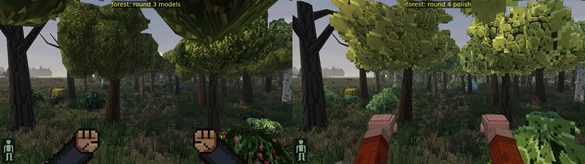
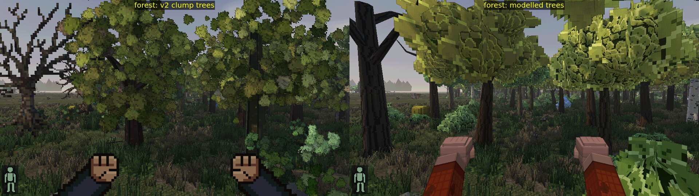
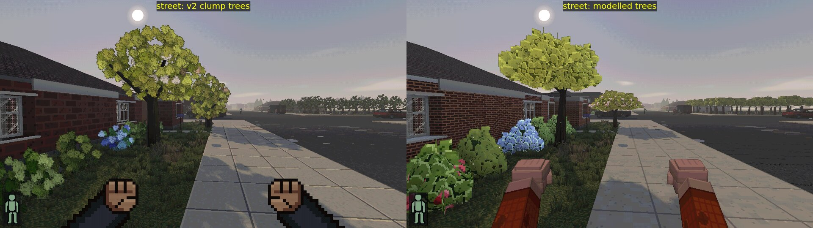
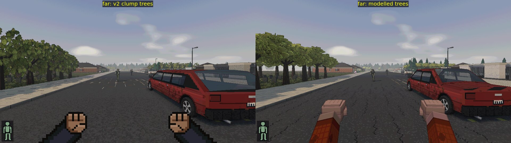
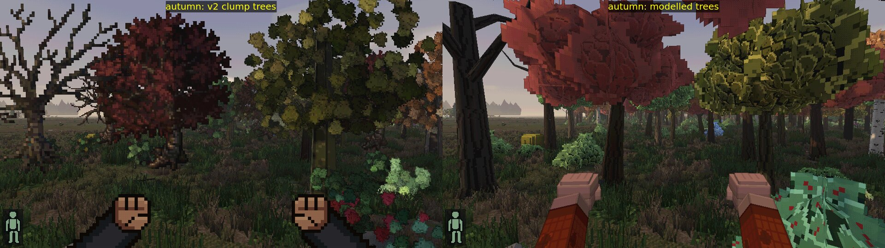
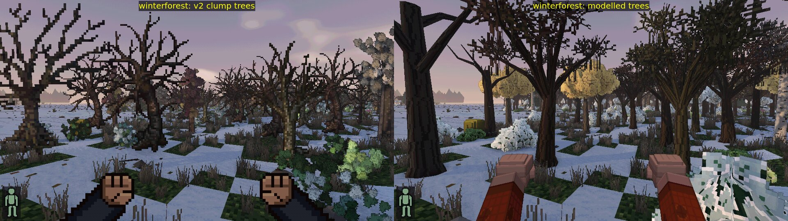
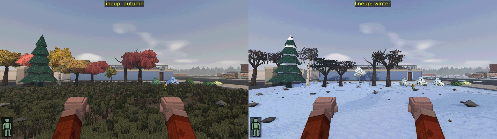
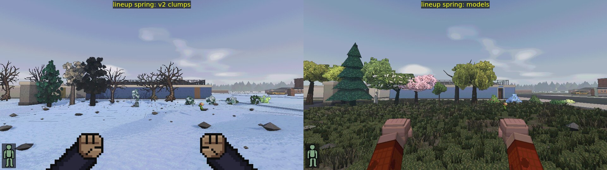

# Trees and vegetation (wave 3, readability round 3)

Feedback: trees were the most "voxel-blob" thing left and fill most forest and suburban frames.
Trunks were square pillars, crowns camo-noise clumps of identical round blobs, bushes fuzzy
green noise, nothing read as a species, and past 43 m every tree became the flat UltiCa
billboard (a pop at the LOD edge).

## What is built now (`src/render/flora.ts`, `src/render/floraArt.ts`)

Every tree/bush terrain id maps to a family with its own layout, built as real geometry in the
world material (toon bands, light map, sun shadows, fill light):

| family | ids | shape |
| --- | --- | --- |
| round | t_tree, maple, oak-likes, elm, walnut, beech, chestnut... | 8-sided trunk with root flare, forking limbs, a crown of 10 low-poly leaf lumps in three bands (bumpy outline), ragged leaf-mass cutout cards through each lump |
| willow | t_tree_willow | low wide dome whose rim lumps droop in long tongues |
| conifer | pine, juniper (spruce/fir/cedar ids too) | straight trunk, 5 star-edged drooping cone tiers with undersides; snow caps in winter |
| birch | t_tree_birch | white bark with dark lenticels, slim trunk, narrow tall crown |
| fruit | apple, pear, cherry, peach, plum, mulberry, almond... | short trunk, wide low dome; white/pink blossom in spring, fruit dots in summer/autumn (none when harvested) |
| sapling | t_tree_young | thin stem, three small lumps |
| dead | t_tree_dead, hickory_dead (and any deciduous tree in winter) | bare limbs with forks and twig cutouts |
| deadconifer | t_tree_deadpine | straight trunk with short stubs |
| bush / underbrush / fern | t_shrub_*, t_underbrush, t_fern | lumps on the ground; roses, hydrangea, lilac as 2x2 flower dots, blueberry/raspberry/blackberry/grape as berries (blossom in spring) |

* Colours come from the tree's own seasonal UltiCa sprite: a 4-step ramp from its crown pixels
  (gap, mid, light, highlight) and bark from its trunk rows, so species tint, autumn colours and
  winter carry over. Pale grey pixels count as snow, not leaves.
* Textures are painted at 32 texels/m: leaf clusters (3-px blades with lit tips), drooping
  needles, furrowed / plated / birch / smooth bark, snow and twig cutouts. They live on a
  private 2048 atlas page (`FloraAtlas`, wrapped padding so mips don't bleed); ~17 % used after
  a forest + town.
* Lumps' normals lean toward the crown's volume normal, so a crown shades as one mass (lit top,
  dark underside, stepped by the toon bands) with lumps in it.
* 3 layout variants per family, random yaw; heights: conifers x1.35, birch x1.12, fruit x0.8.
* Wind: stepped foliage sway since round 4 (below); trunks stay still.

## Round 4: close-up polish

Feedback on round 3: crowns read as faceted PS1 balls with noisy texture, darker and more olive
than the sprite greens; bushes were confetti; walking into a crown filled the screen.

* **Smooth crowns**: lump normals are now 72 % the crown's sphere normal, 28 % the lump's, so
  the crown shades as one mass through the toon bands with no facets; lumps separate by a baked
  occlusion (vertex colour: faces toward the crown's inside and underside darker) and a
  per-lump value/hue tint, like the v2 clumps' pixel-to-pixel variation.
* **Ragged silhouette**: three larger leaf-mass cutout cards per lump, pushed outward from the
  crown centre, plus a flat card under every lower lump for the underside edge.
* **Leaf texture repainted**: overlapping scalloped leaf clusters (~7 px) in four clean steps
  (lit upper-left edge, light body, mid mark, dark lower-right rim/gaps) instead of 3-px noise.
* **Colour/value**: the ramp keeps the sprite's lit tone (x1.12-1.3) and the foliage material
  adds the v2 light-through-leaves glow and backlit translucency; the toon bands do the
  darkening.
* **Bushes**: 5 big floret clusters (5-px rounded blobs, lit top-left) or 9 berry pairs on the
  clean leaf base; fruit trees 6-9 fruit, blossom 9 clusters.
* **Near fade**: leaves dissolve (screen-door on the pixel grid) between 2.0 and 0.9 m from the
  eye; willow tongues no longer hang below ~2.5 m.
* **Stepped wind**: foliage sways 5 cm in 4 keyframes a second (pixel-art timing; a still frame
  between steps doesn't shimmer), fading out by 25 m. `floraWind.value` in flora.ts (0 = off).
* Foliage has its own material (world material + those patches); trunks keep the world material.
  Two draw calls per chunk instead of one.

Standing render (full, 1080p): forest 1.5 ms / 676k tris, street 1.5 ms / 480k, far 1.6 ms /
608k (round 3: 1.4 / 1.5 / 1.6).

Walking flicker (`cdda.flickerTest`, full look): forest 0.021 (v2 clumps 0.028, round 3 0.027),
street 0.018, far 0.017.

## LOD without pops

Chunk rings (chunkManager): near (lodRadius 1.8 chunks, ~43 m) full detail; middle ring
(`midRadius` 3.3, ~80 m) the *same layout* with 5-sided trunks, coarser lumps, no cutout cards;
beyond, two crossed impostor cards per tree painted from that same layout and palette (volume
normals, so the sun side still lights up). A tree keeps its silhouette and colours at every
distance; only detail changes at the ring edges.

## Switches

* **Options > Trees** (persisted): `models` (default) / `clumps` (the v2 trees: sprite-revolved
  blob cards near, billboards beyond). `?flora=models|clumps`, `cdda.setFlora(name)`,
  `cdda.floraStats()` (atlas use, middle radius). Needs a look with `trees3d` (voxel, full);
  classic/crisp/terrain keep their billboards by design.
* Views in `tools/look-views.js`: `lineup` (one of every family on open ground, 14 m),
  `lineup-spring|autumn|winter`, `lineupfar` (60 m: middle/far LOD), `autumn`, `springforest`,
  `winterforest`. `tools/bench-stream.ts --view forest --yaw -20` streams through woods.

## Screenshots (1080p, RTX 5080, seed 1; left v2 clumps, right models)

One of every family (round, maple, pine, birch, apple, cherry, sapling, dead, willow, rose,
hydrangea, blueberry, underbrush, fern) in autumn and winter, and spring (v2 vs an earlier pass
of the models, before the leaf ramp was brightened):

## Performance (RTX 5080, 1080p)

Standing (`look-shots --bench`, full look): render ms / triangles

| view | v2 clumps | models |
| --- | --- | --- |
| forest | 1.8 / 468k | 1.4 / 676k |
| street | 1.7 / 326k | 1.5 / 453k |
| far | 1.9 / 604k | 1.6 / 566k |

Streaming through woods (`bench-stream --view forest --yaw -20`, 20 s runs, main-loop ms):

| run | v2 clumps loop p99 / max | models loop p99 / max | tree meshing total | longest step |
| --- | --- | --- | --- | --- |
| sprint 7 t/s | 9.0 / 11.5 | 10.5 / 15.2 | 36 -> 506 ms | 3.7 ms (one tree) |
| drive 40 mph | 9.6 / 15.4 | 10.3 / 11.8 | 35 -> 533 ms | 3.5 ms |

No frame over 33 ms in either. Trees now exist at every distance (middle ring and impostors
instead of billboards), so there is more tree meshing, but it stays inside the per-frame chunk
budget (a tree per step). Render time is the same or lower (one merged mesh per chunk
instead of hundreds of instanced clump cards per tree). Atlas: ~17 % of the 2048 page after a town and a forest.

## Known gaps

* Within ~2 m the 32 texel/m leaves are big (they dissolve from 2 m inward).
* The middle ring -> impostor switch at ~80 m changes the crown outline a little (flat cards
  vs lumps); colours and proportions match.
* t_fern renders as a low bush (no fronds); saplings in winter keep pale lumps.
* The flora page re-uploads (2048^2) when a new palette is first painted; this settles after
  the first few chunks of a new biome/season.
