# Modelled furniture, fixtures, openings and items (wave 3)

The feedback: "many of the voxels used are not good enough" — chairs were grey blobs, table
tops and legs oddly textured, broken window glass floated in the hole as loose blue squares,
items on tables were lumps. The "full"/"voxel" looks inflated or extruded UltiCa sprites
into voxel volumes. Project Shadowglass does something else: **real low-poly geometry with
pixel-art textures at a fixed texel density**. That is what this pass builds.

## What changed

- **Furniture and fixtures are low-poly models** (`src/render/furniture/`): boxes, prisms,
  tilted and tapered boxes, a few free quads. Every face gets its own texture frame painted
  at the face's exact size at **32 texels per metre** (the UltiCa density: 32 px per 1 m
  tile), nearest filtered: a material pattern (wood grain along the long axis, fabric weave,
  brushed metal, enamel sheen, laminate, cardboard flutes...), a 1 px bevel (light top edge,
  dark bottom edge, so parts separate like hand-drawn pixel art) and details painted in the
  face's own texels (drawer lines and handles, cabinet doors, book spines, burners, oven
  window, fridge split, locker vents, portholes, screens). Details that should catch light
  (handles, faucets, rails, feet, knobs) are geometry.
- **Colours come from the UltiCa sprite** (`palette.ts`): the sprite's colour clusters
  (outline-free), plus the 3/4-view regions — the upper rows are the drawn top surface, the
  lower rows the front — so a counter gets its worktop and cabinet colours, a sofa its
  upholstery, a bed its blanket, a dumpster its green.
- **Data-driven coverage** (`catalog.ts`): an ordered id → archetype table (75 kinds:
  chairs, stools, benches, sofas/armchairs, tables, desks, coffee/pool tables, beds, bunk
  beds, mattresses, dressers, wardrobes, bookcases, shelving, lockers, filing cabinets,
  safes, counters, cupboards (with wall cabinets against a wall), sinks, stoves, fridges,
  freezers, dishwashers, washers/dryers, display fridges and cases, vending machines,
  toilets, bathtubs, showers, crates, boxes, bins, dumpsters, lamps, plants, TV stands,
  pianos, fireplaces, stoves, water heaters, machines, mailboxes, street and traffic
  lights, utility poles, signs, headstones, monuments, boulders, rubble, planters, roof
  props, solar panels, flags, sandbags, barricades, mirrors, arcade and fitness machines)
  and fixture-like *terrain* (consoles, ATMs, gas pumps, tanks). Anything unmatched falls
  back to the voxel path — today that is essentially the wild flowers, which inflate well.
  Around the start (2 seeds, radius 12-14 OMTs) the catalogue covers **every furniture
  tile except plants** (`tools/furniture-freq.ts --unmapped`).
- **Connections and facing**: neighbours of the same group join (long tables drop inner
  legs, counter runs drop side panels, sofas keep arms only at the ends, 2x2 beds become
  one double bed with one headboard, bathtubs and benches extend). Pieces back onto the
  wall (in a corner: the side facing more open floor); counter runs turn corners; chairs
  face the table next to them; multi-tile pieces share one facing found by walking the
  group.
- **Windows** (`openings.ts`, `glass.ts`): real glass — a faint sky reflection drawn as
  ordered-dither screen-door transparency in the low-res image (no sorting; reads as glass,
  not as an empty hole), with diagonal glint streaks. **Broken windows** (`t_window_frame`)
  have jagged glass shards left in the frame; empty frames are open; taped windows get a
  tape X; barred windows bars; curtained windows fabric curtains inside (gathered at the
  sides, or drawn across); stained glass is leaded colour. Broken windows and doors lose
  their WINDOW/DOOR flags in CDDA and were classified as a floor (a decal of glass shards
  on the ground) or a fence (a pane of floating glass texels): a render-only override in the
  mesher now draws them as the opening they are, in every look.
- **Doors**: six-panel wood doors with handles on both faces, painted doors, metal doors,
  glass doors, screen doors (see-through mesh), curtain doors, boarded doors (planks nailed
  across), broken doors (the jagged strip left on the hinges), empty frames; open doors
  swing 90° against the jamb toward the inside.
- **Ground items** (`items.ts`): 16 generic shapes chosen by category / id / material —
  box, bottle, can, jar, mug, bag, folded clothes, blanket, book, paper, stick, blade, gun,
  rock, round food, device — sized from the item's volume (small things scaled up so they
  read past arm's length) and coloured from the item's sprite. Up to three per tile, laid
  out deterministically; they rest on the furniture's real top (table, counter, shelf, sink
  basin, bed, sofa seat...).
- Models are cheap enough to draw in **every chunk** in range (the voxels were near-only
  with billboards beyond), so furniture no longer pops between billboard and volume.

## Switching

| how | effect |
| --- | --- |
| Options > **Furniture** (persisted) | Modelled / Voxel |
| `?furniture=model` / `?furniture=voxel` | per page load |
| `cdda.setFurnitureStyle('voxel')` | live, not persisted |
| `cdda.furnitureStats()` | models built / placed, quads, atlas pages, frames |

Default is **model**. Models need a look with volumes (`full` or `voxel`); `classic`,
`crisp` and `terrain` are unchanged apart from the broken-window/door fix.

## Screenshots (1600x900 JPEG, RTX 5080, seed 1)

| view | voxel (before) | model (after) |
| --- | --- | --- |
| house | 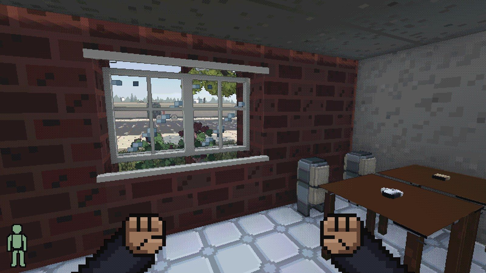 |  |
| kitchen | 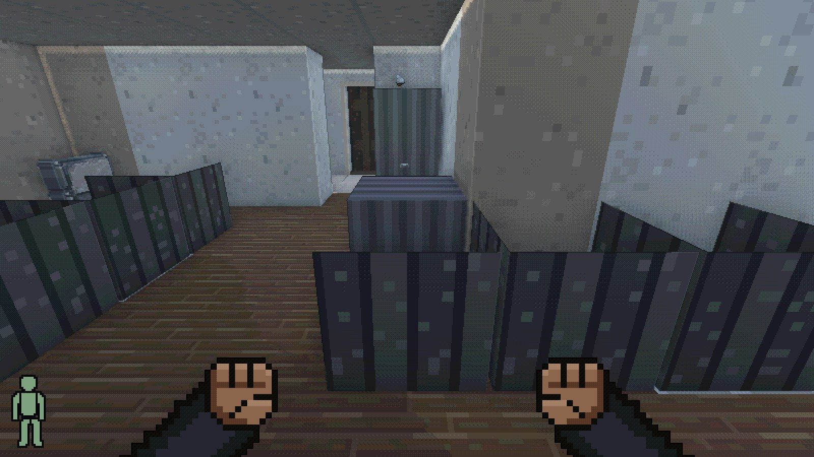 | 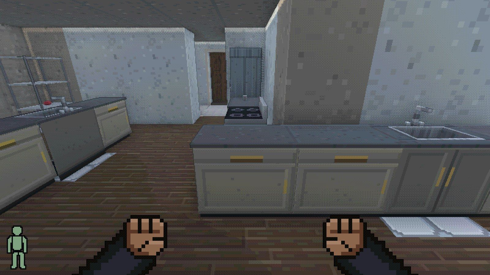 |
| bedroom | 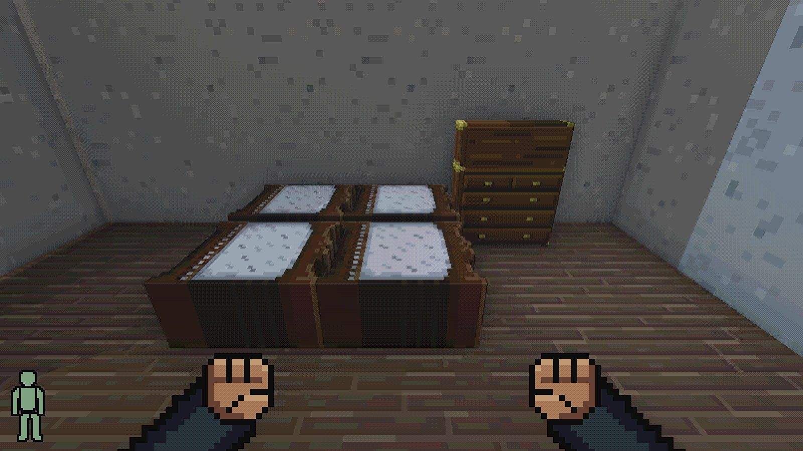 | 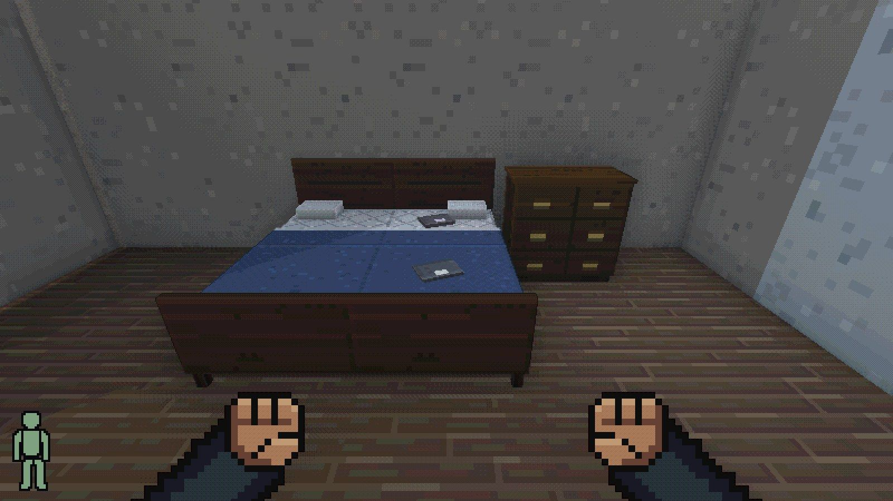 |
| bathroom | 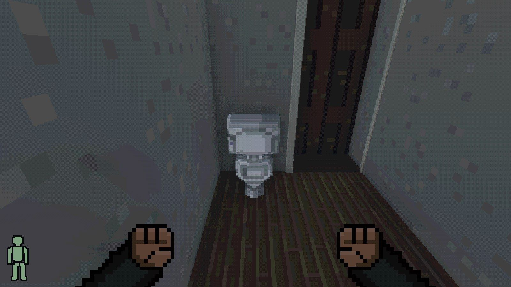 | 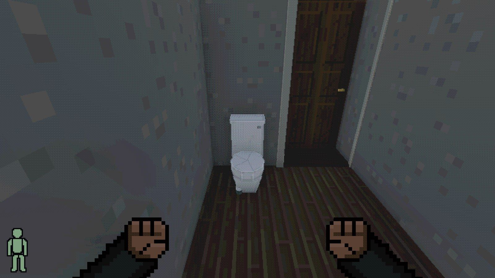 |
| broken window | 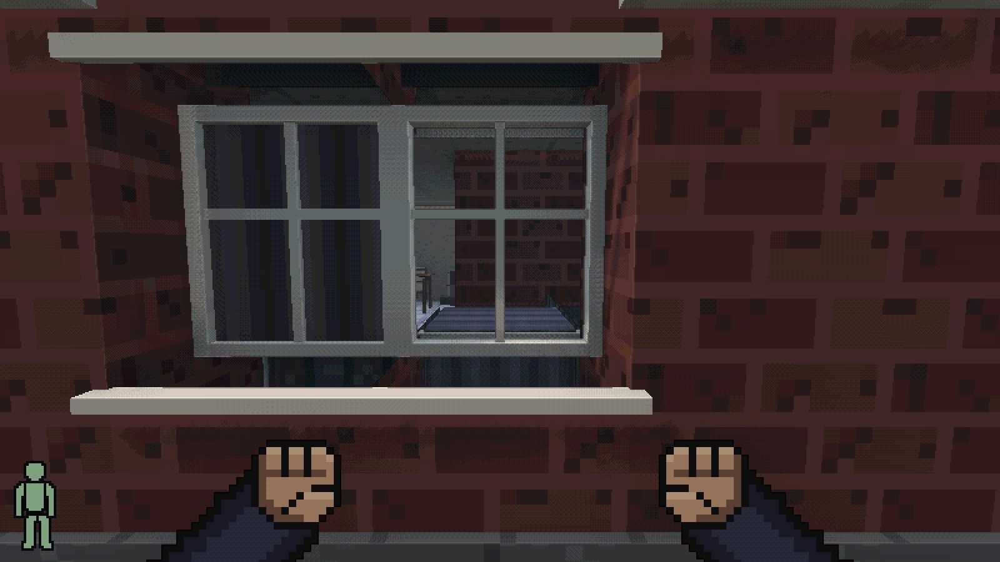 | 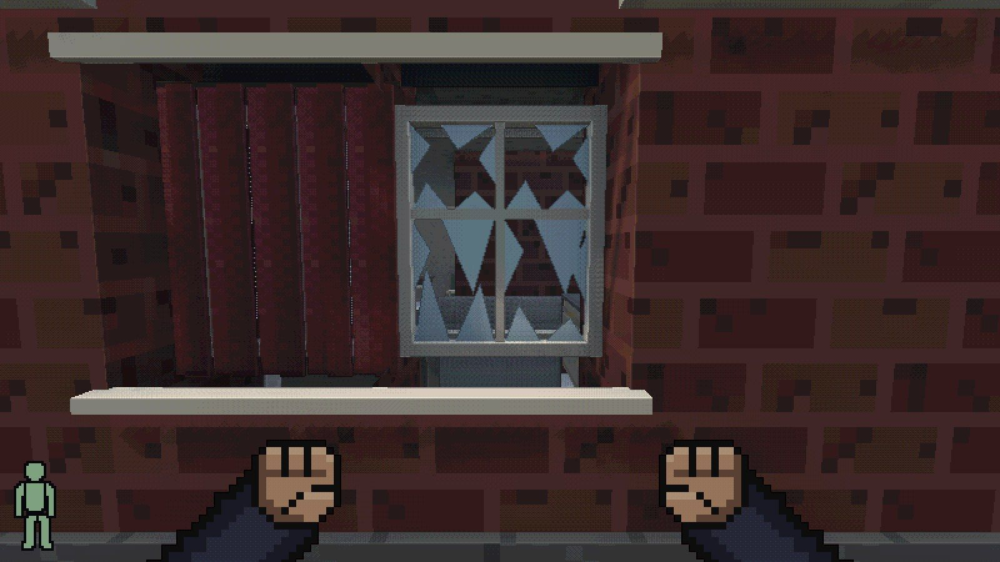 |
| starting shelter | 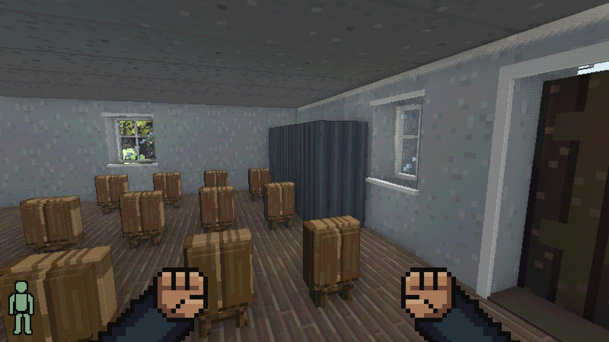 | 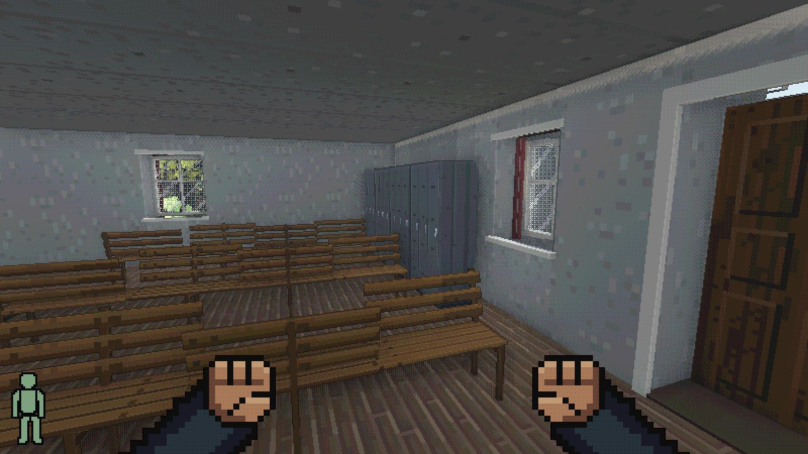 |
| street (mailbox, windows) | 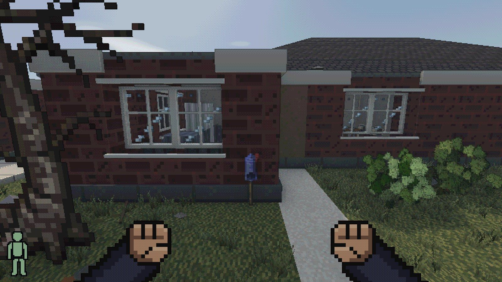 | 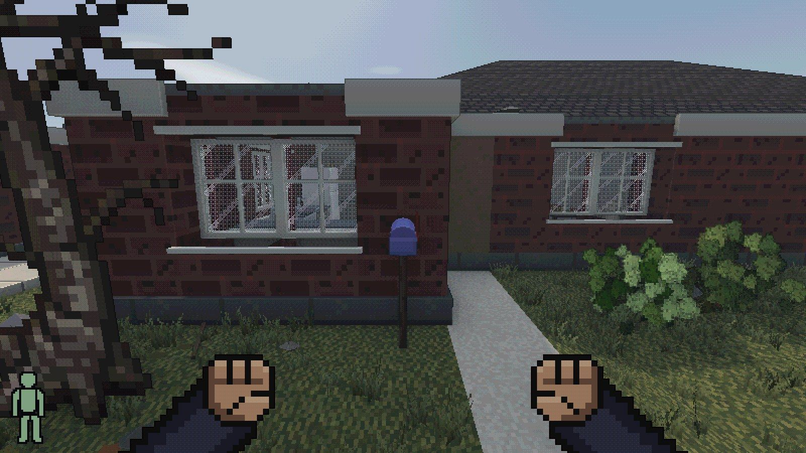 |

Showroom shots (`gallery` views): 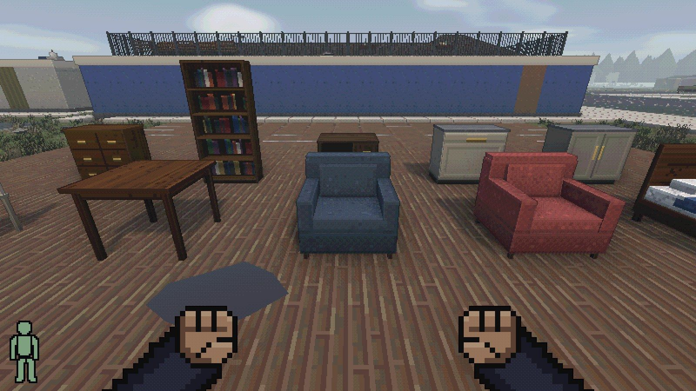
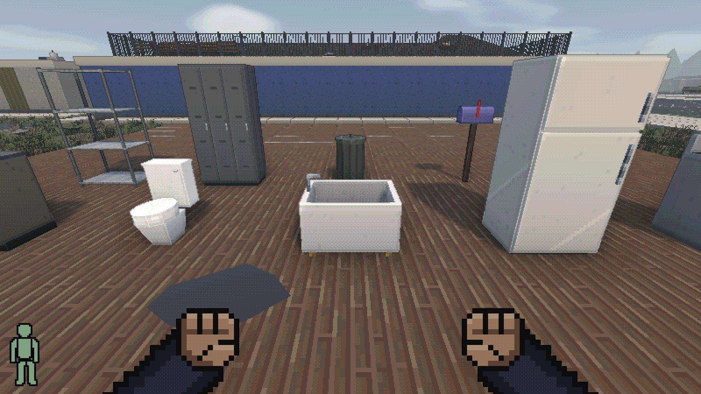
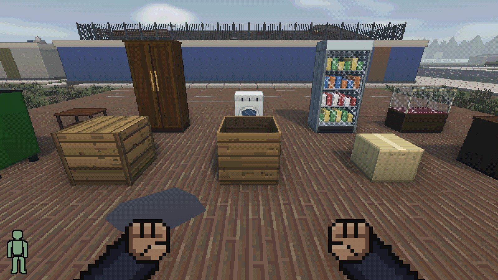
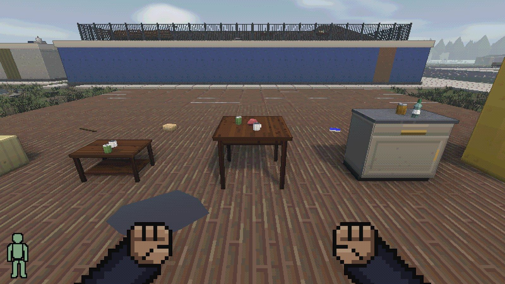

Regenerate: `tools/look-views.js` has close-up views —
`furn:<id regex>[:<nth>[:<dist>[:<pitch>[:<hour>[:<replace id>]]]]]`, `ter:...` (same; the
replace field turns e.g. a window into `t_window_frame` first) and
`gallery:<ids joined by +>` (a showroom on open ground; `i:<item>` places items, `&`
stacks several on one tile) — e.g.

    ~/claude-stuff/bin/heavy --mem 2 --kind gpu -- nix-shell --run \
      "npx tsx tools/look-shots.ts --gpu --size 1600x900 --params furniture=model \
       --views 'furn:f_oven:0:3:-20,gallery:f_sofa+f_table&i:can_drink' full"

## Performance

- Render (look-shots `--bench`, 1080p, `renderMs` = renderer-only GPU-synchronised):
  street 2.4 → 2.5 ms, house 2.1 → 2.2 ms, shelter 1.7 → 1.8 ms. Triangles +16-28 %
  (far furniture and items are geometry now), sprites −75 % (5705 → 1438 on the street),
  draw calls +0-30 per view (the furniture atlas page and glass meshes per chunk).
- Streaming (`tools/bench-stream.ts`, sprint 7 t/s, 1080p): work p99 13.8 → 11.3 ms,
  loop p99 9.6 → 9.6 ms, longest meshing step 3.2 → 2.2 ms, total meshing 679 → 681 ms.
  ~740 models built over the run (0.12 ms each incl. painting), ~9300 placements (0.014 ms
  each). The mesher yields mid-row when first-time model building passes 1.5 ms
  (`ModelFactory.yieldHint`), so a store row full of never-seen items can't become one long
  step.
- Textures: 2 atlas pages (1024², height-class shelf packing, 2 px extruded gutters) after
  a town run; frames are memoised by material + size + decal so identical faces share.

## Code map

| file | what |
| --- | --- |
| `src/render/furniture/index.ts` | `ModelFactory` (furniture / terrain props / windows / doors / items; caching, facing, connections), style state |
| `catalog.ts` | id → archetype table, terrain fixtures |
| `interior.ts`, `fixtures.ts`, `outdoor.ts` | archetype builders |
| `items.ts` | item shapes and sizes |
| `openings.ts` | window states and infills, door kinds and leaves |
| `kit.ts` | build context, palette role pickers, geometry helpers |
| `mesh.ts` | `ModelBuilder` (boxes, prisms, frustums, tilted boxes, quads, glass), `placeModel` |
| `paint.ts` | per-face texture painter, materials, decals |
| `palette.ts` | sprite colour analysis |
| `atlas.ts` | texture pages |
| `glass.ts` | dithered glass material |
| `install.ts` | Options entry, `cdda.*` hooks |
| `tools/furniture-freq.ts` | which ids appear most around the start; `--unmapped` coverage |

Hooks in shared files (additive): `chunkMesh.ts` (furniture/terrain-prop/window/door/item
hooks, `glass` output, broken-opening render shapes, mid-row yield), `chunkManager.ts`
(glass mesh), `renderer.ts` (`models` factory into the mesher extras), `lookInstall.ts`
(install call), `geometry.ts` (`quadsRect`).

Also fixed on the way (playtest report): standing over a climbable counter / table /
cupboard (they're passable in CDDA) the look card and `e` skipped your own tile and picked
the piece next to it; looking down into it now targets it (`raycast.ts`, `targeting.ts`).

## Surfaces (round 2): walls, floors, ceilings, roofs, trim, fences

The architecture was the weakest thing in the frame next to the models: wall faces used a
16 texel/m procedural pattern tinted from the UltiCa sprite (bricks ~30 cm tall in blotchy
pixels), ceilings and plaster were noisy camo. `src/render/surfaces.ts` repaints them like
the furniture: procedural, **32 texels/m**, nearest filtered, real-world scale, colours
from each terrain id's UltiCa sprite.

- **Walls** (`wallMat`): brick (8 x 3 texel courses = 25 x 8 cm, half bond, mortar from
  the sprite's light colour), adobe blocks, stucco/render, lap siding (14 cm boards with a
  shadow line), concrete block (50 x 17 cm), logs, corrugated metal, stone, rock, concrete.
  Frames are one metre of wall and tile exactly (some are 35-36 texels tall so whole
  courses fit and the bond parity survives the wrap).
- **Interior finishes**: the room-facing side of brick, stucco, siding, block and concrete
  walls (and of window sills / lintels and door heads) gets an interior finish instead of
  the outside material — flat drywall paint, striped or damask wallpaper, or painted block
  in commercial buildings — chosen **per building** (one seed per OMT chunk). Coloured
  walls (`t_wall_r/_y/_b...`) keep their colour. Flat on purpose: the renderer's luminance
  bump turned even 1-2 % texel variation into blotches.
- **Trim**: a baseboard (10 cm) along every room-facing wall foot and a crown moulding
  under the ceiling. The corner shade comes from the existing SSAO.
- **Floors** (`floorMat`): 12.5 cm planks with staggered joints (3 variants), carpet,
  linoleum (25 cm), ceramic tile with grout, troweled concrete with metre joints, sidewalk
  slabs, asphalt, tar roofs, diamond plate. Natural ground and marked roads (`_y`, stripes)
  keep the tileset sprite.
- **Ceilings**: flat plaster in houses, 50 cm drop-ceiling tiles under commercial concrete
  slabs.
- **Roofs**: hipped roofs get 32 texel/m shingles (staggered tabs, shadow lines); flat
  roofs a tar/gravel surface.
- **Fences, railings and gates** (`furniture/fences.ts`): picket fences with pointed
  pickets, privacy board fences, split rail, chain-link and chicken wire as a see-through
  wire mesh texture on galvanised posts and rails, barbed wire, metal balusters, glass
  railings, concrete balustrades; gates as leaves of the same kind (swing open like doors),
  and no floating wall lintel over a gate in a fence line.
- **Openings**: locked doors (no DOOR flag in CDDA) were drawn as a plain wall, and stained
  glass (flagged WALL) too; both now render as the door / window they are.
- **L-shaped counters**: the corner piece of a counter run fills its tile to the front edge
  (plain panel) so the two runs' worktops meet.

Switch: Options > **Surfaces** (Painted / Tileset, persisted), `?surfaces=painted|sprite`,
`cdda.setSurfaceStyle('sprite')`. Active in the looks with architectural detail (full,
voxel), like the models. The tileset variant is the previous look unchanged.

| view | tileset (before) | painted (after) |
| --- | --- | --- |
| house | 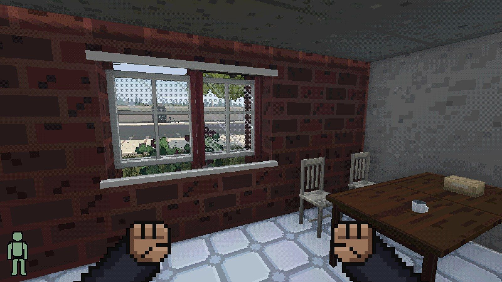 | 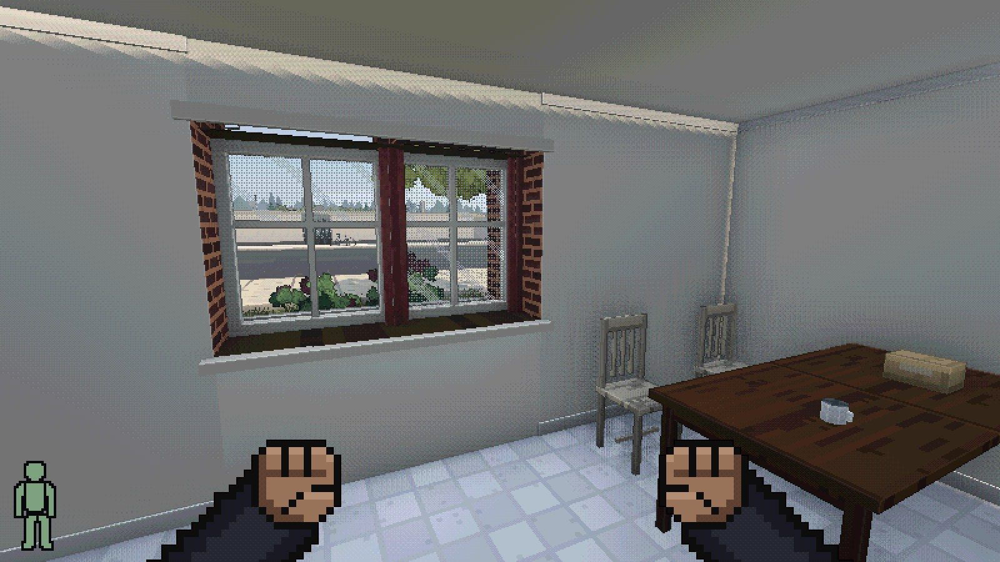 |
| kitchen | 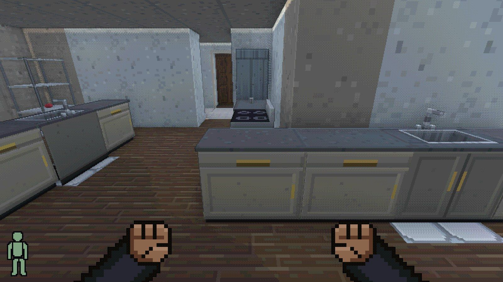 | 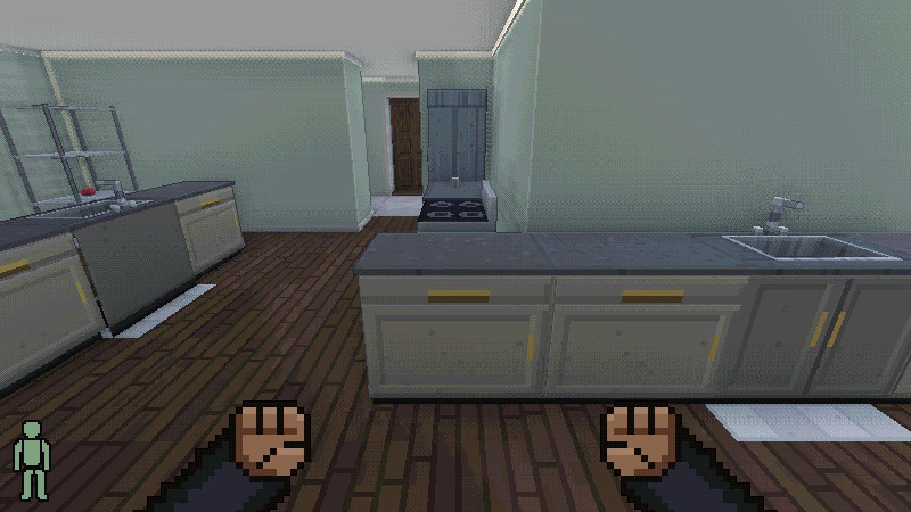 |
| bedroom | 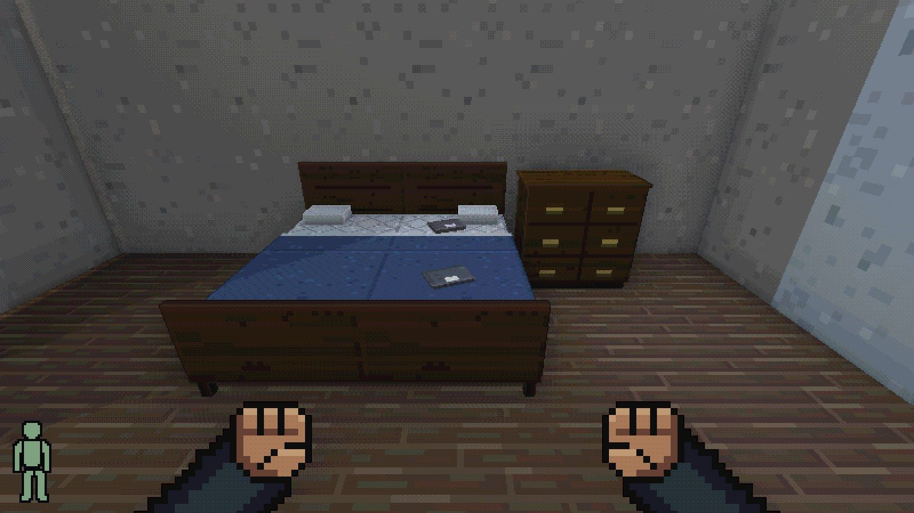 | 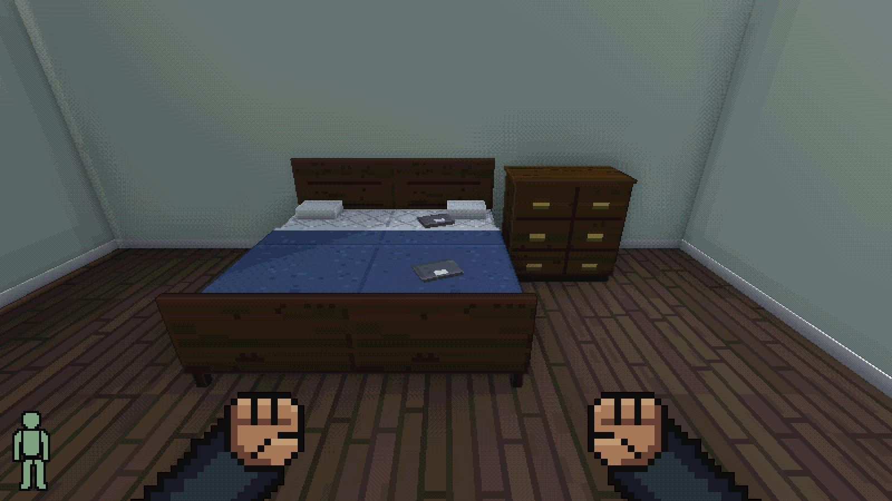 |
| bathroom | 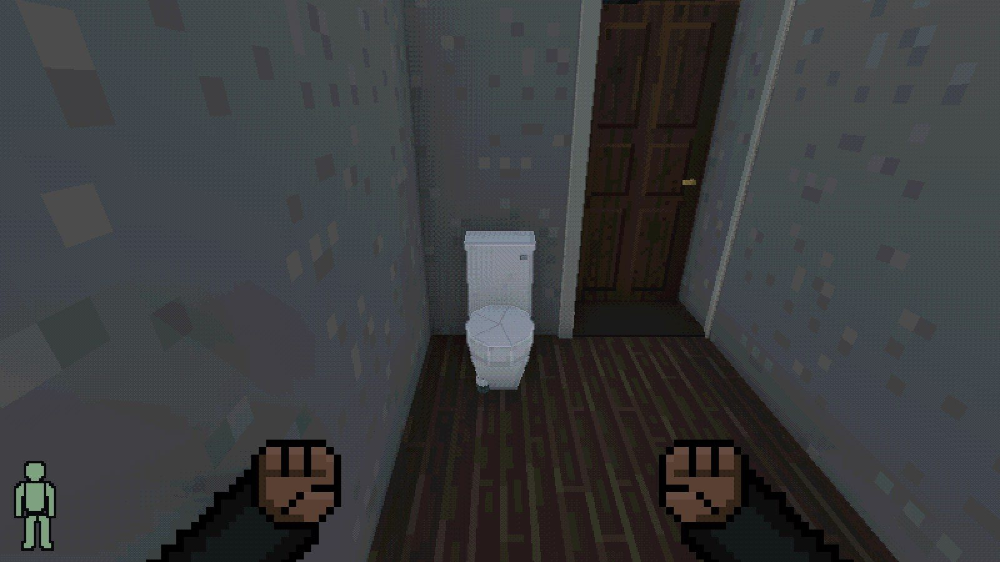 | 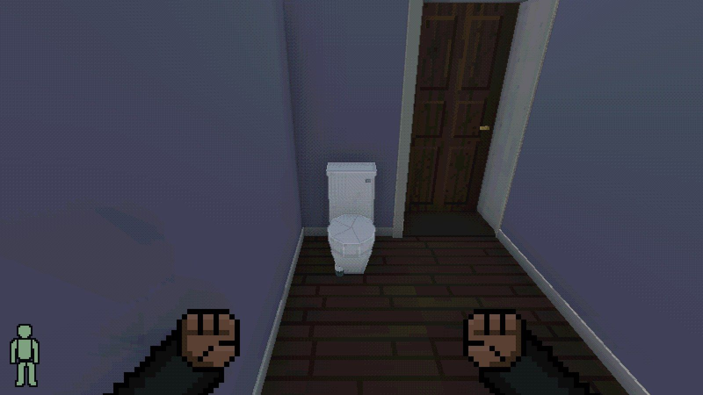 |
| counter run | 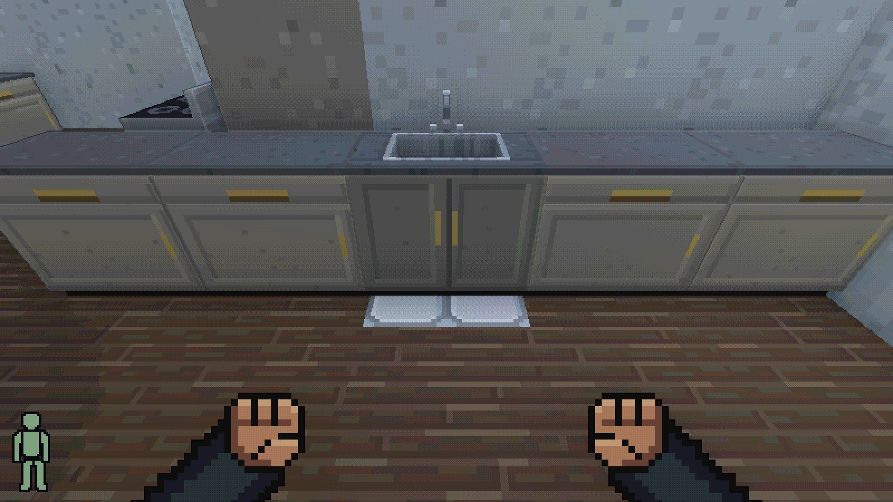 | 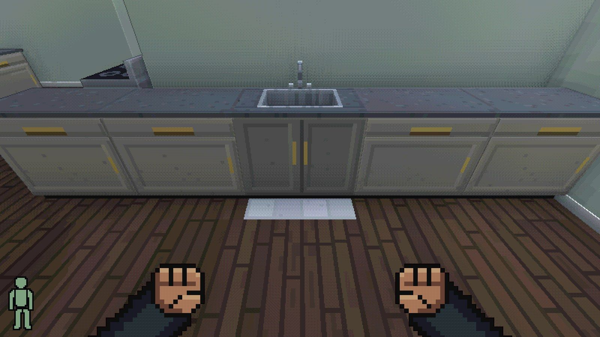 |
| storeroom | 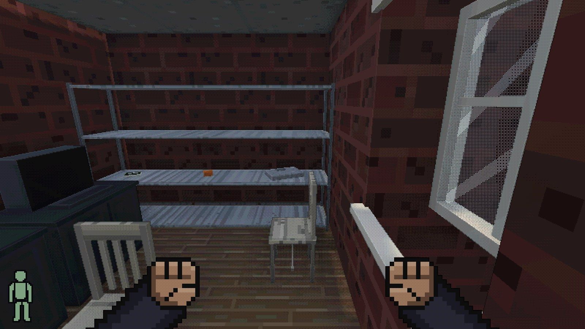 | 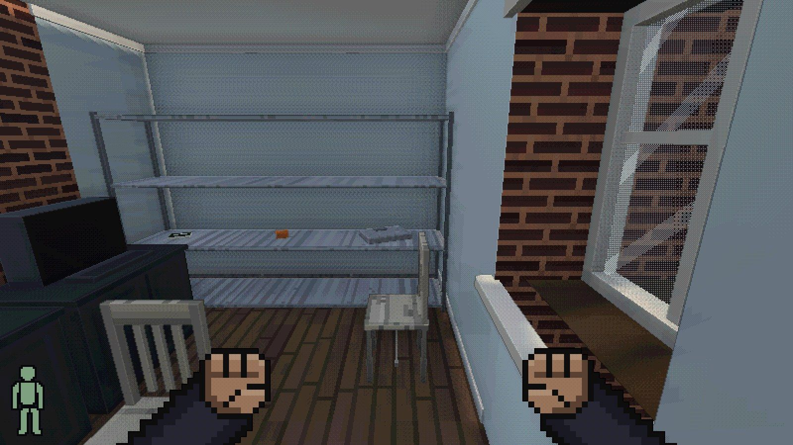 |
| shelter | 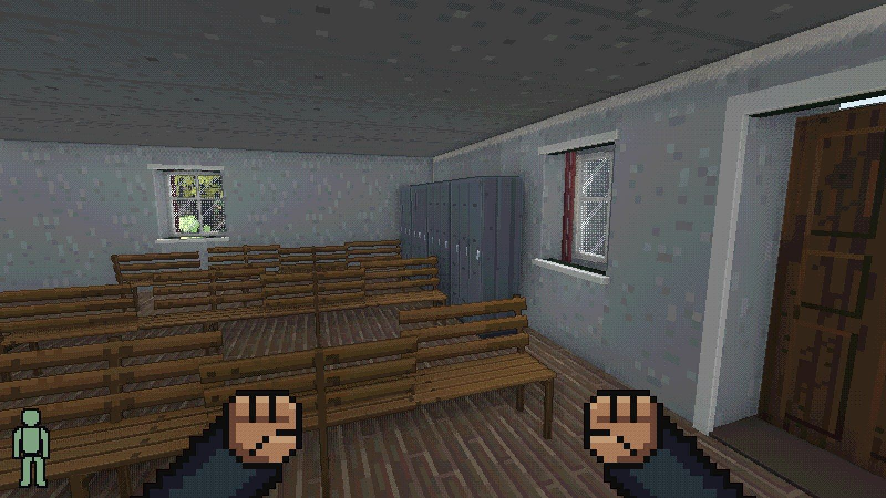 | 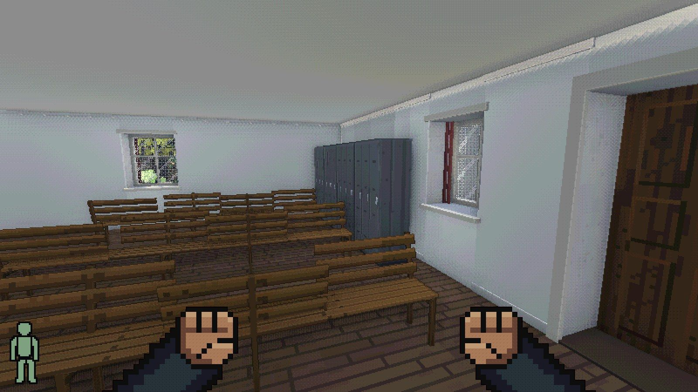 |
| street, roofs | 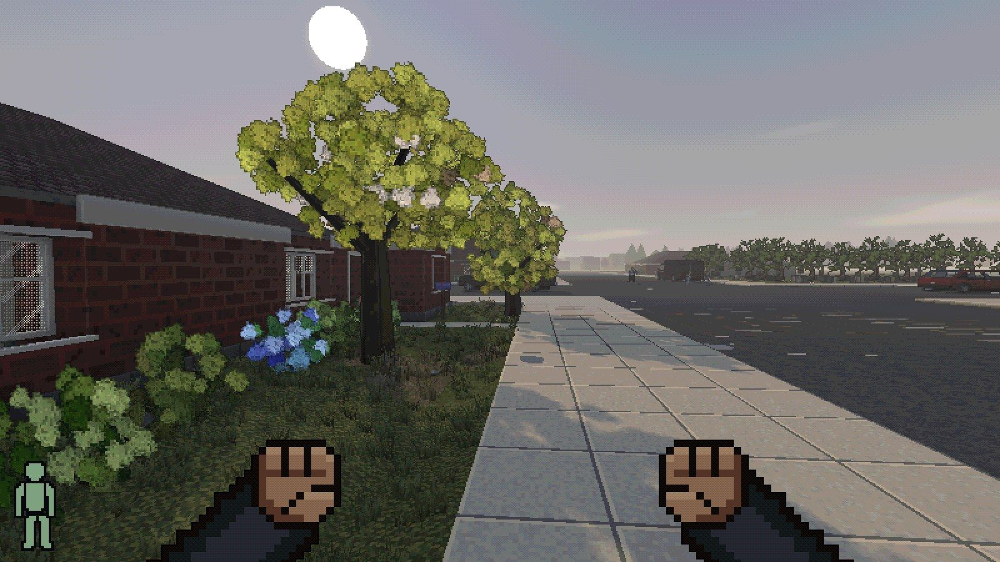 | 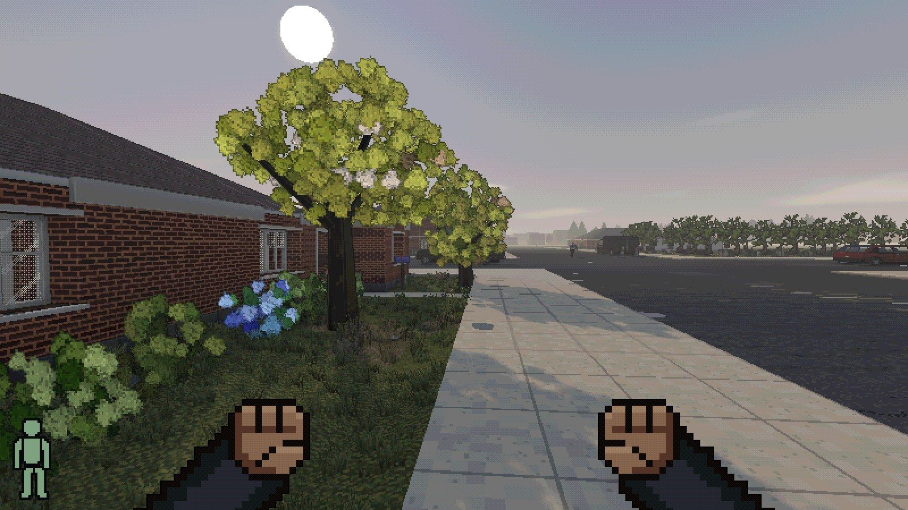 |
| chain-link | 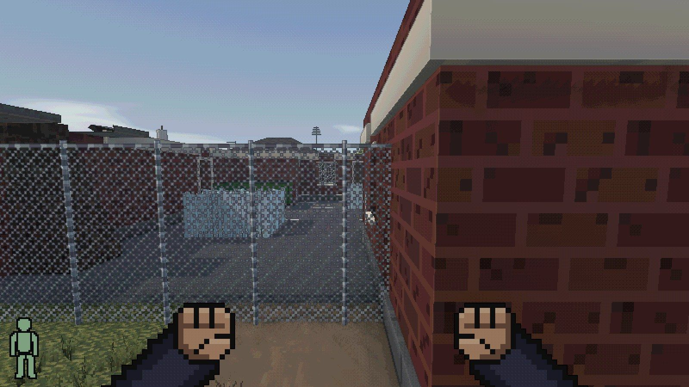 | 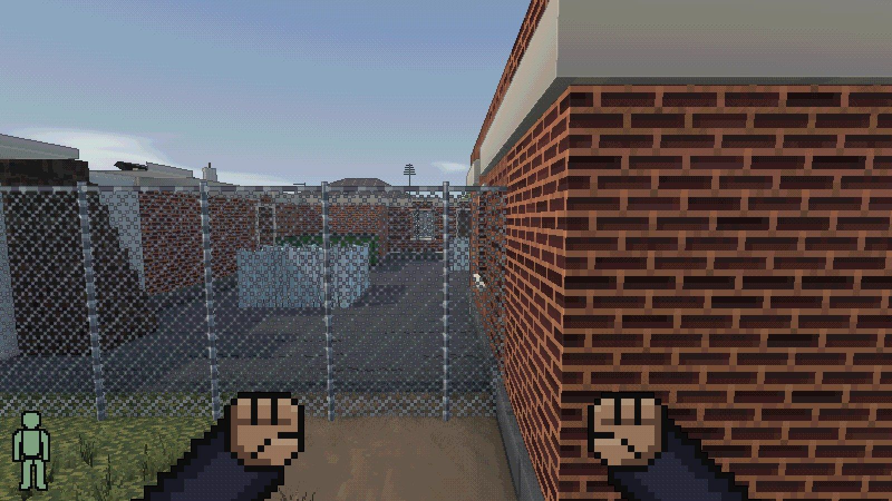 |
| picket fence | 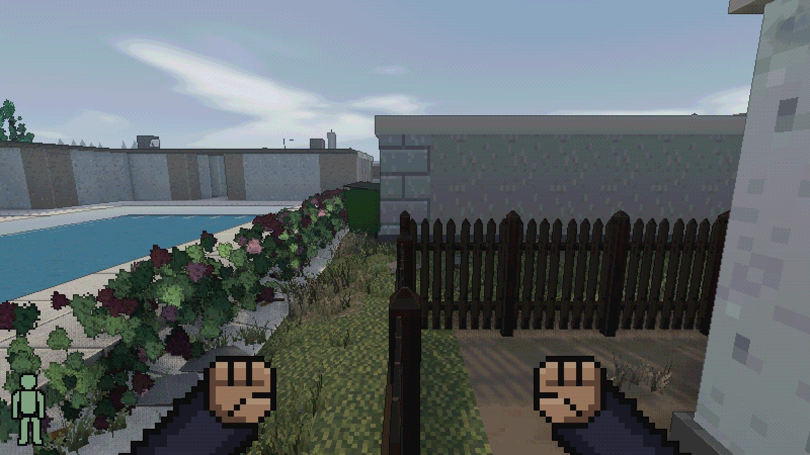 | 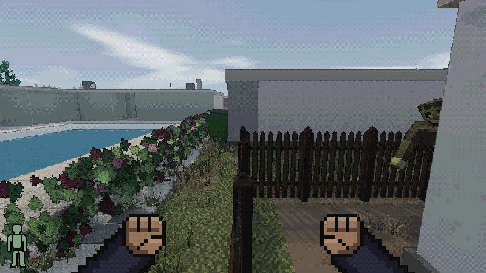 |

Fences and gates showroom: 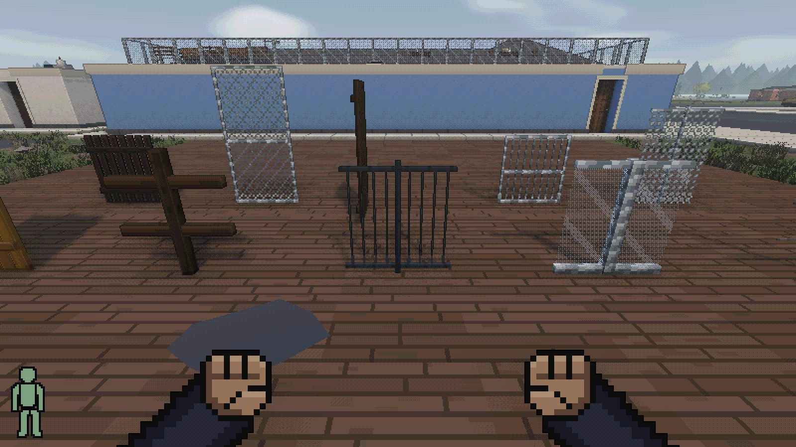

Code: `src/render/surfaces.ts` (materials, painters, `SurfacePainter`), consulted first by
`AtlasTextureSource.terrain` (`surfaces` field) for wall/side/ceiling/floor faces;
`furniture/install.ts` `installSurfaces` (Options, state, mesher extras, shingles);
`chunkMesh.ts` room-facing wall faces (`indoor` in `SurfaceQuery`), baseboards/crown,
sills/lintels/door heads, fence and gate hooks. Painted frames share the furniture atlas
pages (no extra draw calls). `look-shots.ts --format jpg` for JPEG screenshots.

Known gaps (surfaces): window reveals (the neighbouring wall's face into the opening) still
show the outside material; porches count as indoors for interior finishes; wallpaper choice
is per chunk, not per room.

## Known gaps / next

- Wild flowers and a few rare pieces (statues, mannequins) still use the voxel path.
- Glass dither reads as glass but is a fixed 4x4 pattern; a softer look (blue-noise or a
  real blended pass) could come with the post-processing work.
- Items don't stack vertically (three per tile side by side); piles of many identical
  items (warehouses) could use a crate/pallet stand-in.
- Model LOD: every chunk gets full models; if far chunks become a cost, a box-only LOD is
  the obvious next step.
