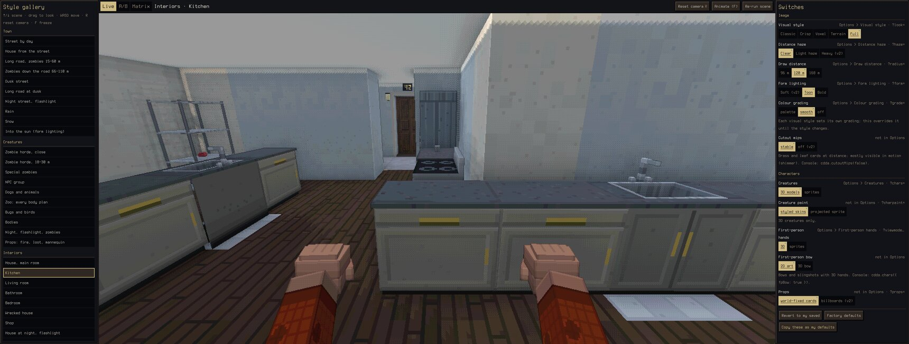
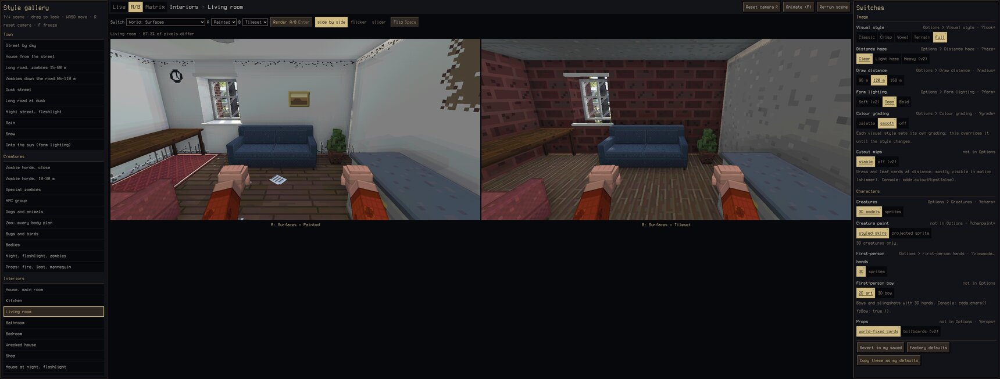
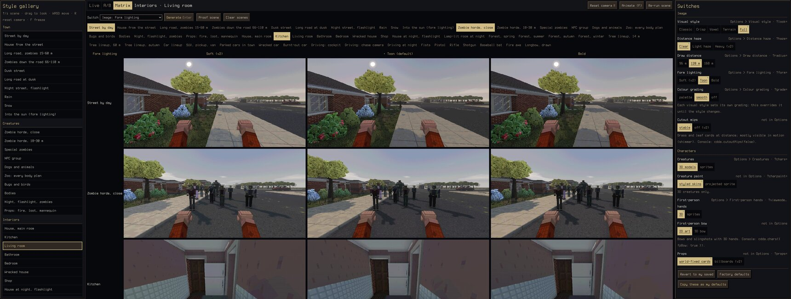

# Style gallery (`/?gallery`)

A debug page for choosing the defaults after wave 3. It runs the real game renderer on world
seed 1 with the simulation paused, puts a list of fixed scenes on the left and every wave-3
variant as a switch on the right, and lets you compare three ways: flip and look (Live), one
switch at two values in the same frame (A/B), or one switch across several scenes (Matrix).

- **Open it:** `http://localhost:5173/?gallery` with `npm run dev` running, or in a dev build
  **Esc → Style gallery (debug)** (opens a new tab; the game you're playing is untouched).
  `?gallery&scene=kitchen` starts on another scene; `&seed=N` uses another world (the scene
  scripts look for a town, a forest and a field near the start, so most seeds work).
- **It changes nothing by itself.** Switches are live-only (the gallery puts back any
  `localStorage` key an owning module writes), it never saves or loads a game (not even the
  dev hot-reload snapshot), and it doesn't answer `tools/live.ts`. Only **Copy these as my
  defaults** writes anything.
- Code: `src/gallery/` (`index.ts` page, `scenes.ts`, `switches.ts`, `capture.ts`, `gallery.css`),
  loaded only for `?gallery` (dynamic import in `src/main.ts`), so normal play never runs it.

## Using it

| | |
|---|---|
| Click a scene / **↑ ↓** (also `[ ]`, PgUp/PgDn) | set the scene up: clock, weather, spawns, camera. The simulation runs while it's set up, then stops; the picture is frozen (animation clock 0) so every comparison sees the same frame. **Re-run scene** does it again. |
| Click a switch value | applied live; the chunks it affects rebuild. The filled button is the current value, the green dot the value the game boots with (your Options), the underlined one the factory default. |
| Drag on the picture | look around (Live). **WASD** walks the camera (Shift: faster), **R** or *Reset camera* puts it back where the scene set it. |
| **F** / *Animate* | let render-time animation run (poses, wind, rain, the sway dot); **F** again freezes. |
| **1 2 3** | Live / A/B / Matrix. |
| A/B: pick switch, A, B; **Enter** or *Render A/B* | renders the current scene at A, then at B, same camera and frozen frame, then puts the switch back. Views: *side by side*, *flicker* (**Space** or **x** flips), *slider* (drag to wipe). The line above says how many pixels differ. |
| Matrix: pick switch, click scene chips; **Enter** or *Generate* | rows = scenes, columns = every value of the switch, thumbnails up to 1400 px wide. *Proof scene* picks the scene where that switch matters most. Click a thumbnail to enlarge; **← →** other values, **↑ ↓** other scenes, **Esc** closes. |
| *Revert to my saved* / *Factory defaults* | every switch back to what the game boots with / what it ships with. |
| *Copy these as my defaults* | persists the current values **through the Options entries themselves** (steps each one round to the value), so storage is exactly what the Options screen would write. Switches that aren't Options settings are listed in the status line with their URL form. |

Captures come from the WebGL canvas (render, then copy in the same task: no
`preserveDrawingBuffer` cost in normal play), so they include the first-person layer and
post-processing, not the HUD (which is hidden anyway). In the gun scenes the aim model's
crosshair path over the next two seconds is drawn over the picture (and into captures), so the
Aim model switch shows its sway; the dice model draws none.

## Scenes

Most reuse the screenshot views the area agents wrote (`tools/look-views.js`,
`char-views.js`, `vehicle-views.js`), so a gallery scene and a doc screenshot of the same name
are the same shot. Every scene starts from one reset (clock back to the boot day, empty hands,
no spawned creatures, NPCs or lamps, weather clear, first-person camera) and the map edits the
previous scene made (planted trees, fires, loot, bodies) are rolled back
(`src/world/mapJournal.ts`), so any order gives the same picture.

| Group | Scenes |
|---|---|
| Town | Street by day · House from the street · Long road, zombies 15–60 m · Zombies down the road 66–110 m · Dusk street · Long road at dusk · Night street, flashlight · Rain · Snow · Into the sun (form lighting) |
| Creatures | Zombie horde, close · Zombie horde, 18–30 m · Special zombies · NPC group · Dogs and animals · Zoo: every body plan · Bugs and birds · Bodies · Night, flashlight, zombies · Props: fire, loot, mannequin |
| Interiors | House, main room · Kitchen · Living room · Bathroom · Bedroom · Wrecked house · Shop · House at night, flashlight · Lamp-lit room at night |
| Nature | Forest in spring / summer / autumn / winter · Tree lineup 14 m · Tree lineup 60 m · Tree lineup, autumn |
| Vehicles | Car lineup · SUV, pickup, van · Parked cars in town · Wrecked car · Burnt-out car · Driving: cockpit · Driving: chase camera · Driving at night |
| First person | Fists · Pistol · Rifle · Shotgun · Baseball bat · Fire axe · Longbow, drawn |

New scene code (not in the tools views): *House from the street* (walks out from a house to the
road and turns back), *Shop* (nearest store, facing the densest shelving), *Lamp-lit room*
(the main room at night with a warm lamp beside you).

## Switches

All are live (no reload needed). "Proof" is the scene the automated pixel-diff check uses.

| Switch | Values (default first where it's the default) | Persisted by | URL | Proof scene | Changed pixels* |
|---|---|---|---|---|---|
| Visual style | Full · Classic · Crisp · Voxel · Terrain | Options > Visual style | `?look=` | street | 35–53 % |
| Distance haze | Clear · Light haze · Heavy (v2) | Options > Distance haze | `?haze=` | far | 5–11 % |
| Draw distance | 120 m · 96 m · 168 m | Options > Draw distance | `?radius=` | far | 0.4–0.7 % (only the horizon changes) |
| Form lighting | Toon · Soft (v2) · Bold | Options > Form lighting | `?form=` | street | 2–24 % |
| Colour grading | per style (Full: smooth) · palette · off | Options > Colour grading | `?grade=` | street | 3–29 % |
| Cutout mips | stable · off (v2) | console only (`cdda.cutoutMips`) | — | forest | 1.7 % (mostly a motion effect) |
| Creatures | 3D models · sprites | Options > Creatures | `?chars=` | horde | 7 % |
| Creature paint | styled skins · projected sprite | URL only | `?charpaint=` | npcs | 11 % |
| First-person hands | 3D · sprites | Options > First-person hands | `?viewmodel=` | fp_pistol | 11 % |
| First-person bow | 2D art · 3D bow | console only (`cdda.chars({fpBow})`) | — | fp_bow | 10 % |
| Props | world-fixed cards · billboards (v2) | URL only | `?props=` | props | 1.8 % |
| Furniture | Modelled · Voxel | Options > Furniture | `?furniture=` | kitchen | 37 % |
| Surfaces | Painted · Tileset | Options > Surfaces | `?surfaces=` | living | 65 % |
| Set dressing | on · bare rooms | URL only | `?dressing=` | living | 6 % |
| Trees | models · clumps | Options > Trees | `?flora=` | lineup | 12 % |
| Vehicle look | modelled bodies · part blocks | Options > Vehicle look | `?vehicles=` | cars | 7.5 % |
| Vehicle width | true to life · fill the tiles | Options > Vehicle width | `?vehiclewidth=` | cars | 3.9 % |
| Aim model | sway · sway + timing · dice (BN) | Options > Aim model | `?aim=` | fp_pistol | see below |

\* Share of pixels that change from the default to each other value in the proof scene
(`cdda.gallery.proof()`, 640 px captures, summed RGB difference > 24). Every switch changes the
picture. Two caveats:

- **Aim model**: `sway` and `sway + timing` have the same weave, so their pictures are the same
  apart from nothing; the timing model's differences (breath, bow ring, active reload, melee
  beat) only exist while you play. `dice` has no weave: the path collapses to a dot.
- **Props**: projectile effects (arrow meshes vs dots, monster globs) keep the mode they were
  created with until a reload; fires, far furniture, loot and figures switch live.

Made live-switchable for the gallery: nothing needed a reload. Small additive hooks were added
instead — `renderer.timeScale` (freeze render-time animation) and `renderer.sizeOverride` (the
canvas sits between the panels), `cdda.dressing()` (read the set-dressing state back),
`registeredOptions()` in `src/ui/options.ts` (so "copy as defaults" steps the real Options
entries).

## Automation

`cdda.gallery` (only on the gallery page): `scenes`, `switches`, `state()`,
`showScene(id)`, `setSwitch(id, value)`, `setMode('live'|'ab'|'matrix')`,
`runAb(switch?, a?, b?)`, `runMatrix(switch?, scenes?)`, `copyDefaults()`,
`revert('saved'|'factory')`, `proof(ids?)` (the per-switch pixel diff), `capture(maxW?)`
(PNG data URL of the stage), `idle()`.

Real input: `tools/realinput.ts --only gallery,galleryproof --gpu` (Chromium) and
`--browser firefox`. `gallery` opens the Esc-menu entry, then clicks every scene and every value
of every switch, drags to look, walks with W, resets with R, runs A/B on five switches (Enter,
Space flip, the three views), one Matrix (chips, Generate, enlarge, arrows, Esc), copies
defaults and checks the stored value, then factory defaults. `galleryproof` runs the pixel diff
per switch.

## Known gaps

- The A/B side-by-side halves are letterboxed on a 16:9-ish stage; flicker and slider use the
  full stage.
- Scenes are deterministic per seed, but a few spawns pick random zombie variants/NPC outfits
  when a scene is set up; the frozen frame then stays identical for every capture of it.
- Switches without an Options row (creature paint, props, dressing, first-person bow, cutout
  mips) can't be made "my defaults"; the copy reports the URL form to use instead.
