# Performance: telemetry, streaming, benchmarks (wave 3)

User report: *"when I am driving through town it is struggling to load things fast enough."*
(Firefox, 3440x1304, voxel look, 168 m draw distance.) This doc covers the tools built to see
that live, what they found, what was fixed, and the checks that keep it fixed.

## For the player: F3

| key | what |
| --- | --- |
| **F3** | performance overlay on/off (also **Options > Performance overlay**, `?perf=1`; remembered) |
| **Shift+F3** | save the last 60 s as `cdda3d-perf-<time>.json` (downloads; send it with a bug report) |

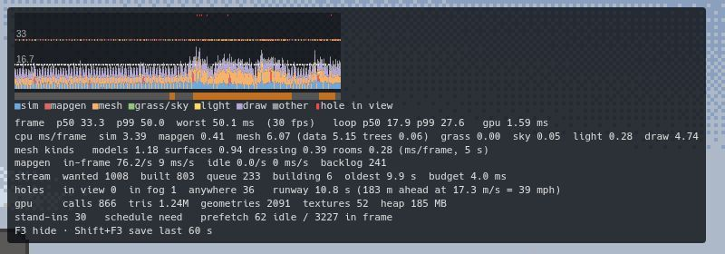

The overlay (top left, never takes the mouse):

* **Graph**: one column per frame, 50 ms full scale, guides at 16.7 and 33 ms. The stacked
  bar is where our main loop spent the frame (blue sim, red mapgen, orange meshing, green
  grass/skyline, yellow light map, violet draw, grey other); the dot above it is the frame
  interval you actually felt (white, orange over 20 ms, red over 33 ms). The strip underneath
  is streaming: **red = an unbuilt chunk in clear view**, orange = one in the fog, grey =
  building, dark green = all built.
* **frame**: interval p50 / p99 / worst over the last 5 s and fps; our loop's p50 / p99; GPU
  ms per frame where the browser allows timer queries (Chromium; Firefox hides them).
* **cpu ms/frame**: sim, mapgen (chunk entries), meshing (and of it: mesh data, 3D trees),
  grass, skyline, light map, draw.
* **mesh kinds** (while the overlay is up): the mesher's time split into furniture models,
  painted surfaces, set dressing, rooms (the rest of "mesh data" is terrain and architecture).
* **mapgen**: chunks generated inside frames vs in idle time (per second, ms per second), the
  prefetch backlog.
* **stream**: chunks wanted / built / queued / building, the oldest wait, the meshing budget
  in force (adaptive: 4 ms floor, 8 when catching up, more when the frame has slack).
* **holes / runway**: unbuilt chunks in view (clear / fog / anywhere) and **runway** = how far
  along your direction of travel the world is built, in metres and in seconds at your speed.
  Under ~2 s at speed you are about to see pop-in.
* **gpu**: draw calls, triangles, geometries, textures, JS heap (Chromium only).
* **stand-ins / schedule / prefetch**: see "What was fixed".

Cost: the rolling recording is always on (~7 µs a frame amortised, measured in Node with radius 8's 1156 entries: ~50 floats into
preallocated columns, a 10 Hz scan of the chunk entries); `?perf=off` disables it. The overlay
itself adds ~0.1 ms/frame; its per-kind mesher timing patches four prototypes (two
`performance.now()` per call) and is only active while the overlay shows.

## For us

* `cdda.perf.dump(seconds = 60)` → the same JSON as Shift+F3; `cdda.perf.summary()` → the
  analysis below; `cdda.perf.show()`, `.detail()`, `.gpu()`, `.reset()`, `.download()`.
* `tsx tools/live.ts perf [out.json]` → dump from the player's live tab (dev server) to a file
  and print the report. (Lead only: agents never touch the live tab.)
* `npx tsx tools/perf-report.ts <dump.json>...` → where the time went (mean ms/frame per
  section), streaming health (hole seconds, runway, wanted→shown latency, rebuilds, dropped),
  mapgen by overmap type, the 8 worst frames with what happened in them, and plain-language
  findings. `--compare` puts several dumps side by side, `--last N`, `--json`.
* Dump format (`src/perf/analyze.ts PerfDump`): `meta` (browser, GPU, window/canvas/low-res
  size, look, radius, budgets, prefetch settings, **every Options value**), `frames` (columns,
  oldest first: interval, work, loop, per-section ms, GPU ms, mesh/trees ms, mapgen ms and
  counts, mesher kinds, player x/y/z/speed, runway, holes, wanted/built/building/oldest,
  budget, draw calls, triangles, geometries, textures, heap), `events` (chunk wanted, map chunk
  generated (ms, prefetch or in-frame, overmap id), first build (work ms, wanted→shown ms),
  rebuild, tree swap, empty, dropped (shown or not), evicted).

Code: `src/perf/telemetry.ts` (recording, stream-health scan), `overlay.ts`, `install.ts`
(keys, Options, mapgen/GPU/mesher hooks, `cdda.perf`), `analyze.ts` (pure, Node-safe). Hooks
in the game are observers: `ChunkManager.probe`, `FrameStats.sink`, a wrapper on the world
generator's `generate`, `onChunkGenerated`/`onChunkEvicted` listeners.

## What was found

Measured with the new telemetry on the user's settings (voxel, radius 8, 3440x1304, RTX 5080),
ghost car through the densest straight roads of Holden (the town by the start, size 6) and
Columbia Falls (size 18), headless Chromium and headless Firefox, both on the GPU:

1. **The road ahead was simply not built.** Driving into a city at 40 mph an unbuilt chunk was
   in clear view for the **whole 30 s run** (Chromium 22-23 s, Firefox 22 s; Holden 10-11 s);
   a chunk waited 5-7.5 s (p50) from wanted to shown, up to 20 s. The runway fell to 1.7-3.4 s.
   It is not a frame-rate problem: frames stayed at ~60 Hz in town, the meshing just built the
   wrong things.
2. **Two thirds of the meshing went to LOD flips next to the car.** The near ring (1.8 chunks:
   3D trees and voxel props at full detail) moves with you, so every chunk you pass is rebuilt
   when it enters the ring and again when it leaves it. City at 40 mph: 606 rebuilds vs 503 first
   builds; the rebuilds cost **2.9 s of meshing vs 1.5 s** for the first builds (event log,
   rebuilds at 1-2 chunks from the player). Those rebuilds are *near* the player, so the old
   distance-squared order ranked them before every unbuilt chunk ahead.
3. **Chunks were built that were never needed**: 261 wanted chunks were dropped before they were
   ever shown (behind or beside the car), and the order paid no attention to where the car was
   going (only to where the camera looked).
4. **Mapgen is not the bottleneck** (so no Web Worker for it): 5-12 ms per second of driving
   inside frames, the slowest chunk 1-6 ms (a town house, a lab). But the idle-time prefetcher
   **never ran**: it needed 8 ms of idle time, and at 3440x1304 a 60 Hz frame leaves ~5-7 ms, so
   all 2000-3000 chunk generations per run happened inside frames.
5. **Where the mesh time goes** (city, `--detail`): of 2.9 ms/frame of mesh data, painted surfaces
   0.68, furniture models 0.56, set dressing 0.17, rooms 0.14; the rest is terrain and
   architecture. 3D trees 0.25 ms/frame.
6. **Firefox** behaves like Chromium on the same machine (same holes before, same fix after), with
   longer single steps (tree 28-31 ms, geometry 17-21 ms once each: GC or first-JIT, not a
   pattern) and a more expensive draw: 5.3-7.6 ms CPU per frame for ~600-980 draw calls in the
   city vs 3.1-3.6 in Chromium.
7. In the city the frame budget is tight regardless of streaming: sim 3.5-3.9 ms (monsters,
   NPCs, vehicles: `beforeRender` 1.7-2.2), draw 3-7.6 ms, and headless Chromium adds ~9 ms of
   presentation before our callback at this size, so the city runs at 30-45 fps in the
   benchmark with or without the fixes.

## What was fixed

* **Build order by need** (`chunkManager.ts`, `schedule = 'need'`, default; `?stream=distance`
  or `cdda.streamSchedule('distance')` gives back the old order). Every entry that needs work is
  classified: *hole* (never shown), *edit* (its chunk or a neighbour changed), or cosmetic LOD
  flips (*up* into the near ring, *down* out of it, *trees* across the flora middle ring).
  Holes and edits are ranked by **seconds until needed**: 0 inside the fog range and in view;
  beyond it the distance left to cover at the speed the player closes on it (velocity tracked
  from positions; 1 m/s floor so standing still fills in nearest first); out of view +0.75 s
  (+3 s when driving: the camera follows the road); basements +1.5 s; the player's own 3x3
  always first (the load curtain). Cosmetic work comes after all of it, and is **deferred**:
  up/tree swaps only when no hole is needed within 3 s, downgrades only when standing still
  with nothing unbuilt (the detailed mesh is already up; the far version only saves a little
  render time).
* **Adaptive budget**: the meshing budget floor is 4 ms, 8 ms while an unbuilt chunk is in
  view or needed within 0.5 s (`boostBudgetMs`; 0-14 % of frames in the benchmark). On top of
  that it grows into the frame's **slack** (smoothed interval minus our loop and the delay
  before it, less a margin): half of it normally, 70 % when behind, capped at 12 / 20 ms.
  Streaming throughput is budget x frame rate, so at 12-30 fps a fixed 4 ms built the world
  several times slower than the time allowed: driving the real car at 60 mph in a windowed
  Chromium presented through Xvfb (12 fps) left the road unbuilt for 12.8 s. A first version
  took a share of the *interval* and fed back on itself (longer frames → bigger budget → longer
  frames: city p99 50 → 83 ms); the slack version is self-limiting.
* **Stand-ins** (`src/render/placeholders.ts`, default on; `?placeholders=0`,
  `cdda.placeholders(false)`): a wanted column whose ground-level chunk has no mesh yet shows the
  skyline's silhouette of what the overmap says is there (house box with a gable roof, town
  blocks, tree crowns), lit and fogged by the world material, removed when the real mesh
  lands. A late chunk now reads as "not detailed yet" instead of a missing street.
* **Prefetch in real idle gaps**: `minIdleMs` 8 → 3 (up to 8 chunks per idle period).
* Telemetry-driven fixes are covered by `tests/render/chunkSchedule.test.ts`.

Before/after (same machine, same load ~15, 3440x1304, voxel, radius 8; "before" =
`?stream=distance&placeholders=0`, which is the old code path):

| route | browser | unbuilt in view (s) | runway p10 (s) | wanted→shown p50 / p95 (ms) | rebuilds / first builds | loop p99 (ms) |
| --- | --- | --- | --- | --- | --- | --- |
| Holden 40 mph | Chromium | 11.2 → **0** | 4.4 → **10.3** | 3501 / 14114 → **318 / 1159** | 266 / 699 → 147 / 777 | 16.8 → 17.7 |
| city 40 mph | Chromium | 23.1 → **0** | 2.4 → **9.1** | 7491 / 10082 → **875 / 6173** | 405 / 360 → 358 / 849 | 20.8 → 29.7 |
| city 60 mph | Chromium | (not run before) → **0** | → 6.6 | → 446 / 2436 | → 180 / 1173 | → 19.8 |
| Holden 40 mph | Firefox | 10.3 → **0** | 4.5 → **9.9** | 2556 / 14087 → **298 / 820** | 278 / 716 → 157 / 781 | 19 → 20 |
| city 40 mph | Firefox | 22.0 → **0** | 4.3 → **9.3** | 5355 / 7870 → **797 / 5310** | 697 / 581 → 324 / 855 | 30 → 36 |

The cost: in the city the loop p99 rises (the boost budget, and ~60 % more of the city is
actually drawn: 600 → 980 draw calls, 1.1 → 1.65 M triangles, Firefox draw 5.3 → 7.6 ms/frame).
Frame-interval p99 is unchanged (33-50 ms in the city, 17-33 in town) because the city was
already below 60 Hz in the benchmark.

**Real input** (`realinput.ts --gpu --only perfdrive`, W to speed, C cruise, Shift+F3; windowed
Chromium on the GPU but presented through Xvfb, which holds it at ~12 fps at 3440x1304 — a
harsh stand-in for a slow machine), down the city's densest road:

| | 30 mph | 40 mph | 60 mph |
| --- | --- | --- | --- |
| need order, fixed 4/8 ms budget | 0 s unbuilt, runway p10 11.5 s | 0 s, 8.1 s | **12.8 s** unbuilt, runway 2.5 s |
| + adaptive (slack) budget | | | **0 s**, runway p10 6.3 s |

Firefox under Xvfb renders WebGL in software (1720x652 there): 40 mph left 6.2 s unbuilt
before the adaptive budget; headless Firefox on the GPU after it: Holden 0 s, city 1.8 s (a side
street entering the view, stand-ins up, runway p10 8.6 s). Chromium, all six benchmark routes
after it: 0 s except the city at 40 mph (0.85 s).

Driving into the city at 40 mph, 12 s in (3440x1304, half-size): the old order (the far
street simply isn't there), the old order with stand-ins, and the new order (default).

| old order, no stand-ins | old order + stand-ins | need order (default) |
| --- | --- | --- |
| 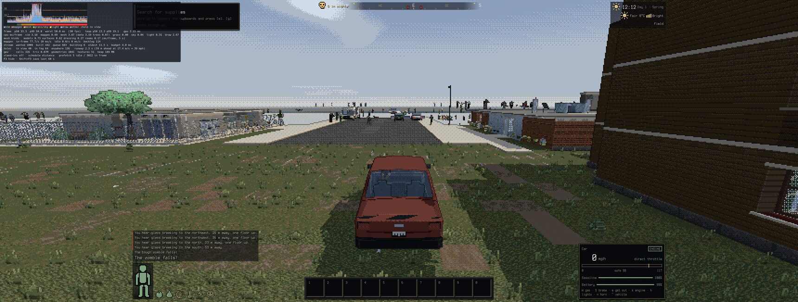 | 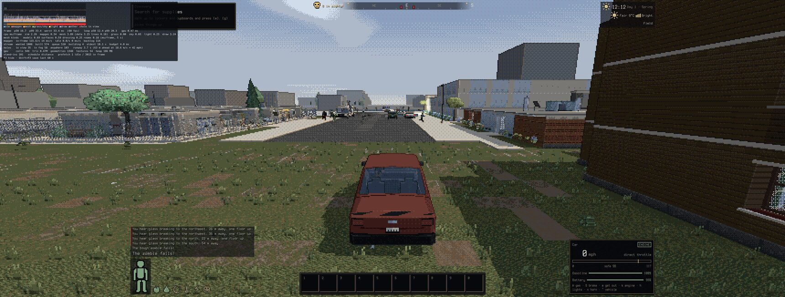 | 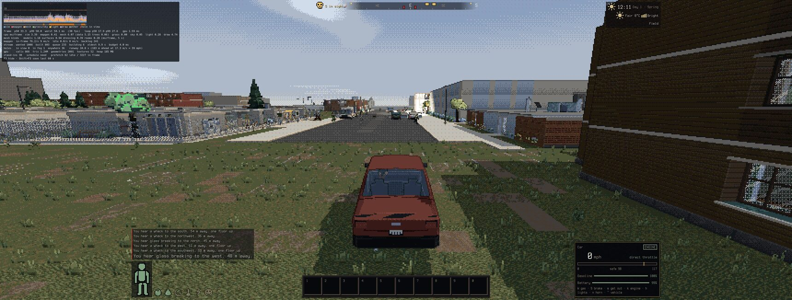 |

## Loads and teleports (round 2: the user's "HUGE performance blip")

The user's F3 dump (Firefox, seed 443226190, a dev hot reload in a city, then driving a pickup
off through a horde) showed an 800 ms first frame (sim 488 ms, draw 183 ms), the first chunk
shown 4.1 s after the page came up, wanted→shown p50 9.8 s, and 58-83 ms sim spikes for the
first 2.5 s. Reproduced (save in that spot, reload; `perf-bench` routes below) and CPU-profiled
in Chromium (`perf-bench --profile DIR`):

1. **Every wanted chunk was created before anything was built.** A load wants ~900 entries
   (225 columns x 4 levels); creating one generates its map chunk and 6 neighbours. Entry
   creation took the whole 8 ms budget for ~35 frames while the player's own 3x3 (behind the
   black load curtain) got the 1-2 ms left over.
2. **The near chunks cost 30-80 ms each** (full-detail ring) at 8 ms a frame, behind a curtain
   where frame rate doesn't matter.
3. **A stats check generated 8 overmap regions in the first frame**: progression's "which town
   am I in" called `closestCity(radius 1)`, 160 ms in Chromium (the user's 488 ms sim frame).
4. **Frames ran before the save was applied**: the page streamed and generated around the
   *new-game shelter* (a shelter search plus its chunks) until the save moved the player.
5. Monster visuals for a horde were all built in one frame (the 43 ms `beforeRender`).

Fixes: behind the curtain (the player's 3x3 unbuilt, `curtainBudgetMs` 40, 4 s cap) only the 3x3
entries are created and builds get 40 ms a frame; afterwards entry creation gets at most half the
budget while builds are waiting (`createShare`); standing still with unbuilt chunks in view the
budget is 16 ms (`settleBudgetMs`: the town assembles twice as fast, moving keeps the smooth
budget); the stats check only reads regions that exist (`closestCity(..., generate = false)`); a
pending load puts the player at the saved spot from the start and starts frames and prefetch once
it is applied (`main.ts`); monster visuals beyond 20 m are created at most 4 ms per frame.

`perf-bench` load routes (3440x1304, from ready or from the jump; before → after):

| | Chromium: 3x3 shown / all in view | Firefox: 3x3 shown / all in view |
| --- | --- | --- |
| `load` (save in the city, reload) | 1550 / 4650 → **700 / 3450 ms** | 1617 / 4317 → **566 / 2866 ms** |
| `teleport` (city → Holden) | 1727 / 3477 → **974 / 2341 ms** | 1256 / 2673 → **734 / 1834 ms** |
| `loaddrive`: unbuilt in view driving off at 40 mph | 5.6 → 5.0 s | 4.1 → 3.6 s |

Longest frame after the curtain lifts: 50 ms standing (both); driving off, 133 ms Chromium, and one
~280 ms gap between frames in Firefox about a second in, outside our code (both before and
after; most likely a major GC — Firefox has no headless profiler here to confirm). Driving off
the moment the curtain lifts still outruns streaming for a few seconds in a dense city
(stand-ins show there); the frames stay smooth, which was the ask.

## Benchmarks and budgets

### `npm run perf` (GPU, pass/fail)

    ~/claude-stuff/bin/heavy --kind gpu --mem 2 --name "cdda3d perf" -- nix-shell --run 'npm run perf'

`tools/perf-bench.ts` hosts its own Vite server and headless browser (never port 5173), loads
seed 1 with a fresh profile (so the defaults: voxel look, 168 m, modelled everything) at
3440x1304 and drives scripted routes in a real car with you at the wheel. The car is a *ghost*
(moved at a fixed speed along a straight line without collision) so every run crosses the same
chunks:

| route | what | baseline (2026-09-30): longest hole / runway p10 / frame p99 / loop p99 |
| --- | --- | --- |
| `town40` | into and through Holden (by the start) at 40 mph, on the straight road with the most buildings, starting 10 OMTs out so the town streams in while you drive | 0 s / 10.3 s / 33.4 / 18.8 ms |
| `town60` | the same at 60 mph | 0 / 6.8 / 33.4 / 17.4 |
| `city40` | into and through Columbia Falls (size 18, the biggest town within ~100 OMTs) at 40 mph | 0.65 / 8.9 / 66.6 / 37.4 |
| `city60` | the same at 60 mph | 0 / 6.4 / 50 / 26.4 |
| `forest` | straight through thick forest at 40 mph (3D trees, flora LOD rings) | 0 / 10.4 / 33.4 / 15.7 |
| `rural` | the longest straight road outside towns near the start at 60 mph | 0 / 6.7 / 50 / 23.8 |

The baseline was recorded with the machine at load ~15 (other agents' jobs), so its timing
metrics are pessimistic; the streaming metrics (holes, runway) barely move with load.

Plus `teleport`, `load` and `loaddrive` (above): ms from ready / the jump to the player's 3x3
shown and to nothing unbuilt in view, the longest frame behind and after the curtain; limits
3x3 ≤ 2 s, all in view ≤ 10 s, frame after the curtain ≤ 250 ms (loaddrive 350, holes 8 s).
`--profile DIR` writes a Chromium CPU profile per route.

Per route it records the telemetry and checks: **longest continuous unbuilt-in-view stretch**,
total unbuilt-in-view time, runway p10, frame-interval p99, loop p99, longest single build
step, mapgen inside frames (ms/s). A route fails when a metric is worse than the baseline
(`tools/perf-baseline.json`) by more than its tolerance (relative *and* absolute, e.g. p99
+35 % and +6 ms: the shared machine's load moves timings a lot), or breaks an absolute limit
(no unbuilt chunk in clear view for more than 2.5 s at a stretch — a side street swinging into the ultrawide view as you enter a city may show its stand-in for a moment; no build step over 50 ms). Firefox has its own baseline (`tools/perf-baseline.firefox.json`). After an
intended change: `--write-baseline`. Options: `--routes`, `--browser firefox` (headless Firefox
also renders on the GPU here), `--params 'radius=6'`, `--detail`, `--gpu-timer`, `--save DIR`
(dumps for perf-report), `--shots DIR`, `--report`, `--dry-run`, `--list`.

### Real input: `tools/realinput.ts --only perfdrive`

    ~/claude-stuff/bin/heavy --kind gpu --mem 2 -- nix-shell --run 'npx tsx tools/realinput.ts --gpu --only perfdrive --size 3440x1304'
    ... PERF_MPH=30,40,60 PERF_SAVE=/tmp/perf ... --browser firefox

Drives the densest road of the nearest town with the keyboard: W until the target speed, C for
cruise control, F3 overlay, Shift+F3 save (checks the "Performance log saved" message), and
judges the telemetry (no unbuilt chunk in clear view for more than 2.5 s). `cdda.*` only places
the car and keeps the road clear of parked cars and zombies (a crash would end the run).

### In `npm test` (headless, not flaky)

* `tests/render/chunkSchedule.test.ts`: the chunk manager's build order with faked time (each
  `performance.now()` call advances 20 µs, so the steps per frame are deterministic): ahead
  of a moving car before behind it, no LOD downgrades while moving, everything built when
  standing still, the old order still available.
* `tests/perf_budget.test.ts`: generates and meshes a 3x3 OMT block of Holden with the default
  look's mesher inputs (models, painted surfaces, dressing); generous time budgets (load 10-15
  on this machine) plus a deterministic vertex-count band that catches a mesher blow-up.
* `tests/perf_telemetry.test.ts`: the ring buffer, speed/runway/holes, the dump analysis.

## Radius 6 vs 8

Same code (need order + stand-ins), Chromium, the city at 40 and 60 mph, 3440x1304:

| | radius 6 (120 m) 40 mph | radius 8 (168 m) 40 mph | radius 6, 60 mph | radius 8, 60 mph |
| --- | --- | --- | --- | --- |
| unbuilt in view (s) | 0 | 0.75 | 0 | 0 |
| runway p10 (s) | 7.5 | 8.9 | 5.2 | 6.4 |
| chunk entries | 605 | 1000 | | |
| draw calls / triangles | 810 / 1.26 M | 1228 / 1.64 M | | |
| loop p50 / p99 (ms) | 15.4 / 25.3 | 19.8 / 37.4 | 11.6 / 19.1 | 16.1 / 26.4 |
| frame p50 (ms) | 33.2 | 33.3 | **16.7** | 33.3 |
| meshing ms/frame | 4.1 | 5.0 | 3.6 | 3.9 |

Radius 8 costs ~4-5 ms of main loop per frame in a city (more to draw: +50 % draw calls,
+30 % triangles; more to mesh), which in the benchmark is the difference between 60 and 30 fps at
60 mph. Streaming itself keeps up at both radii now: **the holes were never about the radius**
— the old order at radius 6 left the city road unbuilt for 21 s of 30 as well
(`?radius=6&stream=distance&placeholders=0`: 21.2 s, runway p10 2.6 s). Radius 6 is the one to
suggest to someone whose frame rate drops in towns; 8 stays the default the user chose.

## Above ground: rooftops (wave 3, zlevels)

User report: *"if you are many z levels up it renders the ground as an odd white thing."* On a
z=3 roof only levels [z-1, z+2] were built, so the street (z 0) and z 1 were never drawn: below
the roofs was the post pass's haze over nothing (a flat pale sheet; the far ground ring starts
only near the draw edge) and buildings floated on it.

| before (`?levels=window`) | after |
| --- | --- |
| 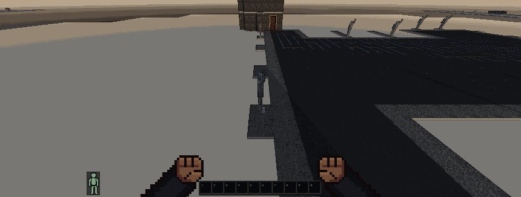 | 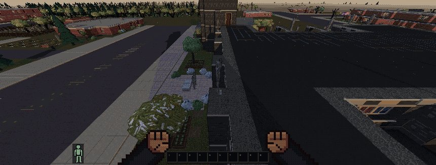 |
| 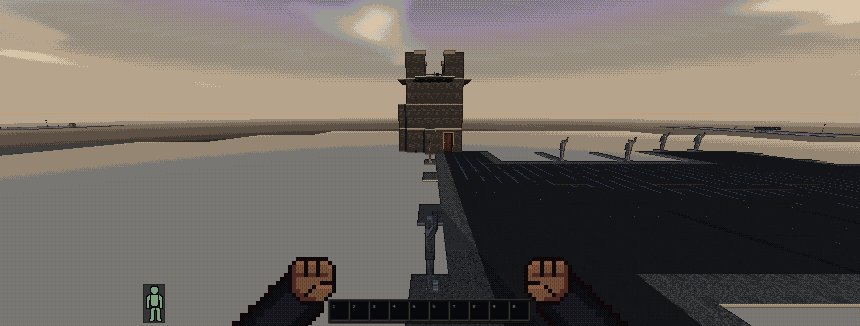 | 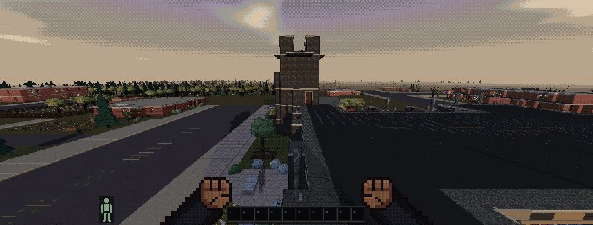 |

* **Levels drawn** (now `src/world/levels.ts`, see the next section): around the player [z-1, z+above] as before;
  above ground also **the ground level at the full radius and every storey down to it**. Most
  of those chunks are open air (skipped without meshing), so the cost is the buildings you see.
  Up a tower with more than 4 storeys between the ground and the player's window, the middle
  ones (not z 0, z 1 or the two under the window) get half the radius. Storeys more than two
  below the player use the far LOD (no near-ring volumes). Above-ground lower levels rank
  +0.25 s in the need order (basements keep +1.5 s). In a basement nothing changes: no
  surface through the ground. Stand-ins (placeholders.ts) and the prefetcher cover z 0 from
  above too. `?levels=window` / `cdda.drawLevels('window')` gives back the old window.
* **The two pale-yellow lines** in the user's frame were the ui2 hover outline (`src/ui2/
  install.ts worldHover`, a `LineSegments` box drawn with depthTest off): hovering a knee-high
  roof railing with the cursor free drew a full storey-high (2.6 m) box around it, whose far
  vertical edges ran from the roof up past the eye into the sky. The box now hugs the solid the
  ray hit (railing 1 m, furniture/creature/vehicle heights from raycast.ts), and it is hidden on
  any frame the cursor isn't free (a stale outline can't stay in the world).
* **Cost** (seed 1, cathedral roof in Holden, z 3, voxel, radius 8, 3440x1304, RTX 5080,
  `tools/zlevel-shots.ts --gpu --size 3440x1304 --bench 15`: a double turn looking down at the
  street, then out):

| | entries | draw calls | triangles | loop p50 / p99 (ms) | draw ms/frame | full rebuild of all wanted chunks |
| --- | --- | --- | --- | --- | --- | --- |
| roof, before | 1167 | 98 | 58 k | 1.4 / 2.5 | 0.6 | 46 ms |
| roof, after | 1434 | 600 | 627 k | 4.3 / 6.3 | 3.2 | 1143 ms |
| street below, after | 1434 | 798 | 805 k | 6.1 / 16.2 | 4.0 | 1311 ms |

  The roof now costs about what the street it shows costs (a little less: fewer near-ring
  volumes, the roof hides part of it). Frame interval stayed at 60 Hz throughout. `npm run perf`
  (ground-level routes) passes unchanged.
* Checks: `tests/render/zlevels.test.ts` (the level set by player level: surface, roof, tower,
  basement; the manager builds and drops them), `tools/zlevel-shots.ts --gpu --check --hover`
  (the street views are not a flat sheet: no colour covers 40 % of the lower frame, before
  54-63 %, after 31-37 %; the railing's hover outline is 1 m and gone once the inventory closes).

## Levels from the world (wave 3, zlevels 2)

User report: inside a fire station at z 0 (seed 443226190, `urban_32_6_south`, tile 942,1539)
looking up showed the sky and the sun. The column is z0 floor, z1 `t_open_air_rooved` (a
two-storey engine bay), z2 catwalk grate, z3 flat roof. The renderer built z-1..z+2, so the roof
never existed; and everything that asked "is something overhead?" looked one level up only (open
air), so the bay was lit and ambient-shaded as outdoors. Same bug class as the rooftop street:
*what exists was decided by a window around the player's z*.

| before | after |
| --- | --- |
| 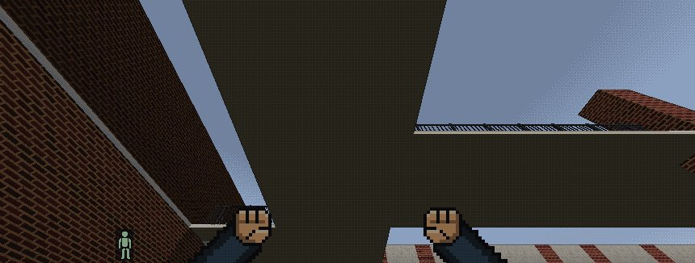 | 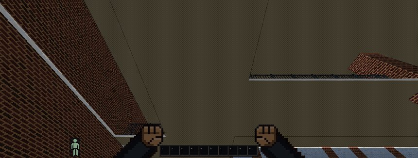 |
| 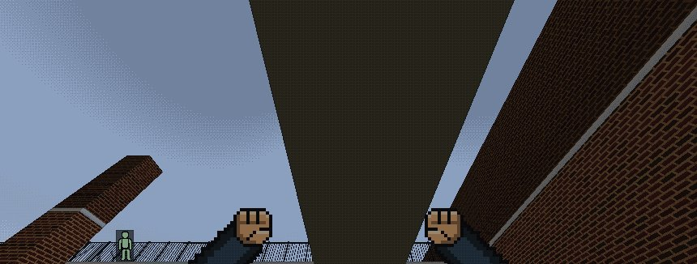 | 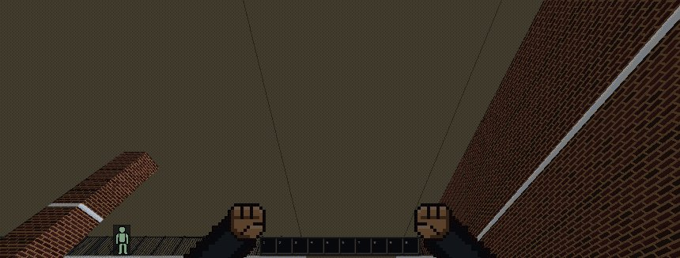 |

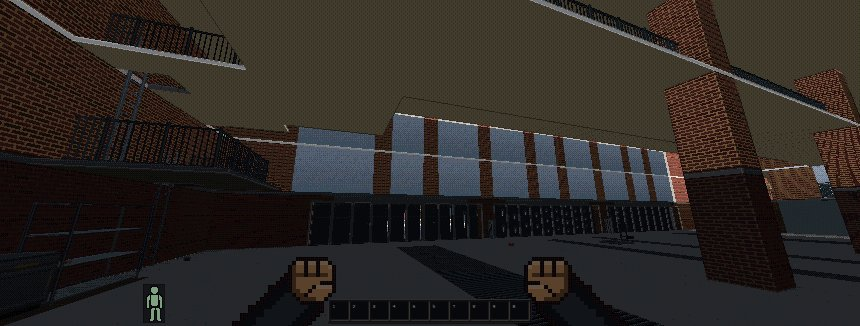

**Rule: what exists is derived from the world, never from a window around the player.**

* **One source of truth: `src/world/levels.ts` `VisibleLevels`** (owned by the chunk manager as
  `chunks.levels`). Per column (one OMT), the overmap says how tall it is without generating
  anything: top = highest non-open-air OMT + 1 (mapgen writes a building's roof into the level
  above its top floor), raised by any generated non-empty chunk above that (a player-built floor;
  re-read every 30 frames). `radiusAt(cx, cy, z, pz)`: the player's window [pz-1, pz+2] at full
  radius; on the surface or above, every level from the ground up to the column's top; underground
  only the window (rock hides the rest: no surface through the ground). `drawn(x, y, z)` = is that
  level of that column drawn for the current eye. `roofAbove(map, x, y, z)` = anything overhead at
  any height (the sky-light test). `?levels=window` / `cdda.drawLevels('window')` = the old rule.
* **Consumers switched to it** (each used its own `pz ± n`):
  * `chunkManager.ts`: entry creation iterates each column's span; eviction/visibility by
    `radiusAt`; `covered()` = `roofAbove`. Scheduling keeps near-first: storeys above the window
    that aren't overhead (tower tops across the street) are a new `'high'` class, ranked +3 s and
    deferred while a street hole is needed within 1 s; the bay's own roof (within a chunk) is not.
  * `prefetch.ts`: the same per-column extent with its own wider window.
  * `perf/telemetry.ts`: wanted = levels the column draws; holes = the levels in front of the eye
    (player's, the one above, the ground under a rooftop), so budgets stay comparable.
  * `monsterView` (live and dormant far figures), `npcView`, `vehicleMesh`, `fireView` (fires and
    embers), `arrowFx`: a thing is drawn iff its level is (`levels.drawn`), not within one level of
    the player (zombies on the street are visible from a roof).
  * `lightmap.ts`: the outside flag and the rain cover height look at every level up to the sky
    (was three levels, outside only one); `lightAt`'s fallback uses `roofAbove`.
  * `chunkMesh.ts`: rooms and the per-vertex sky ambient use "anything overhead" (only generated
    levels: the chunk manager generates every level a column has, so fields don't grow five
    levels of air); `audio/install.ts`: rain sound shelter the same.
  * Placeholders (z 0 stand-ins) and the skyline are ground-level by nature and unchanged.
  * **Not changed on purpose (simulation, not existence):** the monster/NPC activity bubble
    (`monai`/`npcai` `|dz| <= 1`), actualize and field sweeps. Monsters on the street below a
    roof are now drawn but stay dormant (idle) until you come within a level; making the sim
    bubble follow the column is a gameplay/perf decision for its owner.
* **The guard** (fails loudly):
  * Dev builds and tests: `ChunkManager.audit` checks every 60 frames that every generated,
    non-empty chunk on the surface or above inside the radius is on a drawn level, and once
    streaming is idle that every wanted level is built. Misses log once (`[levels] ...`) and
    collect in `chunks.levelMisses`.
  * `tools/skyleak.ts` (part of `npm run perf`, GPU): from each viewpoint in
    `tools/skyleak-views.ts` (fire station bay and roof, cathedral, apartment tower, office tower,
    parking garage, hotel tower top floor and roof, house basement, lab; add new spots there) it
    renders with the sky, skyline and weather hidden behind a sentinel colour (`cdda.skyLeak()`,
    `src/render/skyLeak.ts`), raycasts the tile map through every pixel, and fails if more than
    2 % of the pixels whose ray hits a wall, floor or roof within 60 m show the sentinel.
    Old rule: the fire station bay leaks 6-42 % per look, the cathedral roof 36-100 %; new: 0 %
    everywhere. (BN has no water tower OMT; the hotel tower is the tall one.)
  * `tests/render/zlevels.test.ts`: the level set for the fire station column, a field, a roof,
    a basement, a tower; column tops from the overmap and from live chunks; the manager builds
    the bay's roof; the guard reports content on a level the extent misses; `roofAbove`.
* **Cost** (3440x1304, voxel, radius 8, RTX 5080, shared machine, load ~4;
  `tools/skyleak.ts --bench 12`, a double turn; before = `?levels=window`):

| where | loop p50 / p99 (ms) | draw ms | draw calls | triangles | entries |
| --- | --- | --- | --- | --- | --- |
| fire station bay, before | 7.3 / 18.2 | 4.5 | 1182 | 2.09 M | 900 |
| fire station bay, after | 8.7 / 19.3 | 5.2 | 1529 | 2.71 M | 975 (+75: only tall columns get z3-5) |
| office tower roof z3, before | 3.7 / 11.8 | 1.8 | 206 | 0.22 M | 1125 |
| office tower roof z3, after | 9.5 / 16.6 | 5.5 | 1056 | 1.21 M | 1350 |
| hotel tower roof z5, before | 2.7 / 12.2 | 1.2 | 154 | 0.22 M | 450 |
| hotel tower roof z5, after | 10.6 / 17.2 | 5.4 | 1190 | 2.04 M | 1028 |

  On a roof the new cost is the city you now see (before: nothing below the window). At street
  level (`npm run perf` city40, 3 alternating A/B pairs) the loop p99 is unchanged (37-40 ms both)
  and unbuilt-in-view time is within this machine's noise (window 0-3.97 s, world 0.22-7.42 s over
  6 pairs; both modes break the city40 hole budget on some runs under this load). Towns, forest,
  rural, teleport, load and loaddrive pass.

## Not done / next

* **Draw cost in cities** is now the biggest frame item after streaming: ~1000-1200 draw
  calls, 3-7.6 ms CPU (Firefox the slower). Merging a chunk's per-page meshes and cutting shadow
  casters at distance would be the next wins (rendering, not streaming).
* **Far interior LOD**: interiors (painted surfaces, furniture models, dressing, rooms) are ~half
  of the mesh time (`--detail`) and can't be seen from 100 m. A far version without them,
  refined when you come within a few chunks, would roughly halve the first-build cost of the
  outer rings. Not needed for the benchmark routes any more, so not done.
* **Web Workers**: not needed for mapgen (5-19 ms per second of driving). For meshing they would
  need the texture/model atlases (mutable, main-thread pages) split from geometry emission first;
  the telemetry shows the budget is not the limit now.
* Firefox has single steps of 17-31 ms once or twice a run (a tree, a geometry upload); they
  look like GC/first-JIT, not a slicing problem, but `maxStepMs` in the benchmark will tell.
* The prefetcher still generates most chunks inside frames in a city (30 fps leaves no idle
  time); mapgen is cheap enough that it doesn't matter today.
