# Distance readability (wave 3)

Feedback: "many of [the looks] are too hard to actually see far distance". In
`docs/screenshots/looks/full_street.jpg` (v2) everything past ~30 m dissolved into pale haze, the
sky around the sun was washed out and the far end of the street was unreadable.

## What was killing distance, per look

| cause | looks | fix |
| --- | --- | --- |
| Fog of war started at **35 %** of the draw distance (42 m) and was opaque grey at 120 m, fading into a fog colour that did not match the sky behind it (a grey wall in front of a blue or orange horizon) | all | sky-matched fade (below), starting at 60 % and only partial at the draw distance |
| Aerial perspective mixed up to 45 % pale haze + 40 % desaturation within 60 m | crisp, full | capped (`hazeMax` 0.42 x look strength 0.6), longer e-fold (90 m), toward the sky colour along the view ray |
| No ground beyond the drawn chunks: the world ended in a band of sky below the horizon | all | far ground ring from the overmap (`skyline.ts`), faded by its true distance |
| Sun glow term applied at full strength at noon + a 2.0 HDR sun disc feeding bloom: a third of the sky washed to white-pink around the sun | all (bloom: crisp, full) | glow only strong when the sun is low; disc 1.6 (small halo) |
| Rain fell from a clear blue sky with the sun blazing and hard shadows | all | overcast from the game weather (BN `light_modifier`, `sight_penalty`) |
| Past the mip clamp (lod 3), distant roads/lawns were lod-3 texels aliasing into speckle | all | fade to the tile's average colour past lod 3 (`materials.ts` WORLD_MAP) |
| Tree-crown sway of < 1 px at distance made far crowns flicker | voxel, full | sway fades out from 14 to 30 m |

Monsters beyond the 60-tile reality bubble are dormant and **not drawn at all**
(`monai.ts ACTIVE_RADIUS`); the far view spawns its test zombies at 15/28/42/58 m for that
reason. Drawing dormant monsters as distant figures is the character agent's call.

## The model (`src/render/atmosphere.ts`, `post.ts atmosphere()`)

* **Aerial perspective**: `a = look.atmosphere * hazeMax * (1 - exp(-d / hazeDist))`, part
  desaturation, then a mix toward `skyGradient(viewRay)` (the exact colour of the sky dome behind
  the pixel, `sky.ts SKY_GRADIENT`, so warm toward a low sun, blue elsewhere). Capped, so a dark
  shape on the road at 50 m keeps its contrast.
* **Distance fade**: reaches `edgeLevel` (0.25) at the draw distance, then keeps going over the
  far ground ring and skyline (true distance written to the normal target's red channel, since
  the impostors are pulled in) to `farMax` (0.72) at `farSpan` metres beyond. The ground meets the
  sky at the horizon instead of stopping at a wall. Pop-in at 130+ m is visible at ~25 % haze;
  the ring underneath means a late chunk never shows a hole.
* **Weather**: `applyWeatherSky` eases toward the game weather: overcast dims the sun (-72 %),
  hides its disc, greys sky/fog/sun colour, darkens clouds; `sight_penalty` brings the haze
  closer and denser (still capped below opaque). Forced weather (`cdda.setWeather`) switches at once.

## Presets and switches

| preset | what |
| --- | --- |
| `clear` (**default**) | light haze, fade from 60 % of the draw distance to 25 %, horizon 72 % sky |
| `light` | more atmosphere (planes separate more), still no wall |
| `legacy` | the v2 grey fog + heavy haze, for comparison |

* **Options > Distance haze** (persisted), `?haze=clear|light|legacy`, `cdda.setHaze(name)`,
  `cdda.hazeTweak({hazeMax: 0.3, edgeStart: 0.7, ...})` (fields in `HazeSettings`).
* **Options > Draw distance**: 96 / 120 (default) / 168 m = chunk radius 5 / 6 / 8, persisted;
  `?radius=` still overrides. Radius 8 measured +65 % chunks (548 -> 900), +80-170 MB heap,
  +0.5-0.8 ms render at 1080p, so it stays opt-in; the far ground ring and skyline make 6 read well.
* The look's own `atmosphere` still scales the aerial part (classic has none), so the five looks
  keep their character; the sky-matched fade, far ground, weather and sky fixes apply to all.

## Pixel stabilisation

Already in place before this wave: first-person/cockpit rotation snapped to whole pixel-angles,
view-anchored ordered dither, top-down camera snapped to the low-res grid with a sub-pixel blit
offset, texel-snapped sun shadow camera (`cdda.shimmerTest` measures pans). What translation
(walking) can't get from snapping, this wave reduces at the source: far tiles average instead of
aliasing, no sub-pixel sway on far crowns. `cdda.flickerTest(frames, step, y0, y1, map, dt)` counts
A->B->A pixels while stepping forward (map=true returns a heat map PNG). Caveat: nearest-sampled
pixel art alternates texel colours, so that metric also counts legitimate texel crossings; it
stayed ~flat (full far 0.016 before and after) and is only good for spotting hot spots (the heat
maps show foliage and grass dominate, not the far distance). Temporal reprojection was not tried:
it would smear the pixel art.

**Round 2: near foliage/grass.** Grass blades and leaf clumps are alpha-tested cards with
1-texel features and no mips: a few metres out they are smaller than a pixel and sparkle as you
move. `src/render/cutoutMips.ts` gives them mips built for the alpha test (each 2x2 block is
opaque if >= 1 (blades) or >= 2 (leaves) of its texels are, colour = average of the opaque ones,
alpha stays binary), sampled NearestMipmapNearest: far cutouts become a coarser fixed pixel
pattern instead of crawling (hard edges kept; lawns look slightly fuller at distance).
Alpha-to-coverage was not an option (no MSAA on the low-res target) and dithered alpha would
add its own crawl. A/B: `cdda.cutoutMips(false)`. Same session, mips off -> on:

| view | flickerTest (walk) | shimmerTest (pan) |
| --- | --- | --- |
| full forest | 0.0284 -> 0.0260 | 0.0502 -> 0.0406 |
| full street | 0.0143 -> 0.0128 | 0.0301 -> 0.0257 |
| full far | 0.0161 -> 0.0124 | 0.0320 -> 0.0234 |
| terrain forest | 0.0422 -> 0.0317 | 0.0565 -> 0.0377 |
| terrain far | 0.0131 -> 0.0083 | 0.0256 -> 0.0213 |

## Form lighting (round 2, `src/render/formLight.ts`)

v2 had a strong hemisphere ambient, the sun in 5 bands and a fill from the anti-sun azimuth.
Looking into the sun every visible face is a shadow side and that fill lit them all equally
(flat); with the sun behind you it lit faces you couldn't see. Presets:

| preset | bands | key | ambient | fill | billboards |
| --- | --- | --- | --- | --- | --- |
| `soft` (v2) | 5 | 1 | 1 | look's `fill`, anti-sun, high | flat |
| `toon` (**default**) | 4 | 1.1 | 0.7 | >= 0.5, from 90 deg to the sun, 30 deg up | curved (0.9) |
| `bold` | 3 | 1.2 | 0.56 | >= 0.62, 90 deg, 25 deg up | curved (1.2) |

The side fill is fixed in the world (always 90 degrees counter-clockwise from the sun), never
camera-relative, so shading doesn't change as you turn; it gives three tones: sunlit, fill-lit
and ambient-only, so a house seen from its shadow side still shows its corner. Billboards
(distant trees past the 3D-tree radius, props, sprite creatures) swing their normal across the
quad (`uSpriteCurve`) so a side-lit sprite has a light and a dark half. Ambient floor: a shadow
side stays about a quarter of a sunlit one in toon (never black). Switch: **Options > Form
lighting** (persisted), `?form=soft|toon|bold`, `cdda.setForm`, `cdda.formTweak({...})`.

Also in round 2: the aerial haze toward a low sun takes only a third of the sun's glow (with
all of it, looking into the afternoon sun washed every building past 40 m into one bright
blur); the edge fade still uses the full sky colour so the horizon matches.

## Sun and moon discs (round 2)

The sun was a 6.3-degree angular disc; 40 degrees off-axis the rectilinear projection stretches
that into a big tilted oval (not only the side-by-side squash). Both discs are now tested on the
image plane (screen-round wherever they are), the sun 4 degrees across at the centre with a
warmer rim and a soft glare the dither stipples; HDR 1.6, just over the bloom threshold, so bloom
adds only a small halo. The moon matches in size.

## Screenshots (before | after, 1080p, RTX 5080, seed 1)

`tools/look-views.js` gained `far` (straight road, zombies at 15-58 m), `fardusk`, `farrain`,
`dusk` (street a quarter hour before the real sunset) and `rain`.

| | |
| --- | --- |
| 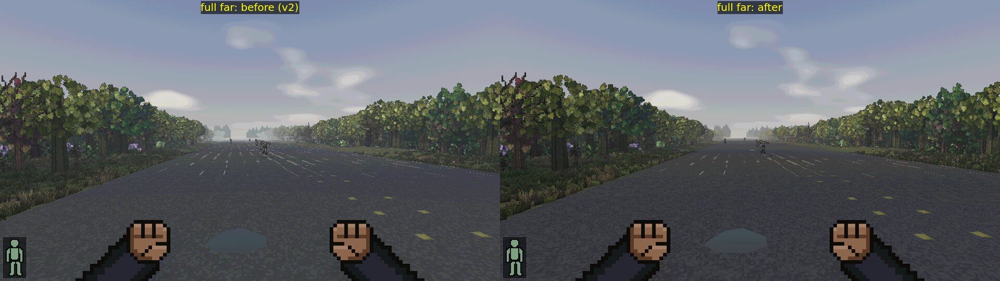 | 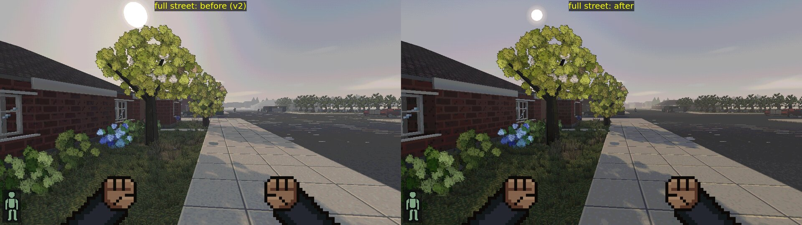 |
| 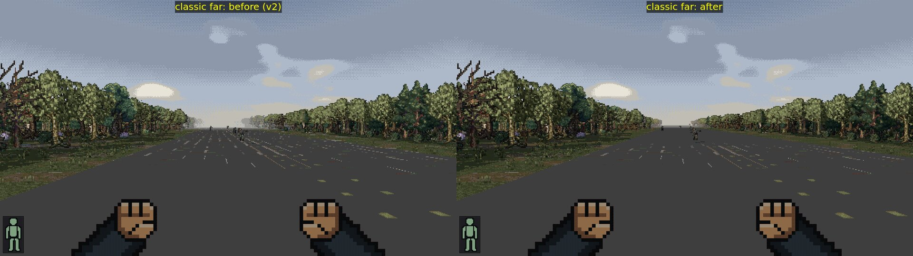 | 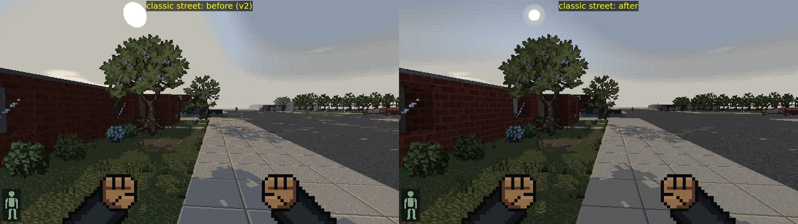 |
| 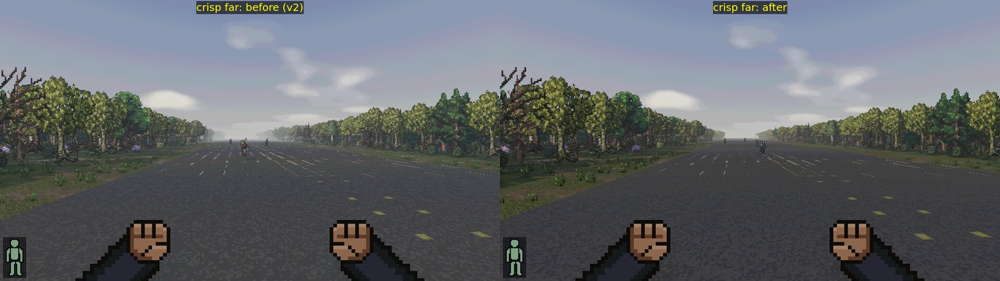 | 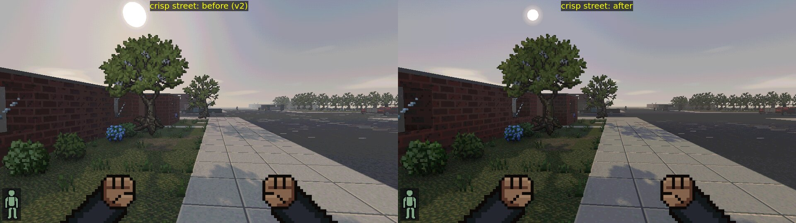 |
| 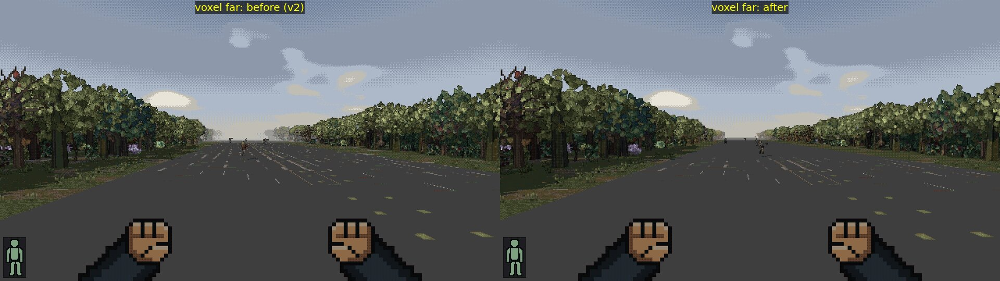 | 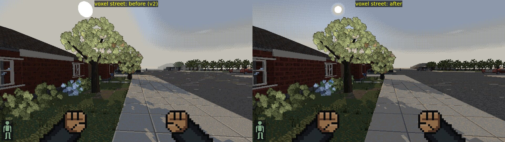 |
| 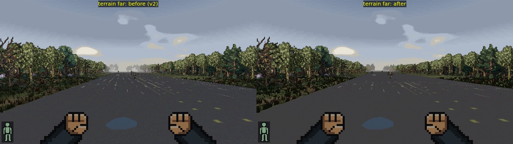 | 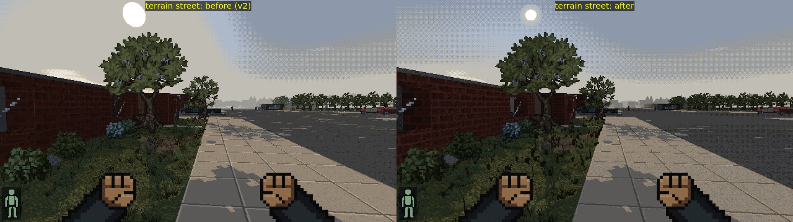 |
| 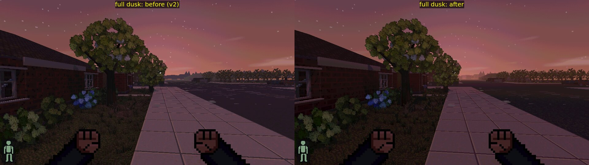 | 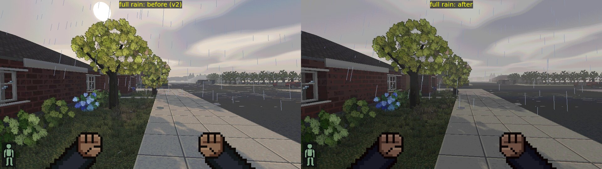 |
| 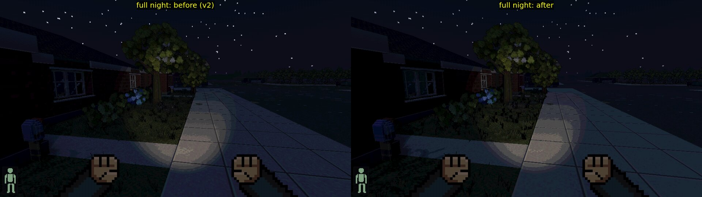 | 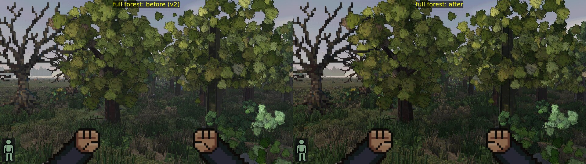 |
| 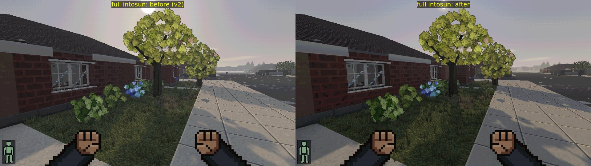 | 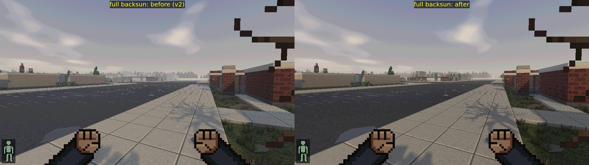 |

"After" is the current state (clear haze + toon lighting + round sun). `intosun`/`backsun` are
town views with the afternoon sun in front of / behind the camera. Form presets side by side:

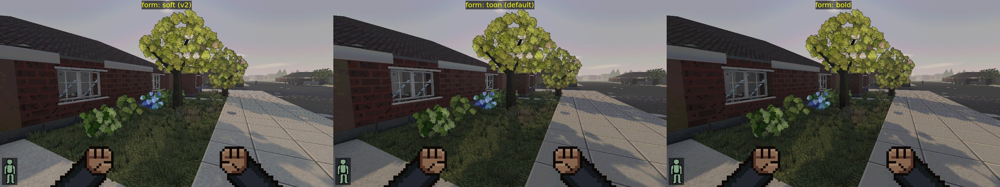
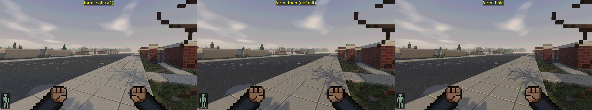

Shots are JPEG q85 (pairs at half size); `tools/look-shots.ts` now writes half-size JPEGs by
default (`--png` for full-size PNG).

## Performance (RTX 5080, `look-shots --bench`, shared machine: +-15 % noise)

`render` = renderer-only ms/frame (`cdda.benchRender`), before -> after:

| look | 1080p street | 1080p far | 3440x1304 street | 3440x1304 far |
| --- | --- | --- | --- | --- |
| classic | 1.6 -> 1.3 | 1.3 -> 1.6 | 2.1 -> 1.9 | 1.7 -> 1.7 |
| crisp | 1.7 -> 1.8 | 1.4 -> 1.2 | | |
| voxel | 1.0 -> 1.7 | 1.9 -> 1.7 | | |
| terrain | 1.9 -> 1.6 | 1.4 -> 3.2* | | |
| full | 1.9 -> 1.7 | 1.9 -> 1.7 | 4.7 -> 3.4 | 2.1 -> 2.1 |

\* single-run outliers in both directions; the shadow map updates at a fixed rate, so a bench
window that includes a shadow pass reads higher. The additions are one sky-gradient evaluation
per post pixel, ~2.5k ground-ring triangles and four texture taps on far world pixels: no
measurable cost.

Round 2 (toon lighting, cutout mips, sky discs), 1080p render ms: classic street/far/forest
1.6/1.6/1.5, full 1.7/1.9/1.8: unchanged. (One full-far run had a 38 ms p99 frame interval from
chunk streaming after the teleport; render time is unaffected.)

## Known gaps

* (Fixed, wave 3 zlevels) From a rooftop the street used to be a flat pale sheet: only one
  level below the player was built. Above ground the ground and the storeys down to it are
  drawn now (docs/PERF.md "Above ground").
* (Fixed, wave 3 zlevels 2) Inside a two-storey engine bay the sky and the sun showed through the
  roof (three levels up, outside the old window), and the bay was lit as outdoors (only one
  level up was checked for cover). Levels and "overhead" now come from the world
  (docs/PERF.md "Levels from the world").

* Dormant monsters past 60 tiles are invisible (see above).
* The ground ring is one flat colour per OMT (roads as strips); up close to the draw edge on a
  hill it can sit visibly below real ground by 0.6 m.
* Clouds stay soft blurred blobs in the smooth grade; rain clouds are darker but not a flat deck.
* Near shimmer is reduced, not gone: at 1-3 m the cards are magnified (no mips apply) and
  their edges still step as you move; nearest-sampled textures on world surfaces crawl a little
  when walking (inherent to point sampling without temporal filtering).
* Billboard curvature is uniform per quad: a very wide or odd-shaped sprite shades like a
  cylinder, not like its silhouette.
* Night sky: the dark cloud blobs grade slightly green in the smooth LUT (pre-existing).

## QA wave 3 fixes (#5, #6, #7)

* **Lamp rings (#7)**: point lights and the light map's lamp term now dither (4x4 ordered,
  `uPointDither`) across their band edges instead of stepping hard, so a ceiling lamp lights a
  wall as a stippled pool rather than concentric rings; the sun/moon/flashlight keep hard toon
  bands. Per form preset: toon 0.9, bold 0.7, soft (v2) 0 = the old rings.
* **Ground after teleport/load (#6)**: never-built chunks next to the player build first under
  the urgent budget and the image stays black until they exist, then fades in over 0.3 s
  (`nearChunks.ts`, `pipeline.curtain`; measured ~0.4 s hold after a 30-OMT teleport; gives up
  after 4 s). The skyline/far-ground ring rebuilds at once after a jump instead of lying under
  the player for a sliced rebuild. Walking and driving never trigger it.
* **Streaming (#5)**: crossing the flora middle ring used to rebuild the whole chunk (mesh +
  furniture + trees); it is no longer in the chunk signature and swaps only the chunk's trees
  (`chunkManager.treeSteps`). Same machine and load (~15), 20 s runs: chunk builds sprint
  789 -> 469, drive 1630 -> 1112; `chunks` mean ms/frame sprint 1.47 -> 0.88, drive 3.63 ->
  2.77; loop p99 sprint 14.2 -> 13.3, drive 15.8 -> 16.4 (noise at that load). Per-tree cost is
  small (`cdda.floraStats().perTreeMs`: near 0.4-0.7 ms, middle 0.2, far 0.02-0.05). The
  longest single step left is a 10-12 ms *mesh row* (modelled furniture/dressing rows), which
  the per-row slicing can't split; worth a look by the furniture owner. A quiet machine
  (load < 2) was not available during this session, so the absolute p99s are not comparable
  to LOOKS.md's pre-wave-3 table.
