# Distance readability (wave 3)

Feedback: "many of [the looks] are too hard to actually see far distance". In
`docs/screenshots/looks/full_street.png` (v2) everything past ~30 m dissolved into pale haze, the
sky around the sun was washed out and the far end of the street was unreadable.

## What was killing distance, per look

| cause | looks | fix |
| --- | --- | --- |
| Fog of war started at **35 %** of the draw distance (42 m) and was opaque grey at 120 m, fading into a fog colour that did not match the sky behind it (a grey wall in front of a blue or orange horizon) | all | sky-matched fade (below), starting at 60 % and only partial at the draw distance |
| Aerial perspective mixed up to 45 % pale haze + 40 % desaturation within 60 m | crisp, full | capped (`hazeMax` 0.42 x look strength 0.6), longer e-fold (90 m), toward the sky colour along the view ray |
| No ground beyond the drawn chunks: the world ended in a band of sky below the horizon | all | far ground ring from the overmap (`skyline.ts`), faded by its true distance |
| Sun glow term applied at full strength at noon + a 2.0 HDR sun disc feeding bloom: a third of the sky washed to white-pink around the sun | all (bloom: crisp, full) | glow only strong when the sun is low; disc 1.6 (small halo) |
| Rain fell from a clear blue sky with the sun blazing and hard shadows | all | overcast from the game weather (BN `light_modifier`, `sight_penalty`) |
| Past the mip clamp (lod 3), distant roads/lawns were lod-3 texels aliasing into speckle | all | fade to the tile's average colour past lod 3 (`materials.ts` WORLD_MAP) |
| Tree-crown sway of < 1 px at distance made far crowns flicker | voxel, full | sway fades out from 14 to 30 m |

Monsters beyond the 60-tile reality bubble are dormant and **not drawn at all**
(`monai.ts ACTIVE_RADIUS`); the far view spawns its test zombies at 15/28/42/58 m for that
reason. Drawing dormant monsters as distant figures is the character agent's call.

## The model (`src/render/atmosphere.ts`, `post.ts atmosphere()`)

* **Aerial perspective**: `a = look.atmosphere * hazeMax * (1 - exp(-d / hazeDist))`, part
  desaturation, then a mix toward `skyGradient(viewRay)` (the exact colour of the sky dome behind
  the pixel, `sky.ts SKY_GRADIENT`, so warm toward a low sun, blue elsewhere). Capped, so a dark
  shape on the road at 50 m keeps its contrast.
* **Distance fade**: reaches `edgeLevel` (0.25) at the draw distance, then keeps going over the
  far ground ring and skyline (true distance written to the normal target's red channel, since
  the impostors are pulled in) to `farMax` (0.72) at `farSpan` metres beyond. The ground meets the
  sky at the horizon instead of stopping at a wall. Pop-in at 130+ m is visible at ~25 % haze;
  the ring underneath means a late chunk never shows a hole.
* **Weather**: `applyWeatherSky` eases toward the game weather: overcast dims the sun (-72 %),
  hides its disc, greys sky/fog/sun colour, darkens clouds; `sight_penalty` brings the haze
  closer and denser (still capped below opaque). Forced weather (`cdda.setWeather`) switches at once.

## Presets and switches

| preset | what |
| --- | --- |
| `clear` (**default**) | light haze, fade from 60 % of the draw distance to 25 %, horizon 72 % sky |
| `light` | more atmosphere (planes separate more), still no wall |
| `legacy` | the v2 grey fog + heavy haze, for comparison |

* **Options > Distance haze** (persisted), `?haze=clear|light|legacy`, `cdda.setHaze(name)`,
  `cdda.hazeTweak({hazeMax: 0.3, edgeStart: 0.7, ...})` (fields in `HazeSettings`).
* **Options > Draw distance**: 96 / 120 (default) / 168 m = chunk radius 5 / 6 / 8, persisted;
  `?radius=` still overrides. Radius 8 measured +65 % chunks (548 -> 900), +80-170 MB heap,
  +0.5-0.8 ms render at 1080p, so it stays opt-in; the far ground ring and skyline make 6 read well.
* The look's own `atmosphere` still scales the aerial part (classic has none), so the five looks
  keep their character; the sky-matched fade, far ground, weather and sky fixes apply to all.

## Pixel stabilisation

Already in place before this wave: first-person/cockpit rotation snapped to whole pixel-angles,
view-anchored ordered dither, top-down camera snapped to the low-res grid with a sub-pixel blit
offset, texel-snapped sun shadow camera (`cdda.shimmerTest` measures pans). What translation
(walking) can't get from snapping, this wave reduces at the source: far tiles average instead of
aliasing, no sub-pixel sway on far crowns. `cdda.flickerTest(frames, step, y0, y1, map, dt)` counts
A->B->A pixels while stepping forward (map=true returns a heat map PNG). Caveat: nearest-sampled
pixel art alternates texel colours, so that metric also counts legitimate texel crossings; it
stayed ~flat (full far 0.016 before and after) and is only good for spotting hot spots (the heat
maps show foliage and grass dominate, not the far distance). Temporal reprojection was not tried:
it would smear the pixel art.

## Screenshots (before | after, 1080p, RTX 5080, seed 1)

`tools/look-views.js` gained `far` (straight road, zombies at 15-58 m), `fardusk`, `farrain`,
`dusk` (street a quarter hour before the real sunset) and `rain`.

| | |
| --- | --- |
| 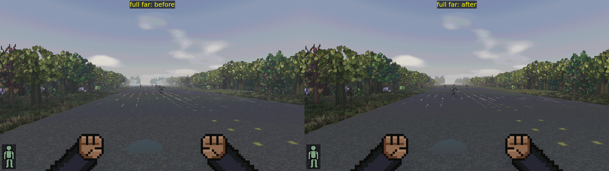 | 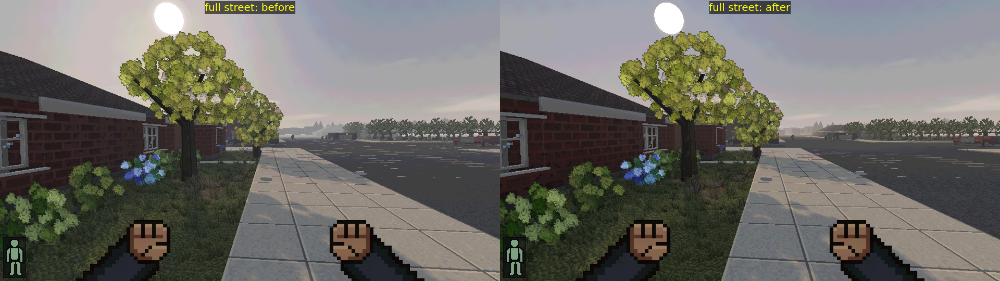 |
| 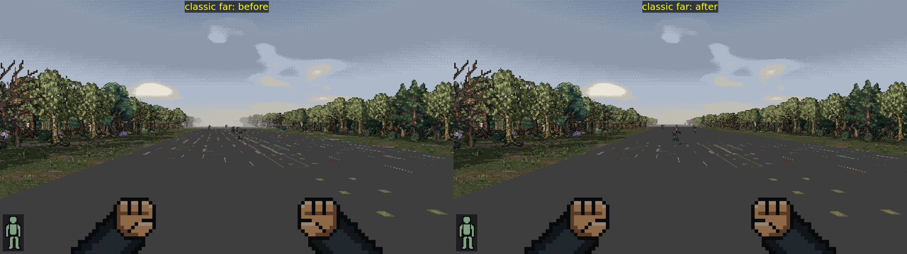 | 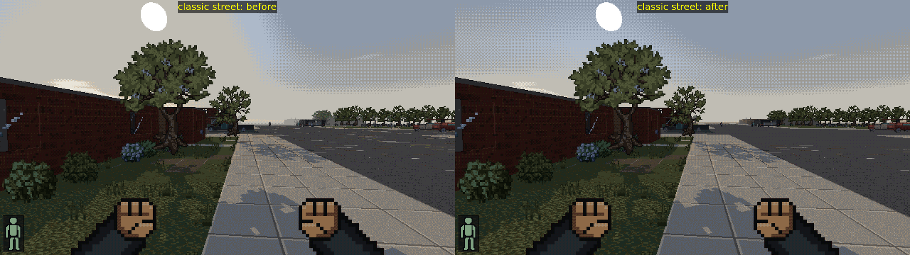 |
| 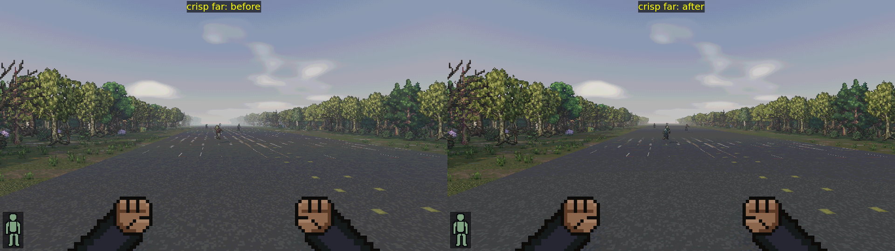 | 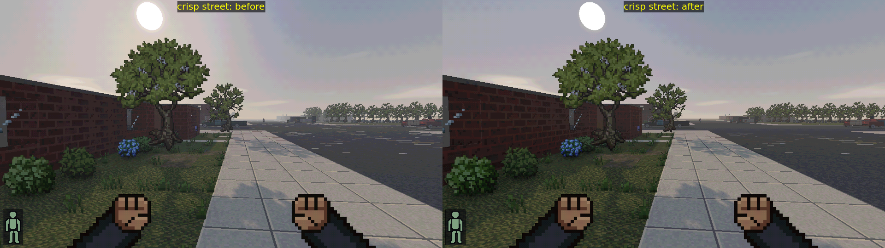 |
| 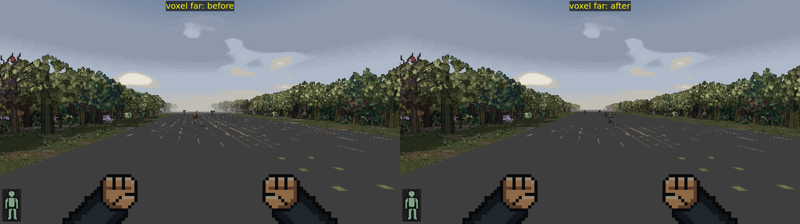 | 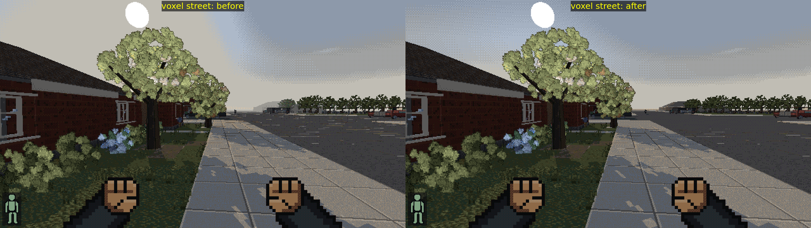 |
| 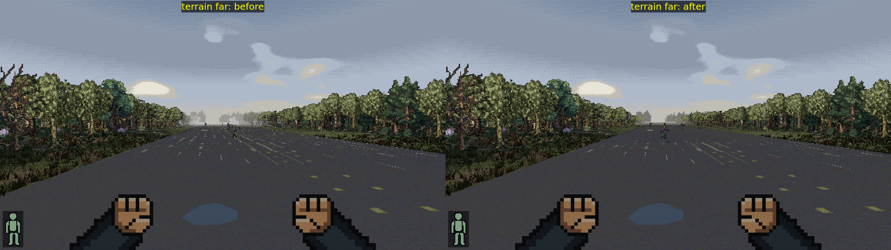 | 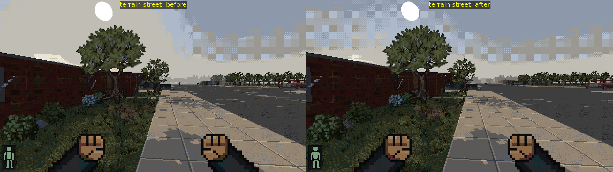 |
| 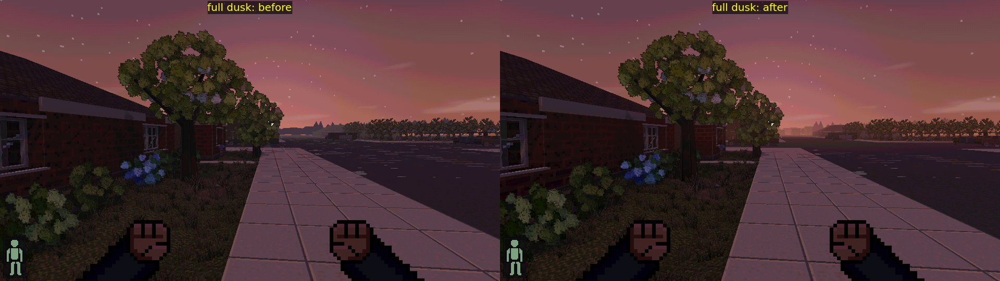 | 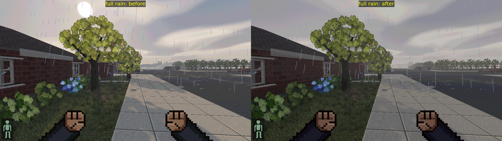 |
| 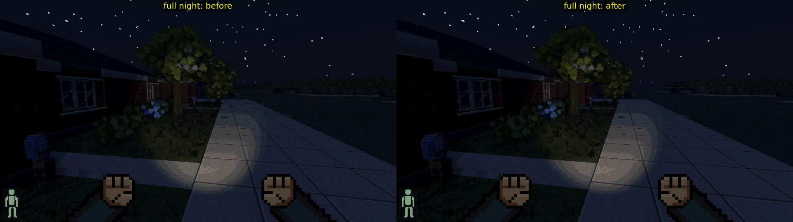 | 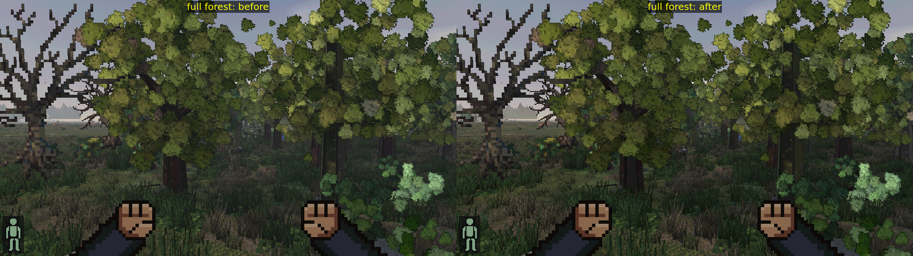 |

## Performance (RTX 5080, `look-shots --bench`, shared machine: +-15 % noise)

`render` = renderer-only ms/frame (`cdda.benchRender`), before -> after:

| look | 1080p street | 1080p far | 3440x1304 street | 3440x1304 far |
| --- | --- | --- | --- | --- |
| classic | 1.6 -> 1.3 | 1.3 -> 1.6 | 2.1 -> 1.9 | 1.7 -> 1.7 |
| crisp | 1.7 -> 1.8 | 1.4 -> 1.2 | | |
| voxel | 1.0 -> 1.7 | 1.9 -> 1.7 | | |
| terrain | 1.9 -> 1.6 | 1.4 -> 3.2* | | |
| full | 1.9 -> 1.7 | 1.9 -> 1.7 | 4.7 -> 3.4 | 2.1 -> 2.1 |

\* single-run outliers in both directions; the shadow map updates at a fixed rate, so a bench
window that includes a shadow pass reads higher. The additions are one sky-gradient evaluation
per post pixel, ~2.5k ground-ring triangles and four texture taps on far world pixels: no
measurable cost.

## Known gaps

* Dormant monsters past 60 tiles are invisible (see above).
* The ground ring is one flat colour per OMT (roads as strips); up close to the draw edge on a
  hill it can sit visibly below real ground by 0.6 m.
* Clouds stay soft blurred blobs in the smooth grade; rain clouds are darker but not a flat deck.
* Walking shimmer on near foliage/grass (alpha-tested point-sampled cutouts) is untouched.
