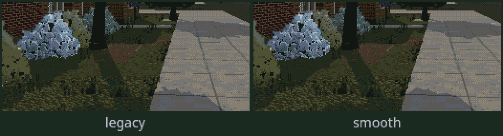
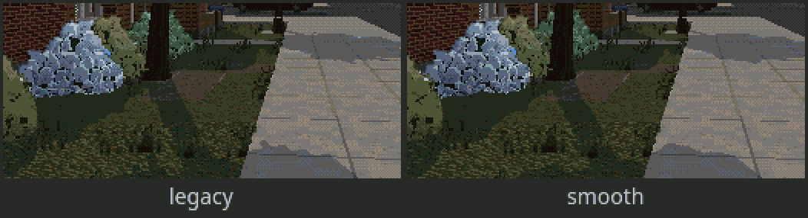

# Sun shadows

User report (wave 3): *"the shadows are very jumpy and sway a lot, additionally they show all of the
artifacts of voxel"*. None of this shows in a still screenshot, so this doc is built on a motion
measurement (`tools/shadow-motion.ts`) and animated captures.

Code: `src/render/shadows.ts` (modes, sun stepping, texel snapping, the light rig),
`src/render/materials.ts` (`RIG_PARS`: which light a fragment takes, the smooth filter, the
shadow-only debug view), `src/render/shadowInstall.ts` (Options entry, console, `shadowMotion`),
`src/render/flora.ts` (sway lock), `tests/shadows.test.ts`.

## What was wrong

Measured, not guessed. `cdda.shadowMotion` draws every frame twice with the same camera, time and
wind: once with the shadow maps as they were, once after they update as they normally would that
frame. Pixels whose shadow state differs are shadow motion that is not the camera's own motion
(shimmer, crawl, swim).

1. **The sun moves every frame and drags the texel grid with it (the main cause).** A game day is
   ~1 real hour (`CLOCK_SCALE = 24`), so the sun turns ~0.1 degrees per real second, and the map
   was re-rendered 20 times a second. The old code did snap the shadow camera to whole texels, but
   along axes rebuilt from the live sun direction every frame. Turning those axes rotates the whole
   texel grid about the world origin. At town coordinates (thousands of metres from the origin) that
   slides the grid by about a texel per update (see the test *"why legacy shimmered"*). So every
   shadow edge re-rasterised and crawled 20 times a second, even standing still. With time
   stopped, legacy shows zero shadow motion. With time running, 0.8-1.3% of the whole image
   (3-12% of its shadowed pixels at p95) flips on every map update, walking, panning or not.
2. **Resolution against the view distance.** There was one 768 map over ±30 m, giving 8 cm texels.
   At a low sun these stretch into 20-40 cm stair steps on the ground, sampled with no filtering
   (`BasicShadowMap`) into a 360 px image. That is the "voxel" look of the edges. Past 30 m nothing
   had a sun shadow, while the draw distance is 168 m.
3. **Swaying leaves against a still shadow map.** The stepped wind moves leaves 4 times a second,
   but their shadow depth pass has no wind, so the shadows slid over the leaves. Measured, this is
   small next to (1): the forest's frame-to-frame change standing still is 0.07% both before and
   after.
4. The fill light also turned with the live sun, so its toon bands crept across rounded forms
   too. The stable modes hold it with the sun step.

Things checked and ruled out as causes of motion: the shadow frustum is not refit to the view
(panning changes nothing once the sun holds still). The low-res target with point sampling only
magnifies (1): the camera itself is already pixel-stabilised.

## The modes

Options → **Shadows**, `?shadows=<name>`, `cdda.setShadows('<name>')`, or the gallery switch
*Shadows* (Image group). Options persists the choice (`cdda3d.shadows`).

| mode | what it does |
|---|---|
| `legacy` | The old behaviour, unchanged: one map sized by the look (768 / ±30 m on voxel), follows the sun every frame, redrawn at 20 Hz. |
| `stable` | The **sun moves in 0.5° steps** (every ~5 s of real time at normal speed). Each step is a 1.2 s **dissolve**, dithered per shadow texel and anchored to the world, from the old direction to the new. Between steps the direction and the texel grid are fixed, so static shadows never change as you walk, pan or wait. The fill light follows the step. Leaves sample their shadow at their rest position (sway lock). One 1024 map, ±32 m. |
| `cascades` | Stable, plus **two maps**: near 1024 over ±20 m (4 cm texels) and far 1024 over ±84 m (16 cm texels, snapped in 8-texel steps, redrawn at 5 Hz). Trees and houses down the street cast shadows. The seam between the two maps is a short world-anchored dither. |
| `smooth` (**default**) | Cascades, plus a **contour filter**: a fixed 3×3 tent of hardware-bilinear depth compares, cut at 50%. The edge follows the filtered contour: straight or diagonal runs and rounded corners instead of texel staircases, and notches thinner than ~1 texel (voxel steps in a silhouette) fill in. The taps sit on a fixed grid (no per-pixel noise), so the edge holds still too. Uses PCF maps. |

Each sun-shadow map is its own `DirectionalLight` carrying the full sun (two sun steps × one or two
cascades). The shader gives every fragment exactly one of them, so the sun is counted once. Tweak
live: `cdda.shadowTweak({ stepDeg: 1, fadeSec: 2, smoothRadius: 1.5, near: { extent: 16 } })`,
`cdda.shadows()` shows the state. `cdda.shadowView(true)` renders only the sun-shadow factor.

## Numbers

`tools/shadow-motion.ts` at 3440×1304, voxel look, seed 1. `street` is 15:30 on a residential
street; `forest` is 15:00 in woods. Each run is 90 frames at 60 fps. *still* = wind only, clock
stopped. *time* = the clock at normal play speed. *walk* = 3 m/s with time running. *pan* =
turning 40°/s with time running.

**Shadow change with the camera held**, as a % of all pixels per frame (mean / share of frames
with any change):

| view | scenario | legacy | stable | cascades | smooth |
|---|---|---|---|---|---|
| street | still | 0.000 / 0% | 0.000 / 0% | 0.000 / 0% | 0.000 / 0% |
| street | time | 0.815 / 33% | 0.000 / 0% | 0.000 / 0% | 0.000 / 0% |
| street | walk | 1.098 / 33% | 0.000 / 0% | 0.000 / 0% | 0.000 / 0% |
| street | pan | 0.686 / 33% | 0.000 / 0% | 0.000 / 0% | 0.000 / 0% |
| forest | still | 0.000 / 0% | 0.000 / 0% | 0.000 / 0% | 0.000 / 0% |
| forest | time | 1.098 / 33% | 0.000 / 0% | 0.000 / 0% | 0.000 / 0% |
| forest | walk | 1.283 / 33% | 0.003 / 0% | 0.001 / 0% | 0.001 / 0% |
| forest | pan | 1.094 / 33% | 0.000 / 0% | 0.000 / 0% | 0.000 / 0% |

As a share of the shadowed pixels, legacy is 2.5-3.5% per update (p95 8-13%). The "33%" is the
20 Hz redraw: every third frame everything re-rasterises. In the stable modes the only shadow
motion left is the sun step itself: in the *sweep* clip (clock ×20) it is 0.05-0.12% per frame,
bunched into the 1.2 s dissolves (legacy: 0.74% on every update). The walk residue (0.001-0.003%)
is creatures and chunk streaming.

**Frame time**, ms per frame with GPU sync (`cdda.benchRender`). "Redraw" is a frame that redraws
every map: a sun step, a teleport or a look change.

| view | legacy | stable | cascades | smooth |
|---|---|---|---|---|
| street | 1.8 (redraw 2.4) | 2.0 (redraw 2.6) | 2.1 (redraw 5.4) | 2.2 (redraw 5.3) |
| forest | 1.9 (redraw 3.0) | 2.3 (redraw 3.1) | 2.5 (redraw 5.0) | 2.4 (redraw 5.2) |

Run-to-run noise is about ±0.3 ms. So the cost is +0.2-0.5 ms on average, and a ~5 ms frame on a
sun step for the two-map modes (the far map covers ~28× the area).

## Captures (`docs/screenshots/wave3/shadows/`)

Legacy on the left, smooth on the right, at the game's own 2x nearest upscale of the low-res
image. Real time, 1 s, looping:

- [`legacy-vs-smooth-time.gif`](screenshots/wave3/shadows/legacy-vs-smooth-time.gif): standing
  on the street with time at normal speed. Legacy's sidewalk and lawn shadows boil; smooth is
  still.

  
- [`legacy-vs-smooth-walk.gif`](screenshots/wave3/shadows/legacy-vs-smooth-walk.gif): walking
  along the sidewalk at 3 m/s.

  
- [`street-sweep.webm`](screenshots/wave3/shadows/street-sweep.webm) (still:
  [`street-sweep.png`](screenshots/wave3/shadows/street-sweep.png)): all four modes (legacy,
  stable / cascades, smooth), the clock at 20x for 2.5 s, to show the sun steps dissolving.
- [`heat-street-time.png`](screenshots/wave3/shadows/heat-street-time.png),
  [`heat-forest-walk.png`](screenshots/wave3/shadows/heat-forest-walk.png): all four modes, red
  where shadows changed without the camera moving.
- [`still-street.png`](screenshots/wave3/shadows/still-street.png),
  [`still-forest.png`](screenshots/wave3/shadows/still-forest.png): the four modes side by side.
  Smooth's sidewalk edges are clean; cascades/smooth show shadows under the trees down the street.
- [`mask-street.png`](screenshots/wave3/shadows/mask-street.png),
  [`mask-forest.png`](screenshots/wave3/shadows/mask-forest.png): the sun-shadow factor only (black
  shadow, white lit, grey = not a lit surface). The staircase-versus-contour difference is easiest
  to see here.

The tool writes more than is committed: 2x2 GIFs of every clip and every heat map. The committed
set was trimmed to keep the folder small (the pairs were cut out of the 2x2 GIFs; the sweep was
re-encoded as VP9).

Re-run: `tools/heavy --kind gpu --mem 2 -- npx tsx tools/shadow-motion.ts`
(`--help`; `--only-stills`, `--no-gifs`, `--look full`, `--modes`, `--scenarios still,time,walk,pan,sweep`).

## What to try in your own tab

The switch is live: Options → Shadows, or in the console `cdda.setShadows('legacy')` and
`cdda.setShadows('smooth')`.

1. **Wait a minute** on a sunny street at mid-afternoon (long shadows). In legacy the edges boil
   non-stop. In smooth they stand still, and every ~5 s a sun step dissolves across in about a
   second. If the steps bother you, try `cdda.shadowTweak({ stepDeg: 0.25 })` (smaller, more
   frequent) or `{ stepDeg: 1, fadeSec: 2.5 }` (rarer, slower).
2. **Walk along the street and watch the tree and bush shadows on the sidewalk.** There should be
   no shimmer. In smooth the edge should read as a shape, not a staircase.
3. **Pan the mouse** slowly across shadows. Nothing should move except the view.
4. **Look down the street** (cascades/smooth): trees and houses 30-80 m away now cast shadows.
   Legacy stops at 30 m.
5. Compare `stable` and `smooth` up close to a bush or a voxel prop at a low sun, to see what the
   contour filter does to voxel steps. `cdda.shadowTweak({ smoothRadius: 2 })` smooths more (and
   rounds small shapes off); `1` is crisper.

## Not done / ideas

- **Proxy casters** (capsules for trunks, ellipsoids for crowns, boxes for buildings). three.js
  tests shadow casters against the *main* camera's layers, so a shadow-only proxy needs a mesh
  that draws nothing in the main pass (a collapsed vertex shader). That is doable per chunk, but
  the smooth filter already removes most voxel steps in image space without touching the meshers.
- **Baked per-chunk sun occlusion / blob shadows** for far distances: the far cascade covers
  85 m. Past it, the tile light map still keeps roofs from being lit from below.
- Creatures' shadows update at 20 Hz near / 5 Hz far (unchanged from legacy's 20 Hz).
- The sky's sun disc still moves continuously (only shading and shadows step).
- The step dissolve is dithered per shadow-map texel, so it is a pixel dissolve rather than a
  smooth fade. A smooth fade would need the two directions blended before toon banding.
