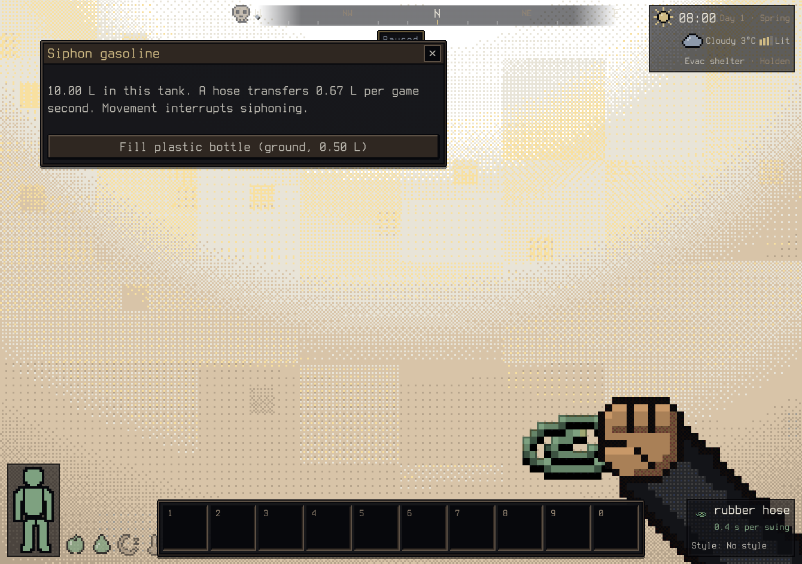

# Vehicle siphoning

Examine a stopped vehicle and choose **Siphon … (n L in the …)**. Every tank with
liquid is listed, whichever square is selected. Carry a hose and stand next to the
vehicle (any side: BN siphons from veh_interact, opened beside any part). Choose a
carried container, a suitable container on nearby ground, or **Fill nearby vehicle**
for another vehicle the hose reaches. The first choice is focused when the panel
opens, so Enter takes it; Tab moves between choices. The transfer takes game time
and movement interrupts it.

The tank loses only liquid successfully placed in the selected container. Full,
incompatible, sealed or inaccessible destinations cannot consume fuel. Completed
partial transfers survive interruption and saving. Restarting siphoning starts a
new activity with the remaining liquid; the activity itself is not saved.

Tank counters use millilitres. Item charges use their authored volume: gasoline
uses 1 ml per charge and clean water uses 250 ml. Incomplete item charges remain
in the tank. The transfer rate is Bright Nights' 4/6 litre per second from
`activity_handlers.cpp::fill_liquid_do_turn`, including its `LST_VEHICLE` source.
The carried hose requirement follows `veh_interact.cpp::cant_do('s')`. Reach is the
gas pump's (`playerReaches`, 2.5 m to the drawn body).

**Vehicle to vehicle** follows BN `liquid_handler` "Fill nearby vehicle %s": the
other vehicle must be within hose reach of you (measured like the gas pump,
`vehiclesByPump`) and have a tank of that liquid, or an empty tank its engines can
burn it from (`fillTanks`, shared with the pump). Tanks store ml on both sides, so
nothing is converted. BN pours the whole amount for 1000 moves; the port keeps the
hose rate so the transfer takes as long as filling cans would, and movement
interrupts it with the completed part kept.

**Which vehicle.** Targets of the same name are told apart (`src/game/vehicleNames.ts`
`distinctVehicleNames`): "Fill nearby vehicle: the red Car to your left (10.00 L)". The colour is
the one drawn (the spawn paint, or the livery: a police car is black-and-white, the M1 tan) and
is given only when it differs within the group; the direction (ahead, to your right, behind you,
to your left) is by where you look; the distance is added when both still match. The vehicle
you siphon from counts as a namesake, so with two Cars the target is always qualified. A unique
name stays "the Pickup". The activity and its message use the same name ("siphoning gasoline
into the maroon Car behind you"), as do the gas pump's "Fill up …" choices. Tests:
`tests/vehicleNames.test.ts`.

This permits emptying a tank before a vehicle removal job. Pouring onto the
ground, tank-to-tank balancing within one vehicle and hose network connections
remain separate work.

Validation covers guards, charge-volume conversion, non-mixing, exact item
conservation, interrupted progress and saved tank state. A real keyboard check
opened the focused tank action and filled a 500 ml plastic bottle, reducing only
the selected tank from 10,000 to 9,500 ml. The panel was visually inspected:

## Refilling from a carried container

Stand next to a stopped vehicle carrying a jerrycan (or any container) of a liquid
its tanks take, examine the vehicle and choose **Refill from your …**. BN
`veh_interact::do_refill` and ACT_VEHICLE `'f'`: no hose, 1000 moves (10 s), and the
whole pour happens at the end, so interrupting it pours nothing. As much as fits
goes in ("There's some left over!" otherwise). The port fills every tank of that
liquid, or empty tanks the engines burn it from (`fillTanks`), instead of asking for
one tank part. Code: `src/game/vehicleRefill.ts`; tests: `tests/vehicleRefill.test.ts`.

## What you see

While siphoning, a clear vinyl hose (`src/render/hoseFx.ts`, from `ActivitySpec.hose`)
runs from the tank's filler cap, on the body side nearest the tank, down to the
ground, along the ground around the vehicle bodies (`hosePath` in
`src/game/siphoning.ts`), and up to the can in your hands, the container's tile, or
the other vehicle's filler. Slugs of the liquid's colour run along it at a steady real
speed, so it reads as flowing whatever the clock warp. A refill is a tipped can at your
hands pouring into the filler when it is within arm's reach, otherwise into the body
side in front of you (BN refills from any adjacent square; a stream across the roof
would read as nonsense).

Real input: `tools/realinput.ts --only siphon` (`tools/realinput_siphon.ts`) walks up
to a car on the side away from its tank, siphons into a jerrycan, checks the
too-far text from 5 m, siphons car to car with the keyboard, and refills the second
car from the can, with screenshots in first person, shoulder and top-down views.
