# Sprite 3D: low-poly zombies that read like the tileset, and a sprite <-> 3D LOD

The brief: a love letter to 2D pixel art made 3D, not voxels. Low-poly models (built in Blender)
whose silhouette, palette and proportions read like the UltiCa sprites when they are small and
far away; and, as a prototype, the 2D sprite itself at a distance turning into the 3D model as
you approach, with a more detailed model up close.

| Switch | |
|---|---|
| `?zstyle=sprite3d`, Options → **Zombie bodies** → *sprite 3D*, `cdda.chars({ zstyle: 'sprite3d' })` | the Blender bodies (persisted like the other zombie styles; nothing else changes) |
| `?zlod=off\|dither\|pop\|flip`, Options → **Zombie sprite LOD**, `cdda.chars({ zlod })` | far creatures as their 2D sprite: off (default, 3D at every distance) / dithered cross-fade / hard pop / quick card flip |
| `cdda.chars({ lod: { far: 30, band: 12, hysteresis: 2, flipTime: 0.22, near: 7 } })` | LOD distances (m): switch distance, dither band, pop hysteresis, flip length (s), close-mesh distance |
| Gallery, group *Zombie bodies* | switches *Zombie bodies* and *Zombie sprite LOD*; scenes *Sprite LOD: one of each kind, 4–56 m* and *…broadside* (docs/GALLERY.md) |

The LOD works in any zombie style (it only needs the 3D body and the sprite); the close-range
mesh is a sprite3d thing.

## What the sprites say

`tools/blender/ref/*.png` are the reference sprites (first variant of each id, from the atlas the
game uses: BN's compiled UltiCa). What makes them read, at 32×48:

- **Chibi proportions.** A plain zombie is ~29 px tall (rows 13–42 of the 48 px frame) with an
  8 px head: about 1/3.6 of its height, where a person is 1/7.5. Hands are mitts, 3–4 px. Legs
  are short and thick, 10–12 px. Limbs are 2–3 px wide, never 1.
- **Pose.** Drawn from the side, three-quarters toward you, facing right: arms out in front a
  little below the shoulder, hands drooping, a stride (one foot forward); not much of a hunch:
  the head sits on top of the body.
- **Palette.** A grey-green skin (≈ 137, 145, 114), the clothes in a dark mid tone with a few
  hand-placed highlights, a 1 px near-black outline. Gore is red blobs on the shirt.
- **Specials by outline first, colour second**: the fat zombie's ball belly and white cap, the
  boomer a pale ball with a torn shirt on top, the brute a tank top and huge grey shoulders, the
  cop black riot gear and helmet, the soldier khaki-olive all over, the spitter hunched with
  glowing green sacs, the runner a blonde ponytail, shorts, bare legs, the skeleton yellow bone.

## How it is built

### Models drawn inside the rig's boxes (no armature)

The game animates every creature as rigid boxes (`src/render/chars/rig.ts`, zombies in
`zombie.ts`): poses, idle life, the death fall, run-over rag dolls (`ragdoll.ts`) and aim picking
(`aimPick.ts`: hit zones are the boxes) all read them. So the Blender pipeline models **one mesh
per rig part, inside that part's box**, exported in the box's unit frame (-0.5..0.5), and the
game draws it with the box's own instance matrix (`charLayer.ts`) instead of the painted unit
shape. Nothing about animation, rag dolls or aim picking changes; the head is still the head box
for a headshot. A skinned armature would have meant a second animation system, a second set of
hit zones and its own rag doll — for rigid zombie limbs that bend only at the joints anyway.

The rig itself gets the sprite proportions: `buildOf(look, 'sprite3d')` in zombie.ts (head ×1.6,
fists ×1.4, limbs ×1.25–1.55 thicker, legs ×0.8, a gentler hunch, arms out and a little down, a
resting stride, no dead dangling arm). Meshes may poke a little out of their box (hair, a
hem, claws); aim picking still uses the box. The bigger head box also means a bigger headshot
zone in this style.

Which model a zombie uses (`spriteModelOf` in zombie.ts): **walker, fat, brute, runner, cop
(also SWAT), soldier, boomer, spitter (every acid zombie), child, skeleton**. Every other zombie
(hulk, necromancer, shrieker, hazmat…) wears the walker's meshes stretched into its own boxes,
plus its family's painted gear and features (sacs, arcs, tendrils keep their painted shapes
unless the model draws them). A torn-off forearm's stump stays painted.

### Colours come from the sprite at runtime

Faces are not textured. Each material is named for what the face is:
`pal:<region>:<shade>` (skin, hair, shirt, inner, upperArm, foreArm, pants, shoes; shade 0.6–1.15
gives the 2–3 tone steps, top-lit), `fix:rrggbb` (blood, teeth, sockets, the cop's helmet) or
`glow:rrggbb:k` (eyes, acid sacs). At load (`spriteModels.ts`) they become one vertex attribute;
the shader looks the region up in an 8-texel **palette row** that `SkinStore` paints next to the
creature's skin from its own sprite (`sprite3dPalette(zombiePalette(personPalette(sprite)))`):
the one walker model wears every zombie sprite's clothes, exactly like the painted bodies. Pixel
art's cloth is a dark mid tone plus highlights a lit mesh doesn't have, so `sprite3dPalette` lifts
dark cloth toward the sprite's highlight level (jeans read blue, not black).

### Low poly, two levels

| model | far mesh (tris) | close mesh (tris) |
|---|---|---|
| walker | 1219 | 4734 |
| fat | 1288 | 5020 |
| brute | 1029 | 3974 |
| runner | 1224 | 4752 |
| cop | 1073 | 4158 |
| soldier | 1393 | 5422 |
| boomer | 1219 | 4734 |
| spitter | 1590 (with all 8 sacs) | 6152 |
| child | 1219 | 4734 |
| skeleton | 1301 | 5030 |

(Counts include parts only some members of a family have — the hump, the belly, a corrosive
zombie's extra sacs; a drawn plain walker is ~1100.) Lofted rings of 6–8 sides, flat shaded,
paint decals as single quads. The close mesh is the same model after one Catmull-Clark step,
still flat shaded (rounder facets), used inside `lod.near` (7 m). The painted bodies were ~70
triangles a part; a crowd of 60 sprite3d zombies is ~70 k triangles more than the shamble style,
in the same handful of instanced draws (one batch per mesh part and skin page).

### The pipeline (reproducible)

    nix-shell --run 'npx tsx tools/blender/export-rigs.ts'                 # rigs.json + ref/*.png
    nix-shell -p blender --run 'blender -b --factory-startup --python tools/blender/zombies.py -- [--models walker,cop] [--no-render] [--no-export] [--dry-run]'

`export-rigs.ts` writes each model's sprite3d rig in its idle pose (every part's box), the
contract (every part the game may ask the model for), the palette the game will read off the
sprite and the sprite itself. `zombies.py` builds the meshes (pure-python lofts, rings, quads),
exports `public/models/zombies/<model>.glb` + `<model>_hi.glb` + `manifest.json`, and renders
the comparison sheets. Both take `--help`; `zombies.py --dry-run` only prints triangle counts.
Blender 5.1.1 comes from nixpkgs' binary cache; renders are Cycles on the CPU (a second a model).
Re-run both after changing proportions in zombie.ts.

### Validation: sprite | 3D at sprite size | 3D large

`zombies.py` assembles each model in its idle pose, renders it with an orthographic camera at
the tileset's angle (side view turned 35° toward you, 16° from above, lit from the upper left),
scaled to the sprite's figure height, then does a pixel-art downsample (per 8×8 block the most
common colour, 40 % coverage, a 1 px dark outline on the silhouette edge) to the sprite's own
32×48 frame, feet on the sprite's foot row.

| | |
|---|---|
| all ten, sprite over 3D (3×) | 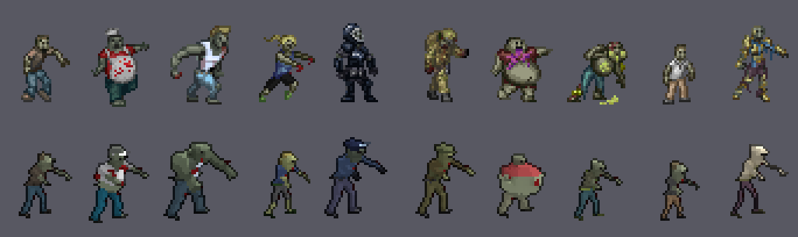 |
| walker | 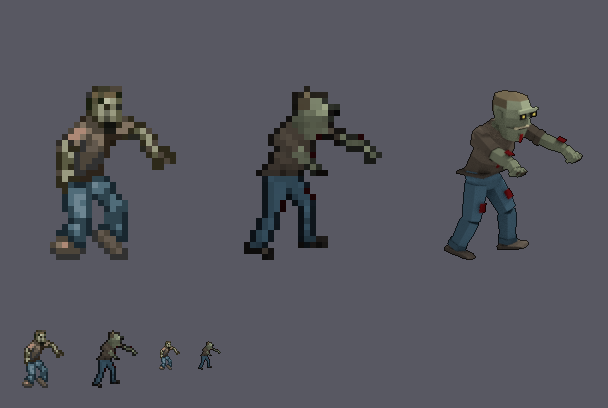 |
| fat | 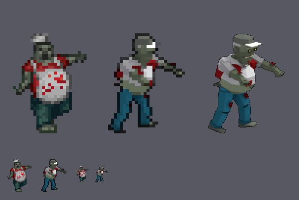 |
| brute | 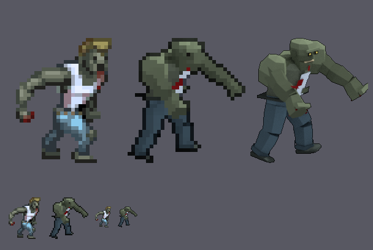 |
| boomer | 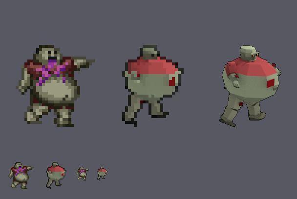 |
| cop | 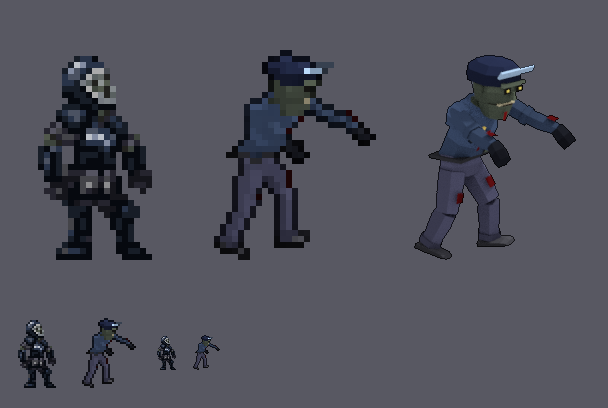 |

The iterations that mattered, in order: scale to the sprite's figure, not the frame (the zombie
fills only 29 of 48 rows); head ×1.6 and short legs; limbs thick enough to stay 2–3 px; arms out
and a little down (straight out read as holding a rifle); a 35° view (more front-on and the
forward arms foreshorten into stumps, more side-on and the chest disappears); lifting dark cloth.

### Fails loudly

`?zstyle=sprite3d` awaits `loadSpriteModels()` at boot (main.ts) and before a live switch: a
missing manifest, GLB, part or an unknown material name rejects the load (the style is not
switched, the error is in the console); a rig asking for a mesh that was never loaded throws in
the character layer instead of drawing a box. No silent fallback to the painted bodies.

## The sprite <-> 3D LOD (prototype)

`src/render/chars/spriteLod.ts` (pure: the mix for a distance), `lodView.ts` (the billboard next
to the body), wired in `monsterView.ts`. Creatures only (not corpses).

- The billboard is sized by the **sprite's figure**, not the frame: the opaque rows match the
  body's height and the empty rows under the feet sink below the floor, so sprite and body are
  the same size and stand on the same spot (`spriteFit`).
- It is mirrored when the body walks toward the left of the screen (UltiCa creatures face
  right), with hysteresis.
- **dither**: the body fades out with the 4×4 ordered dither it already used at the draw
  distance, the sprite fades in with the sprite shader's screen-door dither, same matrix, same
  threshold: complementary, every pixel is exactly one of the two. Band 24–36 m.
- **pop**: a hard switch at 30 m, ±2 m hysteresis.
- **flip**: the switch plays as a card flip: the outgoing picture narrows to an edge (the body:
  its width; the sprite: the billboard), the incoming one widens back, 0.22 s.
- Inside 7 m sprite3d bodies switch to the close mesh (any mode, including off).

| | |
|---|---|
| default (shamble), for reference | 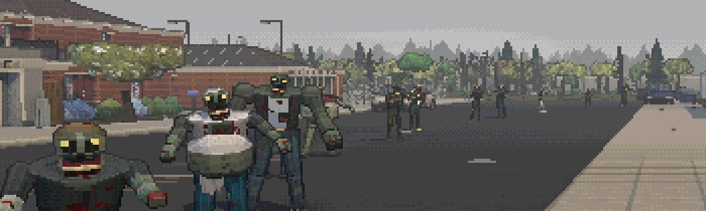 |
| sprite3d, LOD off | 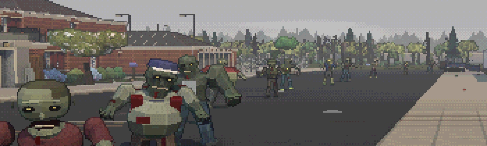 |
| dither (24–36 m) | 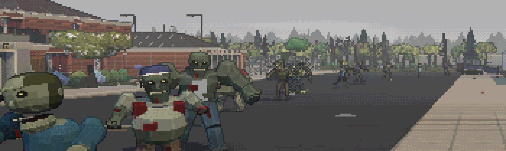 |
| pop (30 m) | 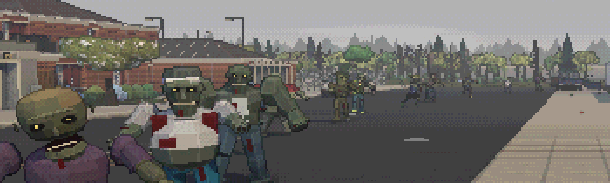 |
| `?chars=billboard` (all sprites) | 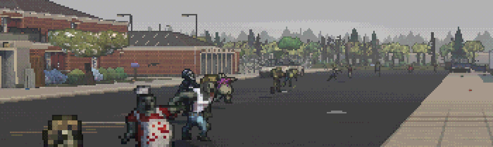 |

### Honest verdict

- **The far sprite3d body reads close to the sprite.** At 25–55 m (10–20 px tall) the sprite3d
  figures have the sprite's mass distribution, colours and big head; on the comparison sheets
  the downsampled render is recognisably the same character for walker, fat, brute, soldier,
  boomer and spitter. Weaker: the cop (the sprite is black riot armour standing upright, ours a
  navy uniform with a hunch), the child (the sprite stands upright) and the skeleton (the sprite
  is yellow bone and rags, ours reads as a white skull on a dark body). The sprites still have
  more contrast: hand-placed highlights and inner outlines a lit mesh doesn't produce.
- **The billboard LOD does not look better in first person, and I would not ship it as is.**
  The tileset draws every creature side-on facing right; in first person most zombies face
  *you*. Far away a horde becomes a row of profiles walking sideways, then turns to face you as
  it crosses 30 m. Mirroring by walking direction helps when they cross the street, not when
  they come at you. At 30+ m the 3D body is already only 10–15 px tall and, since sprite3d,
  has the sprite's proportions and palette, so the sprite adds little except its pixel-exact
  look. *dither* shows a noisy half-and-half figure across the band (visible in a still; in
  motion it reads as a shimmer); *pop* is clean in a still but pops; *flip* hides the pop in a
  0.2 s narrowing that reads as a deliberate stylisation (verified by the unit tests, no motion
  capture yet). If any, pop/flip with a much farther switch (50 m+) where the change is a few
  pixels, or sprites drawn front-on (UltiCa has none), would be the way.

## In-game screenshots

`docs/screenshots/sprite3d/ingame/` (half size JPEG): `default_*` = the current default
(`zstyle=shamble`), `s3d_*` = sprite3d, `billboard_*` = `?chars=billboard` (the sprites
themselves), `s3d_dither_*` / `s3d_pop_*` = sprite3d with the LOD. Views: `horde_near`,
`horde_mid`, `horde_far`, `horde_dusk`, `night` (flashlight), `zombie_scene_crowd`,
`zombie_scene_dusk`, `zombie_scene_night`, `zombie_lineup_a` / `_c` / `_close`, `zombie_lod`,
`zombie_lod_side`. Regenerate:

    tools/heavy --kind gpu --vram 2 --mem 2.5 -- nix-shell --run "npx tsx tools/char-shots.ts --gpu --out docs/screenshots/sprite3d/ingame --prefix s3d --views zombie_lod,horde_far --params 'zstyle=sprite3d'"

| | default (shamble) | sprite3d | the sprites |
|---|---|---|---|
| lineup, 4.5 m |  |  | 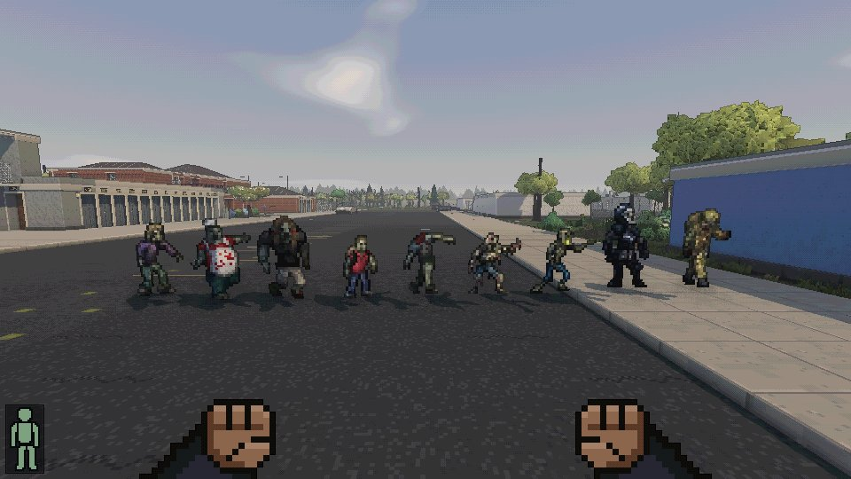 |
| specials | 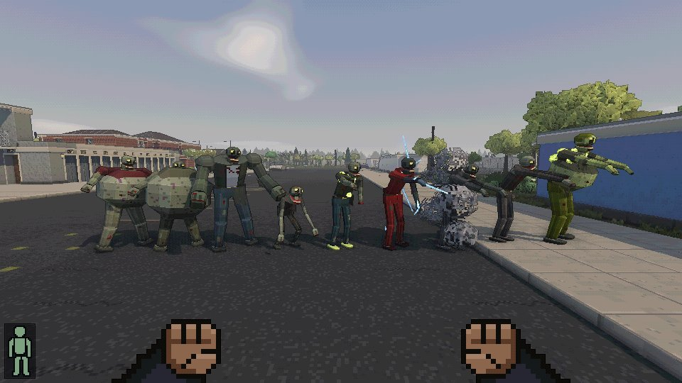 |  | 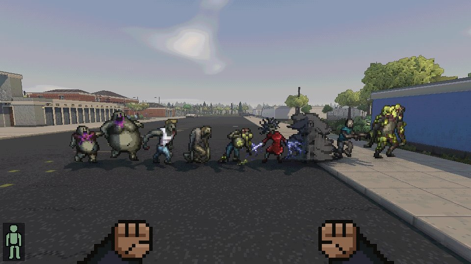 |
| crowd 5–33 m | 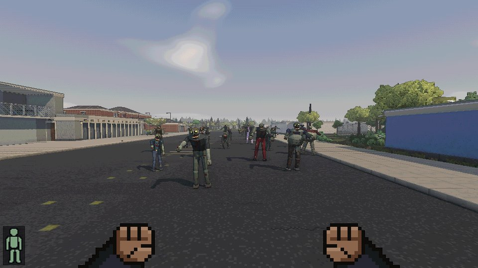 | 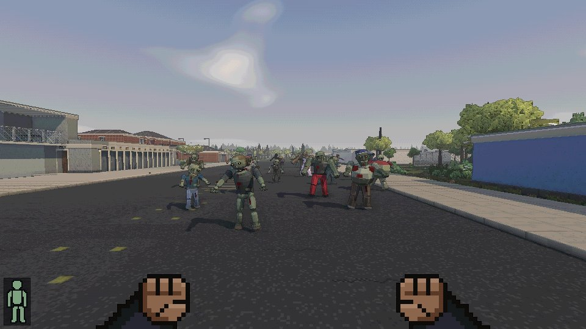 | |
| horde 38–60 m | 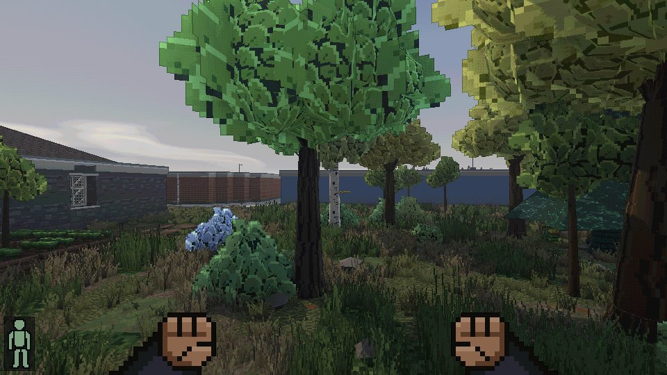 | 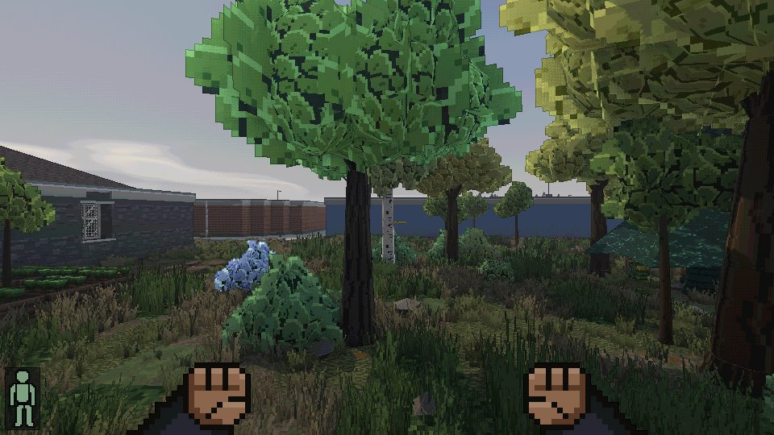 | 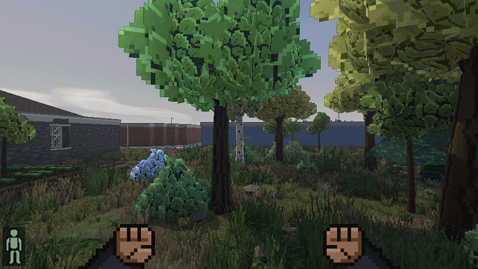 |
| dusk | 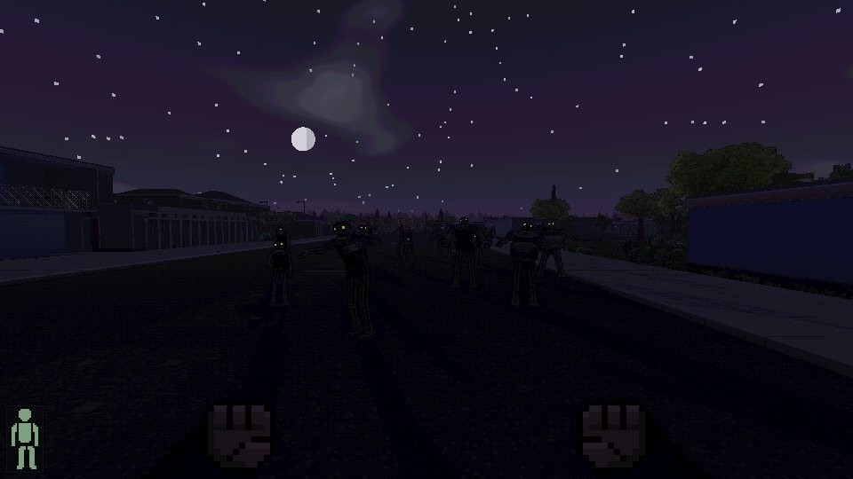 | 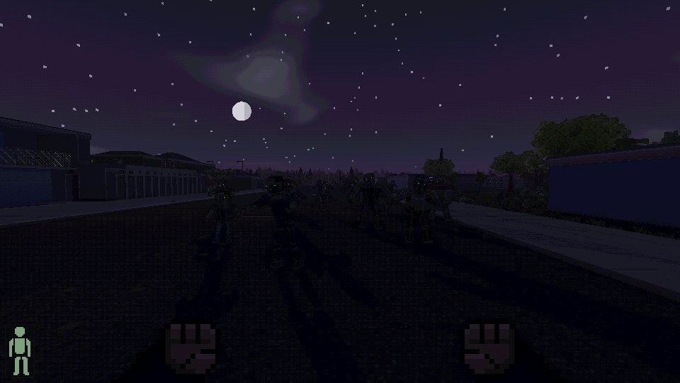 | |
| night, flashlight | 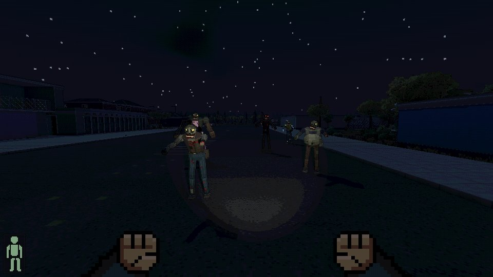 | 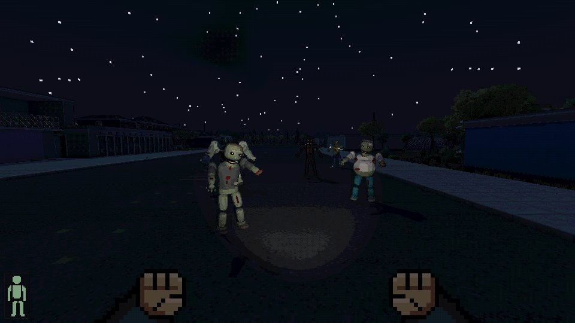 | |
| close (close mesh) | 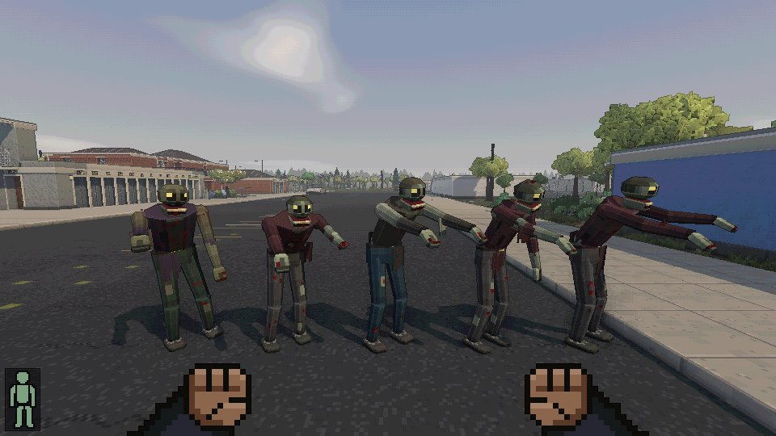 | 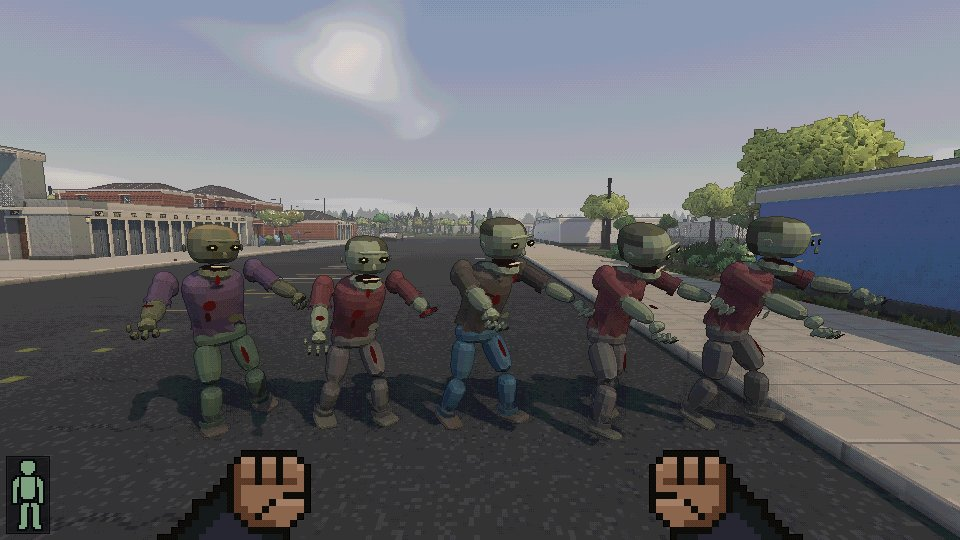 | |

## Open problems

- Model fidelity varies: cop, child and skeleton read less like their sprites (above); the
  boomer's belly sits higher than the sprite's and its shirt is red where the sprite's is
  magenta (the palette reader counts some magenta as blood).
- Faces up close are a dark socket decal + glint per eye: fine to ~5 m, slightly "mask"-like at
  arm's length. The close mesh (subdivided) only rounds facets; it adds no extra detail
  (fingers, ears, hair locks) — that would be a second set of builders in zombies.py.
- The head box (aim picking) grows with the sprite proportions: headshots are easier in this
  style.
- Only 10 kinds have their own model; the rest borrow the walker meshes in their own boxes,
  which works for proportions (hulk, necromancer) but loses their outline details unless the
  family's painted features add it.
- LOD: corpses stay 3D; dormant far figures get the sprite too but idle in profile; no
  per-distance sprite for animals beyond what their own sprite is.
- The palette row is per skin (sprite), so all individuals of a sprite variant share colours;
  gore placement is per model, not per individual (the painted bodies vary it by seed).
