# Stairs you walk up and down (wave 3)

The feedback: *"the stairs look janky as hell and seem worth just letting you walk up and
down them"*. Stairs were BN terrain rendered as eight 32 cm boxes rising 2.6 m inside one 1 m
tile (a wall of giant noisy steps), with a bare hole in the floor above, and changing level
was a key press (`<` / `>`, or `e` on the stair) that teleported you.

## What was janky (before, seed 1, RTX 5080)

| | |
| --- | --- |
| 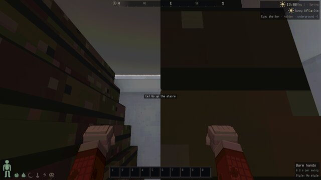 | 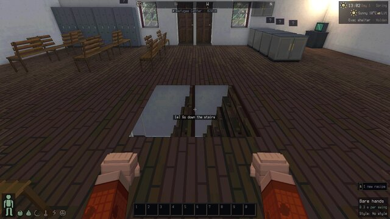 |
| 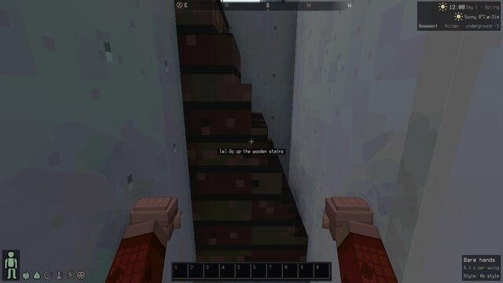 | 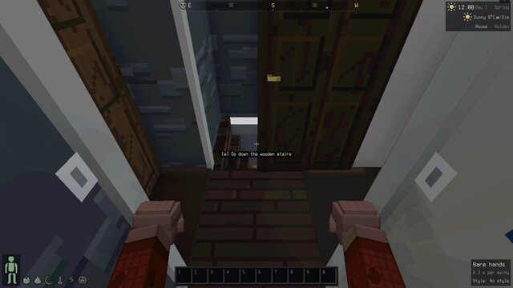 |

- A "staircase" was a solid block of 8 steps, 32.5 cm risers on 12.5 cm treads (69°), the
  tile's floor sprite stretched over every face — it read as a brick wall or a ladder of boxes.
  2x2 stairs (the evac shelter) became one huge block.
- No stringers, handrail, banister or anything under/around the flight.
- Upstairs: a square hole in the floor, no railing, no slab edge (you saw bright slivers of the
  room below through the unclosed edges), nothing saying "staircase".
- The two floors didn't read as one staircase; the flight just stopped at the ceiling line.
- Taking stairs: stand on the tile, press a key, blink to the other level. No motion, no
  sense of height, monsters couldn't follow (they only ever fell down levels).

## What changed

**Stair links** (`src/game/stairs.ts`). Every BN stair pair (GOES_UP below, GOES_DOWN above at
the same x,y — or floor on one side, which BN lets you through) becomes a *link*: a flight
with a footprint, a bottom landing, a top landing and a path. A storey is 2.6 m but a tile is
1 m, so the solver picks a shape per layout:

- **straight flight** — rises along one axis across the stair tiles. The `flight` variant
  extends it over free floor before/after the stairs (both levels must be free there) toward
  a real proportion: 3 tiles ≈ 41°, 14 risers of 18.6 cm, closed risers, nosings. Wide stairs
  (the shelter's 2x2) become one 2-wide flight.
- **spiral** — most BN house stairs sit in a 1-wide pocket (you come in and go out on the
  same side, or turn 90°), where no straight flight fits: one full turn for a U (you come out
  right above where you went in), 1¼ turns for an L. 12–15 wedge treads round a centre post,
  a helical handrail, 48° at the walking line.
- **ladder** — `DIFFICULT_Z` terrain (ladders, manholes, roof ladders): rails and rungs against
  a wall, stepping off over the top onto the roof or turning onto a landing.
- A link never cuts a floor apart: every walkable neighbour of the footprint must still reach
  the landing on its level (BFS). A stair that BN lets you walk *across* to reach another room
  upstairs stays classic (1 of ~120 stairs around the start on seed 1).

Survey of the layouts (`tools/dev/probe_stairs.ts`, seeds 1–3, radius 10 OMTs, 125 GOES_UP
tiles): spiral 360° 50, spiral 450° 6, straight 3-run 16, 2-run 6, 1-run 14, ladder 13, plain
(extra tiles of a wide stair drawn as floor) 9, classic 1. Only ~25 % of stair tiles have both
a straight run behind them and a free exit ahead upstairs; basements are almost all pockets.

**Walking** (`src/game/stairwalk.ts`). The flight's tiles are blocked for ordinary walking (a
map overlay, so physics, monster pathing and vehicles-that-ask all see it). Walking into the
bottom edge (or the top edge, from the upper landing) puts you on the path; your forward input
along the path's facing drives you up or down it, the eye follows the path height, and on
spirals (and while stepping off a ladder) the view turns with the path so W keeps meaning
"onward" and you arrive facing the way you walked. Your level switches where the eye passes
the lower ceiling (`SWITCH_H` = 1.0 m), so the light map and level-bound systems follow the
view; renderers add a `lift` (metres relative to the level) to the eye and to drawn bodies.

- Speed: 0.72× walking along the 3D path (a 3-tile flight ≈ 2 s), running 1.44× (faster, not
  double), crouching half; ladders 0.38× and running barely helps. Up costs more stamina.
- A small head bob per tread (3.5 cm), a footstep per tread (wood thump / tarmac / metal on
  ladders), and every other tread is a footstep sound monsters hear.
- `<` / `>` (and `e` on the stair tile) now climb the nearest flight by themselves; pushing the
  other way cancels. `classic` keeps the old teleport.
- A closed door on a landing opens when you walk into it; a locked one holds you on the top
  step (with its message) until it's opened.
- Nobody falls through a stairwell mid-climb. Items you drop on a flight and bodies of monsters
  killed on one tumble to its foot. Saving mid-climb restores the climb.
- **Monsters**: a hostile that saw you in the last 12 s and is on the level you left walks to
  the flight you took (up to 30 m away, 25 s after you) and climbs it after you — visibly.
  They queue behind each other on a flight. **Followers** take the flight after you too
  (instead of appearing upstairs next to you).

**Models** (`src/render/stairs/`), in the furniture kit's style (low-poly, per-face pixel
textures at 32 texels/m, nearest filtered; tread colour from the stair's UltiCa sprite): wood
treads with nosings, white risers, stringers, a spandrel panel closing the triangle under an
open side, the soffit under the flight, newel post + sloped handrail + a baluster per tread on
open sides, a wall rail against walls. Concrete stairs (shelters, labs) get concrete and steel.
Upstairs the **stairwell** is cut into the floor over the whole flight, with a fascia on the
slab edges, a band closing the gap between the walls of the two storeys, and a balustrade
round the opening except where the flight arrives; ladders get a hatch curb. The model is baked
into the chunk mesh that holds the flight's anchor tile on each level; the chunks a newly
solved flight touches rebuild once.

| | flight | compact |
| --- | --- | --- |
| shelter, from below | 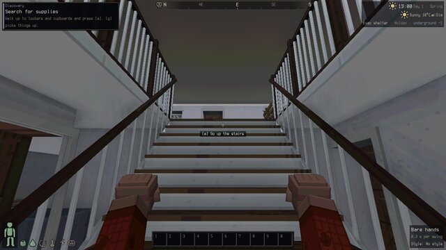 | 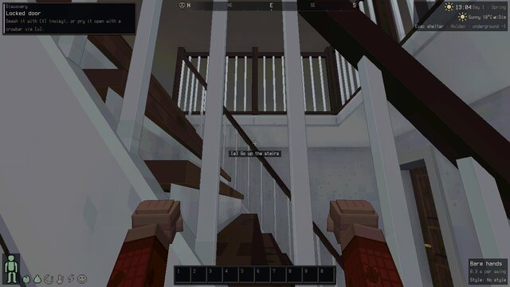 |
| shelter, from above | 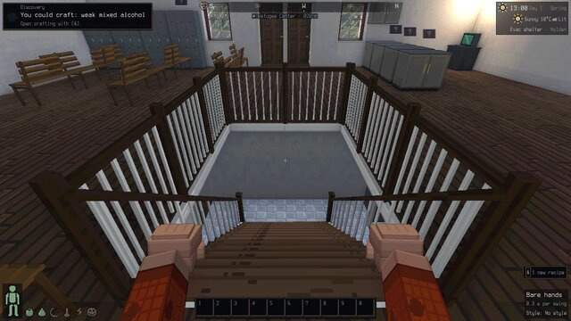 | 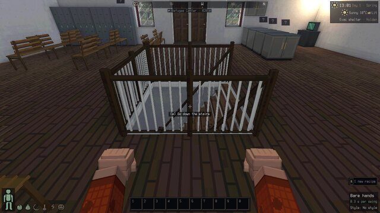 |
| house basement pocket (spiral) | 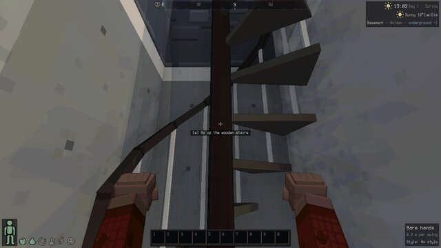 | 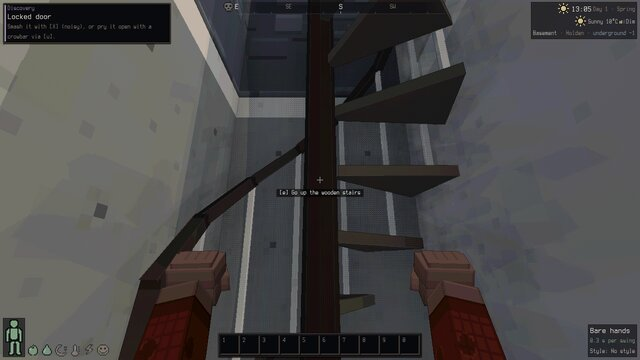 |
| house basement L (450° spiral) |  | 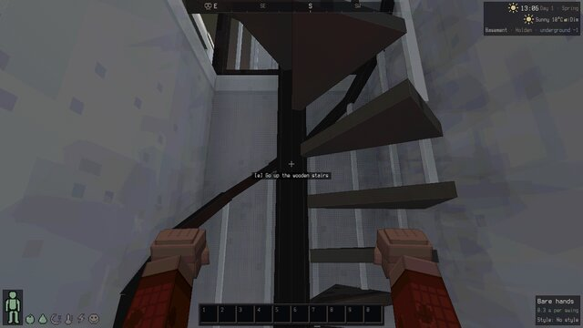 |
| roof ladder | 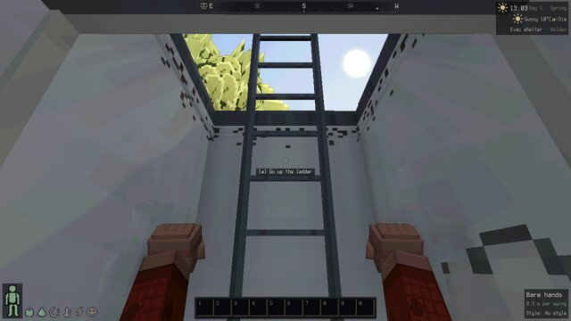 | 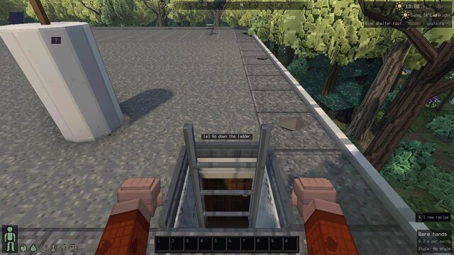 |

Walking (real key holds):

| | |
| --- | --- |
| mid-flight, the eye through the stairwell | 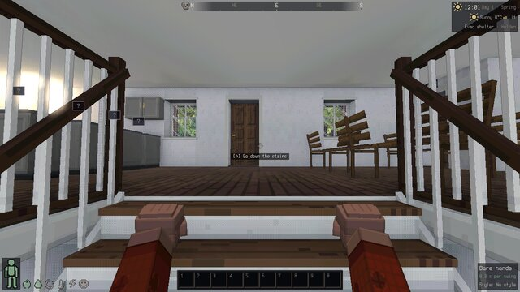 |
| at the top, turned round | 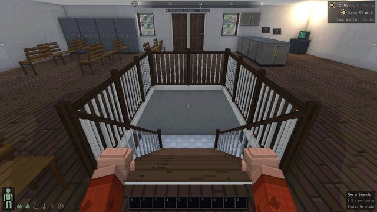 |
| inside a spiral | 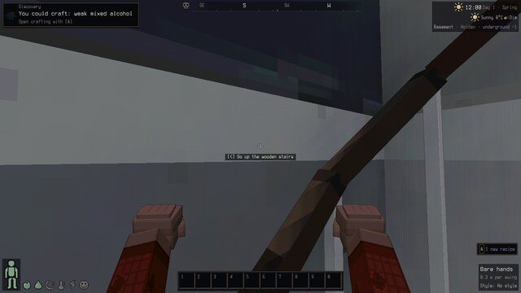 |
| a zombie follows you up | 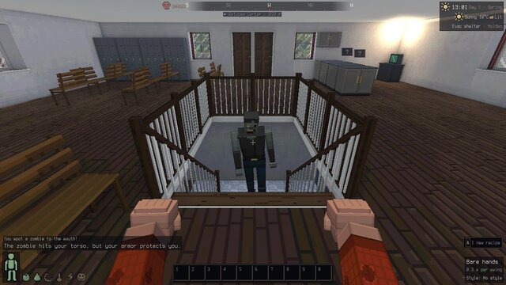 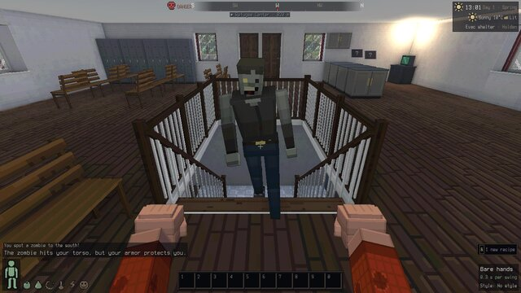 |

Classic comparison shots for every view: `*_classic.jpg`.

## Switching

| how | effect |
| --- | --- |
| Options > **Stairs** (persisted, `cdda3d.stairs`) | Flights / Compact / Classic |
| `?stairs=flight\|compact\|classic` | per page load |
| `cdda.stairs.setVariant('compact')` | live, not persisted |

- **flight** (default): straight flights spread over free floor when there is room, else
  spirals in the tile; walk up and down.
- **compact**: every flight stays inside its stair tiles — a steep ship's stair (69°, open
  risers) when you go straight through, a spiral when you turn, 2-wide flights across 2x2
  blocks; walk up and down.
- **classic**: the old boxes and the key-press teleport.

Debug: `cdda.stairs.near(r)` (links around you: shape, run, landings, footprint, path length),
`cdda.stairs.at(x, y, z)`, `cdda.stairs.climb()` (s, height, lift, level), `cdda.stairs.standAt(x,
y, z, top?)` (stand on a landing facing the flight), `cdda.stairs.liftOf(creature)`.

## Tests

- `tests/stairs.test.ts` (25): the solver on BN-like layouts (U pocket → 360° spiral, L → 450°,
  hall → 3-run flight / 1-run compact, 2x2 → 2-wide, ladders, no floor ever cut apart, a
  walk-across stair stays classic), path continuity/monotonic height/landings, walking up and
  back down every shape with held W (eye smooth and monotonic, time bounds, facing onward at
  the top), the level switch height, run/crouch speeds, no side entry, the `<` / `>` shortcut,
  classic teleport, locked/closed doors on landings, no falling mid-climb, save/load mid-climb,
  a zombie following up a flight, a zombie killed on the stairs and a dropped item ending at
  the foot, a follower taking the flight.
- Real input: `tools/realinput.ts --only stairs` (in `tools/realinput_stairs.ts`, 14 checks,
  `--gpu`): up the shelter flight with held W, turn round with the mouse and back down, run
  up, `<`, a zombie following you up, the house_16 basement spiral, the roof ladder.
- `tools/dev/probe_stairs.ts [seeds] [radius] [examples] [--none] [--where]`: the layout survey.

Perf (1280x720, RTX 5080, shelter basement view): 2.4–2.6 ms/frame with flights vs 2.4–2.5
classic (noise), +1.5k triangles. The solver runs once per stair (cached; chunk-version rescans
only look for new/removed stair tiles), the per-tick cost is a version check of the 3x3 chunks
around you.

## Hot-file edits (all small, additive)

`src/game/game.ts` (`stairStep` hook in `updatePlayerMovement`), `src/main.ts` (install
lines), `src/render/chunkMesh.ts` (`MeshExtras.stairs`; stair roles: no slab/floor/props/clutter
over a stairwell, floors under stair tiles, the model call), `src/render/camera.ts` (`lift`),
`src/render/chunkManager.ts` (`invalidateChunk`), `src/game/monai.ts` (`stairs` hook: drive,
plan, gravity, death), `src/game/npcai.ts` (`stairs` hook for followers), `src/game/zlevels.ts`
(`stairHooks`: shortcut + no falling), `src/aim.ts` (eye lift), `src/audio/install.ts` (no
stride footsteps while climbing), `src/render/monsterView.ts`, `npcView.ts`,
`chars/creature.ts`, `chars/playerModel.ts` (lift), `tools/realinput.ts` (scenario).

## Known gaps

- Fighting *on* a flight: melee and monster attacks compare levels, so a zombie below the
  level switch point can't hit you above it (and vice versa); the fight happens at a landing.
  Hit tests of the drawn 3D bodies do follow the lift.
- Vehicles collide with terrain, not the map overlay, so a car could in principle drive onto a
  flight's lower tiles (stairs are indoors; not seen in play). Not touched: vehicles.ts is
  another agent's file this wave.
- Spirals in 1 m pockets are cramped in first person (the handrail sweeps across the view);
  there is no room for anything else in those BN layouts short of rebuilding the house.
- A stair BN lets you walk across upstairs stays classic (old boxes); a GOES_DOWN tile with
  floor under it counts as a stair, rubble or rock under it keeps the classic teleport.
- Stair search across offset stairs (labs whose stairs don't line up) still uses the classic
  24-tile search teleport.
- Monsters only follow the survivor's own trip; they don't path across levels on their own.
- Ramps (`RAMP_UP` / `RAMP_DOWN`, 4 mapgen references) and ladder shafts spanning several
  levels (`t_ladder_up_down`) are not modelled as continuous shafts (each level is its own link).
