# Vehicles: modelled bodies (wave 3)

Feedback: *"the cars look terrible! so boxy and weird"*. A Bright Nights vehicle is a grid of
parts (frame, boards, doors, windscreen, seats, wheels ... one tile each). v2 drew that grid
literally: one box per part, so a car read as a stack of tiles (and doors, which BN flags
`OPENABLE` rather than `DOOR`, came out as coloured blocks). Wave 3 keeps the grid for
gameplay (collision, interaction, damage) but draws each vehicle as **one cohesive low-poly
body** in the Shadowglass style: shaped geometry, a fixed-density pixel-art skin, stepped
lighting.

## Switching

| how | |
| --- | --- |
| Options > **Vehicle look** | modelled bodies (default) / part blocks (the v2 look), persisted |
| `?vehicles=model` / `?vehicles=parts` | URL override (anything else throws) |
| `cdda.vehicleLook('parts')` | live; every vehicle rebuilds next frame |
| Options > **Vehicle width** / `?vehiclewidth=real\|fill` / `cdda.vehicleWidth('fill')` | model look only: `real` (default) draws real-world proportions; `fill` stretches bodies to the grid footprint. Collision follows the drawn body either way (below), so `real` has no invisible wall |
| Options > Gameplay > **Vehicle crashes** / `?vehcrash=momentum\|immovable` | vehicles push and spin each other (default) / the old immovable-vehicle model ("Momentum crashes" below) |
| Options > Gameplay > **Heavy vehicles** / `?vehheft=weighty\|light` | tanks and other heavy / tracked vehicles handle heavy (default) / everything on the car tuning |

`fill` for comparison (same views as the first two rows below):

| 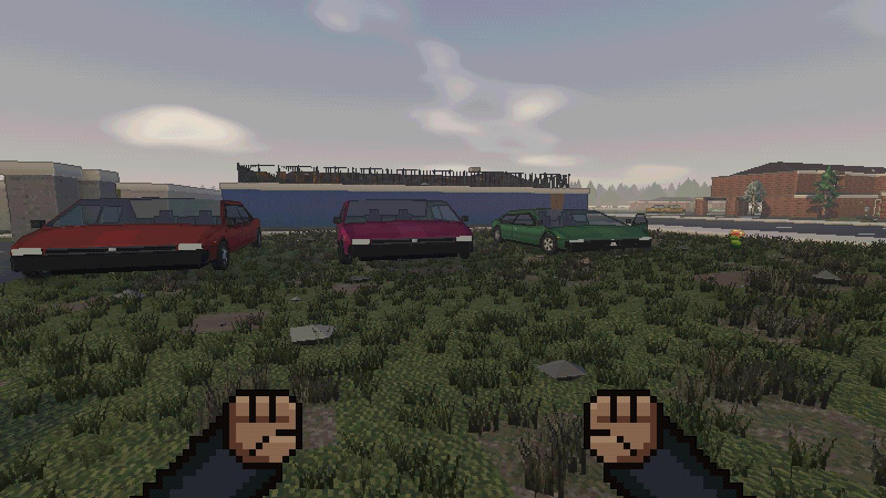 | 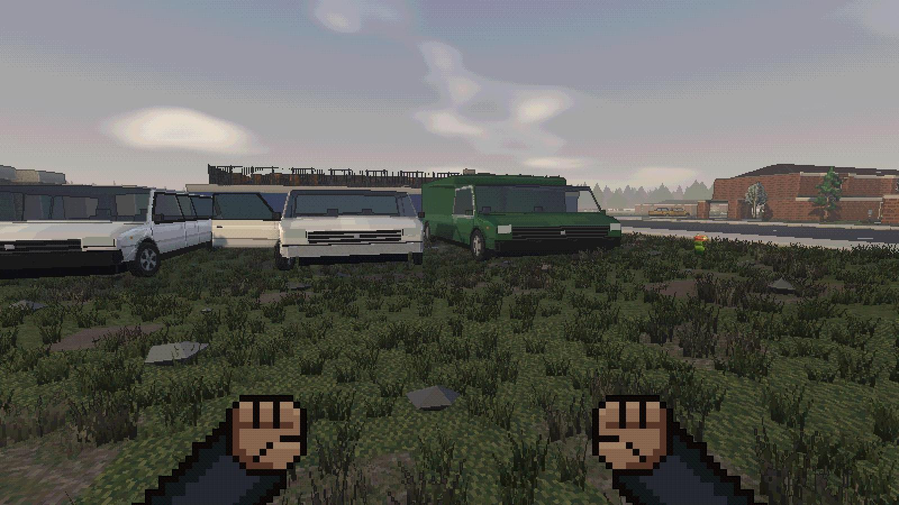 |
| --- | --- |

## v3 phase 1: chassis templates (drawn body = gameplay body)

Vehicles v3 (`docs/design/VEHICLES_V3.md`, research in `docs/research/VEHICLE_BUILDING.md`)
moves every vehicle onto an authored **chassis template**. Phase 1 (this) is templates +
mapping, no building yet: the body a vehicle is drawn with, collides with, is boarded through
and is crashed into is now one thing, owned by the game (`src/game/chassis/`), and every BN
part sits in a typed socket of it.

**Templates** (`src/game/chassis/templates.ts`), a ladder of rungs:

| rung | templates (BN vehicles on them, of 257) |
| --- | --- |
| bike | `bicycle` 7, `scooter` 4, `motorcycle` 8 (sidecars fit) |
| car | `hatch` 3, `sedan` 12, `sports` 8 |
| utility | `suv` 15, `pickup` 3, `minivan` 3, `van` 1 |
| heavy | `box_truck` 15 (cube vans, ambulances, food trucks, RVs), `bus` 4, `semi_cab` 1, `heavy_truck` 8 (fire engines, flatbeds, army trucks), `trailer` 18 (the box trailer and BN's 17 tankers) |
| home | `rig`: the top rung (a long deck with a walkable box), defined now; nothing spawns it (built in phase 3) |
| frame | `frame` 35 (golf carts, tractors, draisines, forklifts...), `frame_small` 27 (carts, chairs), `frame_tracked` 21 (tanks, APCs), `frame_boat` 26, `frame_air` 38 |

A template has a family (`body`: an authored shell; `bike`; `frame`: an honest home-made
grid that collides with its cells), the style the renderer draws it with, a grid envelope it
accepts (body columns x rows), the real-scale body it promises (length / width ranges the
tests hold every mapped vehicle to), its engine-bay rows and its dimensions (sill, belt,
roof, box, rake... the wave-3 `STYLE_PARAMS`, which moved here from the renderer).

**Sockets** (`mapping.ts`): `frame` (structure; belly tanks, non-wheel running gear),
`wheel` (axle + wheel), `cabin` (centre parts in the cab: seats, controls, aisles), `panel`
per side (`left` / `right` / `front` / `rear`: doors, glass, boards, armour, and protrusions
hung on it: wing mirrors), `roof` (roof, on_roof, on_ceiling), `engine` (engine_block, the
tanks and batteries by it) and `interior` (bed / box / deck load space). Each carries the BN
locations it takes and the BN cell it stands for, and has a position on the body
(`socketPos`). BN's empty-location and `on_*` parts (lights, horns, batteries, seatbelts,
alarms) are fittings riding on their cell's host socket.

**Mapping** (`mapChassis`, `pickTemplate`): the template comes from the prototype id (the
wave-3 rules split into rungs), else the grid; a grid outside the named template's envelope
falls back to the frame family (by what it's built from: floats, wings/rotors, tracks or
armour, a cart-sized grid). Every installed BN part object goes into a socket, untouched
(condition, faults, fuel, cargo items stay on it): nothing is copied, so nothing can be lost.
A part the template has no socket for (an engine in a sedan's trunk, a part off the body's
columns) is **kept, installed and working**, in `chassis.overflow` with the reason, and
`VehicleSystem.add` reports it (`[chassis] ...` warning once per prototype). Stock BN data:
**0 of 26,885 parts overflow**. The template is chosen once and saved: a stripped or modified
vehicle keeps its body (only choosing checks the envelope).

Where it is used (`src/game/chassis/index.ts`):

| | |
| --- | --- |
| `chassisOf(v)` | template + sockets + overflow; mapped when a vehicle enters the world (`VehicleSystem.add`: mapgen spawns, debug spawns, saves) and kept current |
| `layoutOf(v)` | the template placed on the grid: nose / tail / half width, sections, wheels, doors (cached per vehicle version and width mode). The renderer's `analyze()` is this now: **the modelled look draws the template** |
| `chassisBodyRect(v)` | the collision outline (the renderer hands it to `VehicleSystem.bodyShape` in the modelled look): terrain, vehicles, creatures, run-overs, `playerOn`, the crosshair, doorways, cargo reach, refuelling reach all use it |
| `hitMount(v, x, y)` | crash damage by side: the contact point's side of the body -> that side's nearest panel socket -> its BN cell -> `collisionPart` (armour, then what blocks, then the frame, as BN) |
| `chassisSeats(v)` | every seat / bed with its drawn position (mount space, inside its cell), cushion height and whether it's the driver's. The driver is seated there; **riders** (NPCs / the survivor drawn seated) should use this: world position `v.mountToWorld(s.x, s.y)`, height `v.z * LEVEL_HEIGHT + s.h`, facing `v.facing` |
| `noseX(v)` | the headlight beam starts at the template's nose |
| `cellAtPoint(v, x, y)` | the part under the crosshair on the paint (a turned car no longer picks the tile centre's part) |

Other gameplay changes: `e` gets you out through the nearest door you can **walk to inside**
(the bus driver's door is across the cab; before, `e` in a bus only let go of the wheel), and
stair flights (`src/game/stairwalk.ts` walls their footprint off for walkers) now stop
vehicles too (`VehicleSystem.obstacle`: any other map overlay that makes a tile impassable),
and mapgen won't place a vehicle on one. BN part stats and behaviour (engines, fuel, wheels,
mass, speed) are unchanged. Headless (tests, the sim) and the `parts` look keep colliding with
whole grid tiles (`bodyShape` null), exactly as before.

**Data**: the vehicle extractor now reads BN's `blueprint` + `palette` prototypes and
single-part mount entries (`{x, y, part}`), which it skipped: 26 prototypes were empty (the
17 tankers, the airship, airboat, F-35, Harrier, airliners, catamaran...) and others had lost
parts (the JLTVs, scooters, superbike, tractors, wagons). 64 prototypes changed; parts and
groups are identical.

**Saves**: each vehicle saves `chassis: { template, v: 1 }`. A save from before v3 (no
`chassis`) is migrated once on load: the same mapping as spawns, keeping every part's
condition, fuel and cargo (`console.info` says how many); saving again writes the templates.
The dev hot-reload snapshot is a save, so it carries them too. Chassis data newer than the
build refuses to load (loudly); an unknown template name is re-mapped with a warning.

**Debug**: `cdda.chassis(uid?)` (template, why, sockets by kind, seats, overflow),
`cdda.chassisCensus()` (templates of every vehicle in the world, overflow, migrated),
`cdda.chassisOverlay(true)` (the template body = collision outline in yellow, sockets as
coloured crosses: panel orange, cabin cyan, engine pink, interior blue, roof green, frame
grey; seats white with the driver's red; overflow red X). `npx tsx tools/chassis-report.ts`
maps all 257 prototypes and prints the table above (`--proto ID` lists one's sockets).

**Tests**: `tests/chassis.test.ts`: all 257 prototypes map, every part in exactly one socket
or the overflow; the familiar vehicles land on the familiar rungs; every shaped body is
inside its template's promise and its grid; seats sit in their cells and the body, every
driver can get in and the road vehicles' passengers can walk to their seats; part state and
cargo items survive mapping and a save round trip (all 257, used and wrecked); overflow for
an engine in the trunk and a ram off the side; the rig on a flatbed's grid; crash sides;
the bus driver seated on the drawn seat and climbing out; stair flights stop a car (body and
whole tiles) and refuse spawns; the pre-v3 save fixture (`tests/fixtures/vehicles_pre_v3.json`,
`tools/dev/gen-vehicle-save-fixture.ts`) migrates with nothing lost. Real input:
`tools/realinput.ts --only chassisdrive` drives a pickup, a cube van and a bus 40+ m through
a town with W / Space / V / e: the drawn shell within 10 cm of the collision outline, seated
on the template seat, no scratch, `e` climbs out to stand outside the body.

BN's own data walls some seats in (no door into the room): the surv_rv's and tour bus's
beds, the bubble car's cabin (its canopy doors open onto windscreen), the Apache's and
Medevac wreck's gunner seats, two airliner seats and the F-15's cockpit (its canopy opens
onto the wings). Drivers still get in from beside the vehicle (`GET_IN_RANGE`) except the
F-15.

Screenshots (half size; `before` = the `bn` branch, `after` = phase 1): see
`docs/screenshots/vehicles-v3/phase1/`.

| | before (`bn`) | after (phase 1) |
| --- | --- | --- |
| bike and car rungs: bicycle, scooter, motorcycle, mini, car, sports |  | 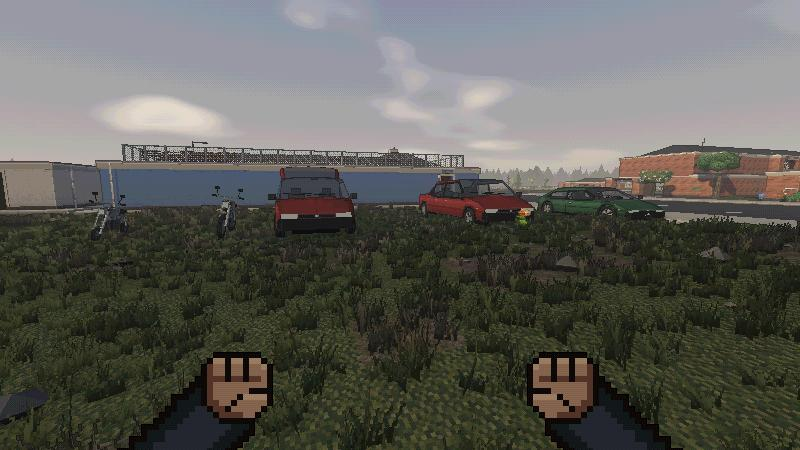 |
| utility: SUV, pickup, minivan, van, box truck | 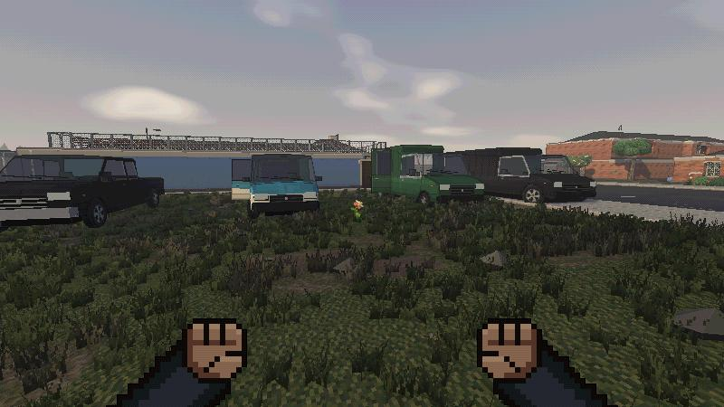 | 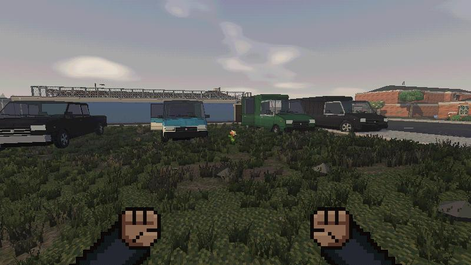 |
| heavy: bus, semi cab, heavy truck, trailer | 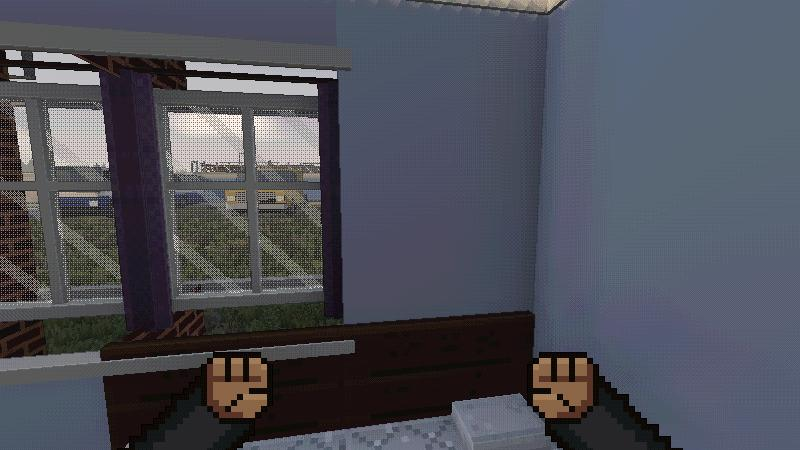 | 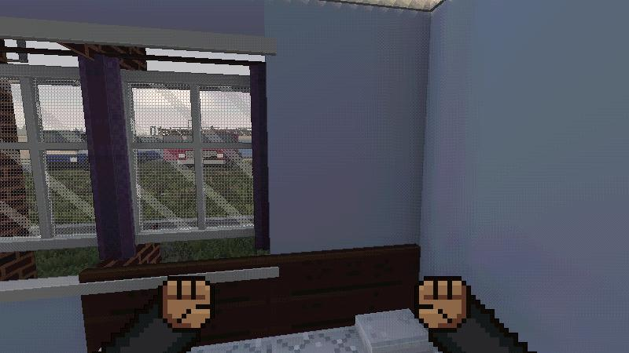 |
| frame family: golf cart, tractor (now with all its BN parts), APC, sea scooter (was drawn as a motorcycle), JLTV | 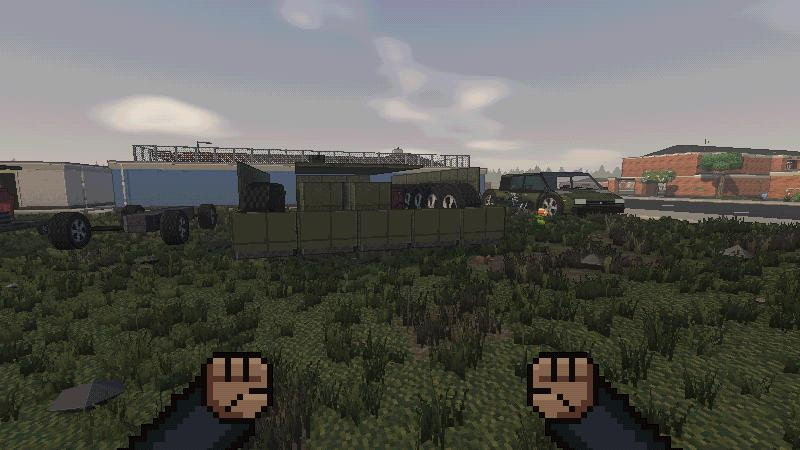 | 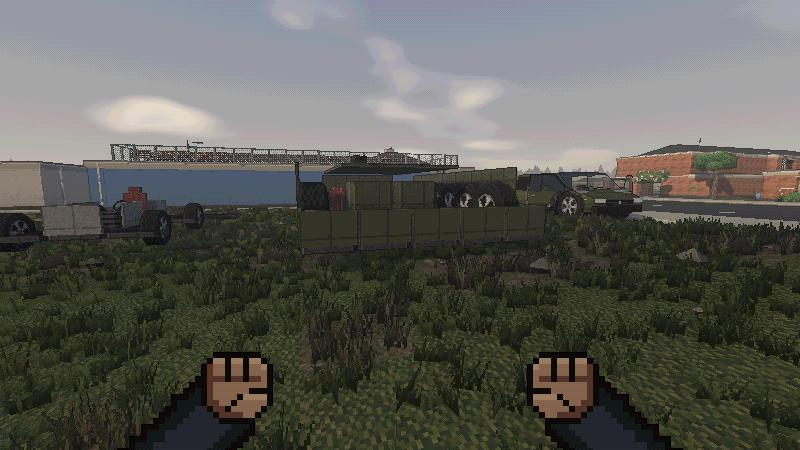 |
| a BN tanker (was an empty prototype: spawning one hung the page) | (nothing) | 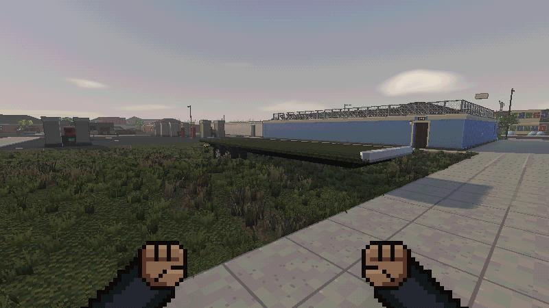 |

The bodies look as in wave 3 on purpose: the templates took over the wave-3 shapes, so
drawn = gameplay changed underneath, not the paint. `cdda.chassisOverlay(true)`: template body
(yellow) = collision outline, sockets, seats (driver red):

| | |
| --- | --- |
| 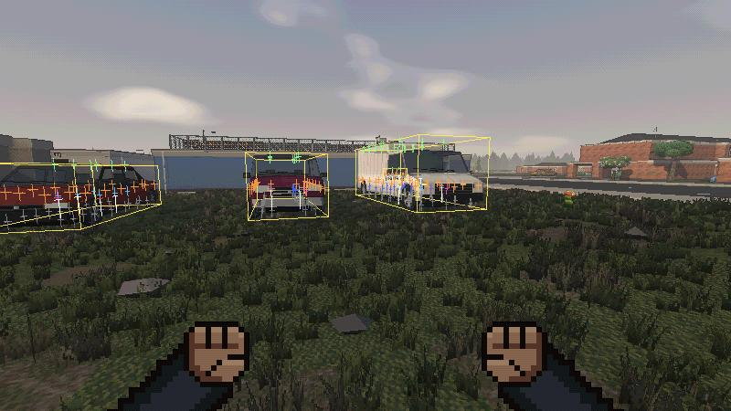 | 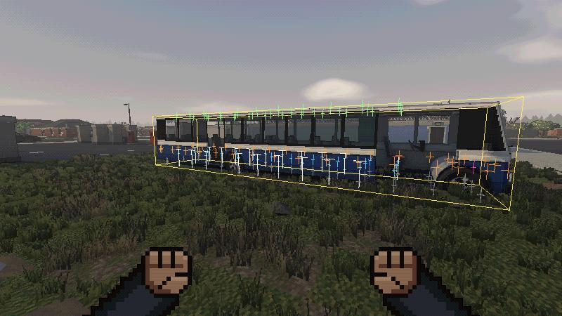 |
| 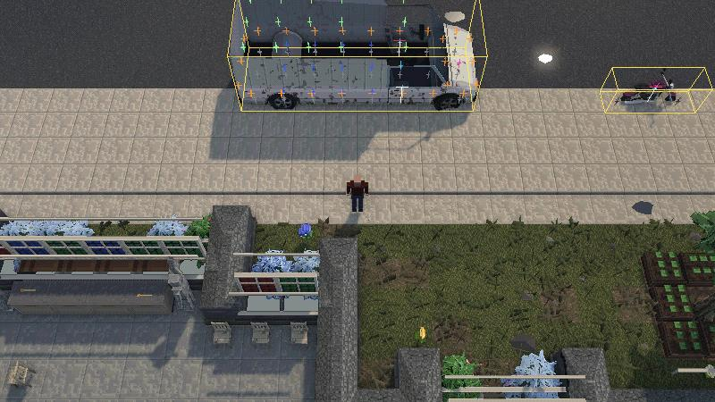 | real input: the bus driven through town 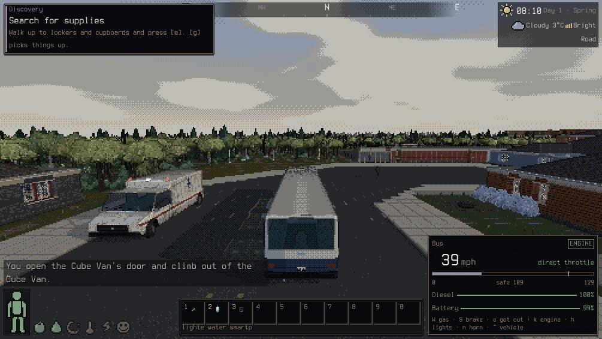 |
| pickup 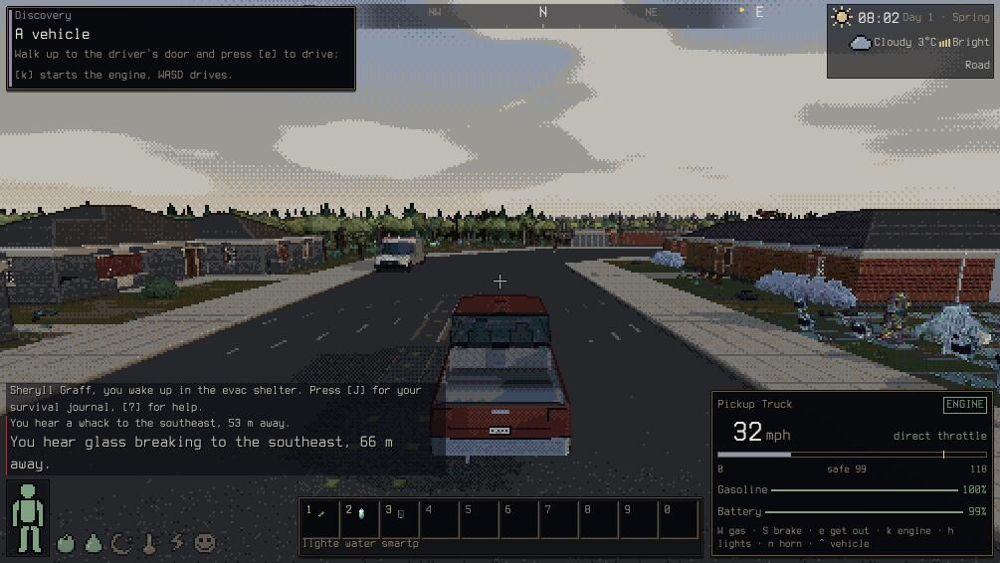 | cube van (box truck) 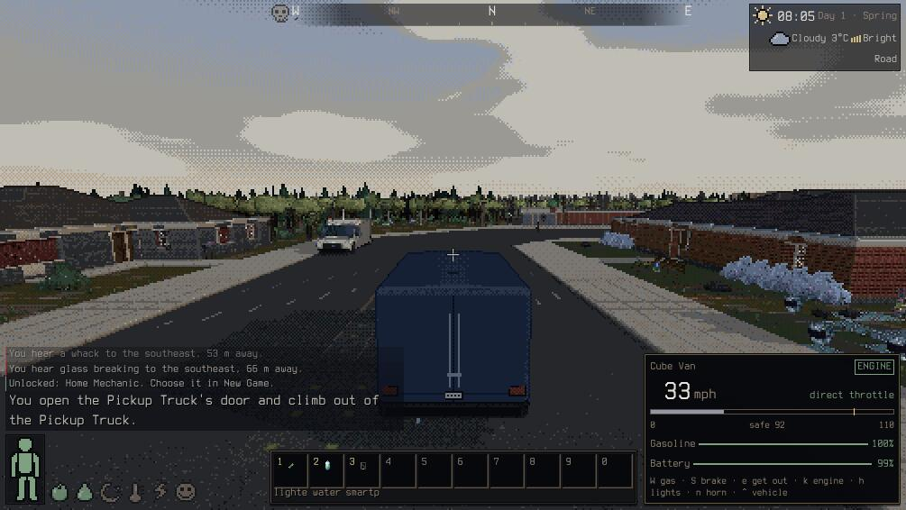 |

Known gaps: tankers are drawn as a flat deck (their tanks aren't modelled: per-part visuals
are phase 5); the sea scooter / flying motorcycle now get the frame look; panels hold BN's
side parts but nothing is drawn per socket yet.

What phases 2-3 build on: `v.template` (saved, authoritative) is the adopted vehicle's body;
sockets list what can be stripped (phase 2: `socket.parts` -> items through `moves.ts`) and
where parts install (phase 3: a socket's `accepts` + BN's per-part gating); `overflow` is the
"doesn't fit, here's why" list the planner shows; `mapChassis(v, 'rig')` already places the
top rung on a long grid. Missing for them: a `Vehicle.removePart` (the part index is
append-only today), sockets that exist without a part in them (today a socket is created by
the part that fills it: the planner needs the template's empty sockets too), and per-socket
visuals (plates over windows, rams, roof racks: phase 5).

## Inside vehicles (`src/game/vehwalk.ts`)

On foot you used to walk a vehicle's cells like any floor, at BN's move costs: every seat or board
cell costs 8 (400 moves, a quarter of road speed: ~0.4 m/s against ~1.5 m/s on the road beside
it, measured with real keys), the eye stayed at the road's 1.6 m whatever the drawn floor (sunk
into an RV's 0.5 m floor, capped under a car roof at 1.42 m), and nothing knew what a seat was:
slowly floating through the vehicle. Now you don't free-walk inside; what you get comes from the
vehicle's data (chassis template, armour, aisle cells), never its id (`cabinKind`):

| cabin | which | inside |
| --- | --- | --- |
| `wheel` | cars, pickups, SUVs, humvees, bikes (< 3 AISLE cells) | at the wheel or outside. `e` at the driver's door drives (as before); walking in an open door takes the wheel if that's the seat you reach, else seats you; `e` at the wheel gets out. Let go of the wheel from the vehicle menu and you sit in the seat: W/A/S/D only say how to get out / drive |
| `deck` | RVs, buses, vans, ambulances (3+ AISLE cells) | stations: the driver's seat, seats, beds, one spot per aisle cell. W/A/S/D hop to the nearest station that way (60 deg cone, only stations you can reach inside: BN-walkable cells plus doors) in ~0.2-0.8 s, eye seated at the drawn seat / standing on the drawn floor under the roof / lying on a bed. `e` at the wheel lets go and keeps you in the driver's seat. Outside doors are the *exits* of the station beside them (the cab door by the driver, the bus door by its front aisle spot): a step toward the door, or `e` there, gets you out through it |
| `crew` | armoured hulls on a frame template (tanks, APCs, IFVs: what vehicleTank.ts draws) | crew stations only: driver (head out of the driver's hatch), gunner / commander seats (seats with a turret or turret mount on their cell; head at the cupola), hatches (head and shoulders out above the turret). All connected; no deck. `e` at a hatch climbs out and drops you on the nearest free tile beside the hull |

Gameplay that stays: boarding through doors, `e` to get out, taking the controls, BN move costs
for everyone else (monsters, NPCs, the free walk), the crosshair's `o` menu (cargo reach) at any
station. Hops burn stamina and spoil aim like a walk of the same length. At a gunner station `e`
mans the gun there (see "Turrets" below): `stationActions` in vehwalk.ts takes `(vs, v, station)
=> { label, run } | null` and wins over the station's own `e`. Shots from any station leave the
station's eye (seat, hatch, cupola: `aimHooks.stationEye`), not 1.6 m over the road; a main gun's
gunner sits 0.7 m to the left of the barrel (the M1's sight), so the gun doesn't hide its target.
In third person a crew station's camera stands 8 m off and 2.4 m higher (`rig.stationWide`) and
is laid on the point your eye's ray reaches (the ground it meets, at most 45 m out), so the
crosshair sits on what the gun is laid on and the turret drops to the bottom of the frame. It
used to look parallel to the eye from 1.6 m above it, and the tank's own opaque armour pulled it
in to a metre behind your head: the screen was turret roof. The pull-in now ignores the tiles of
the vehicle you're in (`rig.stationOwn`); real walls still pull it in.

**Your body at a station** (third person, 3D characters): at a seat, bunk or gunner's seat it
sits (hips 0.66 m under the station eye, hands in the lap, feet on the floor ahead); at a hatch
it stands in it, forearms on the rim, waist down inside (`stationAnchors` in vehicleRider.ts,
placed by VehicleRenderer like the driver's body). A commander in a hatch or a gunner in a turret
faces where you look; everyone else faces forward. Deck spots (RV aisles) keep the standing
body. It used to be the standing body lifted to the station eye, legs through the seat. A hatch
on the hull deck (the M1's driver's) puts your head 0.9 m over the deck, not over the turret
roof (`turretFoot`: the circle the turret covers while it traverses).

**Saved station.** The station you're at is saved (`VehicleSaveJSON.station`: vehicle uid, index,
kind and cell) and restored on load, checked against its kind and cell. Before, a load re-guessed
the nearest station to where the player section put you, which picked the gunner's seat for a
save at another station.

| how | |
| --- | --- |
| Options > Controls > **Inside vehicles** | `stations` (default) / `allstations` (cars and pickups hop seat to seat too) / `free` (the old walk), persisted |
| `?vehwalk=stations\|allstations\|free` | URL override (anything else throws) |
| `cdda.vehWalk(mode?)`, `cdda.vehicleStations(uid?)` | mode + where you are; a vehicle's cabin and stations |

Camera: `rig.stationEye` (render/camera.ts) is set every frame by VehicleRenderer from the build's
`deckY` / `roofY` / `turretTop` / `eyeH` and the station's posture, eased across a hop with a
5 cm step; the third-person body is lifted to match. Tests: `tests/vehicleStations.test.ts`.
Real input: `tools/realinput.ts --only vehwalk` (car in / out, RV driver -> aisle -> door ->
out, Abrams driver -> gunner -> hatch -> out; `--params vehwalk=free` for the old walk).

## Turrets (`src/game/turret.ts`, `src/turrets.ts`, `src/render/turretFx.ts`)

The user plays an M1 Abrams: `mounted_tank_manual` (M246 120 mm, `tank_gun_manual`),
`mounted_browning` (M2HB, belt-fed) on the commander's seat, `mounted_m240` on the loader's, an
ammo rack (`m1_abrams_ammo_rack`: HEAT / APFSDS rounds, cases, primers) in the trunks behind the
gunner. Before this, turrets were drawn and nothing else: "turret firing isn't built yet".

**What BN does** (src/vehicle/turret.cpp, avatar_action.cpp, handle_action.cpp `fire()`,
ranged.cpp, vehicle_functions.cpp, veh_type.cpp):

| | BN | here |
| --- | --- | --- |
| the gun | `vehicle_part::base` is the gun item, flagged `VEHICLE` (ignores `NO_RELOAD`, draws `ups_charges` from the vehicle's batteries) | `VehiclePart.gun` (an `Item`, saved with the part), `turretGun()` creates it and sets `VEHICLE` |
| spawn ammo | prototype part `"ammo"` (% chance), `"ammo_types"`, `"ammo_qty"` ([min, max], default {-1,-1} = full); `place_spawn_items` | extracted onto `VProtoPart` (tools/extract/vehicles.ts), loaded in `placeSpawnItems`: the Abrams' turrets 80% loaded, the 120 mm with one HEAT or AP round, the M2 / M240 with a 10-100 round belt |
| status | `turret_data::query`: no_ammo / no_power (UPS drain × mode qty > battery) / ready; USE_TANKS turrets feed from the tanks | `turretStatus` (USE_TANKS: ammo from the tanks counted; firing them by hand isn't built) |
| manual fire | unarmed on the turret's tile, `f`: `fire_turret_manual` → `turret.fire(you)`: **your** skills; `prepare_fire` zeroes your recoil (only `recoil_vehicle` = \|velocity vmiph\| × 3 / 100 MOA), `post_fire` restores it and drains the battery | at a gunner station `e` mans the gun (or `f` with empty hands mans and fires): it's the active weapon (`bionicguns.ts activeWeapon` providers) and LMB / `f` fire it through PlayerCombat's free-aim pipeline; `PlayerCombat.mounted` swaps your recoil for the vehicle's, sends the round from the muzzle toward the point under the crosshair, drains the battery |
| the controls | `f` at CONTROLS: `turrets_aim_and_fire_mult(MANUAL)`: every non-MANUAL-mount turret in manual targeting mode (spawned disabled = manual), ready and in range, fired at one target by a fake NPC (gun skill 10, marksmanship 5, Str 20, Dex 10, Per 15) | `f` with empty hands at the wheel or the driver's station: the volley, laid on the crosshair's point, the same CPU gunner |
| reload | standing on a turret, `r`: ammo / magazines from you and within 1 tile (`find_ammo_items_or_mags` range 1), `item_reload_cost`, a menu picks the round | `r` while manned: carried items and cargo within one cell of the turret (the rack beside the gunner, the seat cargo under the MGs); `reloadTurret` through moves.ts; the M2's old belt to your inventory (else back to the cargo); reload moves as 1-6 real seconds; `fire_mode` (`b`) at a single-mode gun picks the next round type (`turret_data::ammo_select`), at the M2 its fire mode |
| jams | `handle_gun_damage` per shot | the same roll (`rollMalfunction`); `r` clears a jammed turret gun |
| noise, damage | `fire_gun`: gun + ammo loudness; projectile damage; CUSTOM_EXPLOSION blows up with the round's `explosion` (`{damage, radius}` new style) | as any gun; `ammoEffectsAt` sets off CUSTOM_EXPLOSION through the one BN explosion (`blast.detonate`, the HEAT round's 150 / 3: [Blasts and vehicles](#blasts-and-vehicles-srcgamevehicledamagets)); a round that stops on a vehicle damages a part there (`map::shoot`); a kinetic 120 mm round bashes the wall it hits |
| vehicle recoil push | `apply_gun_recoil_to_vehicle` | not modelled (0.2 mph on the Abrams) |
| autoloaders, auto targeting | `try_autoload_turret`, `automatic_fire_turret` | not built |
| saved state | `vehicle_part` saves `ammo_pref`; the base item (the gun) holds its rounds | the gun with its rounds, each turret's bearing over the hull and elevation (`VehiclePart.aim`, saved hull-relative) and the round type `b` picked (`VehiclePart.ammoPref`) |
| removing a turret | `properties_to_item`: a copy of the base item (the gun, with what's loaded in it), VEHICLE unset; a broken part gives `pieces_for_broken_part` only (its rounds are lost) | the same: vehicleWork.ts removal drops the gun with its rounds / belt in it; installing a gun keeps what it was loaded with |

**The controls volley traverses.** BN fires every turret at once; here `f` at the controls lays
each turret on the crosshair's point (`want`, re-laid every tick as the hull moves) and each
fires its full mode as it comes on target (2.5 deg main gun, 8 deg MGs), or where it got to after
the slowest barrel's traverse time + 1.2 s (6 s at most). A target behind the M1 takes ~4 s:
"The M1 Abrams's turrets traverse…", then the MGs, then the 120 mm. Leaving the controls cancels
what hasn't fired.

**Real time.** Each turret has an aim (`turretAim`: world yaw / pitch, slewed by `slewTurrets`):
a main gun traverses 45 deg/s and elevates 25 deg/s within -9..+20 deg (an M1 slews ~40 deg/s),
a pintle MG 180 / 120 deg/s within -15..+60. The manned one is slewed toward where you look; the
rest hold their bearing as the hull turns (an unmanned MG riding on the turret turns with it). A
click while the barrel is still more than 2.5 deg off (8 for MGs) is queued and fires when it gets
there. A manned gun's weave is half a hand-held one's (`MOUNT_STEADY`: it rests on its mount and
is laid through its sight; your skill and the gun's dispersion still set it), and the aim kick is
the mount's: the 120 mm jumps ~4 deg and springs back, an MG barely twitches.

**What you see.** vehicleTank.ts builds the turret, the main gun (on its trunnion) and each MG (on
its pintle, on the cupola on its own side: the M2 on the commander's) as separate geometry around
their pivots (`ModelBuild.turrets`); vehicleMesh.ts turns them from the aims and runs the barrel
back after a shot. `turretHooks.muzzle` returns the drawn muzzle, so the round, the tracer and the
flash all start there. render/turretFx.ts (events `turretFired`, `explosion`): a two-frame star
plus a disc of flash and a point light, a ring of blast and a roll of smoke down the line of fire
and dust off the road for the 120 mm, half a second of camera shake (nearer = harder), the pack's
huge explosion layered under the gunshot; a fireball, light and smoke for blasts (any explosion,
grenades included). Heavy rounds draw a thick, longer-lived tracer (hitFx, `Tracer.heavy`, with
the muzzle's height). The station panel shows the gun, what's in it, the rounds within reach, the
power it draws, jams, a reload bar and the keys; on the gun it shows only that.

**Dashboard.** The driving dashboard, the vehicle screen and the info window showed CDDA's safe /
top speed (122 / 150 mph for the Abrams). `VehicleSystem.speedLimits(v)` caps them with the track
governor (`handlingFor`): the Abrams reads 45 / 45 mph. The engine note spreads its gears over the
governed safe speed (EngineSounds' `safeSpeed`), so it revs out near 40 mph instead of sitting in
third gear.

| how | |
| --- | --- |
| `cdda.turrets.state(uid?)` | every turret of the vehicle you're in: gun, ammo, status, aim, muzzle, rounds in reach |
| `cdda.turrets.man()` / `leave()` / `session()` | man the gun at your station (what `e` does) |
| `cdda.turrets.stock(uid)` | test setup: the Abrams' 120 mm emptied, two HEAT + one AP in the rack beside the gunner, the M2 on a full belt |
| `cdda.turretFx.hold = s` | screenshot aid: flashes last at least `s` seconds |

Tests: `tests/turret.test.ts` (spawn ammo 60 seeds, save round trip, status, reload from the rack
and not from two cells away, carried rounds and the preferred type, the M2 belt swap, manning →
active weapon → a kill from the muzzle with 25 kJ drained, the gunner's own recoil untouched and
the vehicle's 30 MOA at 10 mph, the M2's 3-round burst, a queued click firing once the turret
comes round, hopping away stands you down, the HEAT blast, the station eye, the controls volley,
the governed dashboard figures and engine gears); `tests/vehicleModel.test.ts` checks the gun's
overhang on the turret geometry. Real input: `tools/realinput.ts --only turret --gpu`: e at the
wheel → driver, W/A/S/D to the gunner, e mans the 120 mm, r loads it from the rack, a left click
kills a zombie 24 m out (HEAT), the AP round in third person, e stands down, hop to the M2, `b` to
auto, held LMB bursts (a jam cleared with r), your body seated at the cupola in third person
(hips under the eye) and the gunner camera laid on the aim point (within 1 deg), a hop to a hatch
(standing in it), F5 there, a hop away and a load (back at the hatch), the controls volley at a
zombie off the rear quarter (nothing fires on the key, the gun swings ~150 deg and fires 3-7 s
later), the dashboard reads 45 mph: 21/21. Tests also cover the turret state round trip (bearing
over a re-faced hull, elevation, round type), the volley traversing before it fires
(`tests/turret.test.ts`) and a removed M2 coming off with its 37 rounds (`tests/vehicleWork.test.ts`).

| | |
| --- | --- |
| the gunner's view, loaded and laid down the road (the sight beside the gun, the barrel on the right) | 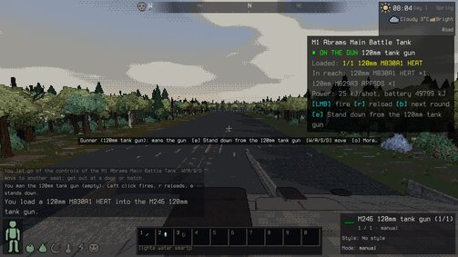 |
| the 120 mm fires: flash, blast smoke | 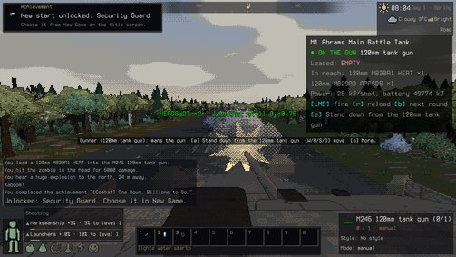 |
| the M2 on auto from the commander's cupola (flash held for the capture; it jammed on that burst: r clears it) | 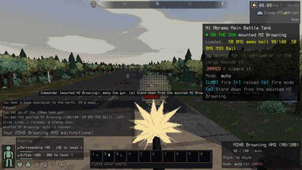 |
| the turret traversed 90 deg right, gun elevated | 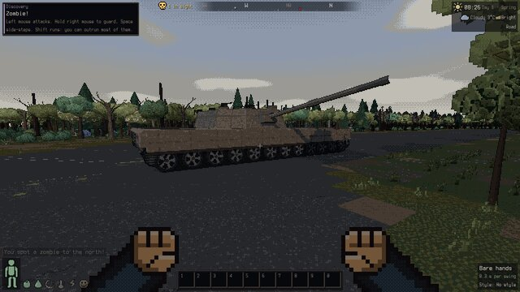 |

## Towing (`src/game/towing.ts`, `src/towing.ts`, `src/render/towFx.ts`)

Before this, a tow cable was an item you could carry and nothing else ("towing, trailer/semi
coupling" in the gaps list).

**What BN does** (src/iuse.cpp `tow_attach`, src/vehicle/vehicle.cpp `do_towing_move`,
`no_towing_slack`, `tow_cable_too_far`, `set_tow_directions`, `invalidate_towing`,
`ground_acceleration`; src/vehicle/vehicle_move.cpp `slowdown`, `thrust`; src/map/map.cpp vehicle
move; src/item.cpp `process_cable`; data: items/vehicle/cables.json `hd_tow_cable`,
vehicleparts/cables.json):

| | BN | here |
| --- | --- | --- |
| the cable | `hd_tow_cable`: 24 kg, `max_charges` 6 (its length while one end is attached), use action `TOW_ATTACH` | the same item; the use action and the vehicle panel |
| first end | "Attach loose end to vehicle" + choose an adjacent tile: a vehicle with no tow-line, an outside square (`is_external_part`). That vehicle **tows** | `a` on the cable picks the vehicle beside you (the one under the crosshair, else a menu), or the panel's "Attach a tow cable here, the rear (this vehicle will tow)" on the selected square. The attached end lives on the item (vars), like BN's `cable_connection_data` |
| carrying the loose end | `process_cable`: charges = 6 - `rl_dist`(you, first end); under 1: "The over-extended cable breaks loose!"; its vehicle gone: "You notice the cable has disconnected from a vehicle!" | the same, each tick; TowFx draws the cable from the hook to your hand |
| second end | the other vehicle (not the same one: "You cannot set a vehicle to tow itself!") is **towed**; both get an `hd_tow_cable` part on the chosen squares; "You link up the %1$s and the %2$s." | the same, and the cable item goes into the tower's part (`installedItem`) through moves.ts `consumeItem`, so it is never lost or doubled |
| slack | the cable pulls once `rl_dist` between the two cable parts is 8 or more | taut at **7 m hook to hook**: the hooks sit on the paint (`hookOnBody`), about half a tile out from each part's tile centre. Slack below |
| how the towed one follows | each turn it gets the tower's velocity (1.8x past 12 tiles), steered at the tower (`selfdrive` with `get_turn_from_angle`); `set_tow_directions` thirds of its length: rear third = towed rear first in reverse, middle third = dragged sideways skidding, front third = steered | a rope constraint in the momentum physics, below; the same thirds (`towDirection`) |
| the tower | accelerates as if it weighed both (`ground_acceleration` adds the towed mass), drags the towed one's slowdown | the pull is an impulse through both bodies, so the load slows the tower by itself |
| too heavy | `thrust`: accel under 89 vmiph per turn while rolling forward = no thrust, "The %s struggles to pull the %s on this surface!" | the same rule on the BN acceleration with the towed mass added (`TOW_MIN_ACCEL` 0.40 m/s²); a golf cart hitched to an Abrams crawls |
| brakes | a towed vehicle has no parking brake (`!is_towed() && brake_hold`) | it rolls free (`rolling()`), whatever crash model |
| snapping | `tow_cable_too_far`: 25 tiles apart; across z-levels ("A towing cable snaps off of %s."); a broken cable part (`UNMOUNT_ON_DAMAGE`); either vehicle destroyed or split | the same, at 24 m hook to hook; plus **overload** (not BN): the cable's tension low-passed over 0.2 s above 120 kN. The cable falls by the tower's hook, once |
| detaching | removing a cable part (`requirements.removal` 500 moves) removes both parts and returns one cable | the panel's "Detach the tow cable" on either vehicle: 5 s, both parts off, the cable back in your pack (else your hands, else at your feet). Vehicle work refuses the cable part ("Detach the tow cable from the vehicle menu instead") |
| saving | the towed vehicle saves the tower's cable-part position (`other_tow_point`); `validate_linked_vehicles` relinks on load | `VehicleSaveJSON.tows`: tower and towed uid and both cable mounts. On load a link whose vehicle or cable part is missing is dropped with a warning and a leftover cable part comes off as the cable, on the ground |

**The rope.** `TowSystem.step` runs after every vehicle has moved each frame. Under 7 m it does
nothing. Taut, it takes the two hooks' velocities (the bodies' `contactBody`, spin and steering
yaw included) and gives both bodies the impulse along the cable that stops them separating, plus
a small correction for any stretch (0.2 of it per frame, at most 2 m/s): equal and opposite,
through `applyImpulse`, so along-the-wheels it goes into `velocity` (the drive model slows), the
rest into the slide and spin. Momentum is conserved, so a pickup with a car behind it is slower
and a heavy truck trailer slower still, and an Abrams barely notices a car. Reversing makes it
slack: a rope doesn't push.

**Following through turns.** The towed vehicle is exempt from the flat slide and spin decay
(`decayMotion(..., towed)`), its tyres do the work instead (`grip`): the axle away from the cable
rolls straight and stops sliding sideways (Coulomb, up to 0.9 g on half the weight), and the axle
by the hook steers toward the pull, at most 35 deg (BN steers the towed vehicle at the tower).
So it trails like a trailer: through a right-angle turn it swings round on the tower's line
within a few seconds. While the cable is slack the hook-end axle only damps the swing (0.3 s).
A cable on the middle third keeps the vehicle skidding (BN TOW_SIDE).

**Stopping.** A rope doesn't push, and a towed car has no driver to brake, so a tower stopping
hard used to get rear-ended by the car it was pulling. BN's do_towing_move brakes the towed
vehicle when the parts are under 6 tiles apart (accel_y 1 → `thrust(-1)`, ~4 m/s²; in BN that
line sits behind the taut check and never runs, BN just sets the towed speed to the tower's).
Here a slack cable with the two closing brakes the towed vehicle at BN's 4 m/s², or harder (up
to 12 m/s²) when it must, to stop closing a metre short while the tower keeps slowing: from 30
mph on the handbrake the car stops ~6 m behind the pickup.

**Tuning** (src/game/towing.ts): `TOW_TAUT_M` 7, `TOW_SNAP_M` 24, `CABLE_REACH` 6,
`CABLE_BREAK_N` 120 kN (a rigid cable turns a jerk into roughly reduced mass x speed change over
0.2 s: an Abrams snatching another Abrams at 8 m/s snaps it; at 1 m/s it doesn't; a car on a
pickup never comes near it), `TENSION_TAU` 0.2 s, `ATTACH_REACH` 1.6 m from a hook,
`TOW_STEER_MAX` 35 deg, `NEAR_TAU` 0.3 s, `TOW_BRAKE` 4 m/s² (`TOW_BRAKE_MAX` 12), `HOOK_H` 0.45 m. Headless (tests): pickup + car, the car
starts moving at ~1.7 s, then holds 7.00-7.01 m at 2-3 kN of steady tension; a 20 mph right
turn and the car is on the tower's line and within 1 deg of its heading 2 s after the tower
straightens; the Abrams' tail swings the car out the other way first.

**Coupling.** BN has no trailer hitch or fifth wheel: `semi_truck` and `truck_trailer` are
separate vehicles, and no vehicle part or flag couples two vehicles. The only link is this tow
cable, and it works on them (a semi can tow the trailer by its nose). So there is no stiffer
coupling constraint: adding one would be a port invention with no BN data behind it.

**What you see** (TowFx): a 10 cm light steel-blue cable (BN draws it light_blue) hook to hook, a parabola sagging onto the road
while slack (sag for the cable's 7 m length), straight once taut; the loose end from its hook to
your hand while you carry it; a small brass hook block at each end. It hides with the chunks
(`drawnAt`).

| how | |
| --- | --- |
| `a` on the cable | attach / attach the loose end / "Detach and re-spool the cable" |
| vehicle panel (`e` or the crosshair menu → Examine) | the selected square: "Attach a tow cable here", "Attach the tow cable's loose end here", "Detach the tow cable" |
| `cdda.towing.links()` | each link: hooks, distance, taut, tension (kN), towed facing / speed / spin, BN direction |
| `cdda.towing.giveCable()`, `.reach()`, `.loose()`, `.carried()` | setup and reading what `a` would offer |

Tests: `tests/towing.test.ts` (15): BN's thirds; attaching moves the cable into the vehicles and
detaching gives it back once (census); self-tow, an inside square, a second cable and an
out-of-reach hook are refused; the loose end breaks loose past 6 tiles; slack then taut at 7 m and
held there, the car matching the pickup's speed and heading; a pickup is slower with a car on and
slower again with a truck trailer; momentum conserved through the jerk (within 4%, drag); an
Abrams tows a car 25+ m at over 90% of its own speed; the pickup and the Abrams swing a car round
a right angle (on the tower's line, heading within 8 deg, never past 7.15 m); it snaps at 25
tiles (one cable on the ground, both parts gone), across z-levels and when a cable part is
destroyed; an Abrams snatching an Abrams overloads it, gently it doesn't; a golf cart can't pull
an Abrams (BN's struggle message); a pickup braking hard from 30 mph doesn't get rear-ended
(the car stops ~6 m back, no crash); save and load keep the link and towing goes on, and a link
with a missing vehicle is dropped with a warning and its cable comes off.

Real input: `tools/realinput.ts --only towing` (47 checks, xdotool keys and mouse; `cdda.*` only
paves a lot of open fields, parks the vehicles, hands out the cable and seats you at the wheel).
For a pickup and then the Abrams: from the gap, the crosshair menu → Examine → click the rear
square → "Attach a tow cable here"; turn round with the mouse (the loose end is drawn to your
hand); Examine the car → its front square → "Attach the tow cable's loose end here"; at the
wheel, top-down (V, wheel to zoom out), W held, D held through a right-angle turn, W on: slack
first, then taut, never past 7.3 m, the car within 15 deg of the tower's heading after the turn
(still rolling), towed 20+ m; then "Detach the tow cable" and the cable is back in your pack.
Setting `player.pitch` from the debug API while the mouse was captured hung the page in every
run of this scenario (towing code on or off), so it tilts with the mouse.

| | |
| --- | --- |
| the vehicle panel on the pickup's tailgate square | 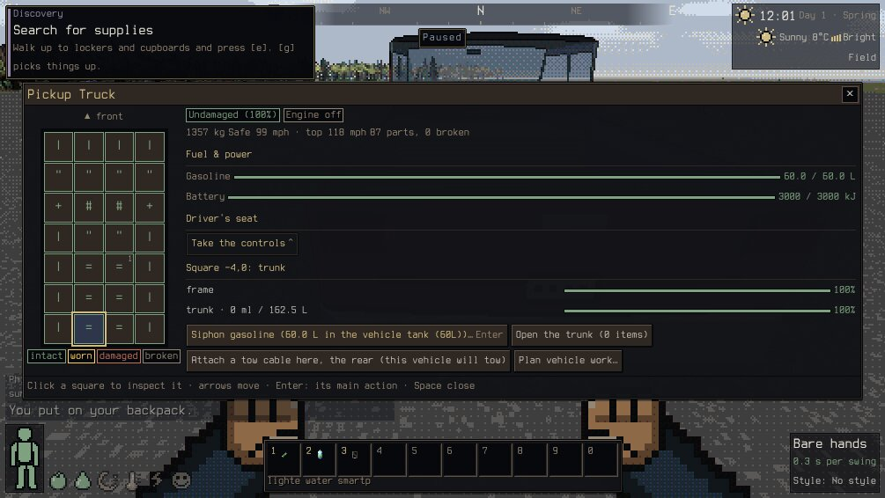 |
| linked: the slack cable from the car's hook to the road | 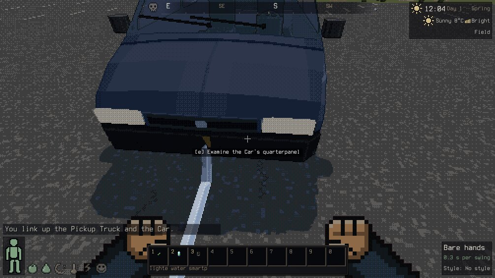 |
| pickup at 43 mph through the turn: taut, the car swinging in | 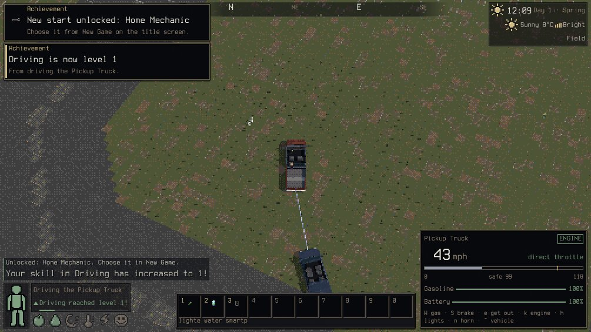 |
| ...and out of it, the car on the pickup's line | 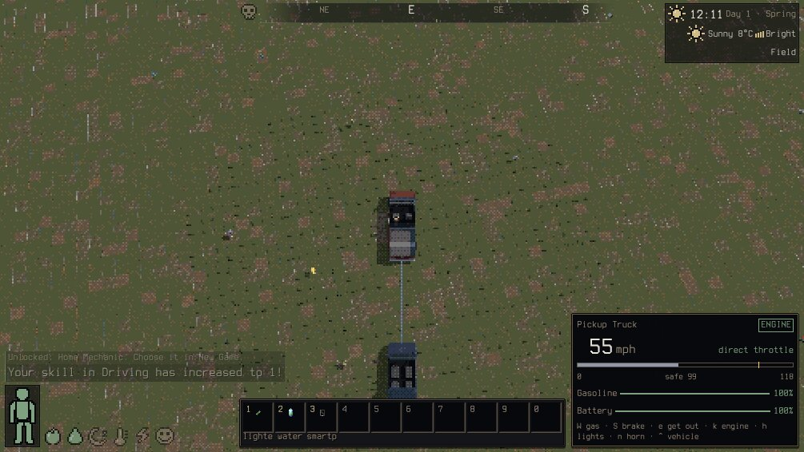 |
| the Abrams turning with a car on the cable (its tail swings the car out first) | 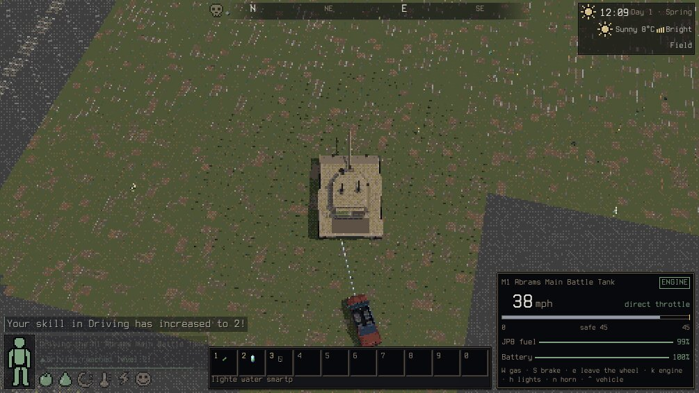 |

## Blasts and vehicles (`src/game/vehicleDamage.ts`)

Before, explosions went straight through vehicles: a 120 mm HEAT round or a grenade next to a car
did nothing to it, and the free-aim ray flew through parked cars. Now (BN `src/explosion.cpp`,
`src/vehicle/vehicle.cpp`, `src/map/map.cpp`; the explosion itself is in
[COMBAT_FEEL.md, Blasts](COMBAT_FEEL.md#blasts-one-explosion-vehicles-ceilings-and-live-grenades)):

| | BN | here |
| --- | --- | --- |
| blast on a vehicle tile | `blast_tile` multibash: `map::bash_vehicle` → `vehicle::damage(part, strength, DT_BASH, aimed, random_part)` once per bash, at damage × obstacle %, falling by damage / 5 (up to five: 150, 120, 90, 60, 30 for HEAT at its centre) | the same (`damageVehicleMount` per multibash step) |
| fragments | `project_shrapnel`: an impassable tile in reach takes impact × 0.25 through `vehicle::damage` | the same: a grenade's 60 → 15 per obstacle part in sight |
| `vehicle::damage` | a random part on the mount (a closed door shields a DOOR_MOTOR); an intact ARMOR part on the mount takes the full hit and shields the struck part by its `damage_reduction` for that type (roof parts aren't covered) | the same |
| `damage_direct` | a hit under min(20, durability / 10) does nothing; the part's own resistance comes off; at 0 HP it's broken (fuel leaks, cargo drops); a broken part can be torn off (`break_off`) | the same through `VehicleSystem.damagePart` (a dead engine stalls); `break_off` not modelled |
| fuel tanks | `explode_fuel` on a damaging hit: one in `chance_cold` (bash) / `chance_hot` (heat) from the fuel's `explosion_data`, power 120 × (1 − e^(factor / −5000 × charges × size_factor)), legacy explosion at distance factor 0.7; the tank is destroyed | the same, queued after the blast that set it off (gasoline: 1 in 5 damaging hits; 40 L ≈ power 66: 8 damage, radius 1, fire) |
| rounds | `map::shoot`: a projectile on a vehicle tile damages a part there by `vehicle::damage(dam, inc ? heat : stab, aimed)` and flies on with what got through | the free-aim ray stops at the vehicle (`vehicleHitHeight`) and `PlayerCombat.shootVehicle` does that damage; the round stops there. The classic ray and thrown items stop at closed obstacle parts |
| occupants | creatures on vehicle tiles are blasted like any other; closed doors, boards and windshields are impassable and occlude the blast | the same (the map's vehicle overlay): a grenade outside a closed car door doesn't reach the driver, an open door lets it in; a seated creature isn't flung |

What it adds up to: a HEAT round's 4000-point impact destroys the part it strikes and its blast
wrecks the near side (a car broadside at 21 m lost a frame and a windshield, ~900 HP); a few
blasts at the hood kill the engine (it won't start). A grenade breaks glass and lights, dents
doors and frames. A tank shrugs off grenades: military plating has 70 bash resistance (a
grenade's blast is 70, its fragments 15 under the plating's threshold of 20), while a HEAT round
takes 80 a hit off the plate. Tests: `tests/blast.test.ts`.

## Armoured hulls (tanks, IFVs, APCs)

BN's military vehicles map onto frame templates (`frame_tracked`; the hover tank / APC land on
`frame_boat` because `hover_repulsor` FLOATS), so collision is their cells. The frame look drew
every `tread3` as a 1.6 m car tyre: an M1 Abrams was a row of giant tyres. `src/render/vehicleTank.ts`
now draws any frame grid plated over at least half its cells (and 12+ armour parts) as an armoured
hull, reading everything from the parts: TRACKED wheels with a size are tracks (road wheels, side
skirts), plain wheels an 8x8, sizeless TRACKED wheels hover pads, none a decoy; the heaviest TURRET
part picks the turret (tank gun: low angular MBT turret, bustle rack and long barrel; howitzer: tall
box turret with a muzzle brake; autocannon: small IFV turret, plus a TOW box), machine guns go on
cupolas. Without a gun the hull is a tall APC box. The M1 is desert tan (0xb09252), the rest olive
drab (0x56612e), on an armour-plate swatch (`armor` in vehicleGeom.ts: one weld seam a metre,
4 px paint mottling, a bolt row) with the lower hull a step darker (0.62). The tan used to be a
greyer 0xa48f66 on the parts' `metal` swatch, a seam every 0.5 m both ways: from the chase camera
the hull read as more paving slabs. You
drive head-out of the driver's hatch. Tractors on treads, armoured boats and helicopters stay frames.
Odd cells outside the hull box (an M60's or M109's nose cell) are low armoured wedges, so collision
still has something under it.

## Drum rollers and treads on frames

BN's `road_roller` maps onto the `frame` template (its id matches the "roller" rule in
`mapping.ts`), and the frame look drew each of its ten `roller_drum` cells as a 1.6 m car tyre.
`vehicleFrame.ts` now knows two kinds of running gear by their part data: `isDrum` (a sized WHEEL
mounted in the cell's `center`, BN `roller_drum`) and `isTrack` (a sized TRACKED wheel `under` the
cell, BN `tread1/2/3`), grouped into runs by `wheelRuns`. Any frame grid with drums is drawn by
`src/render/vehicleRoller.ts`: one smooth steel drum per run in a yellow yoke (end drums pulled
inside the grid), a chassis between the drums, an engine hood over the rear drum with a stack,
an operator platform with handrails and a ROPS cab centred on the driver (glass if BN gives it
windows, an open canopy otherwise), amber beacon. Tracked frames that are neither armoured nor
work machines (below) keep the tile-by-tile frame look but get one track belt per tread run
(`trackRun`, shared with the tanks) instead of a tyre per cell.

## Work machines (construction, farm, warehouse)

`src/render/vehicleWork.ts` draws the frame grids that carry a work tool, chosen from the parts
(`workMachine`), never the id: routed after the armour and drum checks in `buildVehicleModel`.

| tool part (BN) | machine | drawn as | BN prototypes |
| --- | --- | --- | --- |
| `ROCKWHEEL` on treads | excavator | tracks, slew ring, house with a rounded counterweight, glass cab on the driver's side, boom / stick / bucket with rams reaching the rockwheel's cell (BN's excavator digs with it) | `excavator` |
| `ROCKWHEEL` on wheels | trencher | work tyres with fenders, engine hood, open seat with a roll bar, a toothed digging chain from a gearbox down into the ground at the tool cell, a backfill blade on BN's empty end row | `trencher` |
| `ROADHEAD` | roadheader | low tracked body, armoured canopy, a cutter boom from a turret out to a pick-studded cutting head, a gathering apron whose sides are the rams | `roadheader_mining` |
| 3+ `ram_*` across the bow, on treads | dozer | tracks, hood, cab, curved blade with push arms and lift rams; spikes for `ram_spiked`; a grid with guns is a rusty war rig with rebar grilles over plated glass and its guns on mounts | `tractor_bandit` |
| `forklift_fork` | forklift | cushion tyres, black counterweight, overhead guard, mast with chains and a lift ram, forks at their cells | `forklift` |
| `crane_*` on a 1-2 cell grid | engine hoist | red castor legs, column, boom with a ram, chain and hook | `engine_crane`, `handjack` |
| `PLOW` / `REAPER` / `PLANTER` (+ an engine) | tractor | on treads: a Challenger-style tracked tractor with a long hood and a glass cab; on wheels: big fixed-axle tyres, small steering ones, fenders, roll bar; no seat (robot): a closed body with a camera mast; a coal / wood engine: a steam boiler with a stack and flywheel. Implements at their cells: a plough (toolbar, staggered mouldboards, gauge wheel), a header (cutter bar, dividers, bat reel) or a seed drill (blue hopper, disc openers), on a three-point hitch, or under the body between the axles | `tractor_plow`, `tractor_reaper`, `tractor_seed`, `tractor_heavy_*`, `oldtractor`, `autotractor` |
| `SCOOP` (on wheels) | sweeper | white body with an orange band over its wheels, gutter brooms, camera mast | `autosweeper` |

Construction yellow, forklift orange, farm green with yellow hubs, steam brown, hoist red,
sweeper white; amber beacons on cabs. The cab is centred on the driver's seat (glass if BN gives
the grid any window, else open); the rider sits in it (levers on excavators / dozers /
roadheaders, a wheel otherwise). A wreck (half its non-wheel parts destroyed) is scorched, its
glass and beacons are gone; a destroyed tool slumps (the excavator's arm drops, the bucket is
gone) or is drawn bare. Bodies stay on their cells (tests allow 0.75 m for blade corners and
teeth). Collision and interaction are unchanged: the cells, as before.

What stays on the frame look, and why: carts, wheelchairs, beds, the welding / water / food carts
the portable generator and the work light (a frame of parts is the honest shape); trains and draisines (rail
cars: a separate job); boats, aircraft, airships, the hovercraft and their wrecks (hull / wing
models: a separate job); the horse wagons and dog sled (no tool; animal-drawn); the field
cannons; `car_chassis`, `quad_bike`, the golf carts, the F1 car, the unicycle / skateboard; the
`*_test` grids and `custom`. 116 of BN's 257 prototypes still use it (16 moved to vehicleWork; `none` is empty).

| | |
| --- | --- |
| construction lineup: excavator, bandit dozer, roadheader, trencher, forklift | 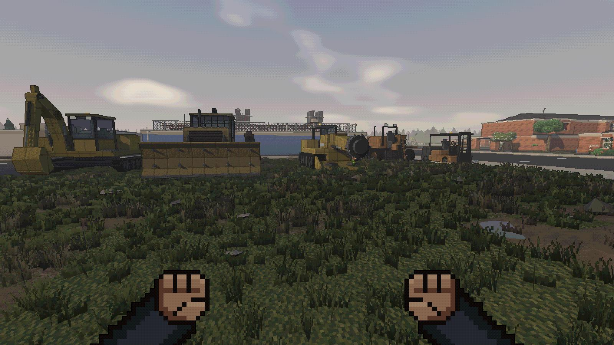 |
| farm lineup: tracked tractor, plough tractor, steam tractor, robot tractor, sweeper, engine crane | 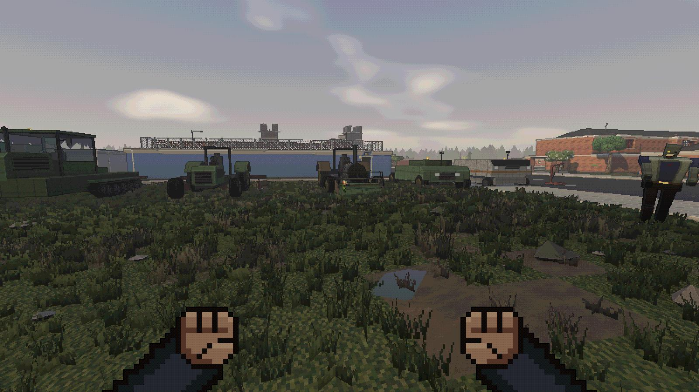 |
| excavator | 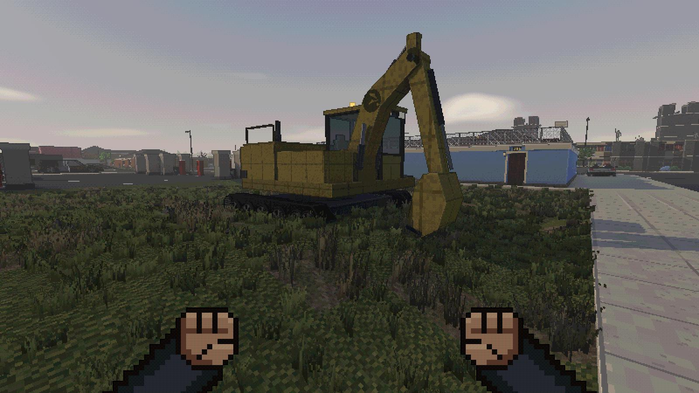 |
| bandit dozer | 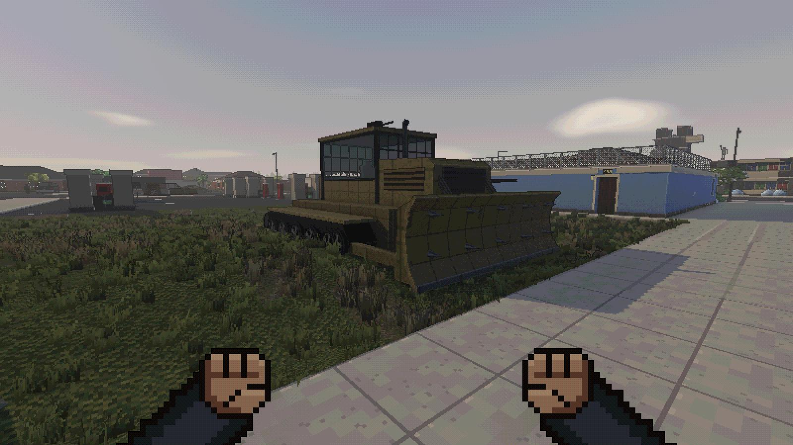 |
| tractor and plough | 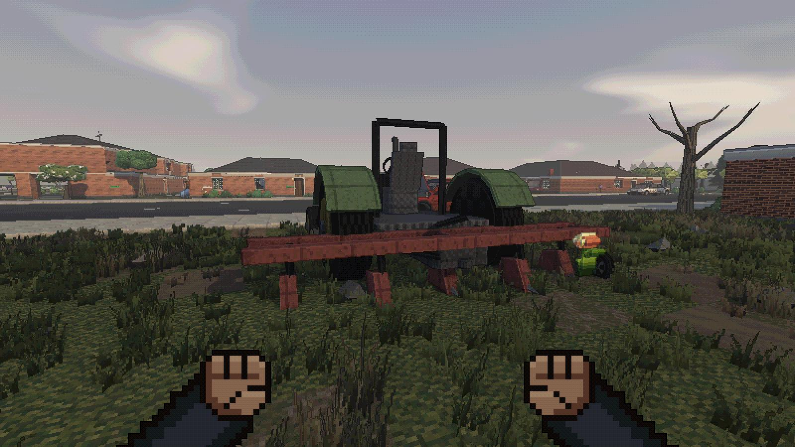 |
| steam tractor (reaper, plough, seed drill) | 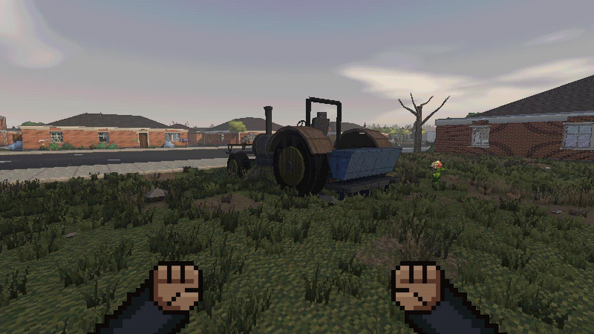 |
| driving the excavator: chase / cab | 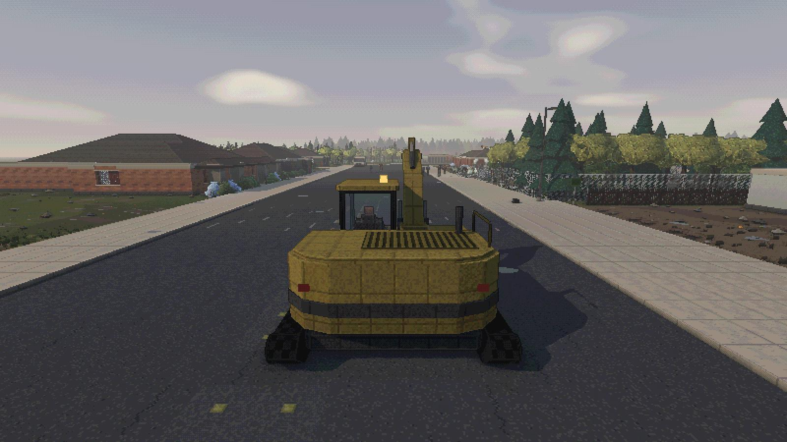 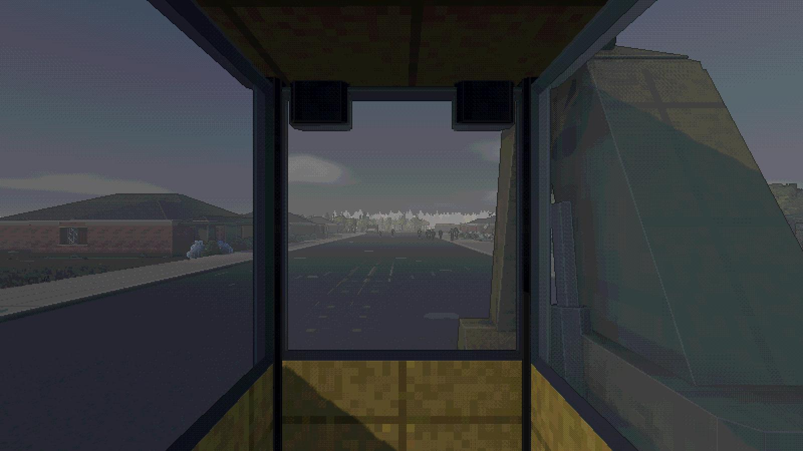 |
| burnt-out excavator | 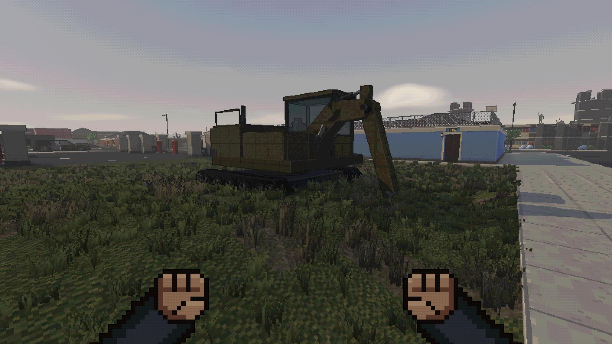 |

Regenerate: `tools/vehicle-shots.ts --gpu --views 'lineup:excavator,tractor_bandit,roadheader_mining,trencher,forklift:15.5:0:12;solo:excavator:50:0:5;drivedaychase:excavator;driveday:excavator;solo:excavator:50:burnt:5' model`.
Tests: `tests/vehicleModel.test.ts` "draws construction and farm machines ..." (routing for all 16
and the ones that must stay frames, footprints, z-level floor, riders) and "work machines: tools
from the parts, wrecks ..." (the arm reaches the tool cell and slumps when it's destroyed; a
burnt-out machine has no glass or beacon).

## How it works

`src/game/chassis/layout.ts` (was `src/render/vehicleLayout.ts`, which re-exports it) places
the vehicle's chassis template on its grid (pure, unit-tested):

- **Body style** from the prototype id with a grid fallback: sedan, hatch, sports, SUV,
  pickup, van (box vans, ambulances, RVs), minivan, bus, truck (semi, flatbed, fire,
  hazmat), motorcycle, bicycle, frame (everything else). Each style has dimensions
  (`STYLE_PARAMS`: sill, beltline, bonnet, roof, box, windscreen rake, crown, shoulder
  radius, tumblehome, lamp placement, chrome/black bumpers...).
- **Livery** from the id: police (black & white, light bar), ambulance (white, red stripe,
  cross, beacons), school bus (yellow, black rub rails, bonnet, warning lamps), transit bus,
  fire, military, FBI, SWAT, security, hazmat, ice cream, hippie (two-tone + flowers).
  Otherwise the spawn paint.
- **Sections** along the length: bonnet rows ahead of the windscreen row, cabin rows, rear
  glass, and behind the cabin a box (full boards), a pickup bed (open top), a trunk / flat
  deck. Wheels (diameter from BN's rim size in **cm**, `vpart_info::wheel_info` `"425 mm"` ->
  42.5, plus a sidewall), doors (the front door reaches forward to the A-pillar), side glass
  per row.
- **Proportions**: BN grids are fat and long (a car is 4 x 6 tiles). Bodies are drawn at
  real-world proportions scaled ~1.15-1.2x to the world (doors and people are big here):
  a sedan ~5.6 x 2.1 x 1.62 m vs a real one's ~4.8 x 1.8 x 1.45. Width is `widthPerCol` per
  column, length is shortened around the grid's middle by `lengthScale` (`xOf`); seats keep
  their columns (`zOf`) and move along with the length, and the driving camera uses the
  drawn seat. BN's generic `car` (a roofed cargo row behind the rear seats) is drawn as a
  notchback sedan, not a wagon.
- **Collision follows the drawn body** (`src/game/vehicleShape.ts`): map overlays can
  resolve collision with sub-tile shapes (`MapOverlay.shaped` / `collide`, used by
  `physics.ts` for the player, monsters and NPCs). Each obstacle mount's cell is clipped to
  the body outline in mount space (so a car turned 45 deg works too); open doors and aisles
  stay walkable. Being *in* a vehicle (`playerOn`), riding along when it moves, a door
  blocked by you standing in it, and run-overs all use the body: a zombie on the verge 0.4 m
  from the paint is not run over, one in the lane is. The crosshair has to reach the paint.
  Driving crashes follow the body too (below). The renderer supplies the outline
  (`vehicleSystem.bodyShape`); headless (tests, sim) and the `parts` look keep whole tiles.
  Real-input check: `tools/realinput.ts --only carside`.

### Driving collision (crashes follow the drawn body)

Crashes used to be CDDA's whole tiles: a car's 4 x 6 grid stopped against a wall or a
parked car with up to ~1 m of air beside the paint, and a gap that looked wide enough (the
refugee center's crammed lot) wasn't. Now, when a vehicle has a drawn body
(`VehicleSystem.bodyRect`), `collidePose` in `src/game/vehicles.ts` tests that body as an
**oriented box** (`vehicleShape.ts`: `rectObb`, separating-axis tests):

- **Terrain**: against every tile square the box newly overlaps (at the next pose, not at
  the current one). *What* blocks is unchanged, BN's per-tile rules (`obstacleAt`: bashable
  terrain / furniture that isn't flat floor, tiny things only under wheels, then impassable
  tiles), and so is the response (`resolveCollision`: smash / bash through, part damage, stop,
  the driver's jolt). Tiles are taken nearest the body's centre first, so a square hit lands
  on the middle of the nose.
- **Other vehicles**: box vs box (theirs is their drawn body, or one unit square per mount
  when they have none: frame builds). The response is momentum (below, "Momentum crashes");
  with the old `immovable` model, light ones (< 20% of the mass) are shoved aside (the shove
  checks the shoved vehicle's boxes against the pusher's box, terrain and other vehicles)
  and anything heavier stops you.
- **Which part takes it**: the contact point (the corners of one box inside the other, or
  the point of the body nearest the tile) goes to the nearest mount (`nearestMount`), and
  `collisionPart` picks armour / obstacle / frame there as before, on both vehicles.
- **Stepping**: shaped bodies move in substeps of at most 0.25 m / 4 deg (a bicycle, the
  thinnest thing to hit, is ~0.6 m across, so nothing is skipped at 60 mph or on a long
  frame), and a substep that ends in a crash is **bisected** (7 halvings) so the vehicle
  stops where the paint touches, within a few mm, not a substep short. Tiles keep 0.3 m /
  8 deg steps.
- **Overlapping grids**: two bodies can now sit closer than their grids, so the tile index
  is a multimap. `at()` returns the vehicle whose body covers the tile centre (the latest
  indexed when both or neither do), `occupantAt` / `playerOn` the one whose body you're in,
  `moveCost` is 0 if any occupant blocks.
- Creatures, run-overs and `playerOn` already used the body; the part that hits a creature
  is now the mount nearest it too.

| how | |
| --- | --- |
| `cdda.vehicleCrashes('tiles')` / `('body')` | crashes on whole tiles even in the model look (the old behaviour, for comparison); creatures keep the body. Default `body` |

Headless (tests, sim) and the `parts` look have no body shape and keep whole-tile
collision exactly as before. Cost: ~0.05 ms per driven frame vs ~0.03 ms on tiles
(Node, a car at 40 mph weaving past parked cars).

Tests: `tests/vehicleCollision.test.ts` (0.3 m past a parked car and along a wall, a
3-tile gap the 4-tile grid can't take, head-on stop at the paint with the front damaged,
OBB vs OBB square and at 30 deg with damage at the contact, a lane change in a 4-tile alley,
turning into a wall stops at the corner, no tunnelling at 60 mph including a 0.25 s frame,
a bicycle shoved at 60 mph, overlapping grids, run-overs while squeezing past; each "whole
tiles" counterpart too). Real input: `tools/realinput.ts --only drivecollide` (W / S / V
through xdotool): passes a parked car with 0.3 m of air (and, with `vehicleCrashes('tiles')`,
the same pass crashes), rams a parked car and a concrete wall and checks the bumper stops
within 3 cm, then at the refugee center (seed 1) lines up with a 2.57 m gap between a car
and a pickup (the body is 2.20 m wide, the grid 4 m), creeps in until the nose meets the
building beyond, and reverses back out, without a scratch on any of the three.

| | |
| --- | --- |
| 0.3 m past a parked car (top-down, V) | 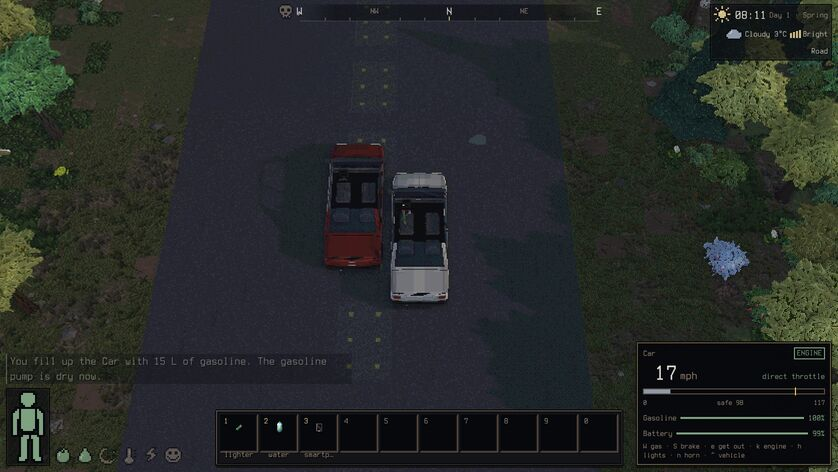 |
| the same pass on whole tiles: stopped by air | 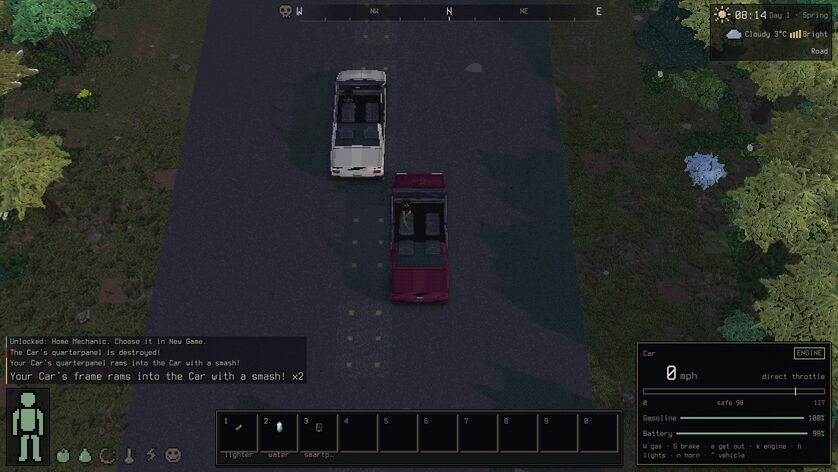 |
| rammed a parked car: bumper to bumper | 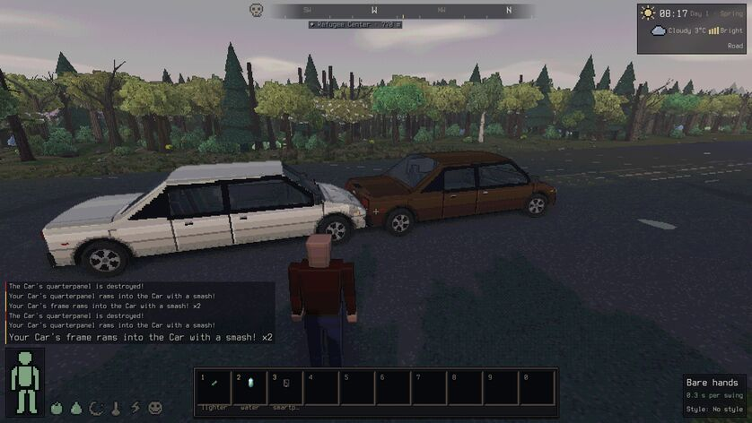 |
| rammed a concrete wall: the bumper on the wall | 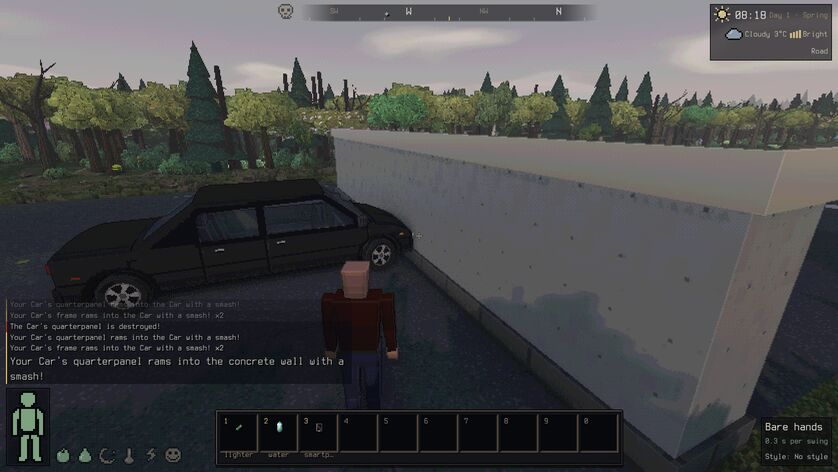 |
| refugee center lot: in the gap between a car and a pickup | 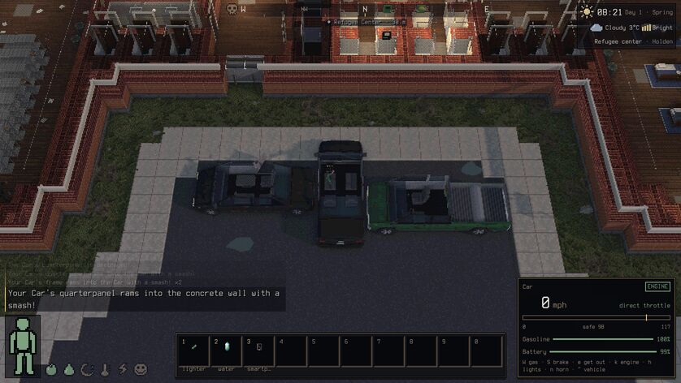 |
| ...from the driver's seat | 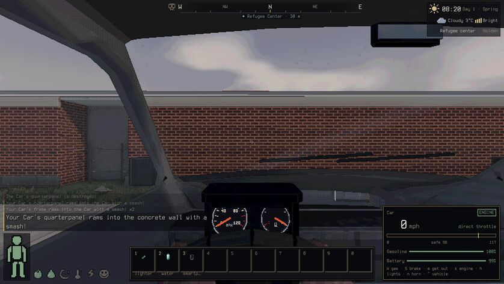 |

### Momentum crashes and heavy handling (2026-10, `src/game/vehicleImpact.ts`)

Playtest: *"I was just driving [the tank] and clipped an ambo and died because all of the force
was just impacted without transferring any force into the other vehicle."* Another vehicle used
to be an immovable heavy obstacle: CDDA's collision loop ran until the rammer stopped, so an 18 t
Abrams glancing off a 1.8 t ambulance at 30 mph lost all its speed and the driver took a 30 mph
jolt. Driving is a single speed along the facing (bicycle model), so there was nowhere to put a
shove or a spin. The brief is GTA 3 / Vice City arcade, with the old model kept as an option.

**State.** Each vehicle also has a transient `Motion`: a world-space **slide** velocity and a
**spin** (deg/s about the body centre). It isn't saved; a load ends any slide. `simulate` passes
`velocity * dt` along the facing, plus the slide and spin, to the same collision-checked `move`,
so a shoved vehicle hits terrain, other vehicles and creatures like a driven one: chain pushes,
run-overs and flung zombies included, and it never ends up overlapping anything. The slide then
decays like tyres. Across the wheels the decay is 7 m/s² + 1/s (tracks 1.5x). Along them, a
vehicle someone drives (or whose engine runs, or that's already rolling) just rolls: that part
goes into `velocity`, which the drive model owns. A parked one is braked at 2.5 m/s² + 1/s. Spin
decays at 60 deg/s² + 1/s.

**Spinning out** (GTA's rear-quarter hit). A car clipped on the tail at 30 mph turned 20-30 deg
and stopped: the parked brake's 1/s term (14 m/s² at 11 m/s) stopped it within metres, and with
W held the rammer's nose caught its swinging tail and pushed the spin back out (211 deg/s to 11
in 0.2 s). Now a hit closing faster than 8 mph (`SKID_MIN_MPH`) that leaves something you aren't
driving spinning faster than 45 deg/s (`SKID_MIN_SPIN`) breaks its tyres loose for 1.6 s
(`SKID_TIME`): it neither rolls nor brakes, the slide decays at 4.5 m/s² + 0.25/s both ways and
the spin at 70 deg/s² + 0.35/s (tracks 1.5x), and another vehicle's impulse can't check its spin
(`SKID_COUNTER` 0: that torque is dropped, the impulse still shoves it; walls check it in full).
A teleport-shoved light vehicle keeps its spin. A square shunt doesn't spin, so it's braked as
before. Measured (car into a parked car, 30 mph, 1.2-2 m off its centre line): 160-260 deg
whether W is held or not (was 22-31), moved 6-12 m; an Abrams clipping an ambulance's corner
swats it round 260 deg and keeps 31 mph. Linear momentum is still exchanged equal and opposite
(the conservation tests pass unchanged); angular momentum isn't conserved while something spins
out, as it already wasn't for the driver's half spin. `INERTIA_SCALE` 0.5, `SPIN_DECEL` 60 and
`VEHICLE_FRICTION` 0.3 are unchanged: with the contact fixed, the spin they give was already
GTA-sized.

**Contact.** When the moving body touches another vehicle, the pose is bisected to the touch.
The contact point comes from the first touching pose and the normal from the last free one (a
separating axis is exactly the face being met). Then the two exchange an **impulse**: rigid
boxes with mass and a moment of inertia (0.5 of a uniform box's, so struck vehicles spin
readily), restitution 0.25 along the normal, friction 0.3 along the face, and the contact
point's velocity includes steering yaw and spin. Momentum is conserved, so the heavy one barely
slows, the light one is shoved and spun, off-centre hits add spin and glancing ones scrape past.
The impulse along the rammer's wheels goes into its `velocity` and the rest into its slide; the
driver's own vehicle takes half the spin (arcade stability: you stay pointed roughly where you
were going). If the two aren't closing (the struck one is already moving off), the struck one is
moved now if it hasn't moved this frame and the substep is retried, so a tank can plow a car
along without stalling on turn order. A light vehicle (< 20% of the mass) pinned where it can't
move falls back to the old sideways teleport shove. Whatever travel is left in the frame slides
along the face that was hit (the turn is dropped), so a corner on a wall or a glancing hit
carries on instead of sticking.

**Walls** are the same solver with an immovable body: no bounce, 0.35 scrape. A wall is a row of
tiles, so every blocking tile the body meets is averaged into one contact, and each tile's normal
is its exposed face (sides shared with another blocking tile aren't faces). A square hit lands
mid-bumper; a car steering into a wall scrapes along it, nose pinned, until you straighten up
(it used to stop dead at the first touch). Only the speed *into* the wall counts for BN's
part_collision bash, so glancing hits do less damage and a smashed fence still lets you through,
slower. Whole tiles (headless, the `parts` look, `vehicleCrashes('tiles')`) keep BN's stop
against terrain, and a slide dies on it.

**Damage and jolts.** Damage comes from the kinetic energy the impulse actually removed: CDDA's
`d_E / 400` (mph²), times `CRASH_DAMAGE_SCALE` 1.2. Each side takes it in proportion to its own
velocity change (the other's share of the mass): a tank clipping an ambulance takes ~10%. Each
goes to the part nearest the contact (`hitMount` → `collisionPart`), less its damage reduction.
Riders feel **their own vehicle's** velocity change (`passengerImpactDamage`, seat belt from the
seat you're in), so tank into ambulance is a nudge and car into tank is a wreck. Below a 35 mph
change in your own speed, a jolt can't take the torso under 1 HP: a moderate glancing hit is
never lethal. A closing speed under 4 mph is pushing, not a crash: no message or bang.

**Bodies for tanks.** Tanks, APCs and frame builds have no drawn outline (they collide on their
cells). Under momentum crashes a grid that's at least 80% full (armoured hulls are 0.84-0.95)
crashes as its grid rectangle, so it gets the same bisection and normals. Sparse grids
(aircraft, L-shaped rigs) keep whole tiles.

**Heavy handling** (`handlingFor`, from mass, engine power and tracks, never the vehicle id).
*Heft* runs from 0 at 3 t to 1 at 20 t on log mass, at full weight on tracks and half on wheels.
That puts a semi at 0.23, a Humvee at 0.16, BN's M113 at 0.42, a Bradley at 0.82 and the Abrams
at 0.95. Cars sit under 3 t and are untouched. Heft scales:

| | car | Abrams |
| --- | --- | --- |
| pedal ramp-up (`1 - 0.8h`): slow-revving | 0.17 s | 0.7 s |
| felt acceleration (`1 - 0.45h`) | 3.4 m/s² | 1.6 m/s² |
| brakes (`1 - 0.4h`), engine braking (`1 - 0.5h`): plows on | 8 m/s² | 4.9 m/s² |
| steering to full lock (`1 + 1.5h`), back (`1 + h`) | 0.45 s | 1.1 s |
| lateral grip at speed (`1 - 0.3h`) | 5.5 m/s² | 3.9 m/s² |
| 0-20 / 0-30 mph (tests, pavement) | 2.8 / 4.2 s | 6.4 / 9.5 s |

Tracked vehicles are **governed**: thrust fades over the last 20% below 27 mph + 18 mph × (power
to weight / 55 W/kg, capped at 1). That's ~45 for BN's Abrams, 36 for the M60 and 33-34 for the
M113 and Bradley; reverse is half of it, and off road divides it by `1 + 0.15 (offroad - 1)`
(tracks lose less than tyres). CDDA's drag maths gave the turbine Abrams 150 mph. The skid-steer
**pivot** reaches 32 deg/s × √(power to weight / 55), clamped 0.45-1.3x (Abrams 32, M113 20,
heavy tractor 42). It spools up linearly over `0.3 + 1.0h` s (1.25 s on the Abrams) and winds
down twice as fast. The CDDA cruise-control driving model keeps its own thrust (governor and
heft don't apply there).

| how | |
| --- | --- |
| Options > Gameplay > **Vehicle crashes** / `?vehcrash=momentum\|immovable` / `cdda.vehicleCrashModel('immovable')` | `momentum` (default) or the old immovable-vehicle model (and BN's stop against walls, no sliding) |
| Options > Gameplay > **Heavy vehicles** / `?vehheft=weighty\|light` / `cdda.vehicleHandling('light')` | `weighty` (default) or `light`: everything on the car tuning, no governor, the old flat 40 deg/s pivot |
| `cdda.vehicleMotion(uid?)` | speed, slide, spin, pivot and heft of the vehicle you drive (or `uid`) |

Neither is a gallery switch: they change motion, not a still image, so the per-switch
pixel-diff proof can't show them.

Tests: `tests/vehicleMomentum.test.ts`. They cover the impulse (momentum conserved, separating
contacts get none, restitution) and momentum conserved within 5% through the world. An Abrams
at 30 mph into a parked ambulance head-on, at 45 deg and clipping its corner: the tank keeps
over 75% of its speed, the ambulance moves 2+ m and spins, the driver loses under 10 HP and
nothing on the tank breaks. The `immovable` model still stops the tank dead. A car at 30 mph
into a parked tank stops to under 2 mph and the tank moves under 0.5 m. A car shoves a parked
car. A glancing hit on 3 torso HP never kills. A tank plowing a car into a row of parked
vehicles and a wall: no two boxes ever overlap, nothing enters the wall, the chain reaches the
row and the zombie in the way is hit. On handling: the Abrams' 0-20 mph is over twice a car's,
it's governed to 40-47 mph, `light` restores it, the car is identical in both modes, the APC
scales below the Abrams, and the pivot spools up. Spinning out: a car clipping a parked car's tail at 30 mph from 1.2, 1.6 and 2 m off its centre
line turns it past 90 deg with W held and let go, and holding W keeps at least half the turn; a
square shunt leaves no skid. Changed: `tests/vehicleCollision.test.ts` "OBB vs OBB" at 60 deg no
longer expects the driverless rammer to stop touching the parked car (that car now spins off;
the rammer rolls on under 1.5 m/s). Changed: `tests/vehicleCollision.test.ts`
"turning toward a wall" now expects the scrape (and the stop under `immovable`). Real input:
`tools/realinput.ts --only crashmomentum` (W held through xdotool) drives the Abrams into an
ambulance clipped and broadside, a car into a parked car's corner and a car into a parked
tank. `drivecollide` now expects the rammed parked car to be shoved down the road, never
overlapped, and its whole-tiles comparison runs under `immovable`.

| | |
| --- | --- |
| Abrams clips an ambulance at 27 mph (top-down, a frame every ~150 ms): swatted aside and spun round, the tank keeps 25+ mph | 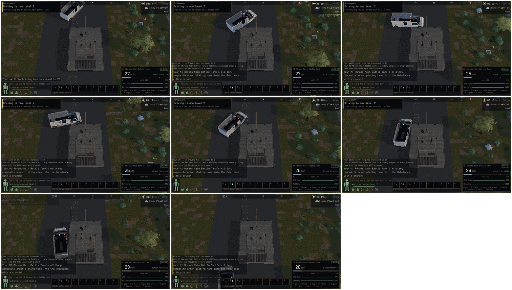 |
| Abrams into an ambulance parked across the lane: plowed down the road | 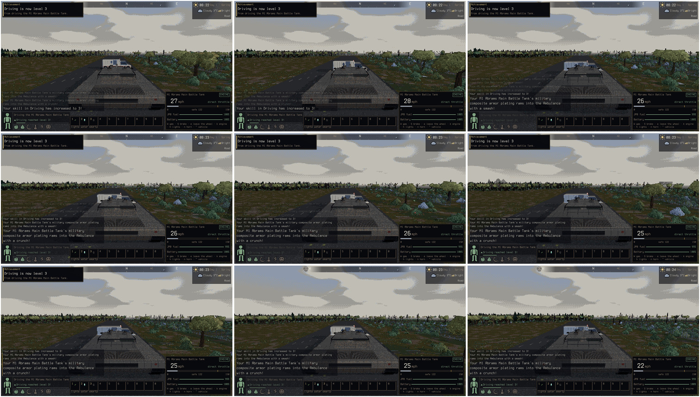 |
| a car at 35 mph into a parked car's corner: knocked ahead and turned, the car slowed (before spinning out; now it swaps ends, `crashmomentum` checks over 90 deg with W held) | 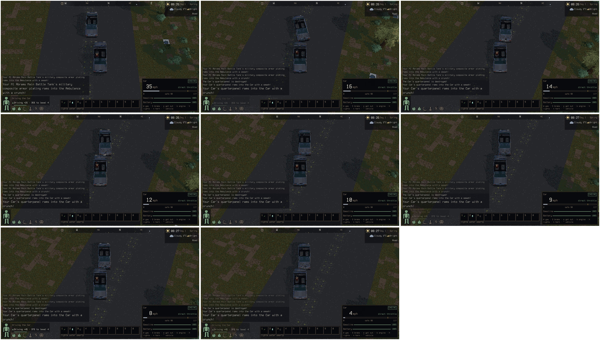 |
| a car at 34 mph into a parked Abrams: stops dead and the driver takes the jolt, the tank doesn't move | 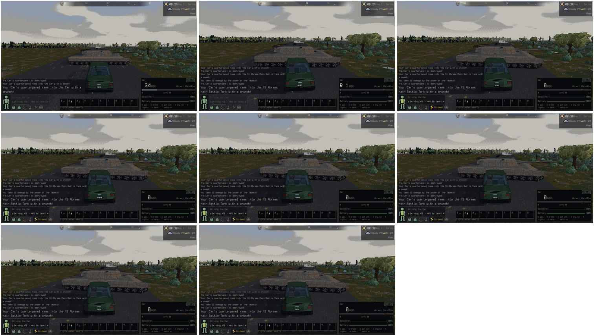 |

`src/render/vehicleModel.ts` builds the geometry:

- A **side profile**: nose -> bonnet -> sloped windscreen -> roof -> rear glass / hatch /
  cab back / box -> tail, over a sill with **wheel-arch cut-outs** per axle; convex corners
  chamfered.
- **Side walls** = the profile at +-half width with the window openings (and open or
  missing doors) cut out; **skin strip** = the profile lofted across the width with rounded
  shoulders, a crown (bonnet / roof / nose bulge), plan taper at the ends and tumblehome
  above the beltline. Windscreen and rear glass are strip segments drawn as glass; side
  glass fills the openings. Everything is a double-sided shell, so the cabin reads from the
  inside (inner faces shade as grey trim).
- Parts: wheels (tread, sidewalls, five-spoke rim) sitting in the arches, seats with
  backrests and headrests, dash, instrument binnacle, steering wheel, bumpers, mirrors,
  exhaust, chassis block, pickup bed floor, emissive head / tail lamps (the existing
  headlight spot + light-map beam are unchanged), roof light bars / beacons (they flash
  while the lights are on).
- State: open doors swing out ~65 deg on the front hinge (the hole shows the interior), an
  open tailgate / shutter / hatch leaves the tail open, broken glass is gone with jagged
  shards left in the frame, flat tyres squash and the body sags onto that corner, broken
  parts rust and dent, blood splashes, heavily wrecked vehicles are burnt out.
- Roof panels hide in top-down view (you look into the cabin, like CDDA's map).
- Cabins get less sky light (like building interiors) and dark trim, and the glass is tinted
  more from outside, so seats read dark through the windows instead of glowing.
- Parked vehicles were left with the wheel wherever it was: about half have the front
  wheels turned up to ~23 deg (per vehicle, stable). The driven vehicle's wheels steer and
  roll; ridden bikes lean into turns.
- **Distance LOD**: past 50 m (back inside 42 m) a vehicle is rebuilt without its cabin
  interior, mirrors and exhaust, with coarser wheels and no shadow casting.

`src/render/vehicleSkin.ts` paints the per-vehicle **skin** at **32 texels/m**, nearest
filtering, onto five sheets the geometry projects onto by face normal (two sides, top, front,
rear): stepped shading bands (shoulder highlight, darker rocker), crease lines, black window
trim and pillars (or body-colour on utility vehicles), door seams and handles, wheel-arch
lips, side markers, fuel filler, grille with slats, head / tail lamp lenses, licence plates,
box-van ribs and rear doors, roof ribs / rails, livery stripes and emblems, then weathering:
road grime from the sills up, rust along the sills and arches that spreads with wear, dents
on damaged rows, blood. Painting runs in a **Web Worker** (`vehicleSkinWorker.ts`); the body
shows its flat paint colour for the frame or two until the skin lands.

`src/render/vehicleBikes.ts`: motorcycles (forks, triple clamp, teardrop tank, saddle,
finned engine, swingarm, shocks, exhaust, round headlamp) and bicycles (diamond frame, wire
wheels with see-through spokes, saddle, bars, cranks). The grid is 3-4 tiles long, so the
wheelbase is pulled in to a real bike's around the grid centre. Parked bikes lean on the
kickstand.

`src/render/vehicleFrame.ts`: the tidy fallback for grids that aren't a car, truck, bus or
bike (golf carts, tractors, carts, APCs, boats, player-built rigs): chassis plates, panels on
the outside edges only, real seats and wheels, glass in frames, machinery as rounded blocks,
turret barrels. Nothing is squeezed there; every part sits on its tile.

Cockpit camera: eye height and lateral position come from the model (seat top + ~0.68 m,
kept above the bonnet), the dash sits under the bonnet line so the car is a band at the
bottom of the view with the A-pillars framing the road.

### The driver's seat (round 3, `src/render/vehicleCockpit.ts`)

Built only for the vehicle you drive (the model's `cockpit` anchors, placed from the eye so
it all sits between the bonnet line, ~14 deg down, and the view's bottom edge, 36 deg):

- **Dials**: a hooded binnacle with a speedometer (0-120 mph, red from 100) and a fuel gauge
  (E-F, red at E), 64x64 pixel-art faces painted in code (3x5 pixel numerals). The needles
  follow the real values (`v.velocity`, main fuel tank or the battery for EVs) with a little
  lag. Unlit (readable at night too).
- **Steering wheel** as its own mesh, turning with the front wheels (x2.6); your **fists**
  ride on the rim at ten-to-two and the forearms stretch from the elbows each frame. Sleeve
  and skin colours come from your outfit composite (like the on-foot 3D arms,
  `src/render/chars/fpView.ts`), so a red jacket drives in red sleeves.
- **Windscreen film**: a faint lit (goes dark at night) texture inside the glass: dust haze
  thicker at the base and corners, two wiper arcs swept cleaner, the odd fleck and a soft
  diagonal reflection band. A few % alpha: the road reads through it.
- **Wipers** parked at the base of the windscreen and an **interior mirror** under the roof
  (every car, not only yours). **A-pillars** are one shoulder quad now (the windscreen glass
  runs further into the rounding).

### Your body in the seat (riders, `src/render/vehicleRider.ts`)

Playtest: "the third person view for the bicycle shows a ghost bicycle (no person)". The 3D
player model used to hide whenever you drove. Now, with 3D characters, outside first person
(chase and top-down cameras) the survivor sits in the seat of the vehicle being driven:

- **Anchors from the model**: every build says where the rider goes (`ModelBuild.ride`, mount
  space): hips on the saddle / seat, torso lean, hand targets (handlebar grips, or ten-to-two
  on the steering wheel's rim), feet (pegs, the floor under the pedals, or a bicycle crank).
  `vehicleBikes.ts` (bicycle: leaning far over flat bars, pedalling; motorcycle / scooter:
  astride behind the tank, feet on pegs), `vehicleModel.ts` (cars: back in the driver seat,
  slight recline), `vehicleFrame.ts` (open frames: golf carts, tractors). Anything without
  anchors (the part-block look) gets a generic upright seat on the driver's tile.
- **Pose**: two-bone IK per limb (`src/render/chars/ridePose.ts`, driven by `PoseIn.ride` in
  the humanoid rig) puts the hand centres and ankles exactly on the targets (unit-tested
  against the built matrices; out-of-reach targets straighten the limb toward them).
- **Placement**: `VehicleRenderer.update` poses the body last, from the lean pivot's world
  matrix, so it follows position, yaw and a bike's lean into turns in the same frame (no
  lag); `CharInstance.rootOverride` carries the transform.
- **Pedalling**: the ridden bicycle's crank (arms + pedals) is its own mesh turning with the
  distance ridden (`CRANK_M_PER_TURN` = 5 m a turn); the crank and the feet on it update at the
  characters' stepped rate (`charSettings.fps`), like other body animation.
- **Cars**: the hands follow the cockpit's turning wheel (`Cockpit.gripPoints`) up to ~57 deg
  (`GRIP_TURN_MAX`), then slide round the rim (full lock is 90 deg of wheel, out of a seated
  body's reach; a test sweeps the range for six body styles); the
  first-person fists hide while the body is drawn, and the driven car's outside glass is
  tinted lighter (0.4 instead of 0.72 opacity) so you can see yourself through it.
- **Unchanged**: first person / the cockpit camera (the fists on the wheel), the billboard
  character mode (the survivor is hidden while driving, as before). `cdda.vehicleRiders(false)`
  brings back the old riderless look for comparison; `cdda.renderer.vehicleView.riderCheck()`
  reports hand / foot error and visibility (the `riders` real-input scenario uses it).
- **NPCs**: nobody else rides. NPCs never board or drive vehicles in this build (no passenger
  system), so there is nobody to seat; the `Rider` / anchors are ready for it.

| before (ghost bike) | bicycle, stopped | bicycle, turning |
| --- | --- | --- |
| 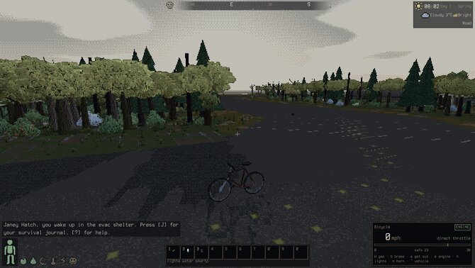 | 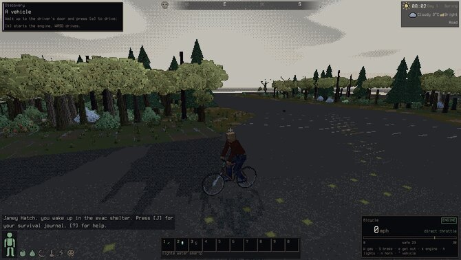 | 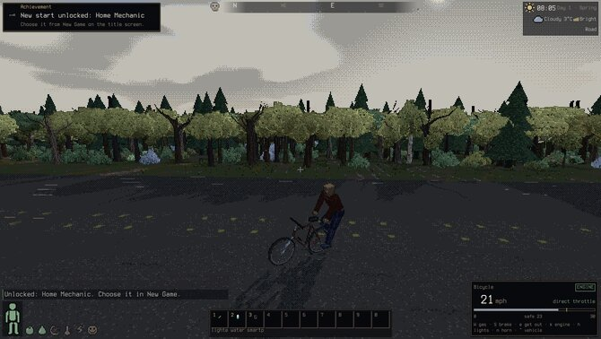 |
| **motorcycle, stopped** | **motorcycle, turning** | **car, chase (crop)** |
| 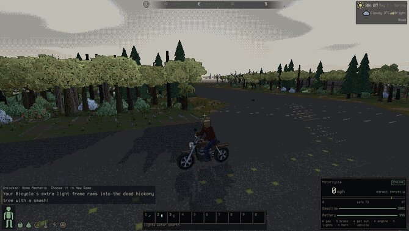 | 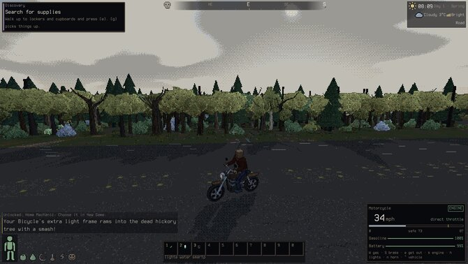 | 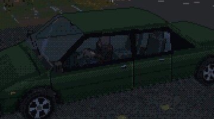 |
| **car, chase, turning** | **car, top-down** | **bicycle, riding** |
|  |  |  |

Real input: `heavy --kind gpu --mem 2 -- nix-shell --run 'npx tsx tools/realinput.ts --gpu --only riders'`
(W / A / S held through xdotool, V cycles the cameras, the mouse orbits the chase camera).

### Lids, wrecks and more silhouettes (round 3)

- **Trunk lids and hatches open**: BN's `door_trunk` (the only lid part: BN has no bonnet part
  or engine-bay interaction, so bonnets stay shut) swings up on its hinge when opened through
  the part menu (cargo access needs it open): a sedan's lid at the foot of the rear window, a
  hatchback's / SUV's glass hatch at the roof's rear edge; long lids (limousines) open less so
  they clear a z-level. Pickup tailgates and box-van shutters stay openings.
- **Wrecks** (status 1 is what BN spawns on city roads, so most road cars): glass flecks on the
  road by every smashed window (sideways out of doors, ahead of / behind a broken windscreen /
  rear window), a soot scorch under burnt-out shells, soot on their paint instead of rust,
  open doors that *hang* (swung wider, drooping at the far end) on damaged doors / wrecks,
  and the body sits lower on destroyed tyres. BN's placements only give axis-aligned facings
  (`road_vehicles.json` `*_wrecks`: 90/180/270), so wrecks aren't yawed; the tilt comes from
  their flat tyres.
- **Silhouettes by spawn frequency**: `tools/vehicle-freq.ts` generates the world around the
  start for several seeds and ranks what mapgen spawns with the style each gets. The road
  vehicles were covered; round 3 fixed the ones that read wrong: **RVs** (a tall box over
  the cab with the overcab bunk, motorhome two-tone), **food trucks** (cab + tall box, orange
  stripe), **fire engines** (crew cab + locker body), **semis** (sleeper cab, chrome stacks,
  fifth wheel), **trailers** (one tall box on high sills), **limousines** (the chauffeur's
  partition glass no longer cuts the cabin in two). Carts, forklifts, quad bikes and golf
  carts stay on the tidy frame look.

### Cockpit polish (round 4)

- **A-pillars**: the eye now sits over the seat's back half (`MODEL_EYE_FORWARD`) and saloons
  have a shorter windscreen run, so the pillar top is ~0.6 m ahead instead of at your cheek;
  the pillar is one narrow shoulder strip at the windscreen corner, and interior faces are a
  lighter trim grey. The road on the left reads past it.
- **Steering wheel**: a round rim (16 segments of an 8-sided tube), a lighter upper arc,
  three spokes and a hub with a horn pad.
- **Hands**: the characters agent's modelled first-person fists (`fistRig` / `FIST_GRIP`
  exported from `src/render/chars/fpView.ts`, curled fingers, thumb, sleeve cuffs, painted
  from your outfit by the shared skin store), placed on the rim at ten-to-two in their own
  small `CharLayer` under the cockpit (`src/render/vehicleHands.ts`), so they turn with the
  wheel. Falls back to simple fists without the character renderer.
- **Dashboard**: grained (leather swatch, a little more sky light) with a lighter lip along
  its top edge.
- **Wipers** sweep while it rains (render weather rain / storm, or the game weather's
  `rains`), faster in storms, and park when it stops. Rain streaks no longer fall inside the
  cabin in the cockpit view (`Weather.clearRadius`).
- Smaller interior mirror, tucked up against the glass.

### Filling up (round 4, `src/game/refuel.ts`)

Look at a gas / diesel pump with a vehicle parked within ~2.5 tiles and `e` offers **Fill up the
Car with gasoline (N L)**. BN keeps a pump's fuel as a liquid item on the pump tile (mapgen
`place_gaspumps`) and `iexamine::gaspump` hands it to the liquid handler, whose
`ACT_FILL_LIQUID` moves 2/3 L per game second: filling is a timed activity at that rate
(interruptible, partial fills kept), charges in ml (`fuels.<id>.chargesPerL` = 1000). Empty
tanks take the fuel the engine burns; a vehicle that doesn't burn it says so. BN's dexterity
spill roll is left out. The pump tile isn't a quick-loot target any more (its fuel is the
pump's). Real input: `tools/realinput.ts --only refuel`. Siphoning isn't done.

### Playtest fixes (round 3)

- `e` at an open door (any side) offers **Drive / Get in**; closing is under More...
- `^` from beside the car finds the controls (the seat distance was measured from a tile
  corner); broken controls are skipped.
- Standing in a doorway ducks the camera under the roof (`rig.eyeCap`) instead of clipping.
- Doors (not trunk lids / shutters) swing shut once you drive off (> 1.5 m/s).
- Real input: `tools/realinput.ts --only cardoors` checks all four.

## Screenshots (RTX 5080, 1600x900, look `full`)

Regenerate: `~/claude-stuff/bin/heavy --kind gpu --mem 2 -- nix-shell --run "npx tsx tools/vehicle-shots.ts --gpu model parts"`
(views in `tools/vehicle-views.js`; `--views 'a;b'` to pick). JPEG q75 (at q85 these
low-res, upscaled frames come out larger than PNG). Left: v2 part blocks (`parts`); right:
modelled bodies (`model`).

| view | before (`parts`) | after (`model`) |
| --- | --- | --- |
| town street, a used box van |  |  |
| hatchback, sedan, sports car |  |  |
| SUV, pickup, cube van |  |  |
| police, ambulance, hippie van |  |  |
| pickup from behind |  |  |
| transit bus |  |  |
| school bus |  |  |
| motorcycle |  |  |
| bicycle |  |  |
| smashed sedan (glass out, flat tyre, door open) |  |  |
| golf cart, tractor, APC (frame fallback) |  |  |
| street at night, headlights on |  |  |
| driving, cockpit |  |  |
| driving, chase cam |  |  |
| night driving, chase cam |  |  |

Round 4 (half size): cockpit by day, in the rain (wipers), at night, and the chase cam.

| | |
| --- | --- |
|  |  |
|  |  |

Round 3 (model look only):

| | |
| --- | --- |
| cockpit, day: dials, wheel, hands, wipers, film |  |
| cockpit, night: the dials stay readable |  |
| hatchback with the hatch open |  |
| burnt-out wreck |  |
| smashed glass on the road |  |
| RV / motorhome |  |
| semi tractor |  |
| food truck |  |
| limousine |  |
| a town street (wrecks as mapgen left them) |  |

## Performance

GPU (`tools/vehicle-shots.ts --gpu --bench --size 3440x1304`, RTX 5080 shared with other
jobs, so frame times are noisy): frame time is unchanged within noise (street p50 23.9 vs
23.2 ms, chase 28.2 vs 27.5 ms); triangles +~5k (+1%); ~10-16 more draw calls in a street.

CPU, per vehicle when it streams into view (built at most one per frame past a 4 ms budget,
the driven vehicle and nearby changes immediately):

| | parts | model (main thread) | model skin (worker) |
| --- | --- | --- | --- |
| sedan | ~1.8 ms | ~3.5 ms geometry | ~4.5 ms |
| bus | | ~5.5 ms geometry | ~7 ms |

(Chromium on a loaded 24-core box; the first build after load pays JIT warm-up, up to ~30
ms once.) Rebuilds on door / light changes reuse the painted skin (keyed by paint, livery,
damage and blood). Memory: one ~200x300 RGBA skin per car in view (~250 kB, a bus ~750 kB).
Build stats: `cdda.renderer.vehicleView.buildStats`.

Driving through town at 40 mph (`tools/bench-stream.ts --runs drive`, 1080p, RTX 5080):
model vs parts: frame p50 16.7 / 16.7 ms, p99 33.4 / 33.4 ms, `beforeRender` (where vehicle
builds happen) mean 0.54 / 0.48 ms and at most 1.9 ms in the slowest frames. The hitches
are chunk streaming and GPU waits, not vehicles.

## Tests

`tests/vehicleModel.test.ts`: style classification, sections (sedan, pickup bed, box van),
seats stay in their tiles, wheel units (cm rims, bicycle wheels), every prototype builds
without NaNs, footprints stay inside the grid (open doors excepted), window / arch cut-outs,
open-door leaves, skin coverage at 32 texels/m, skins survive structured cloning (worker),
skin reuse on door / light changes, frame fallback, proportions, parked steering, LOD.
`tests/vehicleShape.test.ts`: walking into the side stops at the paint (tile rules without a
shape), a car turned 45 deg, walking in through an open door, closing a door from beside
it, driving past someone on the verge, running over what's in the lane only.
`tests/vehicleCollision.test.ts`: driving crashes against the body (see "Driving collision").
`tests/vehicleMomentum.test.ts`: momentum crashes and heavy handling (see "Momentum crashes").
Riders: `tests/render/ridePose.test.ts` (IK lands hands / ankles on their targets in the built
rig), `tests/vehicleModel.test.ts` "where the rider sits" (anchors for bikes and cars, the
ridden bicycle's crank).

## Known gaps / ideas

- Parked vehicles' wheels don't roll (only the driven one's are separate meshes).
- The collision outline is a rectangle: you (and crashes) touch the bumper corners a few cm
  before the rounded paint; mirrors poke a little past it and don't collide.
- Driving crashes: the vehicle turns about its mount (0, 0) (the driver's seat area), not the
  rear axle, so the tail swings out more than a real car's (crash spin does turn about the
  body centre). Vehicles move one after another each frame: a struck one is moved early so a
  pusher doesn't stall, but two vehicles both under way only meet through the impulse
  (no simultaneous solve). Holding W into a car you've just hit keeps pushing it, which
  damps its spin: a rear-quarter tap turns a parked car ~20-30 deg rather than spinning it
  out (tunable: `INERTIA_SCALE`, `SPIN_DECEL`, `VEHICLE_FRICTION` in vehicleImpact.ts). The
  slide isn't saved. The dashboard's safe / top speeds still show CDDA's figures, not the
  tracks' governor.
- Monster pathfinding and `map.passable` still see whole vehicle tiles.
- The LOD keeps the same skin (it's per vehicle, cheap).
- Semi tractors and trailers are separate BN vehicles and aren't coupled: BN has no hitch, only
  the tow cable ("Towing" above), which works on them.
- Boats, aircraft, trains and carts use the frame fallback (tanks, rollers and work machines have models).
- Bonnets never open (BN has no bonnet part); tailgates and shutters open as a hole.
- The mirror shows a flat tint,
  not a reflection.
- Only the driven vehicle gets the cockpit rig; a passenger seat has no view extras.
- Riders: bicycle / motorcycle handlebars and forks don't turn with the steering (the front
  wheel does), so the hands stay put; the rider doesn't lean further than the bike or brace
  on a stop; a wielded weapon is simply not drawn while riding. Nobody sits in passenger seats
  (no NPC passengers exist yet).
- The part-block look (`parts`) is kept as it was in v2, including its door bug.
- Blasts and rounds ([Blasts and vehicles](#blasts-and-vehicles-srcgamevehicledamagets)): a broken
  part isn't torn off and scattered (BN `break_off`), so it soaks further hits; a round that stops
  on a vehicle doesn't fly on with what got through; diagonal gaps in a rotated vehicle
  (`obstructed_by_vehicle_rotation`) don't block a blast; a part the blast breaks is drawn as
  the renderer draws any broken part (no blast-specific scorch or deformation).

## Multi-fuel engines

Engines with BN `fuel_options` burn any of them: gas turbines take gasoline, diesel, JP-8,
avgas, biodiesel, lamp/motor oil and alcohols; ordinary combustion engines take gasoline,
avgas and alcohols; diesels take diesel, biodiesel, lamp/motor oil and JP-8. As in BN
`vehicle::start_engine`, an engine whose current fuel is dry switches to the first option
the vehicle carries when you start it (`Vehicle.selectEngineFuel`); the choice is saved on
the engine (`fuelPref`, BN `ammo_pref`). Gauges show the fuel each engine would run on
(`runningFuels`). Picking a fuel by hand (BN `control_engines`) is not ported.
