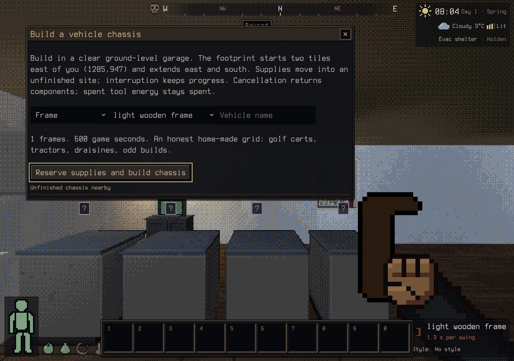

# Building a vehicle chassis

Open construction with `*` and choose **Build a vehicle chassis…**. Choose an
authored template, an initial frame and an optional name. The build footprint
starts two tiles east of you and extends east and south. Clear the whole footprint
inside a ground-level garage and bring the listed supplies. Enter activates the
focused button; Tab moves between controls.

**Reserve supplies and build chassis** moves actual components into an unfinished
craft item at the site and spends tool energy. Movement or changed conditions
interrupt assembly. Reopen this panel near the site and choose **Resume chassis**.
The site, actual reserved items and elapsed progress survive saving. Cancellation
returns the reserved components on the ground; spent tool energy remains spent.
The vehicle is published only after completion, owned and ready for fitting jobs.

This is the v3 adaptation of BN construction: choose the minimum rectangular frame
grid accepted by an existing chassis template, including the 50-frame Rig. The
ground-level garage whitelist uses authored `s_garage`, `s_garage_1/2`,
`garage_gas_1/2/3` and `bandit_garage_1/2` overmap terrain IDs. Roofs and unrelated
buildings do not qualify. Clearance checks include the actual authored collision
body through `chassisBodyRect`, oriented-box tile intersection, and the frame cells.

BN's `constr_veh` and `construct::done_vehicle` start a one-frame owned vehicle in
600 seconds. This adaptation uses that start time and construction practice, plus
the chosen frame's extracted install time for every additional frame, with the
same skill discount and per-frame practice as fitting work. The whole authored
grid reserves the frame's install materials and tool energy for every frame,
including the initial frame; this is stricter than BN's single initial-part item.
Additional-frame timing is calculated when work starts or resumes. Only completion
awards practice, with each additional frame evaluated separately so skill and
focus changes are respected.

Initial parts use BN's `INITIAL_PART` flag. Empty usable frame items are selected
before requirement evaluation and consumption. Positive damage and item metadata
are retained on the installed frames; fully broken or loaded frames are rejected.
Missing reserved components, changed tools, obstructions and leaving range cannot
publish a partial vehicle or consume the site.

Tests cover saved resume, interruption, midjob obstruction, tool-charge rollback,
component cancellation, missing escrow items, body-edge clearance, preview identity
isolation and sequential skill practice. A real keyboard session opened the panel,
reserved one light wooden frame and rope, interrupted at 252 game seconds, and
resumed. Vehicle count remained five while interrupted and became six only after
completion, with exactly one adopted Frame vehicle and no remaining site.

`tools/dev/vehicle-chassis-bench.ts` measures a 50-frame Rig with 500 separate
inventory items and 120 game seconds per activity tick. The final local run of
100 updates measured p50 0.096 ms, p95 0.161 ms, maximum 0.361 ms.

Remaining planner work includes a movable 3D placement ghost, customized chassis
dimensions, authored jack/lift classes, and prospective driving
stats. Existing facility buildings provide the garage gate; constructing a custom
garage capability is separate work.
