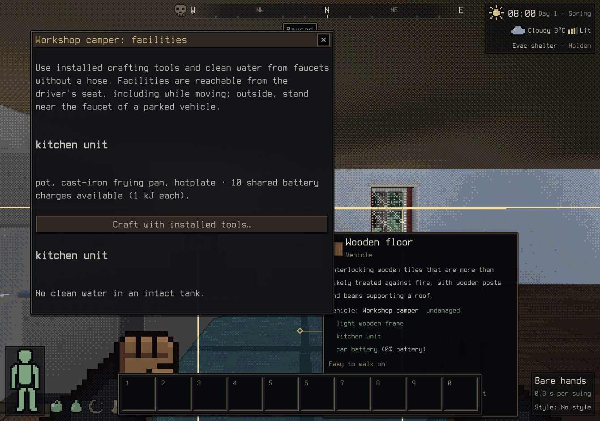
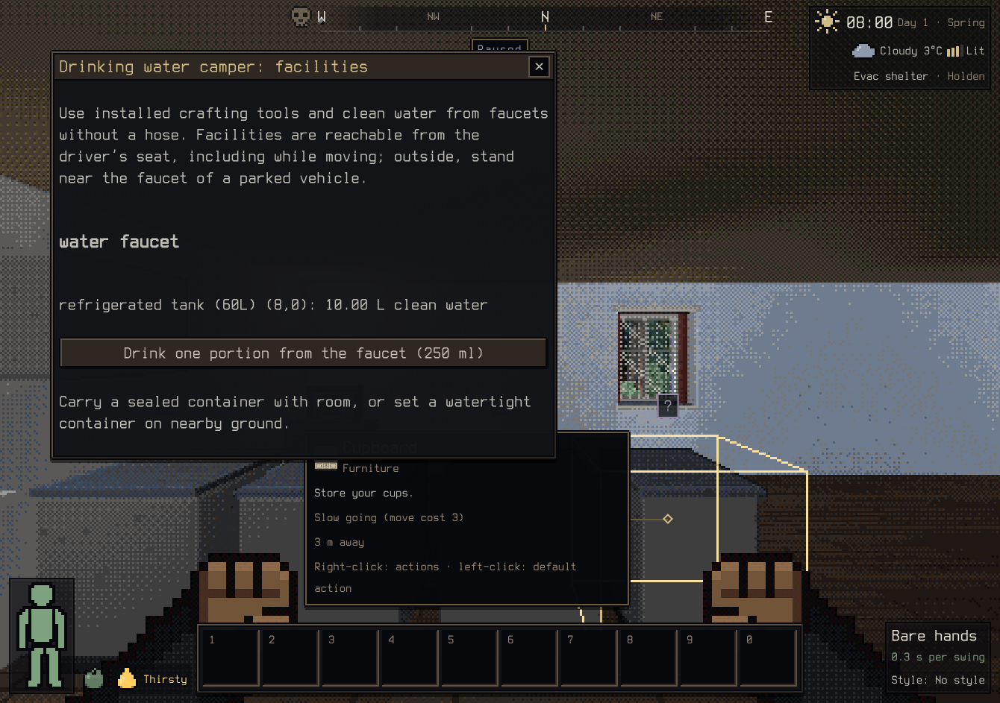
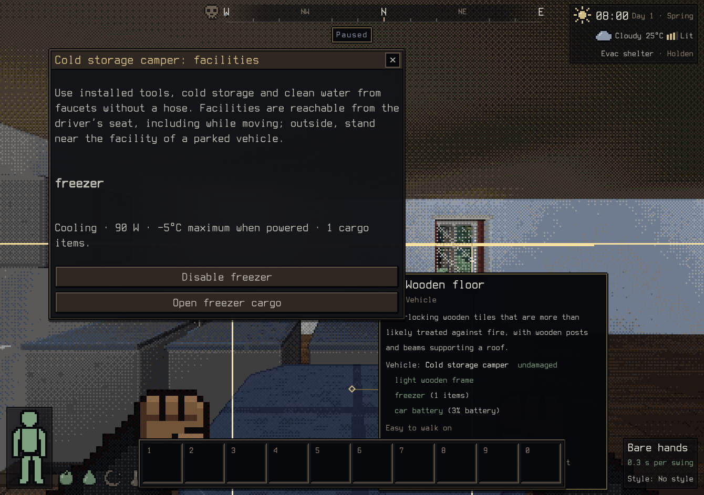
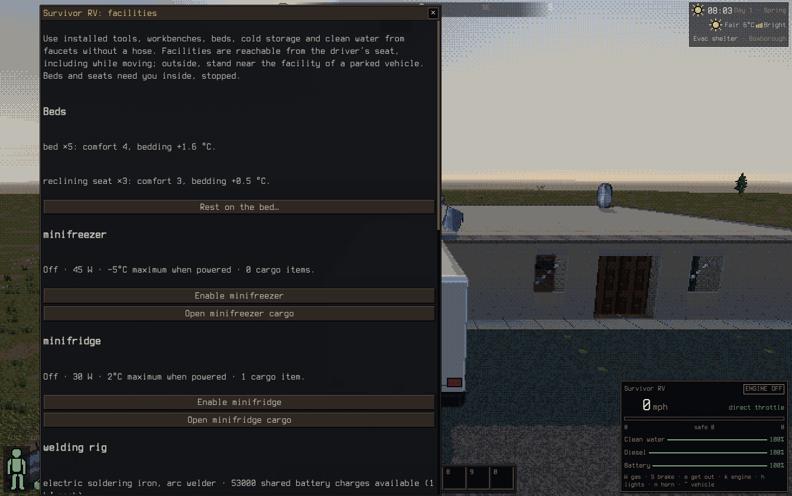
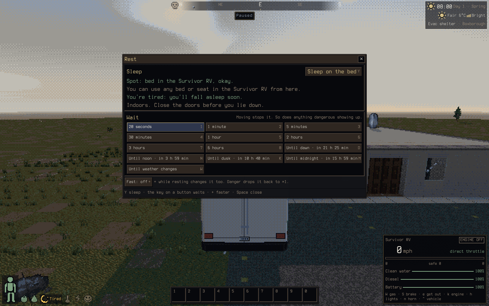
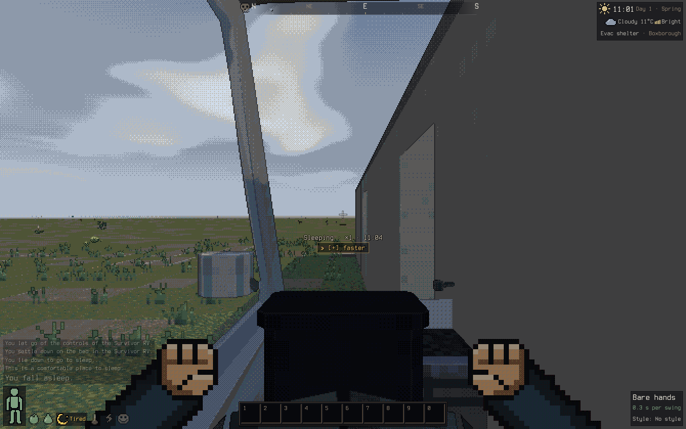
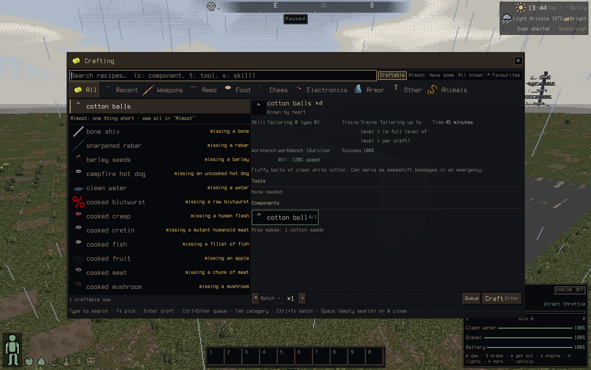

# Vehicle facilities

The vehicle panel’s **Use vehicle facilities…** action exposes installed faucets and
integrated crafting tools.
Choose a clean-water tank and a carried or nearby compatible container. No external
hose is required. The timed fill transfers actual water charges through the item
location API and drains only the corresponding tank volume; an interrupted fill
keeps the water already transferred. Tank contents and filled items survive saves.

From the driver’s seat, faucets anywhere in the vehicle work even while moving,
as agreed in [Vehicles v3](design/VEHICLES_V3.md#q7-facilities-from-your-seat).
Outside, the vehicle must be parked and the player within the existing 2 m crafting
range of the faucet. Broken, removed or locked facilities cannot be used. Access,
tank contents and container capacity are checked throughout filling. Only clean
water is exposed; a fuel tank or dirty-water tank is never substituted.

BN’s `vehicle_use.cpp::vehicle::interact_with` offers filling for an available
FAUCET and `water_clean`; it calls `character_funcs::siphon` for that stored liquid.
The runtime converts ml to the extracted liquid charge volume (clean water is
250 ml per charge). Filling uses the same BN liquid activity rate already adopted
by vehicle siphoning, 4 L per six game seconds. Access from a moving driver’s seat
and parked 2 m reach are explicit 3D adaptations.

## Integrated crafting tools

Kitchen units, welding rigs and other intact CRAFTER parts expose their extracted
`integrated_tools` to the ordinary crafting screen, construction, fitting jobs
and chassis creation. The facilities panel lists those tools and opens crafting.
Installed tools provide their real item qualities, but cannot be consumed as
components. Equivalent tools are exposed once per vehicle; either intact,
accessible provider can keep a tool available.

Tools draw a finite shared battery budget: one requested tool charge costs one
battery kJ. Checking successive requirement groups reserves that energy, so a
hotplate and welder cannot each promise the same remaining charge. Carried tools
and alternate tools still work. Battery changes join the item transaction; a later
failure restores battery charges, version and component locations. The actual
saved vehicle battery supplies subsequent crafts. Static inventory quality queries
stay cached, while installed providers are revalidated after damage, removal,
locking or leaving reach.

Sources: BN `veh_type.cpp::load_crafter` reads `integrated_tools`,
`inventory.cpp::form_from_map` deduplicates those tools per vehicle, and
`map.cpp::use_charges` drains vehicle battery charges for them. Driver-seat access
and parked 2 m reach reuse the v3 facility adaptation above. Crafting duration,
interruptions, escrow, practice and failure behavior remain the ordinary crafting
system’s rules; the energy charge is paid when its tool requirement is consumed.

Water purification actions and walkable parked rigs remain separate gaps; beds
and workbenches are described below.
Installed faucet water as a crafting component and vehicle cargo gathering are
also still separate from these integrated tool sources.

Validation: the cooked-meat recipe uses the installed pot/pan cooking quality
and hotplate; its seven requested tool charges drain 7 kJ. Interruption retains
the real meat escrow, and resuming to completion does not charge the battery again.
`tools/dev/vehicle-crafting-bench.ts` checks 750 recipes with 500 carried items
and 30 vehicles of 52 parts each; a measured run had 11.22 ms median and 15.83 ms
95th percentile. This includes gathering and all requirement checks.

## Drinking from a faucet

Each clean-water tank also offers **Drink one portion from the faucet (250 ml)**.
The default duration is five game seconds: BN normal drinking consumes
250 moves, then vehicle `DRINK` charges 250 additional moves.
At completion, the ordinary food-consumption checks and hydration rules apply;
only successful ingestion drains one 250 ml clean-water charge. Interruption,
breakage, loss of access or refusal leaves the tank unchanged and gives no water.
No bottle or external hose is needed. The same driver-seat and parked-reach rules
apply as for container filling.

Actual OS Enter opened facilities and completed drinking: tank water changed
from 10,000 to 9,750 ml, and thirst changed from 200 to 150, matching the normal
clean-water item quench. No container or hose was carried.

Meal-time modifiers follow `consumption.cpp::eat`: tentacle mouth, mandibles or
spider fangs halve the meal time; otherwise shark teeth divide it by three, or
gourmand subtracts 100 moves. Saber teeth add 250, then amorphous multiplies
meal time by 1.1, with C++ integer rounding. The fixed faucet overhead is added
last. A hummingbird beak does not slow drinking. These modifiers affect timing
only; consumption checks and source-volume conservation are unchanged.

## Powered cold cargo

Fridges and freezers now appear in the unified facilities panel, with **Enable** /
**Disable**, power draw, cold-temperature ceiling, and **Open cargo**. Their ordinary
cargo contains real items and accepts the existing inventory moves. Driver-seat
access works across the vehicle; outside, controls require parked nearby access.

Enabled intact fridges cap cargo temperature at 2°C; freezers cap it at −5°C.
Colder ambient weather stays colder. Cooling spends the part's extracted electrical
draw in game time (fridge 60 W, freezer 90 W). An empty battery provides no cooling;
a partially depleted battery provides only the cooling time it can buy. Disabled
or broken storage, and ordinary cargo, age at the ambient weather temperature.
All real food cargo now advances through the existing item rot rules; nested food
and sealed preserving containers retain those rules. Item rot, enabled state and
battery energy use the existing vehicle save format.

Cold cargo consumes power within the one-game-second generation/charging loop.
Long waits interleave cooling demand, charger demand, solar and reactor output;
cold cargo no longer also drains in the real-time physics electrical update.
Other vehicle consumers and alternators retain their existing timing adaptation.
A switch left enabled resumes cooling when energy becomes available again.

BN references: `game_constants.h` defines the fridge/freezer temperatures;
`item.cpp::clip_by_temperature_flag` caps ambient temperature;
`vehicle_part.cpp::process_contents` chooses a cold flag for enabled storage;
part JSON supplies electrical draw. This runtime applies the cap immediately:
thermal inertia, freezing/thawing tags and ice state are not modelled. Ambient is
the current weather during the interval, rather than a historical weather integral.
Stored tank liquids remain counters without item condition; refrigerated liquid
spoilage is still a separate gap. No new food or energy appears, and stale food is
not made fresh by switching the refrigerator on.

Validation includes actual VehicleSystem game-time integration, finite energy
and split powered/unpowered rot, disabled/broken storage, nested preservation,
save/reload, and solar+charger long-wait partitioning. The power benchmark with
`--cold` measures 30 vehicles, each with solar, charger, a fridge and 20 food items,
advancing 120 game seconds per tick: median 5.07 ms, 95th percentile 5.52 ms,
maximum 5.81 ms in a measured run.

Actual OS Enter opened facilities, enabled the freezer, disabled it, and opened
its real cargo inventory. Advancing the actual VehicleSystem by 60 game seconds
while enabled used 5.4 kJ (100→94.6) and kept the meat's rot at zero. Disabled
storage used no additional energy and advanced rot at 25°C ambient; both enabled
and disabled snapshots restored exactly the battery, item rot and switch state.

## Beds and seats

Sleeping in a vehicle uses BN's comfort rules through the ordinary sleep flow
(`$`, the Rest window, the classic menu). Inside a vehicle, seated at its controls
or standing on one of its mounts, you sleep on its best intact bed or seat.
Following the v3 decision, you use it from your seat as if you had walked there.
You stay in place physically. The Rest window says “Spot: bed in the Survivor RV”.
**Use vehicle facilities…** lists the beds with their comfort and bedding. Its
**Rest on the bed…** button opens the Rest window.

- Comfort follows `character_functions.cpp::base_comfort_value`. It uses the first
  intact BOARDABLE part on the tile: bed 4, reclining seat 3, seat 2, aisle and
  cargo floor 0. With nothing boardable, comfort is the tile's move cost
  subtracted (−8 over seats, −2 on an aisle). The values are extracted
  `vpart_info::comfort`.
- Bedding follows `Character::floor_bedding_warmth`: the boardable part's
  `floor_bedding_warmth` (legacy units, 500 = 1 °C; bed 800 = +1.6 °C, reclining
  seat 250). Nothing boardable gives −4 °C. Torso/leg blankets in that mount's
  cargo add `floor_item_warmth`.
- Messages follow `avatar_functions.cpp::try_to_sleep`. A SEAT or BED is “a
  comfortable place”, an aisle is “a little hard … in the vehicle”. BN refuses to
  lie down on a tile with neither (“It's hard to get to sleep in …”), and so does
  this game. It only happens when every seat and bed is broken.
- You must stop first, because nobody else can drive. Lying down releases the
  controls, so held keys cannot steer a sleeper. If the vehicle starts moving
  (pushed, rolling, rammed), the sleeper wakes. If the bed breaks or the vehicle
  disappears, the next 30-minute sleep roll and the rest bonus use the next best
  spot or the ground.
- Save/load: no new state. Sleeping in a vehicle is restored by the sleep watcher
  from the saved sleep effect and the saved vehicle, which picks the best bed again.

Real input (headful Chromium, xdotool, `look=classic`). Setup used debug helpers:
spawn `surv_rv`, sit at its controls and set sleepiness to 300. Then a real click
captured the game, Shift+6 opened the vehicle panel, and mouse clicks chose
**Use vehicle facilities…** and **Rest on the bed…**. The real Y key started sleep:
`sleeping` activity, comfort 4, bedding +1.6 °C, controls released, “You settle
down on the bed in the Survivor RV. … This is a comfortable place to sleep.
You fall asleep.”

Limitations: comfort is the raw BN sum, used like the existing furniture path (the
map path does not bucket into comfort levels either). SLEEP_AID item qualities
(pillows in cargo, worn sleep aids) are not modelled on the map or in vehicles.
Sleeping while someone else drives needs NPC crews (v3 future work).

## Workbenches

Crafting now picks a workbench as BN does. This covers furniture benches as well
as vehicle WORKBENCH parts, since no workbench selection existed before.
`crafting.cpp::find_best_bench` / `best_bench_here` /
`workbench_crafting_speed_multiplier` choose between:

- hands (`f_fake_bench_hands`: ×1, 5 kg / 10 L) when you can wield and carry the craft,
- the ground (`f_ground_crafting_spot`: ×0.7, 1000 kg / 1000 L),
- furniture with `workbench` data within the crafting reach (2 tiles; BN floods
  PICKUP_RANGE),
- intact vehicle WORKBENCH parts under the v3 facility rule: from the driver's seat
  anywhere in the vehicle, even moving, or parked within 2 m.

At your feet each bench is weighed with the craft's mass and volume. Benches in
reach win on their raw multiplier, a quirk BN has too. Over the bench's allowance,
speed lerps down to 25% at 1000 kg / 1000 L (`activity_speed_adapters.cpp::lerped_multiplier`).
Vehicle data comes from `veh_type.cpp::load_workbench`. Defaults are ×1, 0 g and
0 ml, unlike furniture's unlimited defaults. Extracted values: workbench ×1.2,
survivor's workbench ×1.5, robobench ×1.8 (each 300 kg / 30 L), and vehicle tables
×1.1 (150 kg / 20 L). As in `crafting_speed_multiplier`, a craft is refused when the
bench speed is ≤ 10%, or ≤ 33% while total speed is ≤ 20%.

The craft activity re-picks the bench as it runs, as `craft_activity_actor` does
each turn. If the bench breaks, the vehicle is locked, leaves reach or is removed,
the remaining work continues at the new pace, and progress is kept. Progress lives
on the saved craft item, and a resumed craft uses whatever bench is in reach then.
BN still puts the craft in your inventory or at your feet; so does this game.
The crafting screen shows the bench and its speed. The preview uses one result item,
as `crafting_gui` does. The facilities panel lists each workbench's multiplier and
limits, with **Craft at the workbench…**.

Real input: from the driver's seat, Shift+6, then clicks on **Use vehicle facilities…**
and **Craft at the workbench…**. The crafting screen showed “Workbench: workbench
(Survivor RV): 120% speed” and a time of 45 minutes. The real Enter key started
the cotton-ball craft with an activity duration of 2700 s, which is 3240 s ÷ 1.2.
It completed normally.

Limitations: light and morale are still sampled when a craft starts, not every
turn. Disassembly and construction are not bench-affected, as in BN. NPC crafting
has no bench.
